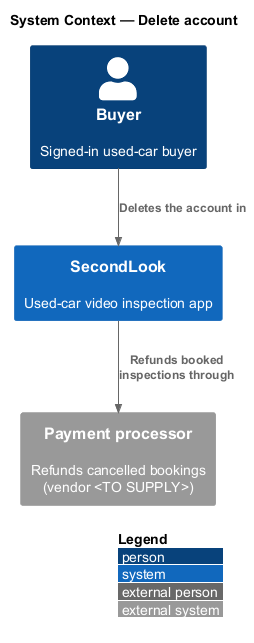
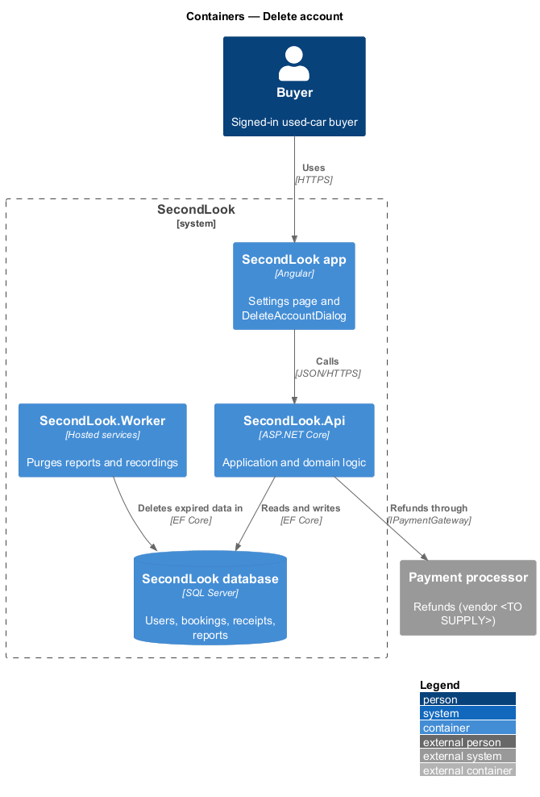
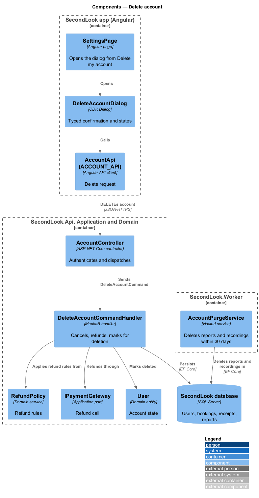
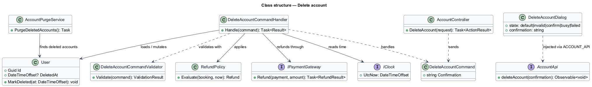
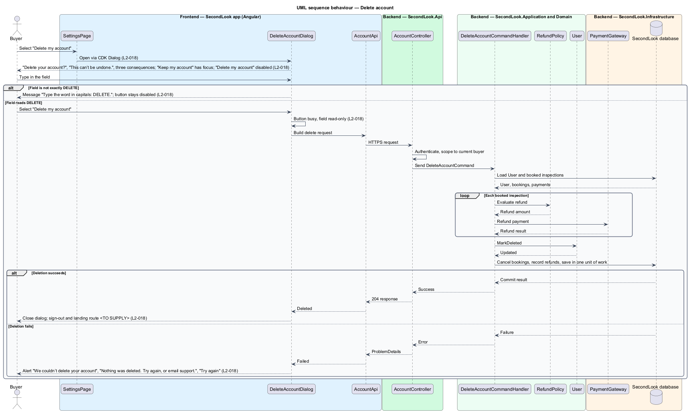
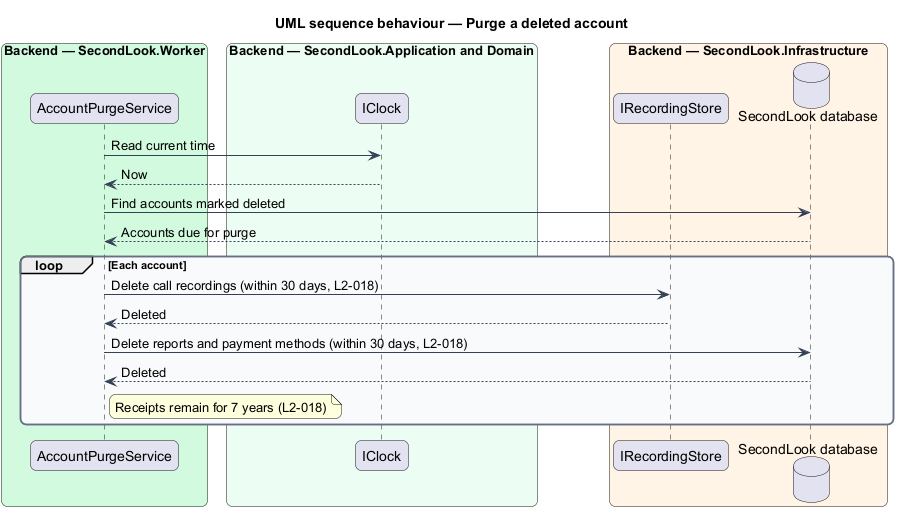

# Delete account

## Overview

SecondLook is a used-car safety app for buyers purchasing a vehicle "as is" who cannot get a mechanic to the car in person. This feature covers deleting a buyer account from the settings page at `/settings`. The "Delete account" card shows "Removes your reports, recordings and payment methods within 30 days. This can’t be undone." and the button "Delete my account", which opens a confirmation dialog.

*Typed confirmation* is a safeguard that enables a destructive action only after the user enters a fixed word. Here the word is `DELETE`. The dialog also states what deletion does to reports, recordings, receipts and booked inspections.

## Description

The feature is a vertical slice from the Angular app to the database and a background worker. No account code exists yet, so every component below is introduced by this design.

- **`SettingsPage`** — Angular page at `/settings`. The "Delete my account" button opens `DeleteAccountDialog`.
- **`DeleteAccountDialog`** — CDK Dialog in `projects/secondlook/src/app/dialogs/`. It has the title "Delete your account?", the description "This can’t be undone.", the list "Your 3 reports and call recordings are deleted within 30 days.", "Receipts are kept for 7 years, as the law requires." and "Any booked inspection is cancelled and refunded.", the field "Type DELETE to confirm", and the buttons "Keep my account" and "Delete my account". The count in "Your 3 reports" comes from the buyer's reports; the query that supplies it is `<TO SUPPLY>`. The dialog is modal with `aria-modal="true"`, labelled by its title and described by its description.
- **`AccountApi` / `ACCOUNT_API`** — contract and injection token in `projects/api`. The dialog depends on the token.
- **`AccountController`** — `SecondLook.Api` controller at `/api/account`. It requires authentication, acts only on the current buyer (`L2-057`) and dispatches `DeleteAccountCommand`. The endpoint path and verb are `<TO SUPPLY>`.
- **`DeleteAccountCommand`**, **`DeleteAccountCommandValidator`** and **`DeleteAccountCommandHandler`** — MediatR types in `SecondLook.Application`. The command carries the typed confirmation, and the validator accepts only `DELETE`, so the server repeats the dialog check. The handler loads the `User` and each booked inspection, applies `RefundPolicy` to each, refunds through `IPaymentGateway`, cancels the booking, marks the `User` deleted and persists in one unit of work. If a step fails, the handler persists nothing, which matches "Nothing was deleted.".
- **`RefundPolicy`** — domain service holding the refund rules (`L2-032`). The amount refunded for a booked inspection of a deleted account is "refunded" per `L2-018`; whether the full amount applies in every case is `<TO SUPPLY>`.
- **`User`** — domain entity. A `DeletedAt` marker records the deletion and disables sign-in. Whether the personal profile fields are cleared at once or at purge time is `<TO SUPPLY>`.
- **`AccountPurgeService`** — hosted service in `SecondLook.Worker`. Within 30 days of deletion it deletes the reports and call recordings (through `IRecordingStore`) and the payment methods. Receipts and the data needed to produce them stay for 7 years. The schedule of the purge is `<TO SUPPLY>`.

Dialog states, one per mock under `docs/mocks/dialogs/delete-account/`:

- **Default.** The field is empty, "Delete my account" is disabled and "Keep my account" has focus.
- **Invalid.** The field reads "delete". The field shows "Type the word in capitals: DELETE." and the button stays disabled.
- **Confirm.** The field reads "DELETE" and "Delete my account" is enabled.
- **Busy.** The field is read-only, "Keep my account" and the close control are disabled, and "Delete my account" carries `aria-busy="true"`.
- **Failed.** An alert shows "We couldn’t delete your account" with "Nothing was deleted. Try again, or email support." and the action "Try again", which repeats the request.

What happens on the client after success, such as signing out and the route shown, is `<TO SUPPLY>`. The email address for support is `<TO SUPPLY>`.

## Requirements

The feature realizes the following level-2 (L2) requirement. The L2 requirement refines a level-1 (L1) requirement, cited by identifier.

| L2 ID | Refines (L1) | Requirement |
|-------|--------------|-------------|
| `L2-018` | `L1-003` | Delete account. Given the settings page, when the buyer selects "Delete my account", then a dialog shall ask "Delete your account?" with "This can’t be undone." and the consequences "Your 3 reports and call recordings are deleted within 30 days.", "Receipts are kept for 7 years, as the law requires." and "Any booked inspection is cancelled and refunded.". Given the dialog, when the field is empty, then "Delete my account" shall be disabled and "Keep my account" shall have focus. Given the field reads "delete", when the buyer enters it, then the field shall show "Type the word in capitals: DELETE." and the button shall stay disabled. Given the field reads "DELETE", when the buyer selects "Delete my account", then the account shall be deleted and the button shall be marked busy while it runs. Given the deletion fails, when the request returns, then the dialog shall show the alert "We couldn’t delete your account" with "Nothing was deleted. Try again, or email support." and "Try again". |

## Diagrams

### System context

The buyer deletes the account in SecondLook. The payment processor refunds booked inspections.

### Containers

The Angular app calls `SecondLook.Api`. The worker purges reports and recordings from the SecondLook database after deletion.

### Components

`DeleteAccountDialog` calls `AccountController`, which dispatches `DeleteAccountCommand`. The handler applies `RefundPolicy`, refunds through `IPaymentGateway` and marks the `User` deleted. `AccountPurgeService` removes data later.

### Class structure

`DeleteAccountCommandHandler` coordinates `User`, `RefundPolicy`, `IPaymentGateway` and `IClock`. `AccountPurgeService` finds deleted accounts.

### Behaviour — delete the account

The dialog gates the action on the typed word, then the handler refunds, cancels and marks the account deleted. The alternate branches cover a wrong word and a failed deletion, in line with `L2-018`.

### Behaviour — purge a deleted account

The worker deletes reports, recordings and payment methods within 30 days and leaves receipts, in line with `L2-018`.

