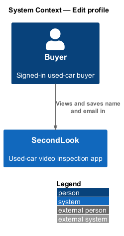
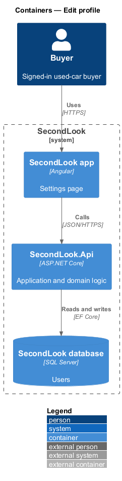
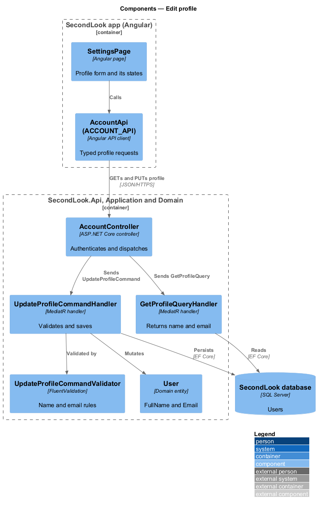
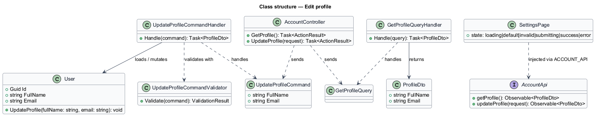
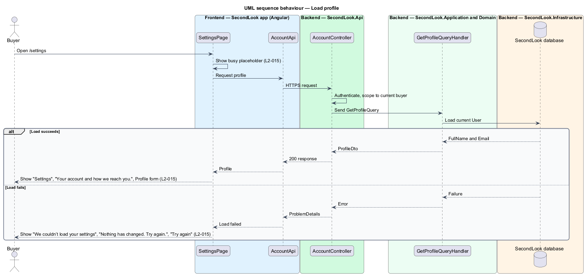
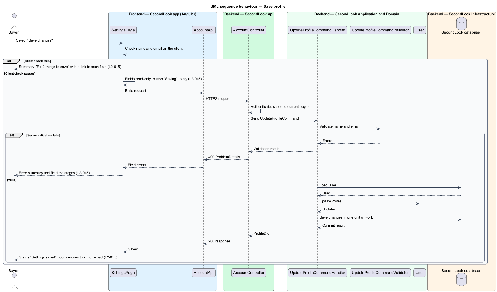

# Edit profile

## Overview

SecondLook is a used-car safety app for buyers purchasing a vehicle "as is" who cannot get a mechanic to the car in person. This feature covers the Profile form on the settings page at the route `/settings`, where a signed-in buyer views and changes the full name and email held on the account.

*Settings page* is the screen at `/settings` that hosts the Profile form, the notification switches, the payment method list and the delete-account entry point. The sibling designs `notification-preferences`, `manage-payment-methods` and `delete-account` describe the other sections of the same page. All four refine `L1-003`.

## Description

The feature is a vertical slice from the Angular app to the database. No account code exists yet, so every component below is introduced by this design.

- **`SettingsPage`** — Angular page in `projects/secondlook/src/app/pages/`, routed at `/settings`. It shows the heading "Settings", the subtitle "Your account and how we reach you." and a Profile form with the fields "Full name" and "Email" and the button "Save changes". The form is the page content, so it is not button-triggered editing and needs no dialog (AGENTS.md).
- **`AccountApi` / `ACCOUNT_API`** — contract and injection token in `projects/api`. The page depends on the token, not the concrete client.
- **`AccountController`** — ASP.NET Core controller in `SecondLook.Api`, base route `/api/account`. It requires authentication, acts only on the current buyer (`L2-057`) and dispatches `GetProfileQuery` and `UpdateProfileCommand`. The endpoint paths under the base are `<TO SUPPLY>`.
- **`GetProfileQueryHandler`** — returns `FullName` and `Email` of the current `User`.
- **`UpdateProfileCommand`**, **`UpdateProfileCommandValidator`** and **`UpdateProfileCommandHandler`** — MediatR and FluentValidation types in `SecondLook.Application`. The validator rejects an empty name and a malformed email. The handler loads the `User`, applies the change and persists it in one unit of work.
- **`User`** — domain entity with `FullName` and `Email`. Whether a changed email clears `EmailVerifiedAt` and triggers a new verification message, and whether the email is unique across accounts, are `<TO SUPPLY>`.

Page states, one per mock under `docs/mocks/pages/settings/`:

- **Loading.** The page shows a busy placeholder in place of the form and marks the region `aria-busy="true"`.
- **Default.** The form shows the stored values, for example "Jordan Lee" and "jordan.lee@example.com".
- **Invalid.** An empty name and an email of "jordan.lee@" produce the alert summary "Fix 2 things to save" listing "Enter your name." and "Enter a valid email address, like name@example.com.". Each item links to its field, and each field repeats its message beneath it. The summary count equals the number of failing fields. Other validation messages are `<TO SUPPLY>`.
- **Submitting.** The fields are `readonly` and the button reads "Saving" with `aria-busy="true"`.
- **Success.** A status region shows "Settings saved" with "We’ll use jordan.lee@example.com for receipts and reports.". The email in the body comes from the saved value. Focus moves to the status region and the page does not reload.
- **Error.** When the profile fails to load, the page shows "We couldn’t load your settings" with "Nothing has changed. Try again." and a "Try again" button that repeats the request.

The page checks both fields on submit to build the summary, and the server validator repeats the rules. The message for a server-side rejection not covered by `L2-015`, such as a duplicate email, is `<TO SUPPLY>`.

## Requirements

The feature realizes the following level-2 (L2) requirement. The L2 requirement refines a level-1 (L1) requirement, cited by identifier.

| L2 ID | Refines (L1) | Requirement |
|-------|--------------|-------------|
| `L2-015` | `L1-003` | Edit profile. Given a signed-in buyer, when they open settings, then the page shall show "Settings", "Your account and how we reach you." and a Profile form with "Full name" and "Email". Given an empty name and an email of "jordan.lee@", when the buyer saves, then the page shall show the summary "Fix 2 things to save" listing "Enter your name." and "Enter a valid email address, like name@example.com.", each linking to its field. Given valid values, when the buyer saves, then the fields shall be read-only and the button shall read "Saving" while it runs. Given the save succeeds, when it completes, then the page shall show the status "Settings saved" with "We’ll use jordan.lee@example.com for receipts and reports." and focus shall move to it without reloading the page. Given the settings fail to load, when the page opens, then it shall show "We couldn’t load your settings" with "Nothing has changed. Try again." and a "Try again" button; while loading it shall show a busy placeholder. |

## Diagrams

### System context

The buyer views and saves the profile in SecondLook. No external system takes part.

### Containers

The Angular app calls `SecondLook.Api`, which reads and writes the `User` row in the SecondLook database.

### Components

`SettingsPage` calls `AccountController`, which dispatches the profile query and the update command. The update handler uses the validator and mutates `User`.

### Class structure

`UpdateProfileCommandHandler` validates the command, then loads and mutates a `User`. `SettingsPage` depends on `AccountApi`.

### Behaviour — load the profile

The page shows the placeholder, requests the profile, and renders the form or the load-error state, in line with `L2-015`.

### Behaviour — save the profile

The page checks the fields, then submits. The alternate branches cover client-side and server-side validation failures, in line with `L2-015`.

