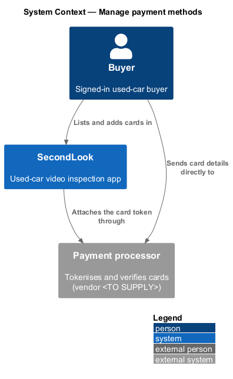
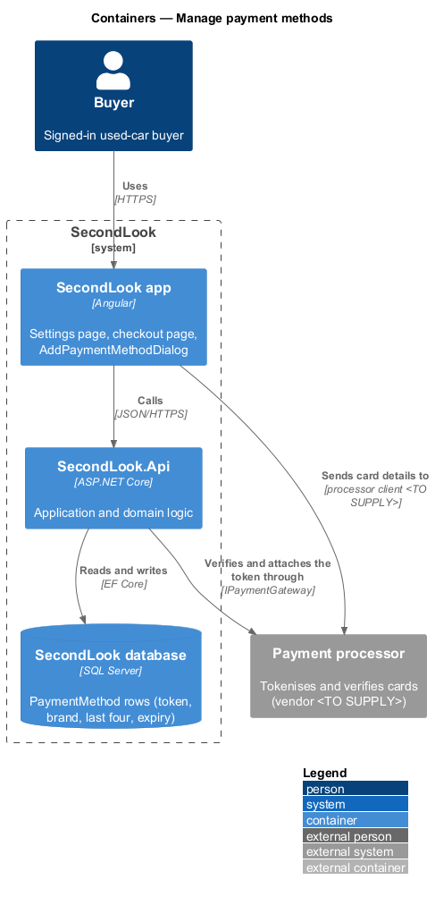
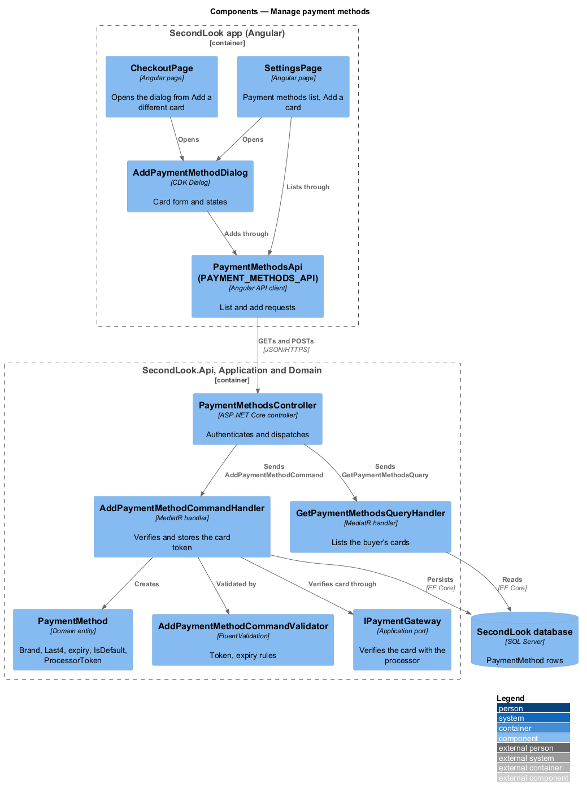
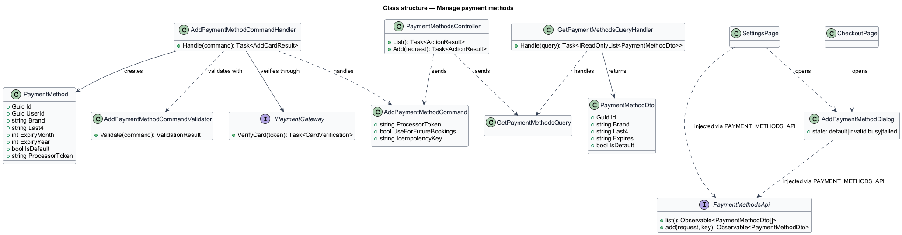
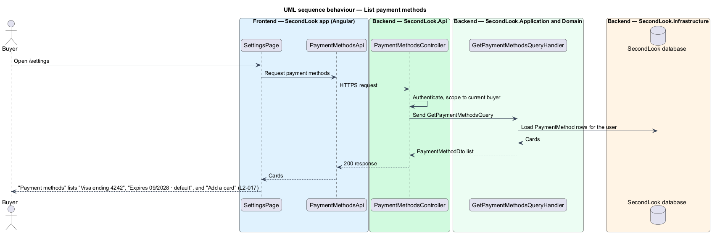
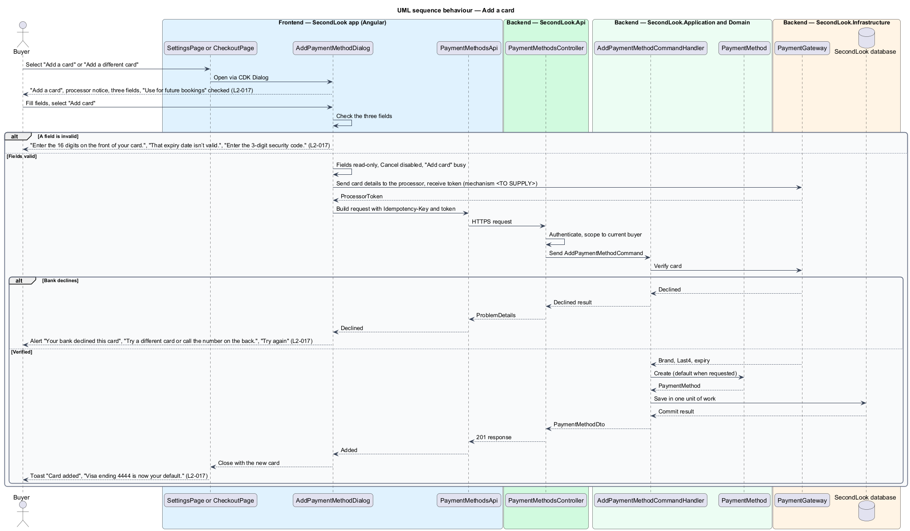

# Manage payment methods

## Overview

SecondLook is a used-car safety app for buyers purchasing a vehicle "as is" who cannot get a mechanic to the car in person. This feature covers the "Payment methods" section of the settings page at `/settings` and the dialog that adds a card.

*Payment method* is a card saved to a buyer account for use in later bookings. SecondLook keeps the brand, the last four digits, the expiry and an opaque processor token. It never stores the full card number: the dialog tells the buyer that "Your card details go straight to our payment processor. We never see the full number."

`AddPaymentMethodDialog` serves two entry points. The settings page opens it from "Add a card". The checkout page opens it from "Add a different card" after a declined card, as described in the `pay-for-booking` design (`booking-pricing`). This design owns the dialog; the checkout design only opens it.

## Description

The feature is a vertical slice from the Angular app to the database and the payment processor. No account code exists yet, so every component below is introduced by this design.

- **`SettingsPage`** — Angular page at `/settings`. The "Payment methods" card lists each saved card and carries the "Add a card" button. A row shows a card icon, the title "Visa ending 4242" and the meta line "Expires 09/2028 · default". The word "default" marks the default card. The page raises the "Card added" toast after the dialog closes with a new card. A way to remove a card or change the default is not in the requirements and is `<TO SUPPLY>`.
- **`AddPaymentMethodDialog`** — CDK Dialog in `projects/secondlook/src/app/dialogs/`. It shows the title "Add a card", the processor notice, the fields "Card number", "Expiry" and "Security code", the checkbox "Use for future bookings" (checked by default) and the buttons "Cancel" and "Add card". The dialog closes with the new `PaymentMethodDto` so each caller reacts in its own way.
- **`CheckoutPage`** — opens the same dialog from "Add a different card". After the dialog returns a card, the checkout page uses its `ProcessorToken` for `PayForBookingCommand`; that behaviour is specified in `pay-for-booking`.
- **`PaymentMethodsApi` / `PAYMENT_METHODS_API`** — contract and injection token in `projects/api`. The client sends one `Idempotency-Key` header per add attempt and reuses it on retry of the same attempt, matching the convention in `pay-for-booking`. The header name is a design choice.
- **`PaymentMethodsController`** — `SecondLook.Api` controller at `/api/payment-methods`. It requires authentication, acts only on the current buyer's cards (`L2-057`) and dispatches `GetPaymentMethodsQuery` and `AddPaymentMethodCommand`.
- **`GetPaymentMethodsQueryHandler`** — returns the buyer's `PaymentMethod` rows as `PaymentMethodDto` items, with the expiry formatted as `MM/YYYY`.
- **`AddPaymentMethodCommand`**, **`AddPaymentMethodCommandValidator`** and **`AddPaymentMethodCommandHandler`** — MediatR and FluentValidation types in `SecondLook.Application`. The command carries the processor token, not card numbers. The handler asks `IPaymentGateway` to verify the card, creates the `PaymentMethod` from the brand, last four digits and expiry the processor returns, and persists it. A repeated request with the same idempotency key returns the stored card.
- **`IPaymentGateway`** — application port shared with `pay-for-booking`. `PaymentGateway` in `SecondLook.Infrastructure` adapts it to the processor. The processor name, the tokenisation mechanism on the client and the verification call are `<TO SUPPLY>`.
- **`PaymentMethod`** — domain entity (`Id`, `UserId`, `Brand`, `Last4`, `ExpiryMonth`, `ExpiryYear`, `IsDefault`, `ProcessorToken`). When "Use for future bookings" is checked, the new card becomes the default and the previous default loses the flag. The outcome when the box is unchecked, such as saving the card without the default flag or not saving it, is `<TO SUPPLY>`.

Validation messages, in the order the fields appear:

- Card number of fewer than 16 digits, for example "4000 0566 5566": "Enter the 16 digits on the front of your card."
- Expiry that is not a valid month and year, for example "13 / 28": "That expiry date isn’t valid."
- Missing or short security code: "Enter the 3-digit security code."

Dialog states, one per mock under `docs/mocks/dialogs/add-payment-method/`:

- **Default.** The fields are empty and "Use for future bookings" is checked.
- **Invalid.** Each failing field shows its message beneath it.
- **Busy.** The fields are read-only, "Cancel" is disabled and "Add card" carries `aria-busy="true"`.
- **Failed.** An alert shows "Your bank declined this card" with "Try a different card or call the number on the back." and the action "Try again", and the entered values remain.
- **Success.** The dialog closes and the toast "Card added" shows "Visa ending 4444 is now your default.". The brand and last four digits in the body come from the stored card.

The settings list has no mock for loading or load failure of the payment methods; the section follows the page-level states in `edit-profile`.

## Requirements

The feature realizes the following level-2 (L2) requirement. The L2 requirement refines a level-1 (L1) requirement, cited by identifier.

| L2 ID | Refines (L1) | Requirement |
|-------|--------------|-------------|
| `L2-017` | `L1-003` | Payment methods. Given the settings page, when it loads, then "Payment methods" shall list each saved card, for example "Visa ending 4242" with "Expires 09/2028 · default", and offer "Add a card". Given the buyer selects "Add a card" or "Add a different card", when the dialog opens, then it shall show "Add a card", "Your card details go straight to our payment processor. We never see the full number.", the fields "Card number", "Expiry" and "Security code", the checkbox "Use for future bookings" checked, and the buttons "Cancel" and "Add card". Given a card number of "4000 0566 5566", an expiry of "13 / 28" and no security code, when the buyer submits, then the fields shall show "Enter the 16 digits on the front of your card.", "That expiry date isn’t valid." and "Enter the 3-digit security code.". Given the bank declines the card, when the buyer submits, then the dialog shall show the alert "Your bank declined this card" with "Try a different card or call the number on the back." and "Try again". Given the card is added, when the dialog closes, then a toast shall show "Card added" with "Visa ending 4444 is now your default.". |

## Diagrams

### System context

The buyer lists and adds cards in SecondLook. Card details go from the buyer to the payment processor, and SecondLook receives only a token.

### Containers

The Angular app sends card details to the processor and the token to `SecondLook.Api`, which verifies the card through `IPaymentGateway` and stores the `PaymentMethod`.

### Components

Both `SettingsPage` and `CheckoutPage` open `AddPaymentMethodDialog`. The dialog and the settings list call `PaymentMethodsController`, which dispatches the query and the add command.

### Class structure

`AddPaymentMethodCommandHandler` verifies the token through `IPaymentGateway` and creates a `PaymentMethod`. Both pages depend on the dialog, and the dialog depends on `PaymentMethodsApi`.

### Behaviour — list payment methods

The settings page requests the buyer's cards and renders the list with "Add a card", in line with `L2-017`.

### Behaviour — add a card

The dialog validates the three fields, obtains a token from the processor, and posts it. The alternate branches cover invalid fields and a bank decline, in line with `L2-017`.

