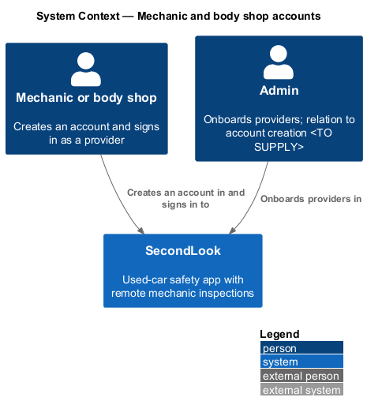
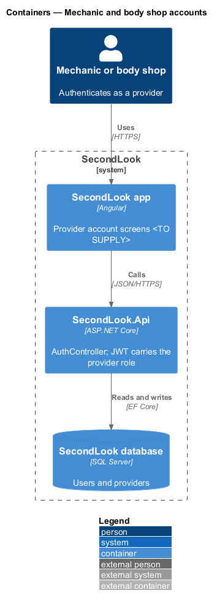
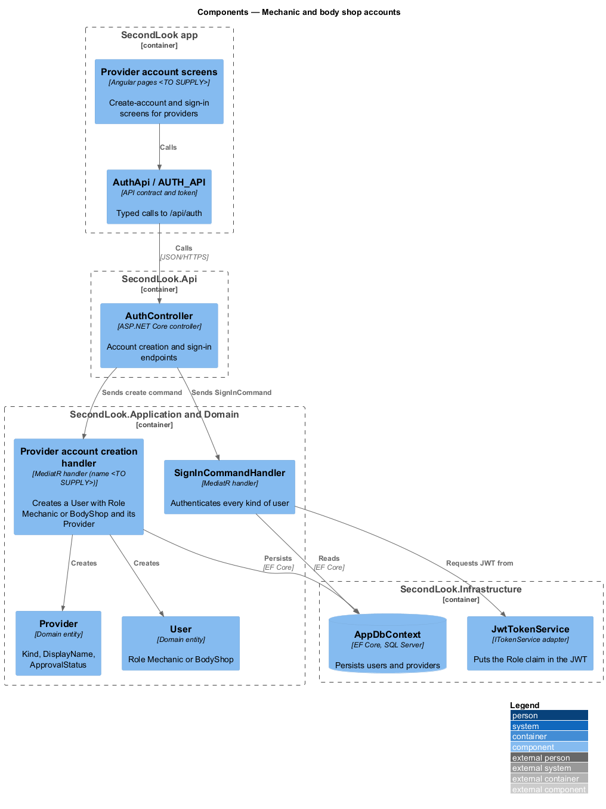
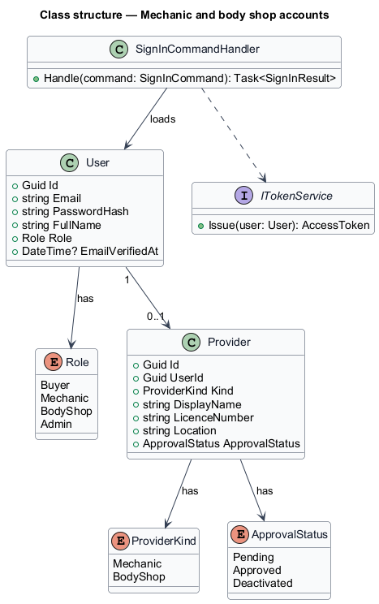
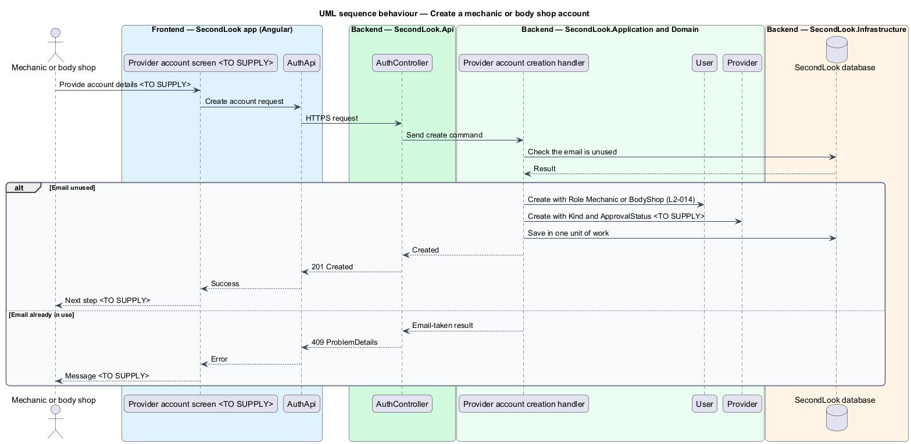
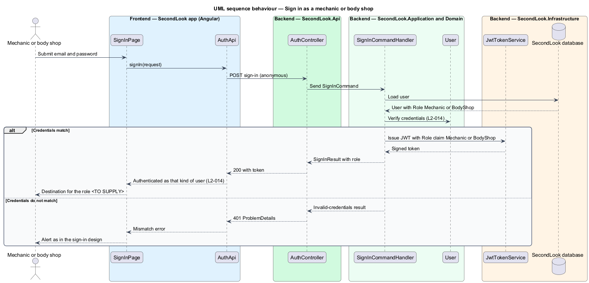

# Mechanic and body shop accounts

## Overview

SecondLook is a used-car safety app for buyers purchasing a vehicle "as is" who cannot get a mechanic to the car in person. Mechanics and body shops are the providers who inspect vehicles over video. This feature covers how a provider creates an account and signs in so that the system authenticates the provider as that kind of user.

This design has no mock and is grounded only in the journey "Sign up and sign in" in `docs/user-journeys.md` ("Buyer, mechanic, or body shop creates an account and authenticates.") and in `L2-014`, whose source is journeys only. Every detail the sources leave unstated is marked `<TO SUPPLY>`. The design adds no screens, fields or rules beyond them.

A *provider* is a mechanic or a body shop that takes inspections; the domain models it as a `Provider` linked one-to-one with a `User`. A *role* is the kind of user a JWT identifies; the values are `Buyer`, `Mechanic`, `BodyShop` and `Admin`.

## Description

No account code exists yet, so every component below is introduced by this design.

- **Account creation for providers.** The journey states that a mechanic or body shop creates an account. The creation path is `<TO SUPPLY>`: self-service sign-up, or admin onboarding from the separate journey "Administer mechanics and shops" ("Admin onboards, approves, and deactivates mechanics and body shops."). The screens, the fields collected, the verification of a licence, and the copy are `<TO SUPPLY>`. The handler that creates the account is therefore unnamed in the sources; the design calls it the provider account creation handler.
- **`User`** — domain entity with `Role` set to `Mechanic` or `BodyShop` for a provider, so the system can authenticate the account as that kind of user (`L2-014` criterion 1).
- **`Provider`** — domain entity (`Id`, `UserId`, `Kind`, `DisplayName`, `LicenceNumber`, `Location`, `ApprovalStatus`) linked to the `User`. `ApprovalStatus` takes `Pending`, `Approved` or `Deactivated`. Which values a new provider receives and whether a `Pending` or `Deactivated` provider can sign in are `<TO SUPPLY>`.
- **Email verification.** `L1-002` lets a buyer, mechanic or body shop verify their email. Whether providers use the verify-email feature unchanged is `<TO SUPPLY>`.
- **Sign-in.** All three kinds of user authenticate through the same `AuthController` sign-in endpoint and `SignInCommandHandler` described in the sign-in design (`L2-014` criterion 2). `JwtTokenService` places the `Role` claim in the JWT, so the system authenticates the caller as a buyer, a mechanic or a body shop. The route and screen a provider sees at sign-in, and the destination after sign-in, are `<TO SUPPLY>`; the sign-in page copy in `L2-008` is written for buyers ("Your inspections are waiting.").
- **Authorization consequence.** AGENTS.md states that mechanics and body shops see only the inspections assigned to them. The role claim carries the identity that those handlers use. The authorization of provider-facing endpoints belongs to the features that expose them, not to this design.
- **Sign-out and password reset.** Whether providers use the sign-out and reset-password features unchanged is `<TO SUPPLY>`; `L2-013` is written for the signed-in buyer.

## Requirements

The feature realizes the following level-2 (L2) requirement. Each L2 requirement refines a level-1 (L1) requirement, cited by identifier.

| L2 ID | Refines (L1) | Requirement |
|-------|--------------|-------------|
| `L2-014` | `L1-002` | Mechanic and body shop accounts. When a mechanic or a body shop creates an account and signs in, the system shall authenticate them as that kind of user. When a buyer, a mechanic or a body shop signs in, the system shall authenticate them. |

## Diagrams

### System context

A mechanic or body shop creates an account and signs in. An admin onboards providers; how that relates to account creation is `<TO SUPPLY>`.

### Containers

The app calls `SecondLook.Api`, which stores the user and provider in the database and issues a JWT that carries the role.

### Components

The provider account creation handler creates a `User` and a `Provider`. The shared `SignInCommandHandler` authenticates every kind of user, and `JwtTokenService` writes the role claim.

### Class structure

A `User` with a provider role has at most one `Provider`. `Role`, `ProviderKind` and `ApprovalStatus` define the kinds and states.

### Behaviour — create a mechanic or body shop account

The handler creates the user with a provider role and the `Provider`, or returns an email-taken result. Screens and copy are `<TO SUPPLY>`.

### Behaviour — sign in as a mechanic or body shop

The shared sign-in handler verifies the credentials and issues a JWT whose role claim is `Mechanic` or `BodyShop`.

