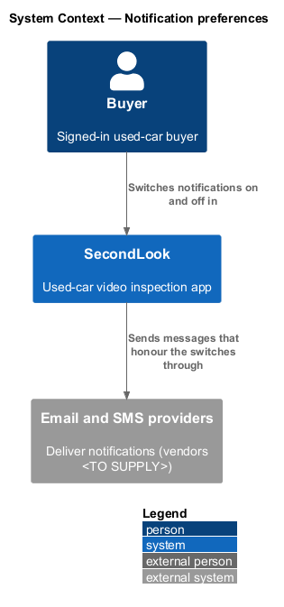
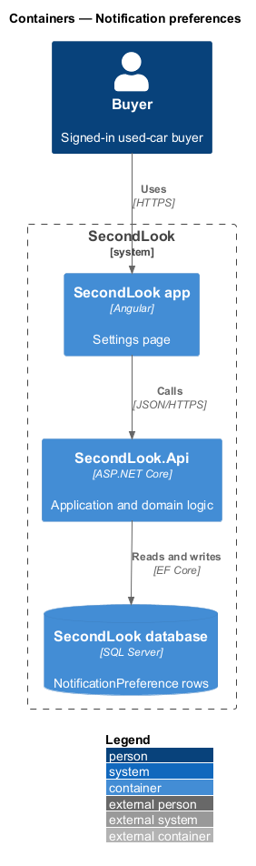
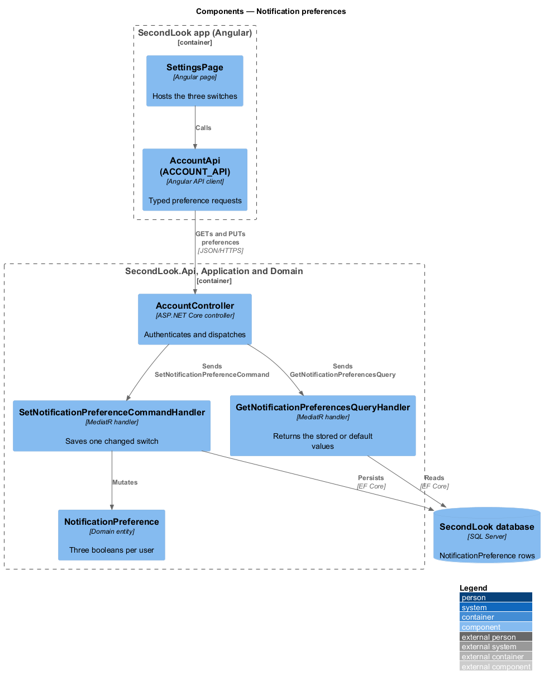
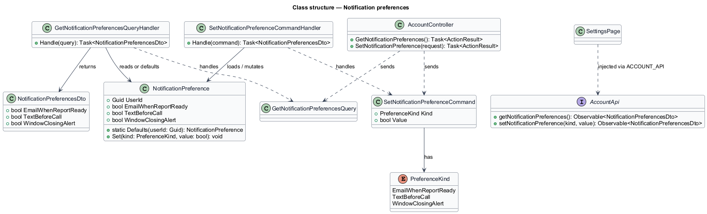
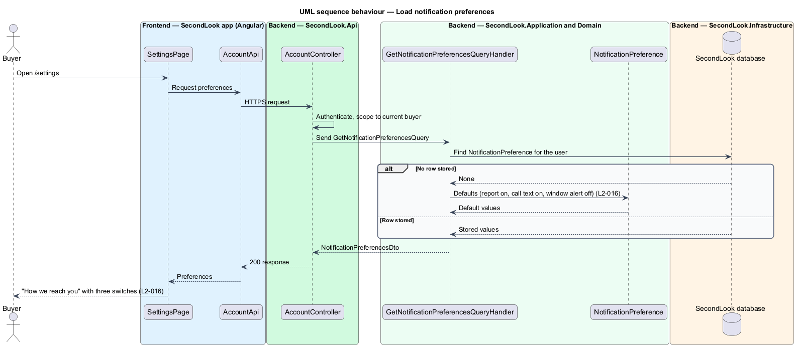
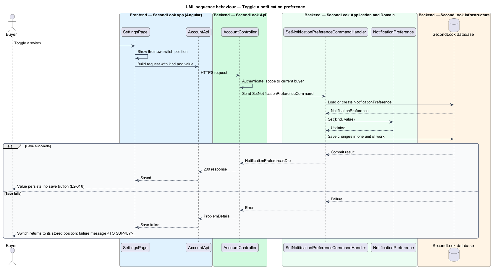

# Notification preferences

## Overview

SecondLook is a used-car safety app for buyers purchasing a vehicle "as is" who cannot get a mechanic to the car in person. This feature covers the "How we reach you" section of the settings page at the route `/settings`, where a signed-in buyer chooses which messages SecondLook sends.

*Notification preference* is a per-buyer setting that turns one kind of message on or off. The feature offers three: an email when a report is ready, a text before a call, and an alert when the pricing window is closing. A preference saves when the buyer toggles it, so the section has no save button.

## Description

The feature is a vertical slice from the Angular app to the database. No account code exists yet, so every component below is introduced by this design.

- **`SettingsPage`** — Angular page at `/settings`. The "How we reach you" section lists three switches, each with a caption from the mock:
  - "Email me when a report is ready", caption "Usually within an hour of the call."
  - "Text me before a call", caption "A reminder an hour before your inspection."
  - "Tell me when my window is closing", caption "Two days before it ends, while you can still add a car for $25."
- **`AccountApi` / `ACCOUNT_API`** — contract and injection token in `projects/api`. The page depends on the token.
- **`AccountController`** — ASP.NET Core controller in `SecondLook.Api`, base route `/api/account`. It requires authentication, acts only on the current buyer (`L2-057`) and dispatches `GetNotificationPreferencesQuery` and `SetNotificationPreferenceCommand`. The endpoint paths are `<TO SUPPLY>`.
- **`GetNotificationPreferencesQueryHandler`** — returns the stored `NotificationPreference` of the current user. When no row exists, it returns the defaults: `EmailWhenReportReady` on, `TextBeforeCall` on, `WindowClosingAlert` off.
- **`SetNotificationPreferenceCommand`** and **`SetNotificationPreferenceCommandHandler`** — carry one switch (`PreferenceKind`) and its new value. The handler creates the row from the defaults if absent, applies the value and persists it in one unit of work. Saving one switch per request means two quick toggles do not overwrite each other.
- **`NotificationPreference`** — domain entity (`UserId`, `EmailWhenReportReady`, `TextBeforeCall`, `WindowClosingAlert`).

Consumers of the preferences are other features: report delivery reads `EmailWhenReportReady`, call reminders read `TextBeforeCall`, and `SecondLook.Worker` reads `WindowClosingAlert` before it raises a window-closing notification. This design only stores the values.

Behaviour on the page:

- **Initial values.** A buyer who has changed nothing sees the first two switches on and the third off.
- **Toggle.** The switch moves at once and the page sends the new value. No button, dialog or inline form is involved.
- **Save failure.** The mocks define no state for a failed toggle. The page returns the switch to its stored position, and the message shown is `<TO SUPPLY>`.
- **Loading and load failure.** The section shares the page-level loading placeholder and the load-error panel of `edit-profile`.
- **Accessibility.** Each switch is a labelled checkbox with the caption as supplementary text. The announcement of a completed save is `<TO SUPPLY>`.

## Requirements

The feature realizes the following level-2 (L2) requirement. The L2 requirement refines a level-1 (L1) requirement, cited by identifier.

| L2 ID | Refines (L1) | Requirement |
|-------|--------------|-------------|
| `L2-016` | `L1-003` | Notification preferences. Given the settings page, when it loads, then "How we reach you" shall show the switches "Email me when a report is ready", "Text me before a call" and "Tell me when my window is closing". Given the buyer has not changed anything, when the page loads, then the first two switches shall be on and the third off. Given a switch, when the buyer toggles it, then the new value shall be saved without a separate save button. |

## Diagrams

### System context

The buyer sets preferences in SecondLook. Email and SMS providers deliver the messages that other features send under these preferences.

### Containers

The Angular app calls `SecondLook.Api`, which stores one `NotificationPreference` row per user in the SecondLook database.

### Components

`SettingsPage` calls `AccountController`, which dispatches the query and the single-switch command. The command handler mutates `NotificationPreference`.

### Class structure

`SetNotificationPreferenceCommandHandler` applies one `PreferenceKind` and value to a `NotificationPreference`. The query handler supplies defaults when no row exists.

### Behaviour — load preferences

The handler returns stored values or the defaults, in line with `L2-016`.

### Behaviour — toggle a preference

A toggle saves one value without a save button. The alternate branch covers a failed save, in line with `L2-016`.

