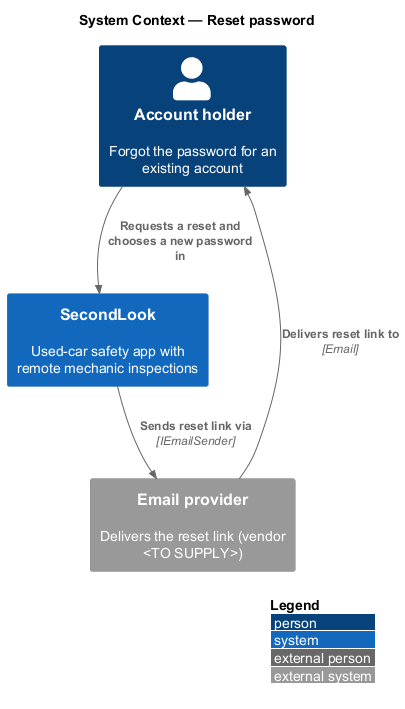
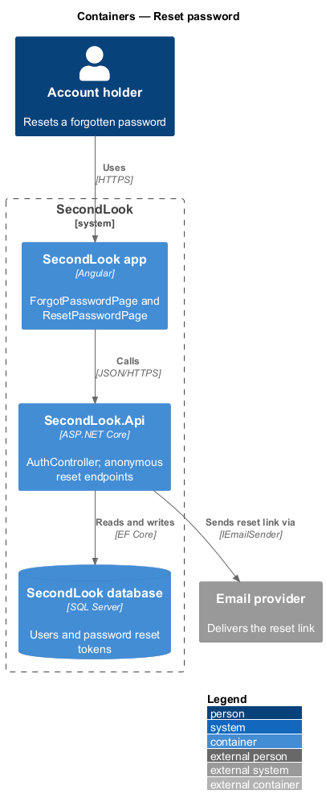
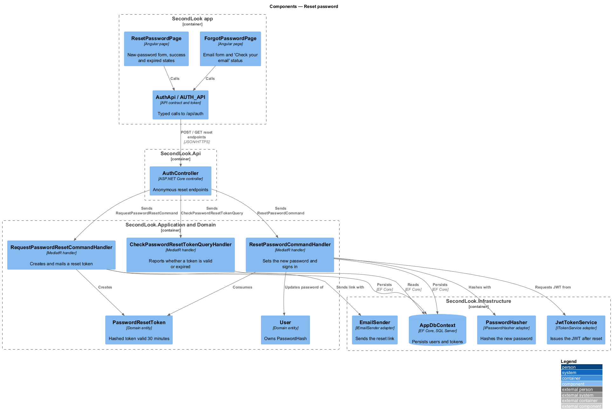
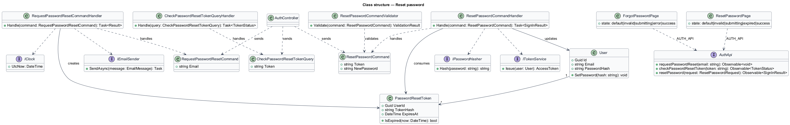
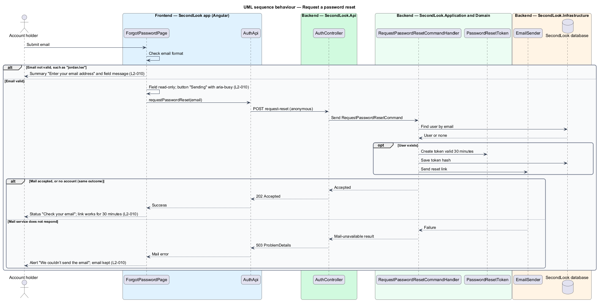
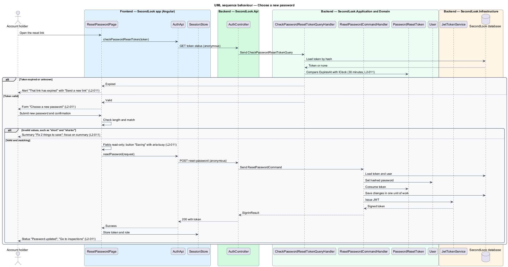

# Reset password

## Overview

SecondLook is a used-car safety app for buyers purchasing a vehicle "as is" who cannot get a mechanic to the car in person. This feature lets an account holder who forgot a password recover access. It spans two screens: the forgot-password page at `/forgot-password`, where the holder asks for an emailed link, and the reset-password page at `/reset-password`, where the holder opens the link and chooses a new password.

A *password reset token* is a single-purpose secret, stored only as a hash, that authorises one password change for one user; it is valid for 30 minutes.

## Description

No account code exists yet, so every component below is introduced by this design.

- **`ForgotPasswordPage`** — Angular page in `projects/secondlook/src/app/pages/`, routed at `/forgot-password`. It shows "Reset your password", "We’ll email you a link to choose a new one.", an "Email" field, the button "Send reset link" and the link "Back to sign in". The mock defines five states: `default`, `invalid`, `submitting`, `error` and `success`.
- **`ResetPasswordPage`** — Angular page routed at `/reset-password`. It shows "Choose a new password", the fields "New password" with "At least 10 characters." and "Confirm new password", and the button "Save password". The mock defines five states: `default`, `invalid`, `submitting`, `error` (expired link) and `success`. The link carries the token to the page; the parameter name and format are `<TO SUPPLY>`.
- **`AuthApi` / `AUTH_API`** — contract and token in `projects/api`. The client exposes `requestPasswordReset`, `checkPasswordResetToken` and `resetPassword`.
- **`AuthController`** — controller in `SecondLook.Api`, base route `/api/auth`. All three reset endpoints are intentional anonymous endpoints, because the caller cannot sign in. Paths under the base are `<TO SUPPLY>`.
- **`RequestPasswordResetCommandHandler`** — finds the `User` by email. When the user exists, it creates a `PasswordResetToken` that expires 30 minutes after `IClock.UtcNow`, stores the hash, and sends the link through `IEmailSender`. The raw token appears only in the email.
- **`CheckPasswordResetTokenQueryHandler`** — reports whether a token is valid or expired, so `ResetPasswordPage` can show the form or the expiry alert when it loads. This query is a design choice that satisfies `L2-011` criterion 5, which shows the alert on page load.
- **`ResetPasswordCommandHandler`** — loads the token and user, validates the new password through `ResetPasswordCommandValidator`, sets the new password hash through `IPasswordHasher`, consumes the token, saves in one unit of work and issues a JWT through `ITokenService`. The JWT is the basis of the status "You’re signed in" in `L2-011`. Whether a reset also invalidates earlier JWTs is `<TO SUPPLY>`.
- **`PasswordResetToken`** — domain entity (`UserId`, `TokenHash`, `ExpiresAt`). Whether a token is single-use and whether a new request supersedes older tokens are `<TO SUPPLY>`; the design consumes the token on success.

State behaviour, forgot-password:

- **Invalid.** An email of "jordan.lee" produces the summary "Enter your email address" with "Enter a valid email address." and the field message "Enter a valid email address, like name@example.com.".
- **Submitting.** The field is read-only, and the button reads "Sending" with `aria-busy="true"`.
- **Success.** The form is replaced by the status "Check your email" with "If there’s an account for jordan.lee@example.com, a reset link is on its way. It works for 30 minutes." and a "Back to sign in" button. The handler returns the same accepted result whether or not an account exists, so the page does not disclose which emails have accounts.
- **Error.** When `IEmailSender` fails, the page shows the alert "We couldn’t send the email" with "Our mail service didn’t respond. Nothing was changed. Try again in a minute." and keeps the email. The HTTP status 503 is a design choice. Rate limiting of requests is `<TO SUPPLY>`.

State behaviour, reset-password:

- **Invalid.** A new password of "short" and a confirmation of "shorter" produce the summary "Fix 2 things to save" listing "Use at least 10 characters." and "The passwords don’t match.", each linking to its field.
- **Submitting.** Both fields are read-only, and the button reads "Saving" with `aria-busy="true"`.
- **Success.** The page shows the status "Password updated" with "You’re signed in. Your inspections are one tap away." and a "Go to inspections" button to the dashboard.
- **Expired.** The form is replaced by the alert "That link has expired" with "Reset links work for 30 minutes. Ask for a new one and we’ll send it straight away." and a "Send a new link" link to `/forgot-password`. An unknown or malformed token takes the same path; its copy is `<TO SUPPLY>`.

## Requirements

The feature realizes the following level-2 (L2) requirements. Each L2 requirement refines a level-1 (L1) requirement, cited by identifier.

| L2 ID | Refines (L1) | Requirement |
|-------|--------------|-------------|
| `L2-010` | `L1-002` | Request a password reset. When a visitor loads the forgot-password page, it shall show "Reset your password", "We’ll email you a link to choose a new one.", an "Email" field, the button "Send reset link" and the link "Back to sign in". When the visitor submits an email of "jordan.lee", the page shall show the summary "Enter your email address" with "Enter a valid email address." and the field message "Enter a valid email address, like name@example.com.". While the request is in flight, the field shall be read-only and the button shall read "Sending" and be marked busy. When the visitor submits a valid email and the request succeeds, the form shall be replaced by the status "Check your email" with "If there’s an account for jordan.lee@example.com, a reset link is on its way. It works for 30 minutes." and a "Back to sign in" button. When the mail service does not respond, the page shall show the alert "We couldn’t send the email" with "Our mail service didn’t respond. Nothing was changed. Try again in a minute." and keep the email. |
| `L2-011` | `L1-002` | Choose a new password. When a visitor with a valid reset link loads the page, it shall show "Choose a new password", the fields "New password" with "At least 10 characters." and "Confirm new password", and the button "Save password". When the visitor submits a new password of "short" and a confirmation of "shorter", the page shall show the summary "Fix 2 things to save" listing "Use at least 10 characters." and "The passwords don’t match.", each linking to its field. While the request is in flight, both fields shall be read-only and the button shall read "Saving" and be marked busy. When the visitor submits valid matching passwords and the request succeeds, the page shall show the status "Password updated" with "You’re signed in. Your inspections are one tap away." and a "Go to inspections" button to the dashboard. When the reset link has expired, the form shall be replaced by the alert "That link has expired" with "Reset links work for 30 minutes. Ask for a new one and we’ll send it straight away." and a "Send a new link" link to the forgot-password page. |

## Diagrams

### System context

An account holder requests a reset and chooses a new password in SecondLook. An external email provider delivers the reset link.

### Containers

The Angular app calls the anonymous reset endpoints of `SecondLook.Api`. The API stores the token hash in the database and sends the link by email.

### Components

`AuthController` dispatches the request, token-check and reset messages. The reset handler consumes the `PasswordResetToken`, updates the `User` and requests a JWT.

### Class structure

The three handlers share `PasswordResetToken` and `User`. `IClock` fixes the 30-minute expiry.

### Behaviour — request a password reset

The handler creates and mails a token for an existing account and returns the same accepted result when no account exists. A mail failure returns the error alert.

### Behaviour — choose a new password

The page checks the token on load, then validates and saves the new password. A valid save issues a JWT, and an expired token shows the expiry alert.

## Implementation (J01)

`POST /api/auth/forgot-password` `{email}` returns 202 whether or not the account exists (400 for an invalid email); `POST /api/auth/reset-password` `{token,newPassword,confirmPassword}` returns 200 `{token}` (signed in), 400 validation problem or unknown link, or 410 `That link has expired` (30 min). A used link cannot be reused; resetting also marks the email verified.
