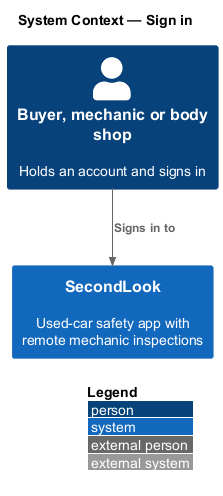
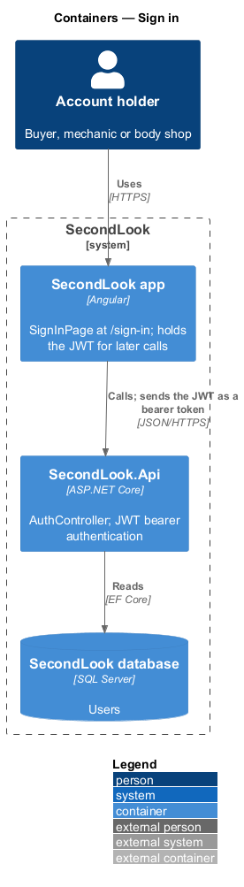
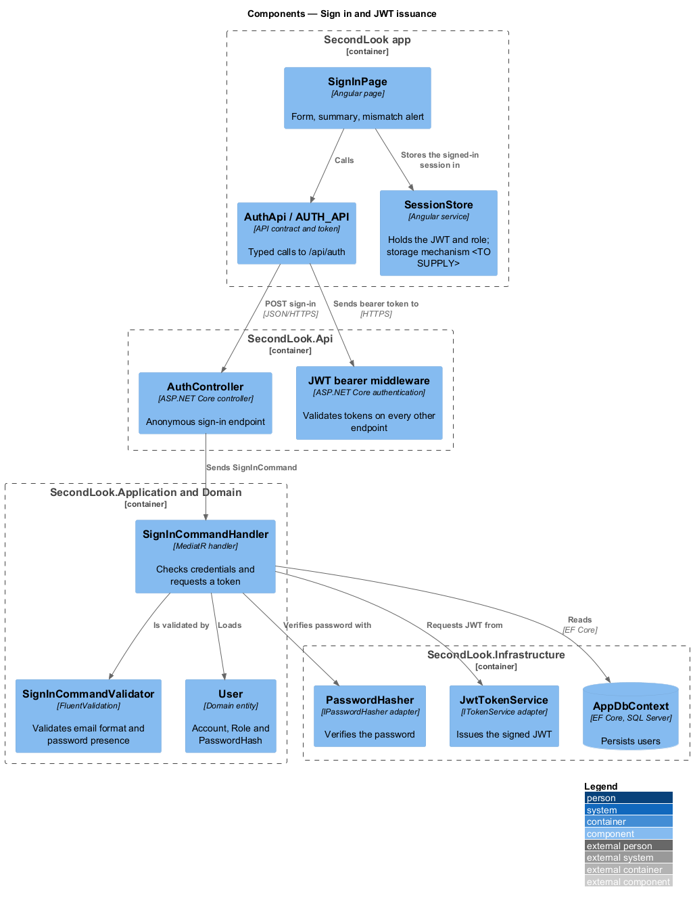
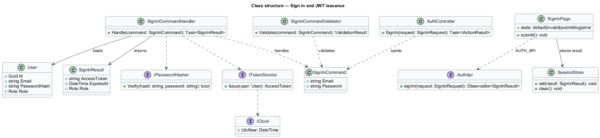
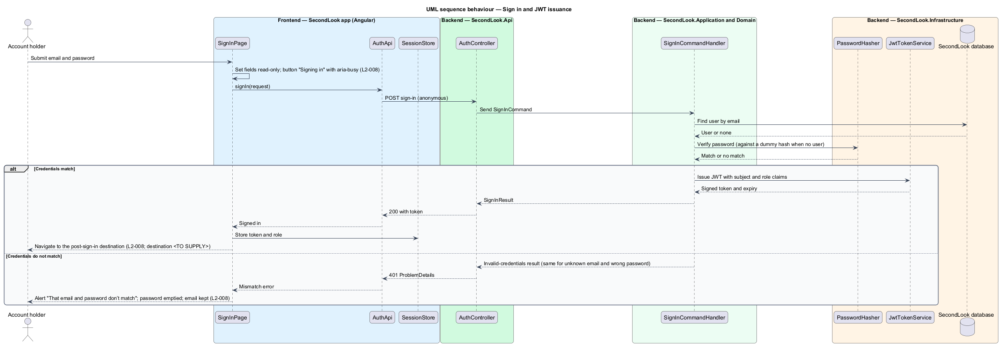
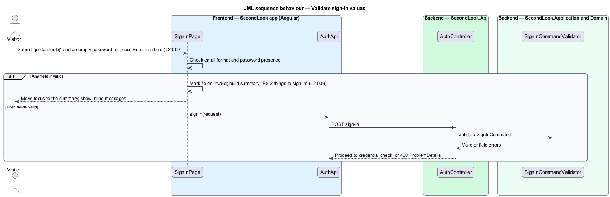
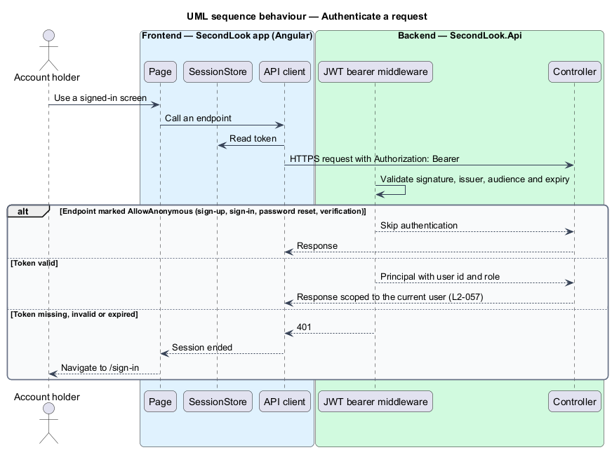

# Sign in

## Overview

SecondLook is a used-car safety app for buyers purchasing a vehicle "as is" who cannot get a mechanic to the car in person. This feature covers sign-in at the route `/sign-in`. A buyer, mechanic or body shop enters an email and a password and is authenticated.

A *JSON Web Token (JWT)* is a signed, self-contained credential that carries the identity and role of the caller; SecondLook issues JWTs locally and does not use an external identity provider. An *anonymous endpoint* is an API endpoint that accepts a request without a JWT.

The feature also defines how the API issues the JWT and which endpoints stay anonymous, because every other feature depends on both. The architecture decision record that governs the auth flow is `<TO SUPPLY>`; `docs/adr/` holds none yet.

## Description

No account code exists yet, so every component below is introduced by this design.

- **`SignInPage`** — Angular page in `projects/secondlook/src/app/pages/`, routed at `/sign-in`. It shows "Sign in", "Welcome back. Your inspections are waiting.", the fields "Email" and "Password", the link "Forgot your password?" to `/forgot-password`, the button "Sign in" and the link "Create an account" to `/sign-up`. The mock defines four states: `default`, `invalid`, `submitting` and `error`. No loading or empty state applies.
- **`AuthApi` / `AUTH_API`** — contract and injection token in `projects/api`. The page depends on the token. The client exposes `signIn`.
- **`SessionStore`** — Angular service that keeps the JWT and role after sign-in and clears them on sign-out. The storage mechanism, the refresh strategy and the post-sign-in destination are `<TO SUPPLY>`.
- **`AuthController`** — controller in `SecondLook.Api`, base route `/api/auth`. The sign-in endpoint is anonymous. Endpoint paths under the base are `<TO SUPPLY>`.
- **`SignInCommand`**, **`SignInCommandValidator`**, **`SignInCommandHandler`** — the validator checks email format and password presence. The handler loads the `User` by email, verifies the password with `IPasswordHasher`, and on a match asks `ITokenService` for a JWT.
- **`JwtTokenService`** — `SecondLook.Infrastructure` adapter that implements `ITokenService`. The token carries the user id as subject and the `Role` as a claim, and its expiry is computed from `IClock` plus a configured duration. The duration, signing key source, issuer and audience are `<TO SUPPLY>`.
- **`User`** — domain entity with `Email`, `PasswordHash`, `Role` and `EmailVerifiedAt`. Whether an unverified account can sign in is `<TO SUPPLY>`; `L2-008` states no restriction.

Validation and error behaviour:

- With an email of "jordan.lee@" and an empty password, the page shows the summary "Fix 2 things to sign in" listing "Enter a valid email address." and "Enter your password.", each linking to its field. The email shows "Enter a valid email address, like name@example.com." and the password shows "Enter your password."; both are marked invalid. Focus moves to the summary on submit, and pressing Enter in either field submits the form.
- While submitting, both fields are read-only, and the button reads "Signing in" with `aria-busy="true"`.
- When the credentials do not match, the page shows the alert "That email and password don’t match" with "Check them and try again, or reset your password." and a "Reset password" link. The password field is emptied and the email is kept.
- The handler returns the same invalid-credentials result for an unknown email and for a wrong password, so the response does not disclose which accounts exist. Verification against a dummy hash when no user is found equalises the response time. Lockout and rate limiting are `<TO SUPPLY>`.

Authentication of other requests:

- The API registers JWT bearer authentication and applies a fallback policy that requires an authenticated user on every endpoint, as AGENTS.md requires.
- The intentional anonymous endpoints are marked `[AllowAnonymous]`: sign-up, sign-in, request password reset, reset password, and verify email. Whether resend verification is anonymous is `<TO SUPPLY>`; it is anonymous only if sign-up does not issue a JWT. Any health or Swagger endpoint exposure is `<TO SUPPLY>`.
- Sign-out, the buyer-owned resources and all other controllers require a valid JWT. Handlers read the user id from the principal and scope data to it (`L2-057`).
- Request logging stays outside the exception-handling middleware, and Swagger middleware ordering is preserved when authentication is registered.
- A missing, invalid or expired token yields `401`, and the app returns the user to `/sign-in`.

## Requirements

The feature realizes the following level-2 (L2) requirements. Each L2 requirement refines a level-1 (L1) requirement, cited by identifier.

| L2 ID | Refines (L1) | Requirement |
|-------|--------------|-------------|
| `L2-008` | `L1-002` | Sign in. When a visitor loads the sign-in page, it shall show "Sign in", "Welcome back. Your inspections are waiting.", the fields "Email" and "Password", the link "Forgot your password?", the button "Sign in" and the link "Create an account". When the visitor submits valid credentials, the system shall sign them in. While the request is in flight, both fields shall be read-only and the button shall read "Signing in" and be marked busy. When the credentials do not match, the page shall show the alert "That email and password don’t match" with the text "Check them and try again, or reset your password." and a "Reset password" link, the password field shall be empty, and the email shall be kept. |
| `L2-009` | `L1-002` | Sign-in validation. When the visitor submits an email of "jordan.lee@" and an empty password, the page shall show the summary "Fix 2 things to sign in" listing "Enter a valid email address." and "Enter your password.", each linking to its field. The email shall show "Enter a valid email address, like name@example.com." and the password shall show "Enter your password.", and both shall be marked invalid. When the visitor submits while the summary is shown, focus shall move to the summary; when they press Enter in either field, the form shall submit. |

## Diagrams

### System context

An account holder signs in to SecondLook; no external system takes part.

### Containers

The app posts credentials to `SecondLook.Api`, which reads the user from the database and returns a JWT. The app then sends the JWT as a bearer token on later calls.

### Components

`SignInCommandHandler` verifies the password through `IPasswordHasher` and requests a JWT from `JwtTokenService`. The JWT bearer middleware validates tokens on all non-anonymous endpoints.

### Class structure

`SignInCommandHandler` returns a `SignInResult` that carries the access token, expiry and role.

### Behaviour — sign in and JWT issuance

The handler verifies the credentials and issues a JWT, or returns the invalid-credentials result that the page shows as the mismatch alert.

### Behaviour — validate sign-in values

The page validates email and password before the request, moves focus to the summary, and submits on Enter.

### Behaviour — authenticate a request

The bearer middleware skips anonymous endpoints, accepts a valid token, and returns `401` otherwise.

## Implementation (J01)

`POST /api/auth/login` `{email,password}` returns 200 `{token,role,isApproved,displayName}`, 400 validation problem, 403 `Verify your email to sign in`, or 401 `That email and password don’t match` (identical for unknown email and wrong password). The token is the J00 local JWT. Providers can sign in without being approved; approval gates taking inspections (L2-064).
