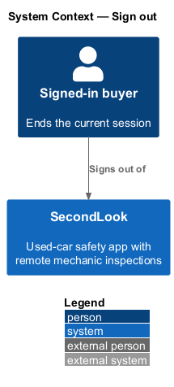
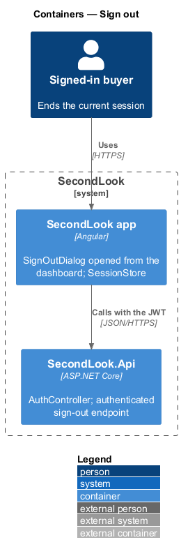
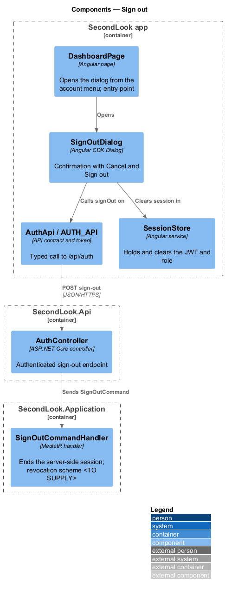
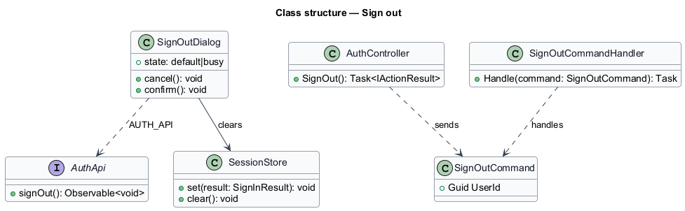
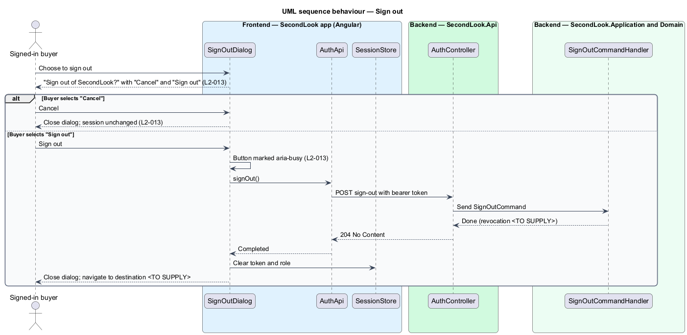

# Sign out

## Overview

SecondLook is a used-car safety app for buyers purchasing a vehicle "as is" who cannot get a mechanic to the car in person. This feature lets a signed-in buyer end the current session through a confirmation dialog. The mock manifest lists the dialog `sign-out` as opened from the dashboard (`/inspections`), with two states: `default` and `busy`. No invalid state applies, because the dialog has no inputs.

A *session* is the period during which the app holds a valid JWT for the user. Sign-out removes the JWT from the app.

## Description

No account code exists yet, so every component below is introduced by this design.

- **`SignOutDialog`** — Angular dialog in `projects/secondlook/src/app/dialogs/`, opened with Angular CDK Dialog from `DashboardPage`. It asks "Sign out of SecondLook?" with "Your inspections and reports stay in your account. You’ll need your email and password to get back in." and the buttons "Cancel" and "Sign out". Other opening points, such as the account menu or settings, are `<TO SUPPLY>`.
- **`AuthApi` / `AUTH_API`** — contract and token in `projects/api`. The client exposes `signOut`.
- **`SessionStore`** — Angular service that holds the JWT and role. It is cleared when sign-out completes.
- **`AuthController`** — controller in `SecondLook.Api`, base route `/api/auth`. The sign-out endpoint requires authentication and is not anonymous. The path under the base is `<TO SUPPLY>`.
- **`SignOutCommand`** and **`SignOutCommandHandler`** — MediatR command and handler. The JWT is stateless, so the server holds no session to end by default. Whether the server revokes the token, for example by a deny list, is `<TO SUPPLY>`; without revocation the handler records nothing and the token remains valid until its expiry.

Behaviour of the dialog:

- **Cancel.** The dialog closes and the buyer remains signed in. Focus returns to the element that opened the dialog, which the CDK Dialog restores.
- **Sign out.** The "Sign out" button carries `aria-busy="true"` while the request runs. On completion, `SessionStore` clears the token and role and the dialog closes. The destination after sign-out and the busy-state copy are `<TO SUPPLY>`; `L2-013` states only that the button is marked busy.
- **Failure.** `L2-013` states no failure behaviour. Whether the app clears the local session when the request fails is `<TO SUPPLY>`.

## Requirements

The feature realizes the following level-2 (L2) requirement. Each L2 requirement refines a level-1 (L1) requirement, cited by identifier.

| L2 ID | Refines (L1) | Requirement |
|-------|--------------|-------------|
| `L2-013` | `L1-002` | Sign out. When a signed-in buyer chooses to sign out, a dialog shall ask "Sign out of SecondLook?" with "Your inspections and reports stay in your account. You’ll need your email and password to get back in." and the buttons "Cancel" and "Sign out". When the buyer selects "Sign out", the system shall sign them out and the button shall be marked busy while it runs. When the buyer selects "Cancel", the dialog shall close and the buyer shall remain signed in. |

## Diagrams

### System context

A signed-in buyer signs out of SecondLook; no external system takes part.

### Containers

The Angular app holds the session and calls `SecondLook.Api` with the JWT.

### Components

`DashboardPage` opens `SignOutDialog`, which calls `AuthApi` and clears `SessionStore`.

### Class structure

`SignOutDialog` depends on `AuthApi` and `SessionStore`. `SignOutCommandHandler` handles the server side.

### Behaviour — sign out

The buyer cancels, or confirms and the dialog shows the busy state until the session is cleared.

## Implementation (J01)

`POST /api/auth/logout` (authenticated) returns 204. Sessions are stateless JWTs, so signing out discards the token in the client (`Session.end`) after the confirmation dialog of `L2-013`; the dialog is a CDK Dialog in `projects/secondlook/src/app/dialogs/`.
