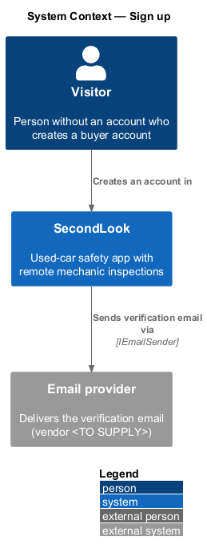
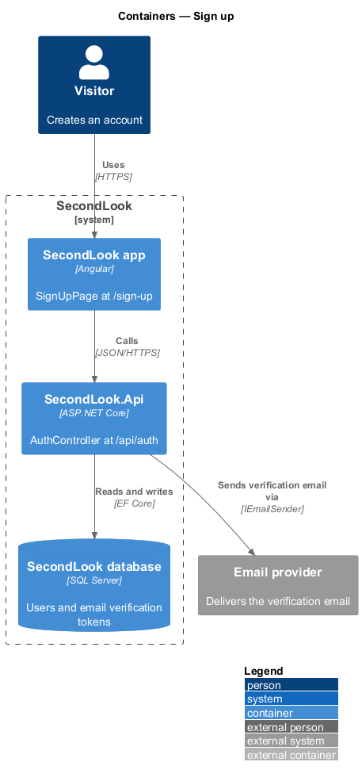
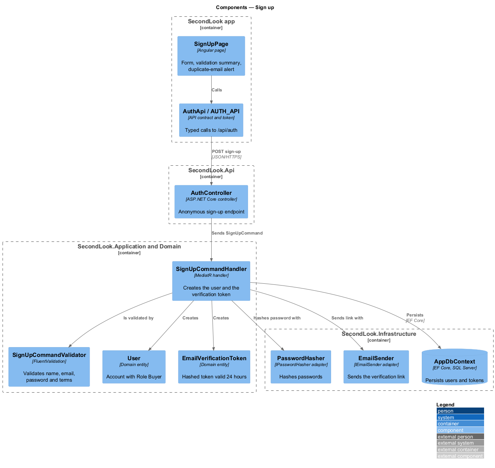
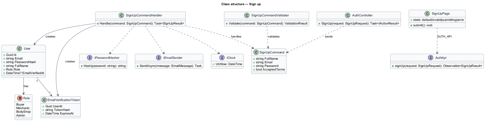
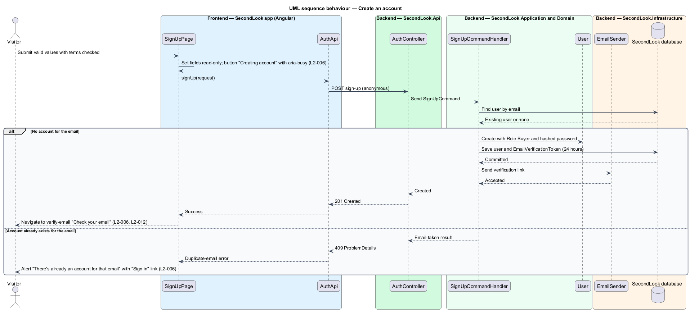
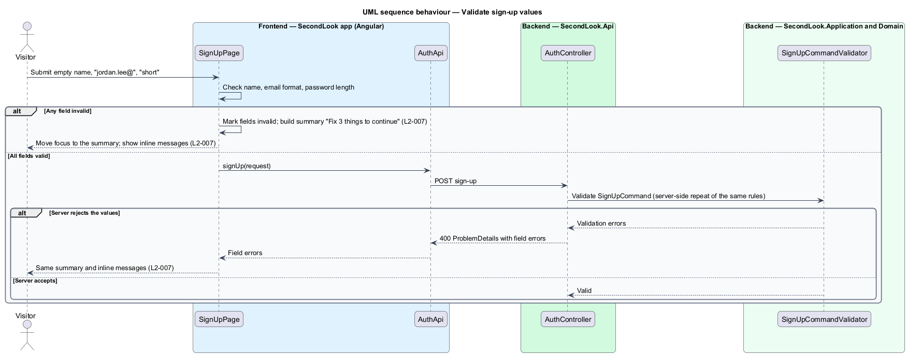

# Sign up

## Overview

SecondLook is a used-car safety app for buyers purchasing a vehicle "as is" who cannot get a mechanic to the car in person. This feature covers account creation for a buyer at the route `/sign-up` (mock title "Create account"). The visitor enters a full name, an email and a password, accepts the Terms and Privacy policy, and receives an email asking to verify the address.

An *email verification token* is a single-purpose secret, stored only as a hash, that proves control of an email address; it is valid for 24 hours. The verification step itself belongs to the verify-email feature (`L2-012`).

Public sign-up creates accounts with `Role.Buyer`. Mechanic and body shop accounts are covered by the mechanic-and-shop-accounts design.

## Description

The feature is a vertical slice from the Angular app to the database and the email port. No account code exists yet, so every component below is introduced by this design.

- **`SignUpPage`** — Angular page in `projects/secondlook/src/app/pages/`, routed at `/sign-up`. It shows "Create your account", the fields "Full name", "Email" and "Password" with the help text "At least 10 characters.", the checkbox "I agree to the Terms and Privacy policy." and the button "Create account". It also shows the link "Sign in" under "Already have one?". The mock defines four states: `default`, `invalid`, `submitting` and `error`. No loading or empty state applies, because the form renders without fetching data.
- **`AuthApi` / `AUTH_API`** — contract and injection token in `projects/api`. The page depends on the token. The client exposes `signUp`.
- **`AuthController`** — ASP.NET Core controller in `SecondLook.Api`, base route `/api/auth`. The sign-up endpoint is an intentional anonymous endpoint, because the caller has no account yet. The endpoint path under the base is `<TO SUPPLY>`.
- **`SignUpCommand`**, **`SignUpCommandValidator`** and **`SignUpCommandHandler`** — MediatR command, FluentValidation validator and handler in `SecondLook.Application`. The validator repeats the client rules on the server. The handler looks up the email, creates a `User` with `Role.Buyer`, hashes the password through `IPasswordHasher`, creates an `EmailVerificationToken` valid 24 hours from `IClock`, saves both in one unit of work and sends the verification link through `IEmailSender`.
- **`User`** and **`EmailVerificationToken`** — domain entities in `SecondLook.Domain`. `User.EmailVerifiedAt` is empty until verification.
- **`IPasswordHasher`**, **`IEmailSender`**, **`IClock`** — application ports. The hashing algorithm and the email vendor are `<TO SUPPLY>`.

Validation rules on the page:

- An empty name produces "Enter your name.".
- An email that is not a valid address, such as "jordan.lee@", produces "Enter a valid email address, like name@example.com." inline and "Enter a valid email address." in the summary.
- A password shorter than 10 characters, such as "short", produces "Use at least 10 characters.".
- With three errors the summary reads "Fix 3 things to continue"; the count follows the number of errors. Each summary entry links to its field, each field is marked invalid, and focus moves to the summary on submit.
- The rule for the unchecked terms checkbox, including its message, is `<TO SUPPLY>`; `L2-006` and `L2-007` state no copy for it.
- Password rules other than the 10-character minimum are `<TO SUPPLY>`.

State behaviour on the page:

- **Submitting.** The fields are read-only, and the button reads "Creating account" and carries `aria-busy="true"`.
- **Error (duplicate email).** The page shows the alert "There’s already an account for that email" with "Sign in instead, or reset your password if you’ve forgotten it." and a "Sign in" link. The API reports the condition as an email-taken result; the HTTP status 409 is a design choice.
- **Success.** The account exists and the page navigates to `/verify-email` with "Check your email" (`L2-012`). Whether the response also issues a JWT, so the visitor is signed in before verifying, is `<TO SUPPLY>`. The design takes the unverified account to the verification screen without signing in.

Revealing a duplicate email at sign-up is required by `L2-006`. The design therefore accepts that sign-up discloses whether an email has an account; rate limiting of the endpoint is `<TO SUPPLY>`.

## Requirements

The feature realizes the following level-2 (L2) requirements. Each L2 requirement refines a level-1 (L1) requirement, cited by identifier.

| L2 ID | Refines (L1) | Requirement |
|-------|--------------|-------------|
| `L2-006` | `L1-002` | Create an account. When a visitor loads the sign-up page, it shall show "Create your account", the fields "Full name", "Email" and "Password" with the help text "At least 10 characters.", the checkbox "I agree to the Terms and Privacy policy." and the button "Create account". When the visitor submits valid values with the checkbox checked, the system shall create the account and ask the visitor to verify their email. While the request is in flight, the fields shall be read-only and the button shall read "Creating account" and be marked busy. When an account already exists for the email, the page shall show the alert "There’s already an account for that email" with the text "Sign in instead, or reset your password if you’ve forgotten it." and a "Sign in" link. |
| `L2-007` | `L1-002` | Sign-up validation. When the visitor submits an empty name, an email of "jordan.lee@" and a password of "short", the page shall show the summary "Fix 3 things to continue" listing "Enter your name.", "Enter a valid email address." and "Use at least 10 characters.", each linking to its field. The page shall mark each field invalid with the inline messages "Enter your name.", "Enter a valid email address, like name@example.com." and "Use at least 10 characters.". When the visitor submits while the summary is shown, focus shall move to the summary. |

## Diagrams

### System context

The visitor creates an account in SecondLook, and the system sends the verification email through an external email provider.

### Containers

The Angular app calls `SecondLook.Api`, which persists the user and token to the SecondLook database and sends the email.

### Components

`SignUpPage` calls `AuthController` through `AuthApi`. The controller dispatches `SignUpCommand`, and the handler creates the user and token, hashes the password and sends the link.

### Class structure

`SignUpCommandHandler` creates a `User` with `Role.Buyer` and an `EmailVerificationToken`, using the password hasher, email sender and clock ports.

### Behaviour — create an account

The handler creates the account and sends the link, or returns the email-taken result that the page shows as the duplicate-email alert.

### Behaviour — validate sign-up values

The page checks the values first and shows the summary; the server validator repeats the rules and returns field errors in the same shape.

## Implementation (J01)

`POST /api/auth/register` `{fullName,email,password,acceptedTerms,role?}` returns 201 `{userId,email,verificationRequired}`; 400 validation problem with `fullName`, `email`, `password`, `acceptedTerms` or `role` errors; 409 `Account exists`. Passwords are hashed with ASP.NET Core Identity's `PasswordHasher`; email is lower-cased and unique. The unchecked-terms rule reports "Agree to the Terms and Privacy policy to continue." only when the other fields are valid. Mechanic and body shop registrations are created with `IsApproved = false`; `Admin` cannot be self-registered.
