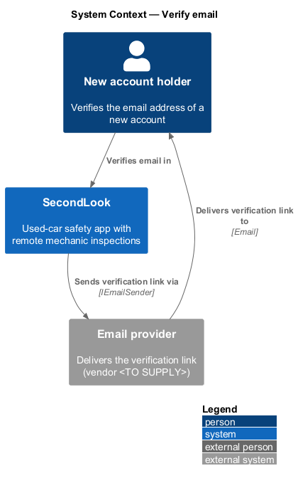
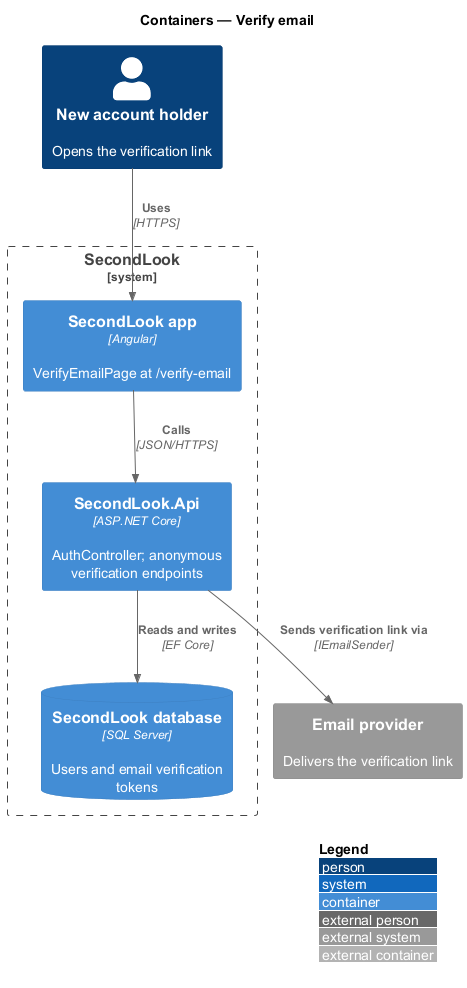
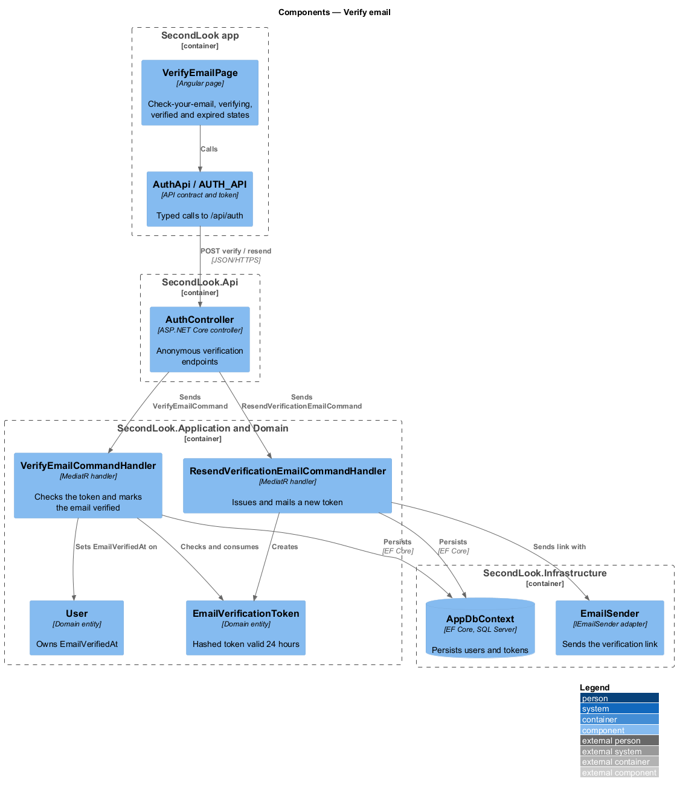
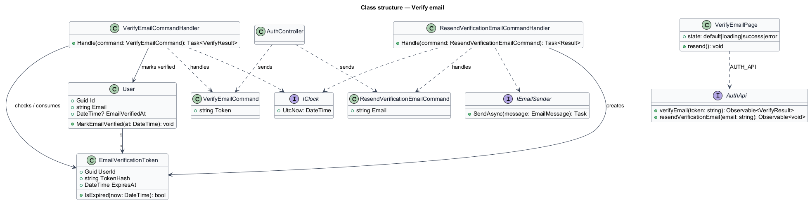
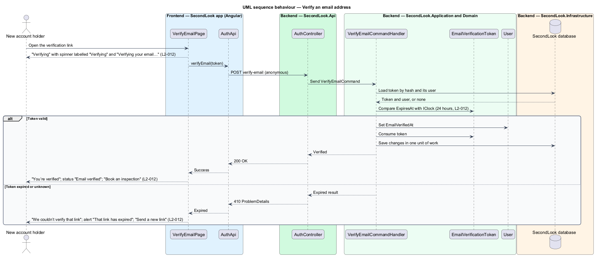
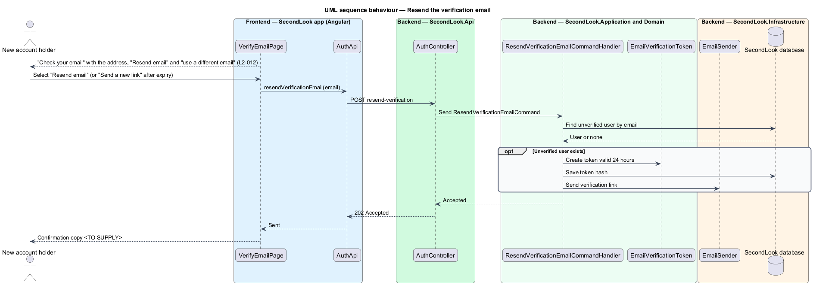

# Verify email

## Overview

SecondLook is a used-car safety app for buyers purchasing a vehicle "as is" who cannot get a mechanic to the car in person. This feature confirms that a new account holder controls the email address given at sign-up. It lives at the route `/verify-email` and handles four situations: asking the holder to check their email, checking a link, confirming success and reporting an expired link.

An *email verification token* is a single-purpose secret, stored only as a hash, that proves control of an email address; it is valid for 24 hours. A *verification link* is the URL in the email that carries the token to `/verify-email`.

## Description

No account code exists yet, so every component below is introduced by this design.

- **`VerifyEmailPage`** — Angular page in `projects/secondlook/src/app/pages/`, routed at `/verify-email`. The mock defines four states: `default`, `loading`, `error` and `success`. No empty state applies.
- **`AuthApi` / `AUTH_API`** — contract and token in `projects/api`. The client exposes `verifyEmail` and `resendVerificationEmail`.
- **`AuthController`** — controller in `SecondLook.Api`, base route `/api/auth`. The verify endpoint is an intentional anonymous endpoint, because the holder opens the link without a session. Whether the resend endpoint is anonymous depends on whether sign-up issues a JWT, which is `<TO SUPPLY>`. Paths under the base are `<TO SUPPLY>`.
- **`VerifyEmailCommandHandler`** — loads the token by hash and the owning `User`, compares `ExpiresAt` with `IClock.UtcNow`, sets `User.EmailVerifiedAt`, consumes the token and saves in one unit of work.
- **`ResendVerificationEmailCommandHandler`** — creates a new `EmailVerificationToken` valid 24 hours and sends the link through `IEmailSender`. The handler returns the same accepted result whether or not an unverified account exists for the email. Whether a new token replaces older ones, and any rate limit on resending, are `<TO SUPPLY>`.
- **`EmailVerificationToken`** — domain entity (`UserId`, `TokenHash`, `ExpiresAt`), created by sign-up and by resend.
- **`IEmailSender`** and **`IClock`** — application ports. The email vendor is `<TO SUPPLY>`.

State behaviour on the page:

- **Default.** The page shows "Check your email" with "We sent a link to jordan.lee@example.com. Open it on this device to finish setting up.", a "Resend email" button and "use a different email" linking to `/sign-up`. The address in the body comes from the sign-up result; how the page learns it after navigation is `<TO SUPPLY>`.
- **Loading.** While the token is checked, the page shows "Verifying", a spinner labelled "Verifying" and "Verifying your email…".
- **Success.** The page shows "You’re verified" and the status "Email verified" with "You’re all set. Book your first inspection whenever you’re ready." and a "Book an inspection" button. The button target is `/book/vehicle`, the first booking step.
- **Error.** The page shows "We couldn’t verify that link" and the alert "That link has expired" with "Verification links work for 24 hours. We can send a new one." and a "Send a new link" button that triggers the resend. An unknown or malformed token takes the same path; its copy is `<TO SUPPLY>`.

The copy and behaviour after a resend succeeds, and whether verification is required before booking or signing in, are `<TO SUPPLY>`; `L2-012` states neither.

## Requirements

The feature realizes the following level-2 (L2) requirement. Each L2 requirement refines a level-1 (L1) requirement, cited by identifier.

| L2 ID | Refines (L1) | Requirement |
|-------|--------------|-------------|
| `L2-012` | `L1-002` | Verify email. When a new account asks the visitor to verify, the page shall show "Check your email" with "We sent a link to jordan.lee@example.com. Open it on this device to finish setting up.", a "Resend email" button and "use a different email" linking to sign-up. When the visitor opens the verification link and it is being checked, the page shall show "Verifying", a spinner labelled "Verifying" and "Verifying your email…". When the link is valid and verification succeeds, the page shall show "You’re verified" and the status "Email verified" with "You’re all set. Book your first inspection whenever you’re ready." and a "Book an inspection" button. When the link has expired, the page shall show "We couldn’t verify that link" and the alert "That link has expired" with "Verification links work for 24 hours. We can send a new one." and a "Send a new link" button. |

## Diagrams

### System context

A new account holder verifies an email address in SecondLook. An external email provider delivers the link.

### Containers

The Angular app calls the verification endpoints of `SecondLook.Api`. The API stores token hashes in the database and sends links by email.

### Components

`AuthController` dispatches the verify and resend commands. The verify handler checks and consumes the token and sets `EmailVerifiedAt`.

### Class structure

`VerifyEmailCommandHandler` and `ResendVerificationEmailCommandHandler` share `EmailVerificationToken` and `User`. `IClock` fixes the 24-hour expiry.

### Behaviour — verify an email address

The page shows the verifying state, then the verified state for a valid token or the expired alert.

### Behaviour — resend the verification email

The holder asks for a new link from the check-your-email state or after expiry. The handler issues a token and mails it.

