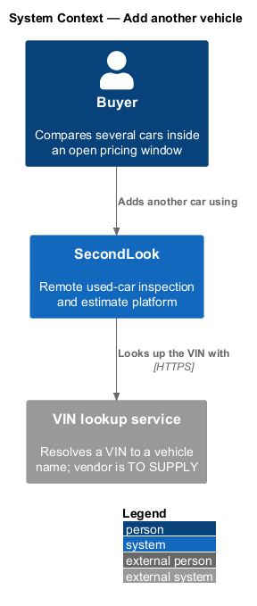
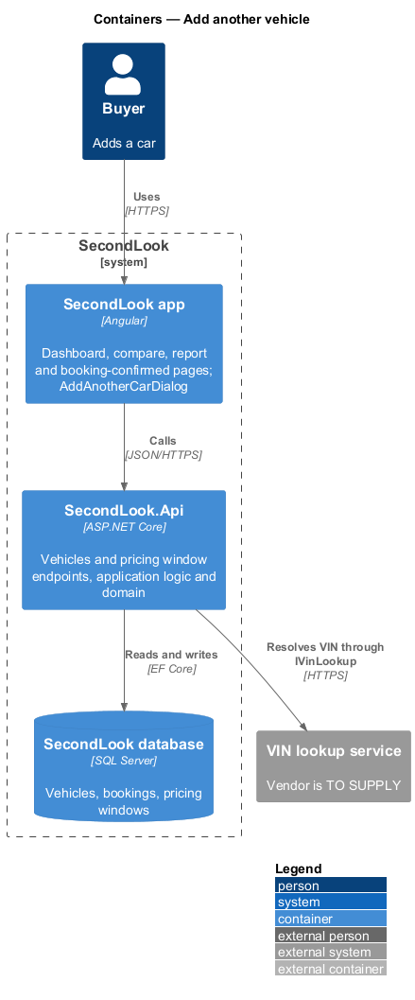
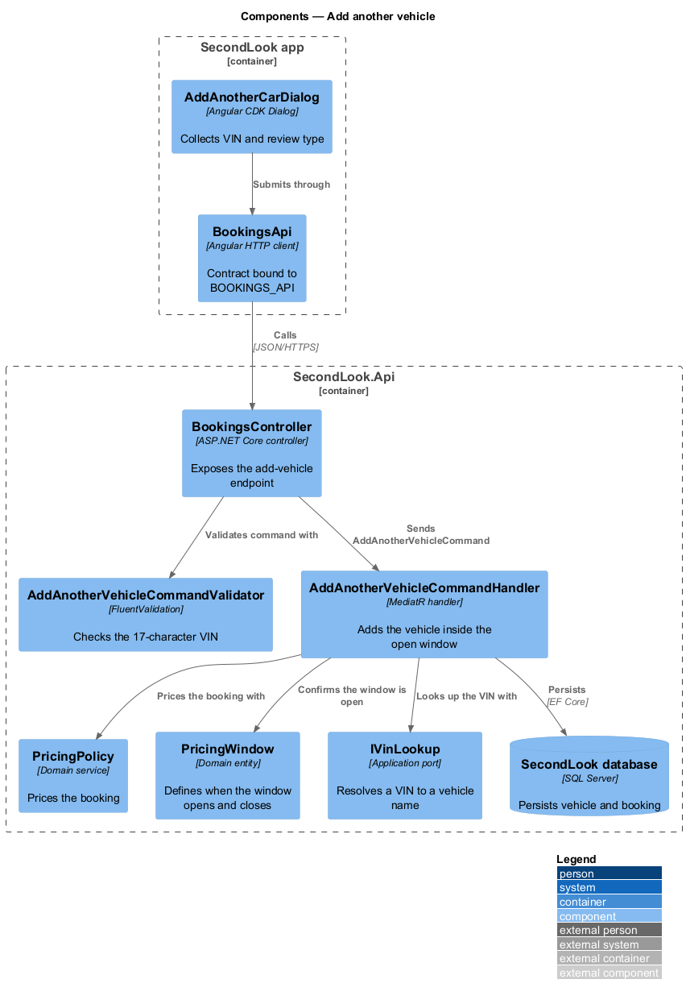
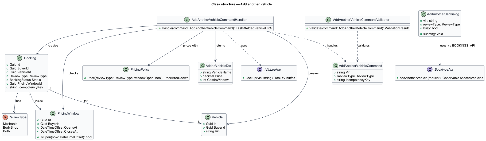
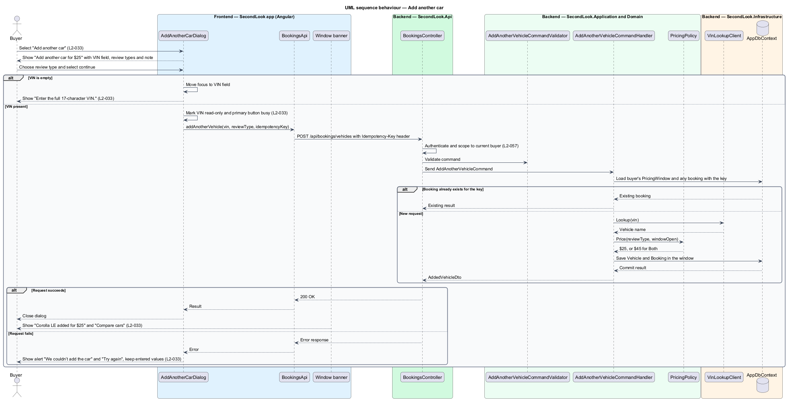

# Add another vehicle

## Overview

SecondLook prices the first inspection at $50 and opens a pricing window. A *pricing window* is a period of fourteen days from a buyer's first booking, during which each additional vehicle costs $25. This feature lets a buyer add a further vehicle from inside an open window so that the buyer can compare two or more cars.

The buyer opens a dialog from the dashboard, the compare page, the report page or the booking-confirmed page. The buyer enters the VIN of the next car and picks a review type. The system adds the vehicle at the reduced price, and the window banner then confirms the addition. Dialog behaviour that applies to every dialog (modal, Escape, busy and failure handling) is covered by `L2-065` and is not restated here.

## Description

The feature is a vertical slice from the dialog to the database. No booking or pricing code exists yet, so every component below is introduced by this design.

- **`AddAnotherCarDialog`** — Angular CDK Dialog in `projects/secondlook/src/app/dialogs/`. It shows the title "Add another car for $25", the field "VIN of the next car", and the review types "Mechanic", "Body shop" and "Both" with "+$20". It owns the invalid, busy and failed states. The VIN is read-only and the primary button is marked busy while the request runs. A failure shows an alert and keeps the entered values.
- **Opening pages** — `DashboardPage`, the compare page, the report page and `BookingConfirmedPage` each open the dialog. Each depends on the dialog rather than on an inline form.
- **`BookingsApi`** — API contract in `projects/api`, bound to `BOOKINGS_API`. It sends the add-vehicle request with an `Idempotency-Key` header. The header name and the route `POST /api/bookings/vehicles` are design choices.
- **`BookingsController`** — exposes the endpoint, authenticates the caller and scopes data to the current buyer (L2-057).
- **`AddAnotherVehicleCommand`**, **`AddAnotherVehicleCommandValidator`** and **`AddAnotherVehicleCommandHandler`** — in `SecondLook.Application`. The validator rejects a VIN that is not 17 characters. The handler loads the buyer's `PricingWindow`, confirms it is open, resolves the vehicle name through `IVinLookup`, prices the booking through `PricingPolicy`, and saves a `Vehicle` and a `Booking` linked to the window. A repeated request with the same idempotency key returns the existing booking.
- **`PricingPolicy`** — domain service and the single source of the pricing rules (L2-027). The review type `Both` adds $20.
- **`PricingWindow`** — domain entity with `OpensAt` and `ClosesAt`. `IsOpen` compares the current time from `IClock` with `ClosesAt`.
- **`IVinLookup`** and **`VinLookupClient`** — port and `SecondLook.Infrastructure` adapter that resolve a VIN to a vehicle name such as "Corolla LE". The vendor is `<TO SUPPLY>`.
- **Window banner** — on success the banner reads "Corolla LE added for $25" with "Three cars are in your window. Compare them side by side when the reports land." and "Compare cars". The car count comes from `AddedVehicleDto.CarsInWindow`.

Open points:

- The behaviour when the window has closed before the buyer submits is `<TO SUPPLY>`.
- When the added booking is paid, and whether the buyer pays inside this dialog, is `<TO SUPPLY>`.
- Whether the client or only the server validates the VIN check digit is `<TO SUPPLY>`. The specification states only the 17-character message.

## Requirements

The feature realizes the following level-2 (L2) requirement. It refines a level-1 (L1) requirement, cited by identifier.

| L2 ID | Refines (L1) | Requirement |
|-------|--------------|-------------|
| `L2-033` | `L1-007` | Add another vehicle. Given an open window, when the buyer selects "Add another car", a dialog shall show "Add another car for $25", "Compare more cars within your window. We’ll ask for the seller’s details next.", the field "VIN of the next car", the review types "Mechanic", "Body shop" and "Both" with "+$20", and the note "Your window is open until Wed 4 Nov 2026, so this car is $25. Choosing both adds $20.". Given an empty VIN, when the buyer continues, focus shall move to the VIN field and the dialog shall show "Enter the full 17-character VIN.". Given the request is running, when the dialog is busy, the VIN shall be read-only and the primary button shall be marked busy. Given the car cannot be added, when the request fails, the dialog shall show "We couldn’t add the car" with "Your window is still open. Check your connection and try again." and "Try again". Given the car is added, when the banner updates, it shall show "Corolla LE added for $25" with "Three cars are in your window. Compare them side by side when the reports land." and "Compare cars". |

## Diagrams

### System context

The buyer adds a car through SecondLook, which resolves the VIN with an external lookup service.

### Containers

The Angular app hosts the dialog and calls `SecondLook.Api`, which persists the vehicle and booking and calls the VIN lookup.

### Components

The dialog submits through `BookingsApi`. The controller validates the command and sends it to the handler, which uses `PricingWindow`, `PricingPolicy` and `IVinLookup`.

### Class structure

The handler creates a `Vehicle` and a `Booking` inside a `PricingWindow` and prices the booking with `PricingPolicy`.

### Behaviour — add another car

The sequence covers the empty VIN, the busy request, the idempotent repeat, the failure alert and the success banner.

