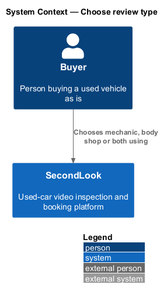
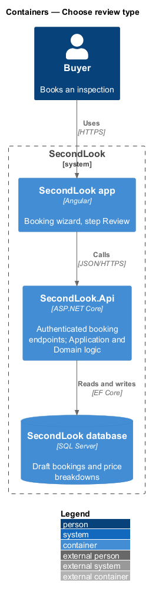
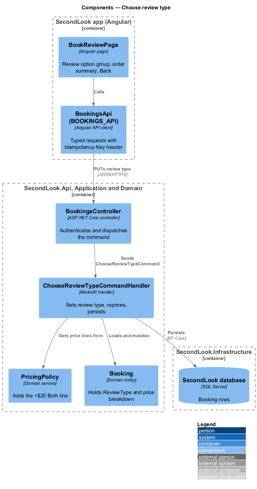
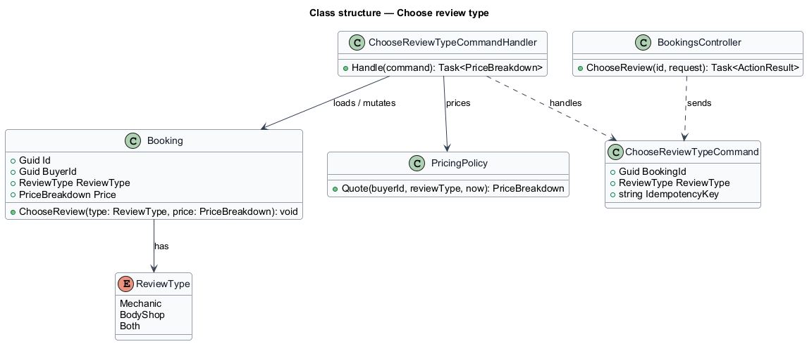
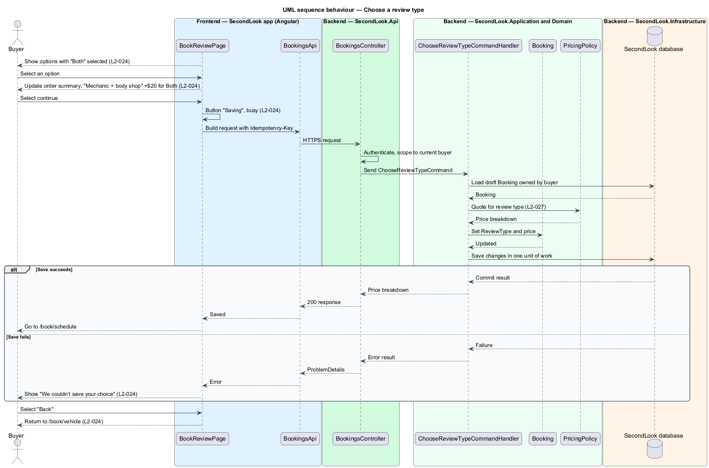

# Choose review type

## Overview

SecondLook is a used-car safety app for buyers purchasing a vehicle "as is" who cannot get a mechanic to the car in person. A *review type* is the kind of live-video inspection a buyer books for one vehicle: a mechanic review, a body shop review, or both in one call. This feature covers the second booking step, "Review", at the route `/book/review`.

The mechanic review yields a safety certification estimate. The body shop review covers rust, paint and panel damage. Choosing both adds a $20 fee. The choice changes the price, so the order summary updates its lines and total from the same pricing rules that determine the charge (`L2-027`).

This document assumes no prior knowledge of SecondLook internals; the diagrams show where each part lives.

## Description

The feature is a vertical slice from the Angular app to the database. No booking code exists yet, so every component below is introduced by this design.

- **`BookReviewPage`** — Angular page in `projects/secondlook/src/app/pages/`, routed at `/book/review`. It shows "Pick the review that fits the car." and a single-choice group of three options: "Mechanic" ("Safety certification estimate"), "Body shop" ("Rust, paint and panel damage") and "Both" ("Mechanical and body in one call", "+$20"). "Both" is selected on load. It also shows the order summary, a "Back" action and a continue action.
- **`BookingsApi` / `BOOKINGS_API`** — contract and injection token in `projects/api`. The page depends on the token. The client sends the `Idempotency-Key` request header (the header name is a design choice).
- **Shared components** — `sl-*` components from `projects/components` supply the stepper, the option group, the alert and the button. The option group exposes the selected state through accessible radio semantics.
- **`BookingsController`** — ASP.NET Core controller in `SecondLook.Api`, base route `/api/bookings`. It authenticates the caller and dispatches `ChooseReviewTypeCommand`. The endpoint path under that base is `<TO SUPPLY>`.
- **`ChooseReviewTypeCommand`** — request object carrying the `BookingId`, the `ReviewType` and the idempotency key.
- **`ChooseReviewTypeCommandHandler`** — MediatR handler. It loads the draft `Booking` owned by the current buyer, sets `ReviewType`, recomputes the price breakdown through `PricingPolicy`, and persists the change in one unit of work.
- **`PricingPolicy`** — domain service. For `Both`, it adds a line "Mechanic + body shop" at +$20 to the base line (`L2-027`). The price lines are $50 with no open window and $25 inside an open window.
- **`ReviewType`** — enumeration with `Mechanic`, `BodyShop` and `Both`.
- **`Booking`** — domain entity holding `ReviewType` and the price breakdown.

State behaviour on the page:

- **Default.** "Both" is preselected. The order summary includes the line "Mechanic + body shop" at "+$20". Selecting another option updates the summary lines and total from `PricingPolicy` through `QuoteBookingQuery`. Whether the page computes the quote locally or calls the API for each selection is `<TO SUPPLY>`; the rules shall remain in `PricingPolicy` either way.
- **Submitting.** The continue button reads "Saving" and carries `aria-busy="true"`.
- **Error.** When the save fails, the page shows "We couldn’t save your choice" with "Check your connection and try again. Nothing has been charged.". The selection remains on screen.
- **Back.** The "Back" action returns the buyer to `/book/vehicle` and keeps the saved vehicle details.

The continue button label and the destination are not stated in `L2-024`. The next step is the Schedule step at `/book/schedule`; the exact label is `<TO SUPPLY>`.

## Requirements

The feature realizes the following level-2 (L2) requirement. The requirement refines a level-1 (L1) requirement, cited by identifier.

| L2 ID | Refines (L1) | Requirement |
|-------|--------------|-------------|
| `L2-024` | `L1-005` | Book - review type. When the buyer reaches the Review step, the page shall show "Pick the review that fits the car." and the options "Mechanic" ("Safety certification estimate"), "Body shop" ("Rust, paint and panel damage") and "Both" ("Mechanical and body in one call", "+$20"), with "Both" selected. When the buyer chooses "Both", the order summary shall include the line "Mechanic + body shop" at "+$20". When the buyer continues and the request runs, the button shall read "Saving" and be marked busy. When the choice cannot be saved, the page shall show "We couldn’t save your choice" with "Check your connection and try again. Nothing has been charged.". When the buyer selects "Back", the page shall return the buyer to the vehicle step. |

## Diagrams

### System context

The buyer chooses a review type inside SecondLook. No external system takes part in this step.

### Containers

The Angular app calls the SecondLook API, which reads and writes the SecondLook database.

### Components

`BookReviewPage` uses `BOOKINGS_API`. `BookingsController` dispatches the command to the handler, which sets the review type and prices the booking through `PricingPolicy`.

### Class structure

`ChooseReviewTypeCommandHandler` loads and mutates `Booking`, which holds a `ReviewType`, and calls `PricingPolicy`.

### Behaviour — choose a review type

The page saves the selection. The handler applies `L2-027` pricing and persists the booking; a failure shows the error alert and the buyer may navigate back.

