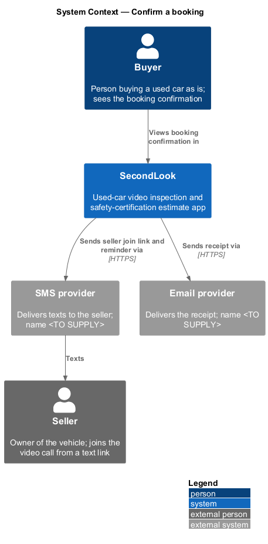
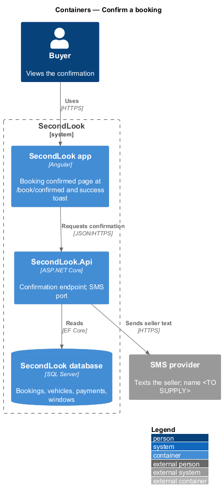
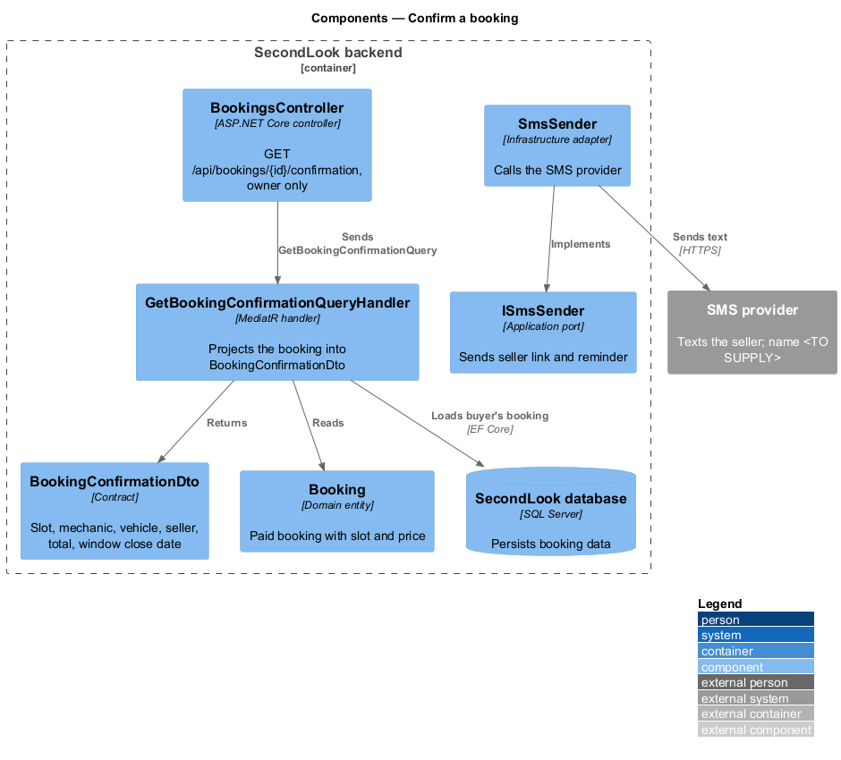
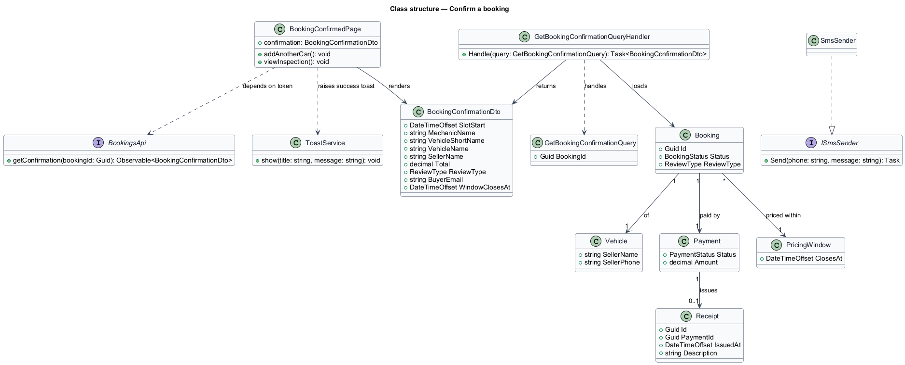
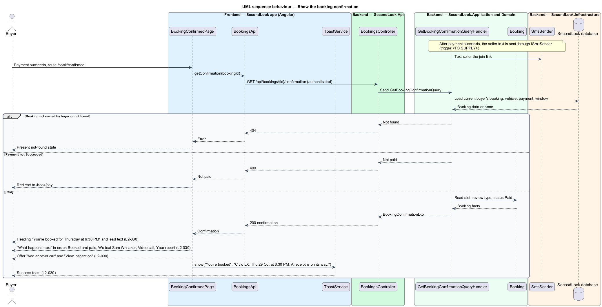

# Confirm a booking

## Overview

SecondLook is a used-car safety app. A buyer pays for a live video inspection, and a local mechanic estimates the cost of getting the car safety certified. After payment succeeds, the buyer lands on the confirmation view at the route `/book/confirmed`.

*Booking confirmation* is the view that tells the buyer a paid booking is secured, what happens before and after the call, and how to continue. The view states the inspection time and the mechanic, lists the steps ahead in a "What happens next" timeline, offers the next actions, and raises a success toast.

This feature covers that view, the data behind it, the text message that invites the seller, and the toast. Taking payment is covered in the pay-for-booking design, and the receipt history is outside this feature.

## Description

The feature is a vertical slice from the confirmation page to the database.

- **`BookingConfirmedPage`** — Angular page at `/book/confirmed`. It shows the heading "You’re booked for Thursday at 6:30 PM" and the lead "Dev Patel will inspect the Civic over video. Your estimate lands within an hour of the call." The weekday, time, mechanic name, and vehicle model come from the booking.
- **`WhatHappensNext`** — timeline section of the page, headed "What happens next". It lists four steps in a fixed order:
  1. "Booked and paid" with "$45 for the Civic, mechanic + body shop. Receipt sent to jordan.lee@example.com."
  2. "We text Sam Whitaker" with "He gets a link to join, and a reminder an hour before."
  3. "Video call, Thu 29 Oct, 6:30 PM" with "Join from this page. About 20 minutes."
  4. "Your report" with "A findings list and a cost range, inside an hour."
- **Actions** — the page offers "Add another car" and "View inspection". "Add another car" opens `AddAnotherCarDialog`. "View inspection" navigates to the inspection in `DashboardPage` at `/inspections`. Beside the actions, the page shows the prompt "Comparing more than one car? Add another within the window for $25, until Wed 4 Nov 2026." The window date comes from the buyer's `PricingWindow`.
- **`ToastService`** — shared component service from `projects/components`. On load, the page raises the success toast "You’re booked" with "Civic LX, Thu 29 Oct at 6:30 PM. A receipt is on its way." The toast auto-dismisses after 8 s and pauses on hover and focus.
- **`BookingsApi` / `BOOKINGS_API`** — contract and injection token in `projects/api`. The page depends on the token and calls `getConfirmation(bookingId)`.
- **`BookingsController`** — exposes `GET /api/bookings/{id}/confirmation`. The route shape is a design choice. The endpoint requires authentication and returns the booking only to its owner; any other caller receives 404 (`L2-057`).
- **`GetBookingConfirmationQuery`** and **`GetBookingConfirmationQueryHandler`** — MediatR types in `SecondLook.Application`. The handler loads the buyer's `Booking` with `Vehicle`, slot, assigned mechanic, `Payment`, and `PricingWindow`, and projects a `BookingConfirmationDto`. A booking whose `Payment` is not `Succeeded` returns no confirmation, and the page redirects to `/book/pay`.
- **`BookingConfirmationDto`** — contract holding the slot start, mechanic display name, vehicle short and long names, seller name, total, review type, buyer email, receipt state, and window close date.
- **`ISmsSender`** — application port. `SmsSender` in `SecondLook.Infrastructure` sends the seller the join link and, one hour before the call, a reminder. The seller's name and phone come from `Vehicle` (`SellerName`, `SellerPhone`). The trigger that sends the first text (payment-success handler or `SecondLook.Worker`), the SMS provider, the message wording, and the retry policy are `<TO SUPPLY>`.
- **Receipt email** — the step "Receipt sent to jordan.lee@example.com" and the toast "A receipt is on its way." imply an email sender. The port and the provider are `<TO SUPPLY>`. A `Receipt` entity (`Id`, `PaymentId`, `IssuedAt`, `Description`) records the issue.
- **Video call link** — "Join from this page" implies an embedded join action. The video provider and the join mechanism are `<TO SUPPLY>`. The expected call length "About 20 minutes" and the report window "inside an hour" are copy from the mock; their enforcement is outside this feature.
- **`Booking`** — domain entity; the confirmation reads it only.

## Requirements

The feature realizes the following level-2 (L2) requirement. The L2 requirement refines a level-1 (L1) requirement, cited by identifier.

| L2 ID | Refines (L1) | Requirement |
|-------|--------------|-------------|
| `L2-030` | `L1-006` | Booking confirmed. Given the payment succeeds, when the confirmation shows, then it shall show "You’re booked for Thursday at 6:30 PM" and "Dev Patel will inspect the Civic over video. Your estimate lands within an hour of the call.". Given the confirmation, when it shows, then "What happens next" shall list "Booked and paid", "We text Sam Whitaker", "Video call, Thu 29 Oct, 6:30 PM" and "Your report" in that order. Given the confirmation, when it shows, then it shall offer "Add another car" and "View inspection". Given the confirmation, when it shows, then a toast shall show "You’re booked" with "Civic LX, Thu 29 Oct at 6:30 PM. A receipt is on its way.". |

## Diagrams

### System context

The buyer sees the confirmation in SecondLook. SecondLook texts the seller through an external SMS provider and sends the receipt through an external email provider.

### Containers

The Angular app reads the confirmation from the SecondLook API, which reads the database and sends texts through the SMS provider.

### Components

Inside the API, `BookingsController` sends `GetBookingConfirmationQuery` to its handler, which reads the booking and returns a `BookingConfirmationDto`. `ISmsSender` serves the seller text.

### Class structure

`BookingConfirmedPage` depends on `BookingsApi`. The handler projects `Booking`, `Vehicle`, `Payment`, and `PricingWindow` into `BookingConfirmationDto`.

### Behaviour — show the confirmation

After payment succeeds, the page loads the confirmation, renders the heading and the "What happens next" timeline in order, offers both actions, and raises the success toast, in line with `L2-030`. The seller text is sent after payment succeeds.

## Implementation (J06)

Decisions are in ADR 0008. Mocks reused: `book-vehicle`, `book-review-type`, `book-schedule`, `checkout`, `booking-confirmed`, `dashboard` and `inspection-detail`.

`POST /api/bookings` `{checkoutId,holdId,vehicleId}` (role Buyer) confirms a paid checkout: 201 or 200 with the inspection (one per checkout, unique index; concurrent calls return the same one), 402 when unpaid, 404 for another buyer's hold, checkout or vehicle, 409 "We couldn’t hold that slot" when the slot was lost after the hold expired, in which case the payment is refunded in full automatically (`RefundReason.SlotUnavailable`). The inspection copies the vehicle details (ADR 0008).
