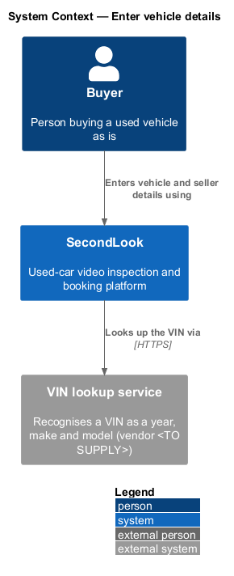
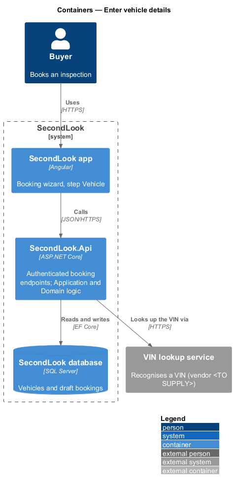
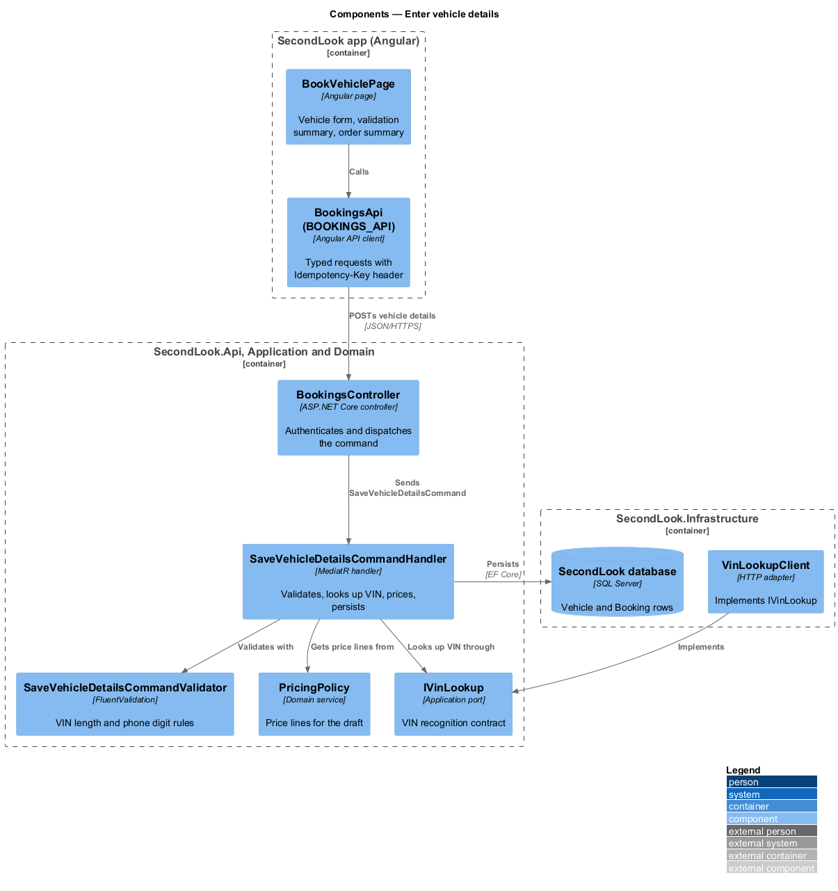
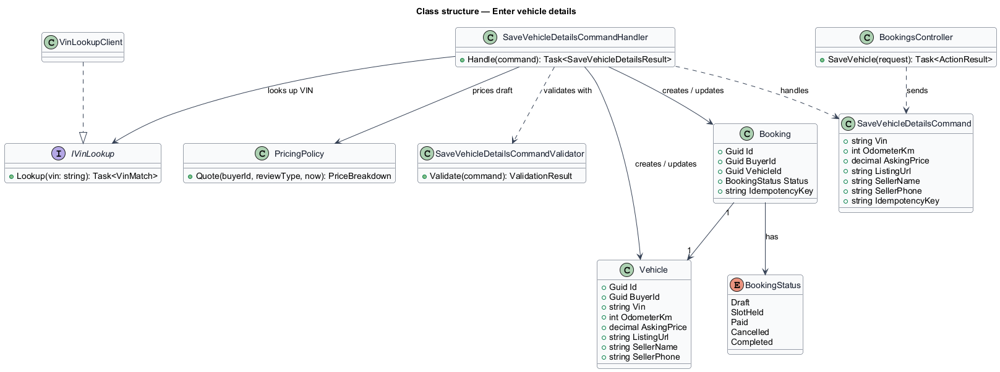
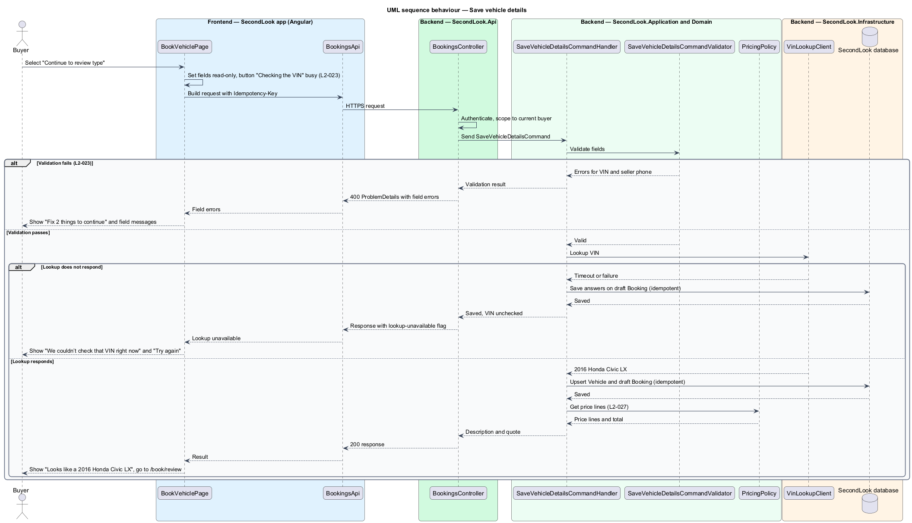

# Enter vehicle details

## Overview

SecondLook is a used-car safety app for buyers purchasing a vehicle "as is" who cannot get a mechanic to the car in person. A *booking* is a buyer's request for a live-video inspection of one vehicle; it passes through four wizard steps named "Vehicle", "Review", "Schedule" and "Pay". This feature covers the first step, at the route `/book/vehicle`.

*Vehicle details* are the facts the buyer records about the car and its seller: VIN, odometer reading, asking price, optional listing link, seller name and seller phone. The seller phone receives the text link used to join the inspection call. The step validates the answers, checks the VIN against an external lookup, and saves the answers to a draft `Booking` before the buyer moves to the Review step.

The page also shows an order summary ("Your order") that lists the vehicle, the price lines and the total. The price lines come from `PricingPolicy` (`L2-027`), the single source of pricing rules, so the summary and the amount charged cannot diverge. This document assumes no prior knowledge of SecondLook internals; the diagrams show where each part lives.

## Description

The feature is a vertical slice from the Angular app to the database. No booking code exists yet, so every component below is introduced by this design.

- **`BookVehiclePage`** — Angular page in `projects/secondlook/src/app/pages/`, routed at `/book/vehicle`. It renders the heading "Book an inspection", the subtitle "Tell us about the car. It takes about two minutes.", the progress steps, the vehicle form, and the order summary. It holds the form state and the view state: `default`, `invalid`, `submitting`, `error`.
- **`BookingsApi` / `BOOKINGS_API`** — contract and injection token in `projects/api`. The page depends on the token, not on the concrete HTTP client. It sends the `Idempotency-Key` request header (the header name is a design choice) so that re-posting returns the existing draft.
- **Shared components** — `sl-*` components from `projects/components` supply the stepper, field, alert, button and order summary. The form is part of the routed page, not an inline form opened by a button, which satisfies the rule in `AGENTS.md`.
- **`BookingsController`** — ASP.NET Core controller in `SecondLook.Api`, base route `/api/bookings`. It authenticates the caller and dispatches `SaveVehicleDetailsCommand`. The endpoint path under that base is `<TO SUPPLY>`.
- **`SaveVehicleDetailsCommand`** — request object carrying the VIN, `OdometerKm`, `AskingPrice`, `ListingUrl`, `SellerName`, `SellerPhone` and the idempotency key.
- **`SaveVehicleDetailsCommandValidator`** — FluentValidation validator. It rejects a VIN that is not 17 characters with "A VIN has 17 characters. This one has 15." (the count is the actual length) and a seller phone that is not 10 digits with "Enter a 10-digit phone number.". Validation rules for odometer, asking price and listing link are `<TO SUPPLY>`.
- **`SaveVehicleDetailsCommandHandler`** — MediatR handler. It validates, calls `IVinLookup`, creates or updates the `Vehicle` and the draft `Booking` scoped to the current buyer, and returns the recognised description and the quote lines.
- **`IVinLookup`** — application port for VIN recognition. The adapter `VinLookupClient` in `SecondLook.Infrastructure` implements it. The vendor is `<TO SUPPLY>`.
- **`PricingPolicy`** — domain service returning the price lines for the draft: $50 with no open pricing window, $25 inside an open window (`L2-027`).
- **`Vehicle`** and **`Booking`** — domain entities. `Booking.Status` is `Draft` until a slot is held.

State behaviour on the page:

- **Default.** The page loads with the fields, "Save and finish later" and "Continue to review type". When a full 17-character VIN is recognised, the page shows "Looks like a 2016 Honda Civic LX".
- **Invalid.** The page shows an alert "Fix 2 things to continue" whose list items link to the offending fields, and per-field messages. The inputs carry `aria-invalid="true"`.
- **Submitting.** The fields become read-only and the primary button reads "Checking the VIN" with `aria-busy="true"`.
- **Error.** When the lookup does not respond, the page shows "We couldn’t check that VIN right now" with a "Try again" action. The answers remain saved, so the buyer may also continue and the VIN is checked before the call.
- **Save and finish later.** The button persists the current answers on the draft `Booking`. The post-save destination and whether partial answers pass validation are `<TO SUPPLY>`, because `L2-023` specifies only that the button is shown.

## Requirements

The feature realizes the following level-2 (L2) requirement. The requirement refines a level-1 (L1) requirement, cited by identifier.

| L2 ID | Refines (L1) | Requirement |
|-------|--------------|-------------|
| `L2-023` | `L1-005` | Book - vehicle details. When a buyer starts a booking, the page shall show "Book an inspection", "Tell us about the car. It takes about two minutes.", the progress steps "Vehicle", "Review", "Schedule" and "Pay", and the fields "VIN", "Odometer (km)", "Asking price ($)", "Listing link (optional)", "Seller’s name" and "Seller’s phone". When a full 17-character VIN is recognised, the page shall show "Looks like a 2016 Honda Civic LX". When the buyer continues with a VIN of 15 characters and a phone of "905-555-01", the page shall show "Fix 2 things to continue" listing "Enter the full 17-character VIN." and "Enter the seller’s 10-digit phone number.", with the messages "A VIN has 17 characters. This one has 15." and "Enter a 10-digit phone number.". When the VIN lookup does not respond and the buyer continues, the page shall show "We couldn’t check that VIN right now" with "The VIN lookup service didn’t respond. Your answers are saved. Try again, or continue and we’ll check it before the call." and "Try again". When the buyer continues and the request runs, the fields shall be read-only and the button shall read "Checking the VIN" and be marked busy. When the page loads, the order summary "Your order" shall show the vehicle, the price lines and the total, and the buttons "Save and finish later" and "Continue to review type" shall be shown. |

## Diagrams

### System context

The buyer enters vehicle details in SecondLook, which asks an external VIN lookup service to recognise the vehicle.

### Containers

The Angular app calls the SecondLook API, which reads and writes the SecondLook database and calls the VIN lookup service.

### Components

Inside the app, `BookVehiclePage` uses `BOOKINGS_API`. Inside the API, `BookingsController` dispatches the command to the handler, which validates, looks up the VIN, prices the draft, and persists it.

### Class structure

`SaveVehicleDetailsCommandHandler` depends on the command, its validator, `IVinLookup` and `PricingPolicy`, and writes `Vehicle` and `Booking`.

### Behaviour — save vehicle details

The page submits the answers. The validator enforces `L2-023` field rules, the handler calls the VIN lookup, and the page shows the invalid, error or success state.

