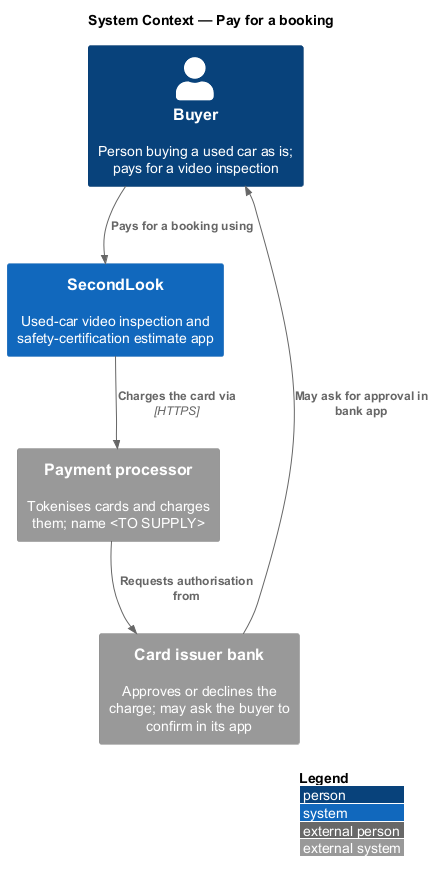
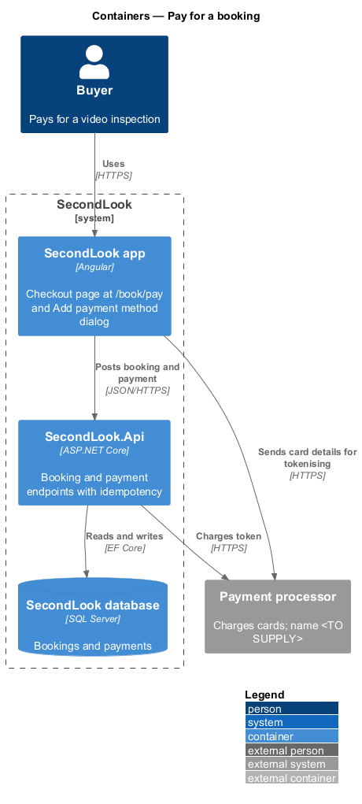
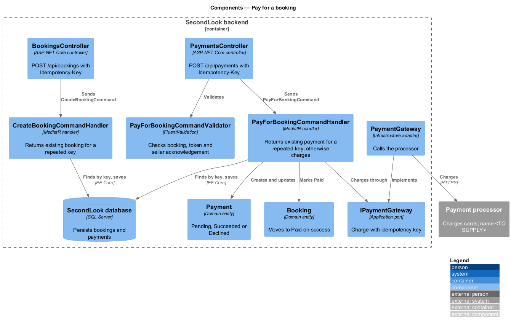
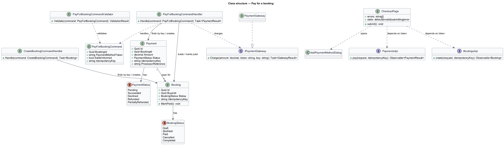
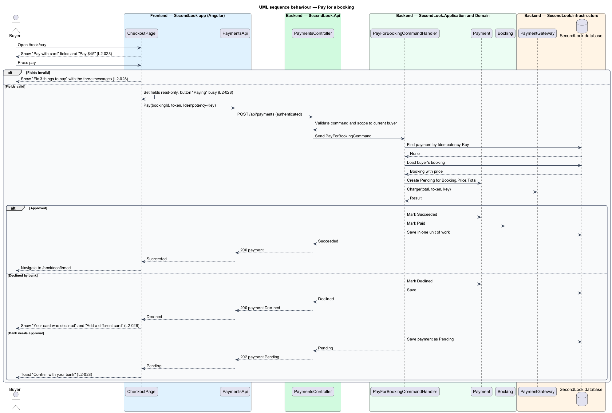
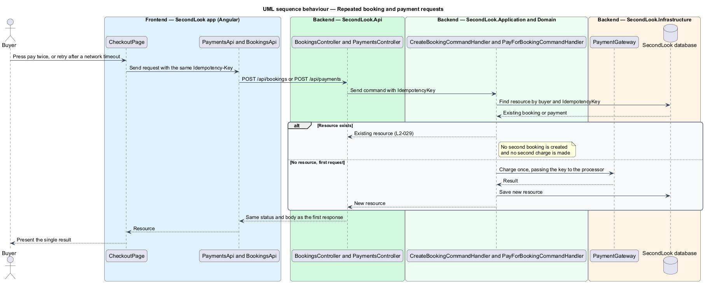

# Pay for a booking

## Overview

SecondLook is a used-car safety app. A buyer books a live video inspection of a vehicle, and a local mechanic estimates the cost of getting the car safety certified. Payment is the last step of booking, at the route `/book/pay`.

*Checkout* is the Pay step of the booking flow, where the buyer confirms the seller is aware of the video call and pays the quoted total by card. *Idempotency key* is a client-generated identifier, sent with a write request, that lets the server recognise a repeated request and return the original result.

This feature covers the Pay page, the card validation messages, the submitting state, a declined card, a bank approval prompt, and the guarantee that posting the same booking or payment request twice returns the existing resource and charges once. The amount charged comes from the booking price set by `PricingPolicy` (see the price-booking design).

## Description

The feature is a vertical slice from the Pay page to the payment gateway.

- **`CheckoutPage`** — Angular page at `/book/pay`. It shows the heading "Pay now. If the seller doesn’t join, you’re refunded in full.", the group "Pay with card", the fields "Card number", "Expiry", "Security code", "Name on card" and "Postal code", the checkbox "I’ve told the seller about the video call and they’re happy to take part.", the button "Back", and a pay button showing the total, for example "Pay $45". It renders the shared order summary beside the form.
- **`CardForm`** — form state inside `CheckoutPage`. It validates the five fields and the checkbox on submit and builds the error summary. The mocks define four states: default, invalid, submitting, and error.
- **`AddPaymentMethodDialog`** — CDK Dialog in `projects/secondlook/src/app/dialogs/`. The error panel's "Add a different card" action opens it. The dialog collects "Card number", "Expiry" and "Security code", offers "Use for future bookings", and shows the states default, invalid, busy, and failed. The copy states that card details go straight to the payment processor.
- **`PaymentsApi` / `PAYMENTS_API`** and **`BookingsApi` / `BOOKINGS_API`** — contracts and injection tokens in `projects/api`. `CheckoutPage` depends on the tokens. The client generates one `Idempotency-Key` per booking attempt and one per payment attempt and reuses the same key on a retry of the same attempt. The header name is a design choice.
- **`BookingsController`** — `POST /api/bookings` accepts the `Idempotency-Key` header.
- **`PaymentsController`** — `POST /api/payments` accepts the `Idempotency-Key` header. Both endpoints require authentication and act only on the current buyer's bookings (`L2-057`).
- **`CreateBookingCommandHandler`** — looks up an existing `Booking` by buyer and `IdempotencyKey`. A match returns the existing booking. No match creates the booking.
- **`PayForBookingCommand`**, **`PayForBookingCommandValidator`**, and **`PayForBookingCommandHandler`** — MediatR types in `SecondLook.Application`. The validator rejects a missing booking, a missing payment method token, and an unchecked seller acknowledgement. The handler looks up an existing `Payment` by `IdempotencyKey` and returns it on a match. Otherwise it creates a `Payment` with status `Pending`, charges `Booking.Price.Total` through `IPaymentGateway`, and records the outcome.
- **`IPaymentGateway`** — application port. `PaymentGateway` in `SecondLook.Infrastructure` adapts it to the processor. The processor name, tokenisation method, and webhook shape are `<TO SUPPLY>`. The gateway passes the `Payment` idempotency key to the processor so a retried call cannot charge twice.
- **`Payment`** and **`PaymentStatus`** — domain entity and enumeration (`Pending`, `Succeeded`, `Declined`, `Refunded`, `PartiallyRefunded`). A payment awaiting bank approval stays `Pending`. The mechanism that resolves a `Pending` payment to `Succeeded` or `Declined` (webhook or polling) is `<TO SUPPLY>`.
- **`Booking`** — on `Succeeded`, the status moves to `Paid`.

Card validation messages, in the order the fields appear:

- Card number of fewer than 16 digits: "Enter the 16 digits on the front of your card."
- Expiry that is not a valid month and year in the future, for example "13 / 28": "That expiry date isn’t valid."
- Missing or short security code: "Enter the 3-digit security code."

The summary heading counts the failing items, for example "Fix 3 things to pay". Messages for "Name on card", "Postal code", and the seller acknowledgement are `<TO SUPPLY>`.

Page states:

- **Submitting** — the fields are read-only, and the pay button reads "Paying" and carries the busy state.
- **Declined** — the page shows "Your card was declined" with "Your bank didn’t approve $45.00. Try another card, or call the number on the back of this one. You haven’t been charged." and the action "Add a different card". The `payment-failed` notification repeats the outcome as a toast: "Your card was declined", "You haven’t been charged. Try another card."
- **Bank approval** — a toast shows "Confirm with your bank" with "Your bank may ask you to approve $45.00 in its app." The amount shown is the booking total.

## Requirements

The feature realizes the following level-2 (L2) requirements. Each L2 requirement refines a level-1 (L1) requirement, cited by identifier.

| L2 ID | Refines (L1) | Requirement |
|-------|--------------|-------------|
| `L2-028` | `L1-006` | Checkout. Given the buyer reaches the Pay step, when it loads, then it shall show "Pay now. If the seller doesn’t join, you’re refunded in full.", "Pay with card", the fields "Card number", "Expiry", "Security code", "Name on card" and "Postal code", the checkbox "I’ve told the seller about the video call and they’re happy to take part.", the button "Back" and a pay button showing the total, for example "Pay $45". Given a card number of 12 digits, an expiry of "13 / 28" and no security code, when the buyer pays, then the page shall show "Fix 3 things to pay" listing "Enter the 16 digits on the front of your card.", "That expiry date isn’t valid." and "Enter the 3-digit security code.". Given the payment is in flight, when it is submitting, then the fields shall be read-only and the button shall read "Paying" and be marked busy. Given the bank declines the card, when the buyer pays, then the page shall show "Your card was declined" with "Your bank didn’t approve $45.00. Try another card, or call the number on the back of this one. You haven’t been charged." and "Add a different card". Given the bank needs approval, when the buyer pays, then a toast shall show "Confirm with your bank" with "Your bank may ask you to approve $45.00 in its app.". |
| `L2-029` | `L1-006` | Idempotent booking and payment. Given a booking request has been accepted, when the same request is posted again, then the system shall return the existing booking and shall not create a second one. Given a payment request has been accepted, when the same request is posted again, then the system shall return the existing payment and shall not charge again. |

## Diagrams

### System context

The buyer pays in SecondLook, which charges the card through an external payment processor.

### Containers

The Angular app posts the booking and payment to the SecondLook API, which charges through the processor and persists the result.

### Components

Inside the API, `PaymentsController` dispatches `PayForBookingCommand`. The handler checks for an existing payment by idempotency key, charges through `IPaymentGateway`, and persists the outcome.

### Class structure

`PayForBookingCommandHandler` loads a `Booking`, creates a `Payment`, and calls `IPaymentGateway`. `CheckoutPage` depends on the API tokens.

### Behaviour — pay for the booking

The page validates the card fields, then creates the booking and the payment with idempotency keys. The alternate branches cover invalid fields, a declined card, and a bank approval prompt, in line with `L2-028`.

### Behaviour — repeated booking and payment requests

A repeated request with the same `Idempotency-Key` returns the stored booking or payment and does not call the gateway, in line with `L2-029`.

## Implementation (J05)

Decisions are in ADR 0007. Mocks reused: `docs/mocks/pages/checkout` and `billing-history`.

Endpoints (role Buyer): `POST /api/payments/tokens` (card details to the processor adapter, 400 field errors, returns an opaque token), `POST /api/checkouts` `{review, idempotencyKey}` (201, or 200 for a repeated key), `GET /api/checkouts/{id}`, `POST /api/checkouts/{id}/pay` `{paymentToken}` (200 Paid; 402 "Your card was declined"; 202 RequiresAction; 404 for another buyer's checkout). One successful `Payment` per checkout (unique index); the local processor charges once per checkout. Only brand and last four digits are stored. Test cards: 4242 4242 4242 4242, 4000 0000 0000 0002 (declined), 4000 0025 0000 3155 (bank approval).
