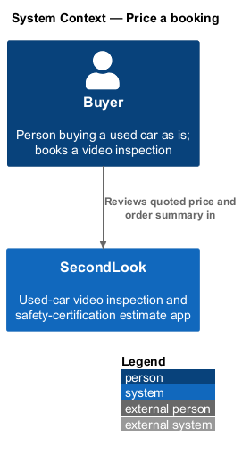
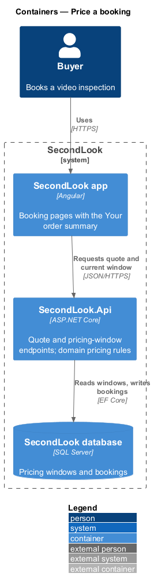
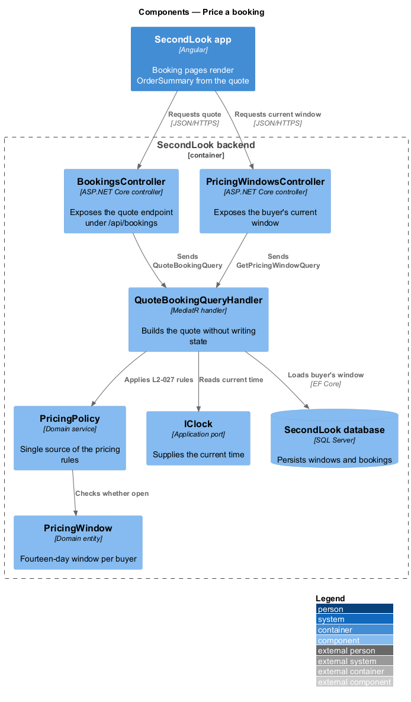
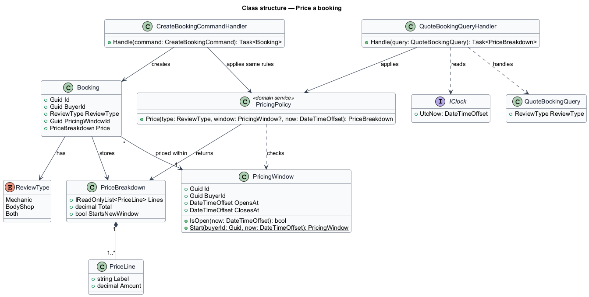
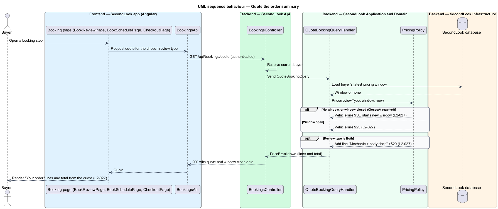
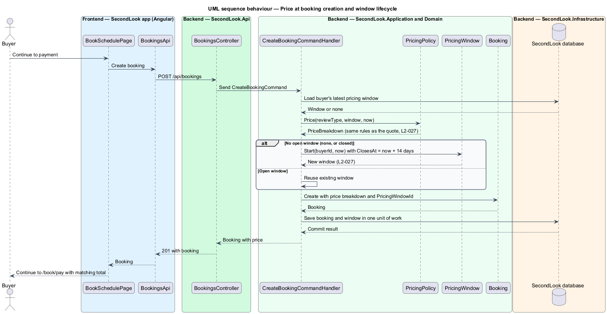

# Price a booking

## Overview

SecondLook is a used-car safety app. A buyer who cannot get a mechanic to a vehicle books a live video inspection, and a local mechanic estimates the cost of getting the car safety certified. This feature covers the price of that booking.

*Pricing window* is the interval of fourteen days, starting at a buyer's first booking, during which each further vehicle is priced at the reduced rate. The first inspection costs $50, and each additional vehicle booked inside an open window costs $25. A buyer who adds a body shop review to the mechanic review (review type `Both`) pays $20 more.

The rules live in one place, the `PricingPolicy` domain service. Every price the buyer sees, on the order summary of each booking step and on the Pricing page, and every amount the system charges comes from that service. The summary and the charge therefore cannot disagree.

## Description

The feature is a vertical slice from the booking pages to the database.

- **`PricingPolicy`** — domain service in `SecondLook.Domain`. It is the single source of the pricing rules. Given a review type and the buyer's pricing window (or none), it returns a `PriceBreakdown`.
- **`PriceBreakdown`** — value object holding the ordered price lines and the total. Lines are the vehicle line ($50 or $25) and, for review type `Both`, the "Mechanic + body shop" line (+$20).
- **`PricingWindow`** — domain entity (`Id`, `BuyerId`, `OpensAt`, `ClosesAt`). `ClosesAt` is `OpensAt` plus fourteen days. A window is open when the current time is before `ClosesAt`.
- **`Booking`** — domain entity. It stores the `PriceBreakdown` computed at creation and the `PricingWindowId` the price was based on.
- **`QuoteBookingQuery`** and **`QuoteBookingQueryHandler`** — MediatR query and handler in `SecondLook.Application`. The handler loads the buyer's open window through `IAppDbContext`, reads the time from `IClock`, calls `PricingPolicy`, and returns the quote without writing state.
- **`GetPricingWindowQuery`** — returns the buyer's current window, so the summary can show "Your window closes Wed 4 Nov 2026. Cars added before then are $25 each."
- **`BookingsController`** — exposes the quote endpoint under `/api/bookings`. The route shape is a design choice: `GET /api/bookings/quote?reviewType=...`. The endpoint requires authentication and reads only the current buyer's window.
- **`PricingWindowsController`** — exposes `GET /api/pricing-windows/current`, scoped to the current buyer.
- **`BookingsApi` / `BOOKINGS_API`** — contract and injection token in `projects/api`. Pages depend on the token.
- **`OrderSummary`** — shared component from `projects/components` (selector `sl-order-summary`). It renders the "Your order" lines and total from a quote and holds no pricing logic. `BookVehiclePage`, `BookReviewPage`, `BookSchedulePage`, and `CheckoutPage` each render it with the quote returned by the API.
- **`PricingPage`** — public page that shows the rules as copy; its interactive example reuses the same quote contract for the displayed amounts. The anonymous quote shape is `<TO SUPPLY>`.

Rule application, in order:

1. `PricingPolicy` finds whether the buyer has an open window at the current time.
2. With no open window, the vehicle line is $50 and the booking starts a new window of fourteen days from the booking. A closed window counts as no open window.
3. With an open window, the vehicle line is $25 and the existing window is reused.
4. For review type `Both`, the policy adds the "Mechanic + body shop" line of +$20.
5. The total is the sum of the lines.

`CreateBookingCommandHandler` calls the same `PricingPolicy` with the same inputs to set the booking price, and `PayForBookingCommand` charges that stored total. The point in the booking flow at which a new window is persisted (at booking creation or at successful payment) is `<TO SUPPLY>`. The label of the first-vehicle line is `<TO SUPPLY>`; the mocks show only the line "Additional vehicle, in your window".

## Requirements

The feature realizes the following level-2 (L2) requirement. The L2 requirement refines a level-1 (L1) requirement, cited by identifier.

| L2 ID | Refines (L1) | Requirement |
|-------|--------------|-------------|
| `L2-027` | `L1-006` | Pricing rules. Given a buyer with no open pricing window, when the buyer books a mechanic review, then the price shall be $50 and the booking shall start a pricing window. Given a buyer with an open pricing window, when the buyer books another vehicle, then the price shall be $25. Given a booking that chooses both a mechanic and a body shop review, when it is priced, then it shall add $20. Given a window, when it is created, then it shall last fourteen days from the first booking. Given the window has closed, when the buyer books, then the price shall be $50 and a new window shall start. Given a booking, when the order summary shows, then its lines and total shall come from the same rules and shall match the price charged. |

## Diagrams

### System context

A buyer sees quoted prices in SecondLook while booking. Payment of the quoted amount happens in a separate feature.

### Containers

The Angular app requests a quote from the SecondLook API, which reads pricing windows from the database.

### Components

Inside the API, the controller sends `QuoteBookingQuery` to its handler, which applies `PricingPolicy` to the buyer's window.

### Class structure

`PricingPolicy` produces a `PriceBreakdown` from a `ReviewType` and an optional `PricingWindow`. `Booking` stores the breakdown it was priced with.

### Behaviour — quote the order summary

A booking page requests a quote. The handler applies `L2-027` through `PricingPolicy` and the page renders the returned lines and total.

### Behaviour — price at booking creation and window lifecycle

Creating a booking reuses `PricingPolicy`. With no open window, the booking starts a window of fourteen days. After the window closes, the next booking is $50 and starts a new window.

## Implementation (J05)

Decisions are in ADR 0007. Mocks reused: `docs/mocks/pages/checkout` and `billing-history`.

`PriceCalculator` (Domain) is the only place prices are decided: first review $50, additional vehicle $25 inside a 14-day window that opens when the first payment succeeds, +$20 for both reviews. `PricingService` reads the buyer's windows; a checkout's quote is recomputed on read and at payment (ADR 0007).
