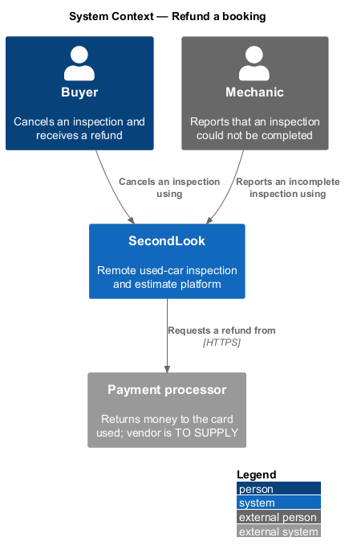
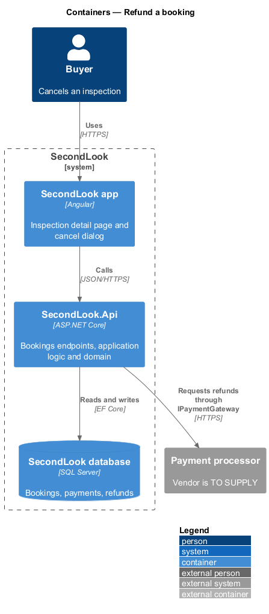
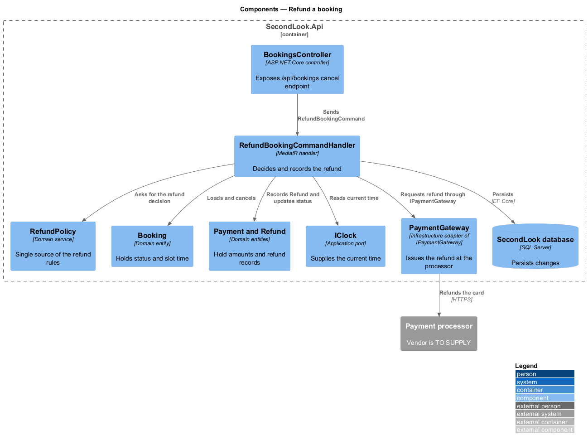
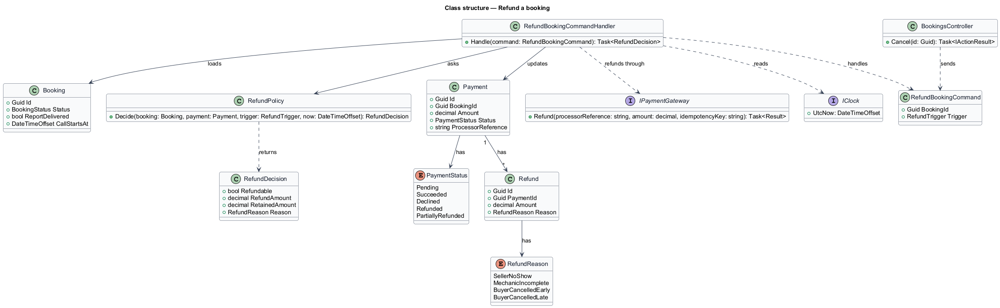
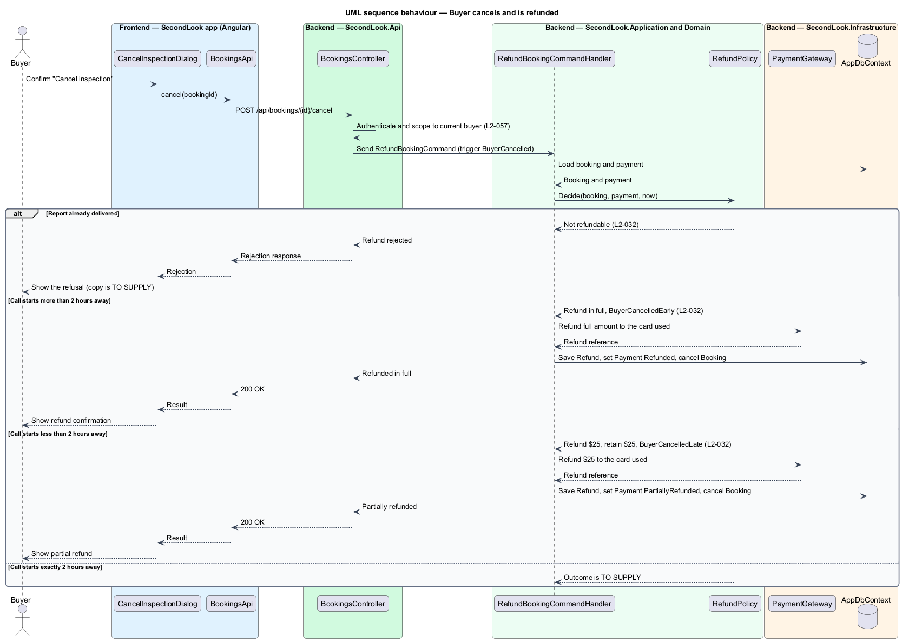
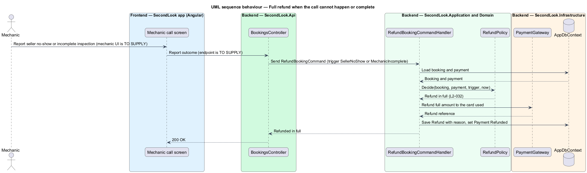

# Refund a booking

## Overview

SecondLook charges a buyer when a booking is paid. A *refund* is a return of all or part of a payment to the card used. This feature defines when a refund is issued, how much is returned, and how the decision is recorded.

A *refund policy* is a set of rules that maps the cause of a cancellation and its timing to a refund amount. The policy has five rules. A seller who does not join the call, a mechanic who cannot complete the inspection, and a buyer who cancels more than 2 hours before the call each receive a full refund. A buyer who cancels less than 2 hours before the call receives $25 back and the platform retains $25. Once a report is delivered, the booking is not refundable.

## Description

The feature is a vertical slice from the cancel dialog to the payment processor. No booking or payment code exists yet, so every component below is introduced by this design.

- **`RefundPolicy`** — domain service in `SecondLook.Domain` and the single source of the refund rules. It takes the booking, the payment, the trigger and the current time, and returns a `RefundDecision` holding `Refundable`, `RefundAmount`, `RetainedAmount` and `Reason`.
- **`RefundBookingCommand`** — MediatR command carrying the `BookingId` and the trigger: seller no-show, mechanic incomplete, or buyer cancellation.
- **`RefundBookingCommandHandler`** — handler in `SecondLook.Application`. It loads the booking and payment, reads the time from `IClock`, asks `RefundPolicy` for the decision, calls `IPaymentGateway` to refund, and saves a `Refund`, the new `PaymentStatus` and the cancelled `Booking` in one unit of work.
- **`Refund`** and **`RefundReason`** — entity and enumeration recording the amount and the reason: `SellerNoShow`, `MechanicIncomplete`, `BuyerCancelledEarly`, `BuyerCancelledLate`.
- **`Payment`** and **`PaymentStatus`** — a full refund sets the status to `Refunded`. A partial refund sets it to `PartiallyRefunded`.
- **`IPaymentGateway`** and **`PaymentGateway`** — port and `SecondLook.Infrastructure` adapter that issue the refund at the processor. The processor is `<TO SUPPLY>`. The refund request carries an idempotency key so that a repeated request does not refund twice.
- **`BookingsController`** — exposes the buyer cancel endpoint, `POST /api/bookings/{id}/cancel`, a design choice. It scopes the booking to the current buyer (L2-057).
- **Cancel dialog** — the `Cancel inspection` dialog mock states "You’ll get $45.00 back" and "Cancelling more than 2 hours before the call is a full refund to the card ending 4242, usually within 3 business days.". The cancelled inspection page reads "We refunded $45.00 to the card ending 4242." and the status "Cancelled · refunded $45".

Open points:

- The outcome when the buyer cancels exactly 2 hours before the call is `<TO SUPPLY>`.
- The specification fixes the late-cancellation split at $25 refunded and $25 retained. The split for a booking whose total is not $50 is `<TO SUPPLY>`.
- The mechanic-facing action and endpoint that report a seller no-show or an incomplete inspection are `<TO SUPPLY>`.
- The copy shown when a delivered report makes a booking non-refundable is `<TO SUPPLY>`.
- The `BookingStatus` values beyond `Draft`, `SlotHeld`, `Paid`, `Cancelled` and `Completed` are `<TO SUPPLY>`.

## Requirements

The feature realizes the following level-2 (L2) requirement. It refines a level-1 (L1) requirement, cited by identifier.

| L2 ID | Refines (L1) | Requirement |
|-------|--------------|-------------|
| `L2-032` | `L1-006` | Refunds. Given the seller does not join the call, when the call cannot happen, the system shall refund the buyer in full. Given the mechanic cannot complete the inspection, when the call ends, the system shall refund the buyer in full. Given the buyer cancels more than 2 hours before the call, when the cancellation is accepted, the system shall refund the buyer in full to the card used. Given the buyer cancels less than 2 hours before the call, when the cancellation is accepted, the system shall refund the buyer $25 and retain $25. Given a report has been delivered, when the buyer asks for a refund, the booking shall not be refundable. |

## Diagrams

### System context

The buyer and the mechanic trigger refunds through SecondLook, which asks the external payment processor to return the money.

### Containers

The Angular app sends the cancellation to `SecondLook.Api`, which records the result in the database and calls the processor.

### Components

`RefundBookingCommandHandler` consults `RefundPolicy`, reads `IClock`, mutates the booking and payment, and calls `IPaymentGateway`.

### Class structure

`RefundPolicy` returns a `RefundDecision`. The handler applies it to `Booking` and `Payment` and creates a `Refund` with a `RefundReason`.

### Behaviour — buyer cancels

The policy decides among rejection, a full refund, and a $25 partial refund from the report state and the time before the call.

### Behaviour — call cannot happen or complete

A seller no-show or an incomplete inspection leads to a full refund without any buyer action.

## Implementation (J05)

Decisions are in ADR 0007. Mocks reused: `docs/mocks/pages/checkout` and `billing-history`.

`RefundPaymentCommand(paymentId, reason, hoursBeforeCall, reportDelivered)` applies L2-032: full refund for a seller no-show, an incomplete inspection, or a cancellation more than 2 hours before the call; a cancellation under 2 hours refunds the amount minus a $25 retained fee; a delivered report is not refundable; a payment is refunded once. It is a contract for the booking journeys; J05 adds no buyer-facing refund endpoint.

## Implementation (J07)

Decisions are in ADR 0009. Mocks reused: `inspection-detail`, `dialogs/reschedule` and `dialogs/cancel-inspection`.

J07 uses the refund contract for buyer cancellations (`RefundReason.BuyerCancelled` with the hours before the call) and guarantees one refund per cancellation (ADR 0009).
