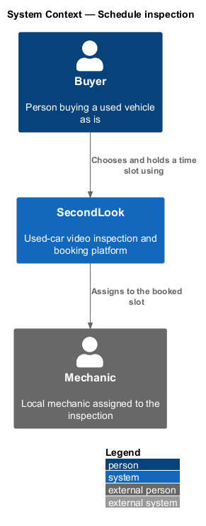
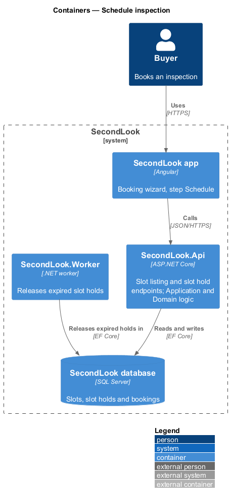
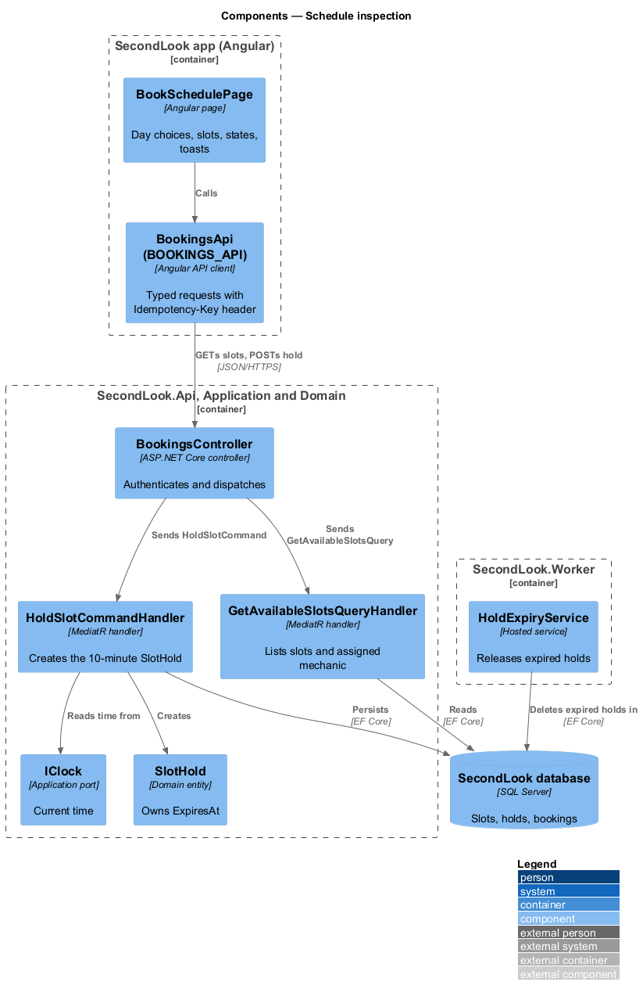
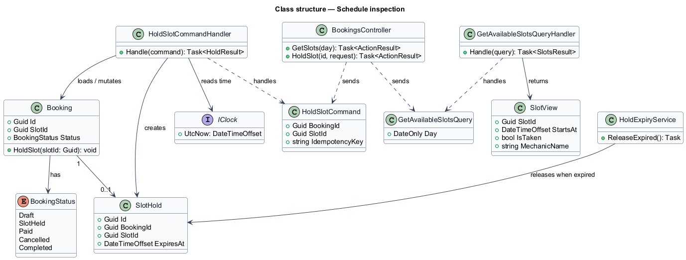
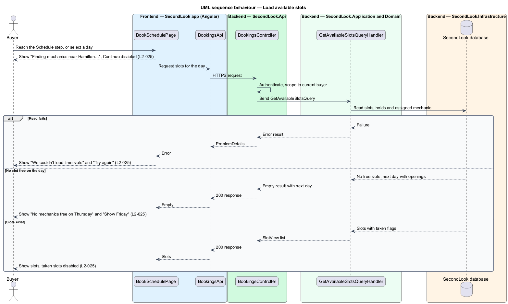
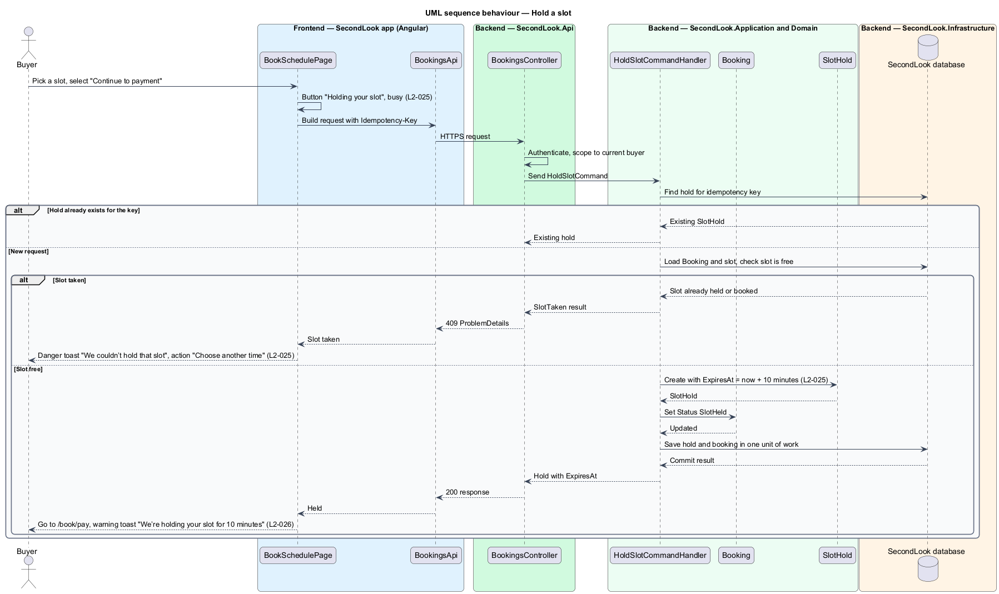
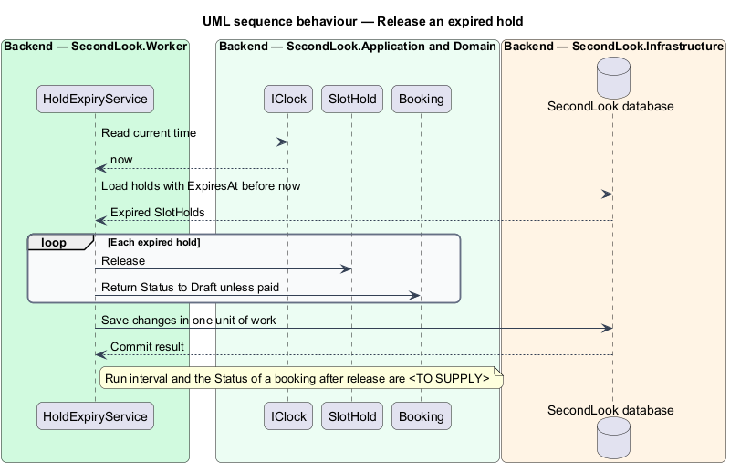

# Schedule inspection

## Overview

SecondLook is a used-car safety app for buyers purchasing a vehicle "as is" who cannot get a mechanic to the car in person. This feature covers the third booking step, "Schedule", at the route `/book/schedule`. The buyer chooses a day and a time slot with an assigned local mechanic. The seller joins the live-video call from a text link, so the page reads "Choose a time. The seller joins from a text link."

A *slot* is a bookable time on a given day for one mechanic. A *slot hold* is a temporary reservation of one slot for one booking, retained for 10 minutes so the buyer can finish paying. If the hold lapses, `SecondLook.Worker` releases the slot. If another buyer takes the slot first, the hold fails and the buyer is told in a toast.

This document assumes no prior knowledge of SecondLook internals; the diagrams show where each part lives.

## Description

The feature is a vertical slice from the Angular app to the database and a background worker. No booking code exists yet, so every component below is introduced by this design.

- **`BookSchedulePage`** — Angular page in `projects/secondlook/src/app/pages/`, routed at `/book/schedule`. It renders the day choices, the time slots for the chosen day, the assigned mechanic with a "View profile" link, the order summary, "Back" and "Continue to payment". It holds the view state: `loading`, `default`, `empty`, `error`, `submitting`.
- **`BookingsApi` / `BOOKINGS_API`** — contract and injection token in `projects/api`. The page depends on the token. The client sends the `Idempotency-Key` request header on the hold request (the header name is a design choice).
- **Toast** — a booking toast from `projects/components`. The page raises two toasts: the slot-taken failure and the hold warning.
- **`BookingsController`** — ASP.NET Core controller in `SecondLook.Api`, base route `/api/bookings`. It authenticates the caller, scopes data to the current buyer (`L2-057`), and dispatches `GetAvailableSlotsQuery` and `HoldSlotCommand`. The endpoint paths under that base are `<TO SUPPLY>`.
- **`GetAvailableSlotsQuery`** and handler — return, for a day, the slots with their availability and the assigned mechanic. The rule that assigns a mechanic, the number of day choices and the service area definition ("near Hamilton") are `<TO SUPPLY>`.
- **`HoldSlotCommand`** and **`HoldSlotCommandHandler`** — MediatR command and handler. The handler checks the slot is free, creates a `SlotHold` that expires 10 minutes after creation, and sets `Booking.Status` to `SlotHeld`. Re-posting with the same idempotency key returns the existing hold.
- **`SlotHold`** — domain entity (`Id`, `BookingId`, `SlotId`, `ExpiresAt`). `ExpiresAt` is computed from `IClock`.
- **`Booking`** — domain entity. `BookingStatus` moves from `Draft` to `SlotHeld`.
- **`IClock`** — application port for the current time, so tests control expiry.
- **`SecondLook.Worker`** — background host that releases expired slot holds so the slot returns to the available list.

State behaviour on the page:

- **Loading.** The page shows "Finding mechanics near Hamilton…" with busy placeholders, and "Continue to payment" is disabled.
- **Default.** The page lists time slots for the chosen day. Taken slots are rendered disabled. The note reads "Slots grey out when taken. The slot is held for 10 minutes once chosen."
- **Empty.** When no mechanic is free on the chosen day, the page shows "No mechanics free on Thursday" with "Everyone near Hamilton is booked that day. Fri 30 Oct has openings from 10:00 AM." and "Show Friday". The next day with openings comes from `GetAvailableSlotsQuery`.
- **Error.** When the slots fail to load, the page shows "We couldn’t load time slots" with "Check your connection and try again. Your answers so far are saved." and "Try again".
- **Submitting.** When the buyer continues, the button reads "Holding your slot" and carries `aria-busy="true"`.
- **Slot taken.** When the slot is taken before the buyer pays, a danger toast shows "We couldn’t hold that slot" with "Someone just took it. Pick another time and you won’t lose your answers." and the action "Choose another time". The action returns focus to the slot list and reloads availability.
- **Hold warning.** While a slot is held and payment is unfinished, a warning toast shows "We’re holding your slot for 10 minutes" with "Finish paying to keep Thu 29 Oct, 6:30 PM.". The date and time in the body come from the held slot. When the toast is raised and whether it reappears are `<TO SUPPLY>`; `L2-026` states only the condition and the copy.

Whether a hold is created when the buyer picks a slot or when the buyer selects "Continue to payment" is stated in two ways by `L2-025`: criterion 3 says the slot is held when chosen, and criterion 7 shows "Holding your slot" on continue. This design creates the hold on continue and treats the 10-minute period as starting at that moment. Confirmation of this reading is `<TO SUPPLY>`.

## Requirements

The feature realizes the following level-2 (L2) requirements. Each L2 requirement refines a level-1 (L1) requirement, cited by identifier.

| L2 ID | Refines (L1) | Requirement |
|-------|--------------|-------------|
| `L2-025` | `L1-005` | Book - schedule. When the buyer reaches the Schedule step, the page shall show "Choose a time. The seller joins from a text link.", day choices, time slots for the chosen day, the assigned mechanic with a "View profile" link, and "Continue to payment". Slots that are taken shall be disabled. When the buyer picks a slot, the slot shall be held for 10 minutes. While the slots are loading, the step shall show "Finding mechanics near Hamilton…" with busy placeholders and "Continue to payment" disabled. When no mechanic is free on the chosen day, the step shall show "No mechanics free on Thursday" with "Everyone near Hamilton is booked that day. Fri 30 Oct has openings from 10:00 AM." and "Show Friday". When the slots fail to load, the step shall show "We couldn’t load time slots" with "Check your connection and try again. Your answers so far are saved." and "Try again". When the buyer continues and the request runs, the button shall read "Holding your slot" and be marked busy. When a slot is taken before the buyer pays, a toast shall show "We couldn’t hold that slot" with "Someone just took it. Pick another time and you won’t lose your answers." and "Choose another time". |
| `L2-026` | `L1-005` | Slot hold warning. When a slot is held and the buyer has not finished paying, a toast shall show "We’re holding your slot for 10 minutes" with "Finish paying to keep Thu 29 Oct, 6:30 PM.". |

## Diagrams

### System context

The buyer schedules an inspection in SecondLook. The system holds the slot and, through the worker, releases it when the hold expires.

### Containers

The Angular app calls the SecondLook API. The API and the worker share the SecondLook database, which stores slots and holds.

### Components

`BookSchedulePage` calls `BookingsController`, which dispatches the slot query and the hold command. `SlotHold` expiry is computed from `IClock`, and `HoldExpiryService` in the worker releases lapsed holds.

### Class structure

`HoldSlotCommandHandler` creates a `SlotHold` for a `Booking` and moves it to `SlotHeld`. `GetAvailableSlotsQueryHandler` returns `SlotView` items.

### Behaviour — load available slots

The page requests slots for a day and renders the loading, default, empty or error state.

### Behaviour — hold a slot

The handler creates a 10-minute hold, or fails with the slot-taken result. The page then moves to payment with the warning toast, or shows the danger toast.

### Behaviour — release an expired hold

The worker releases holds whose `ExpiresAt` has passed, so the slot becomes available again.

## Implementation (J06)

Decisions are in ADR 0008. Mocks reused: `book-vehicle`, `book-review-type`, `book-schedule`, `checkout`, `booking-confirmed`, `dashboard` and `inspection-detail`.

`POST /api/bookings/holds` `{providerId,start}` (role Buyer) holds a free slot for 10 minutes (201 `{holdId,expiresAt,...}`; 409 "We couldn’t hold that slot" when it is held, booked or not offered). A buyer has one active hold; a new one releases the old. `GET /api/slots` lists only free slots (L2-061). The schedule step groups slots by Eastern day.

## Implementation (J07)

Decisions are in ADR 0009. Mocks reused: `inspection-detail`, `dialogs/reschedule` and `dialogs/cancel-inspection`.

Rescheduling reuses the slot reservation rules: the new slot is reserved as Booked first and the old reservation is deleted only after the inspection has moved (ADR 0009).
