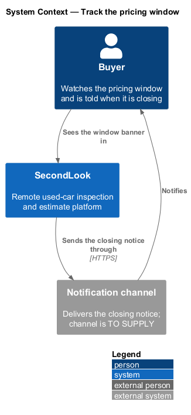
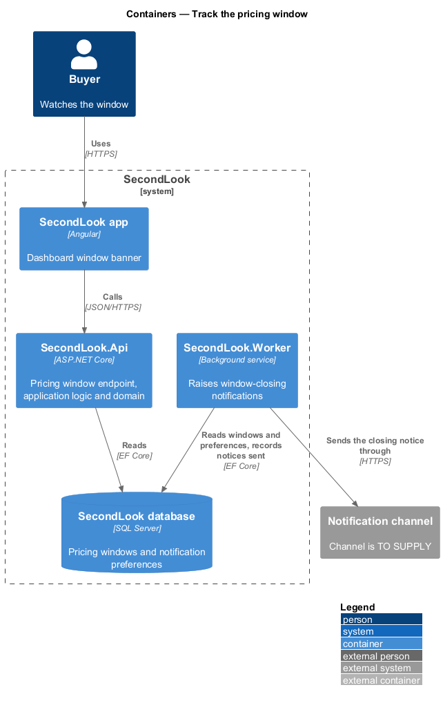
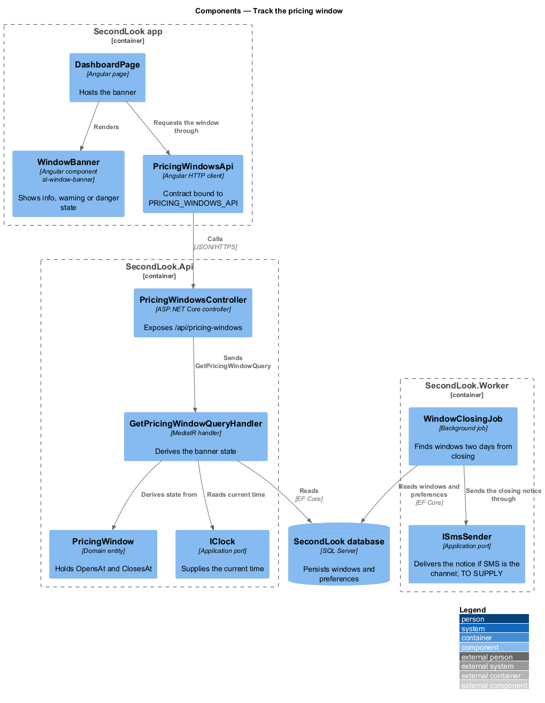
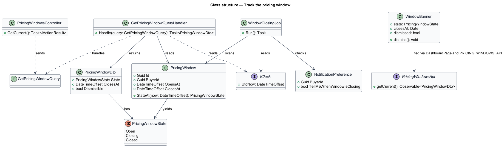
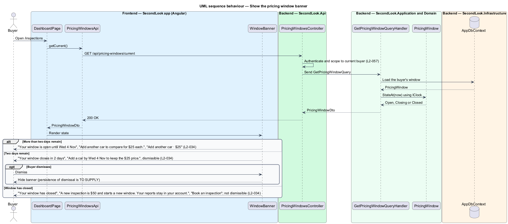
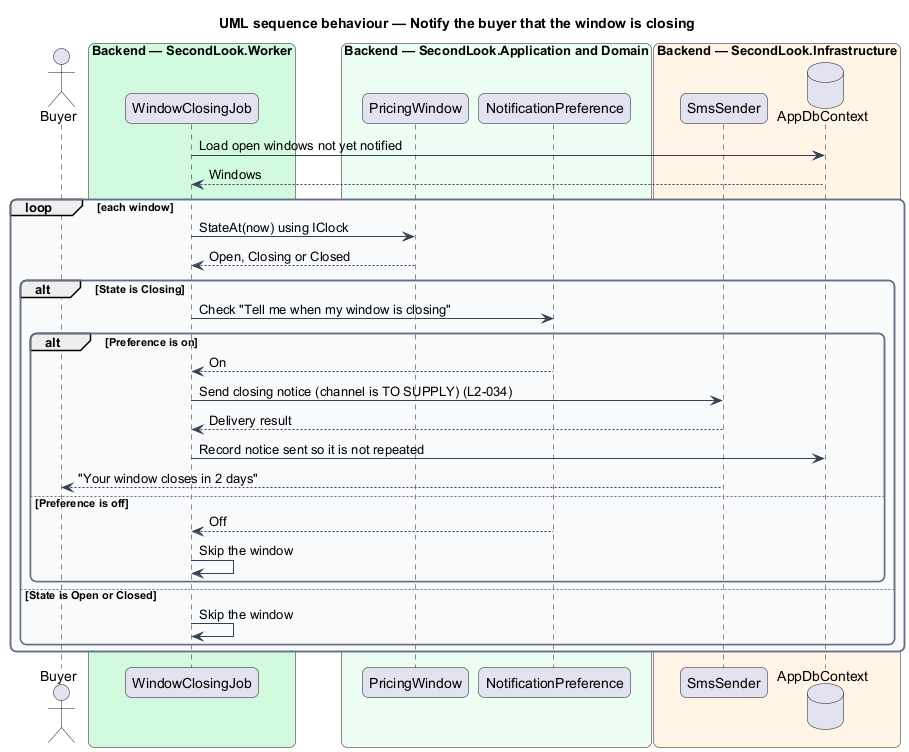

# Track the pricing window

## Overview

SecondLook prices additional vehicles at $25 while a buyer's pricing window is open. A *pricing window* is a period of fourteen days from a buyer's first booking, during which each additional vehicle costs $25 instead of $50. This feature keeps the buyer informed about the window through a banner on the dashboard and through a notice raised by the Worker.

The banner has three states derived from the time remaining: more than two days, two days, and closed. The notice reaches only buyers who turned on the preference "Tell me when my window is closing".

## Description

The feature is a vertical slice from the dashboard banner to the Worker. No pricing code exists yet, so every component below is introduced by this design.

- **`DashboardPage`** — Angular page at `/inspections`. It requests the window and hosts the banner.
- **`WindowBanner`** — shared UI component from `projects/components` with the selector `sl-window-banner`. It renders the info, warning or danger state from the state it receives. The mocks `info`, `warning`, `persistent` and `danger` under `notifications/window-expiring` show the states, and `persistent` shows the warning banner at the top of the dashboard. The `success` mock belongs to the add-another-vehicle feature.
- **`PricingWindowsApi`** — API contract in `projects/api`, bound to `PRICING_WINDOWS_API`. It returns the current window.
- **`PricingWindowsController`** — exposes `GET /api/pricing-windows/current`, a design choice. It authenticates the caller and scopes data to the current buyer (L2-057).
- **`GetPricingWindowQuery`** and **`GetPricingWindowQueryHandler`** — in `SecondLook.Application`. The handler loads the window, reads the time from `IClock` and returns a `PricingWindowDto`.
- **`PricingWindow`** and **`PricingWindowState`** — the entity holds `OpensAt` and `ClosesAt`. `StateAt(now)` returns `Open` when more than two days remain, `Closing` when two days remain, and `Closed` once `ClosesAt` has passed. The state for a remaining time between zero and two days other than exactly two days is `<TO SUPPLY>`.
- **`NotificationPreference`** — buyer setting `TellMeWhenWindowIsClosing`. Where the preference is edited is `<TO SUPPLY>`.
- **`WindowClosingJob`** — job in `SecondLook.Worker`. It scans windows whose state is `Closing`, checks the preference, sends one notice per window and records that the notice was sent. The delivery channel is `<TO SUPPLY>`. `ISmsSender` and `SmsSender` are the SMS port and adapter and apply only if SMS is chosen.

Banner copy by state:

- Open: "Your window is open until Wed 4 Nov" with "Add another car to compare for $25 each." and the action "Add another car · $25".
- Closing: "Your window closes in 2 days" with "Add a car by Wed 4 Nov to keep the $25 price." The banner is dismissible. Whether a dismissal persists across sessions is `<TO SUPPLY>`.
- Closed: "Your window has closed" with "A new inspection is $50 and starts a new window. Your reports stay in your account." and the action "Book an inspection". The banner is not dismissible.

## Requirements

The feature realizes the following level-2 (L2) requirement. It refines a level-1 (L1) requirement, cited by identifier.

| L2 ID | Refines (L1) | Requirement |
|-------|--------------|-------------|
| `L2-034` | `L1-007` | Pricing window banner. Given the window is open, when more than two days remain, the banner shall read "Your window is open until Wed 4 Nov" with "Add another car to compare for $25 each." and "Add another car · $25". Given two days remain, the banner shall read "Your window closes in 2 days" with "Add a car by Wed 4 Nov to keep the $25 price." and shall be dismissible. Given the window has closed, the banner shall read "Your window has closed" with "A new inspection is $50 and starts a new window. Your reports stay in your account." and "Book an inspection", and shall not be dismissible. Given the buyer's preference "Tell me when my window is closing" is on, when two days remain, the system shall tell the buyer. |

## Diagrams

### System context

The buyer sees the banner in SecondLook, and an external notification channel delivers the closing notice.

### Containers

The Angular app reads the window from `SecondLook.Api`. `SecondLook.Worker` reads windows and preferences from the database and sends the notice.

### Components

The dashboard requests the window through `PricingWindowsApi`, and the handler derives its state. `WindowClosingJob` scans windows independently of the API.

### Class structure

`PricingWindow` yields a `PricingWindowState` that the handler returns in `PricingWindowDto`. `WindowClosingJob` combines the window with `NotificationPreference`.

### Behaviour — show the banner

The handler derives the state from the time remaining and the banner renders the matching copy.

### Behaviour — notify the buyer

The Worker sends one notice for each window in the closing state when the preference is on.

