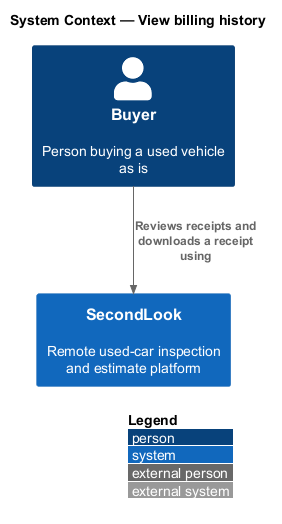
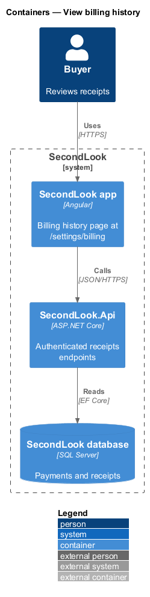
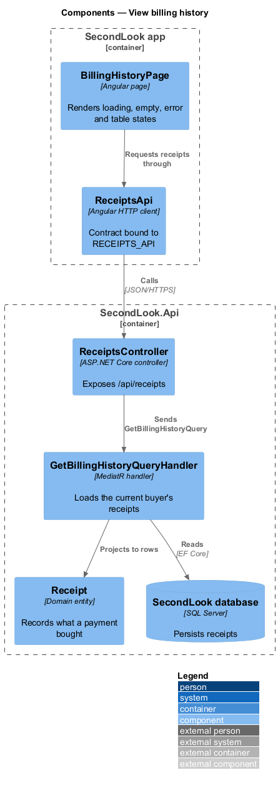
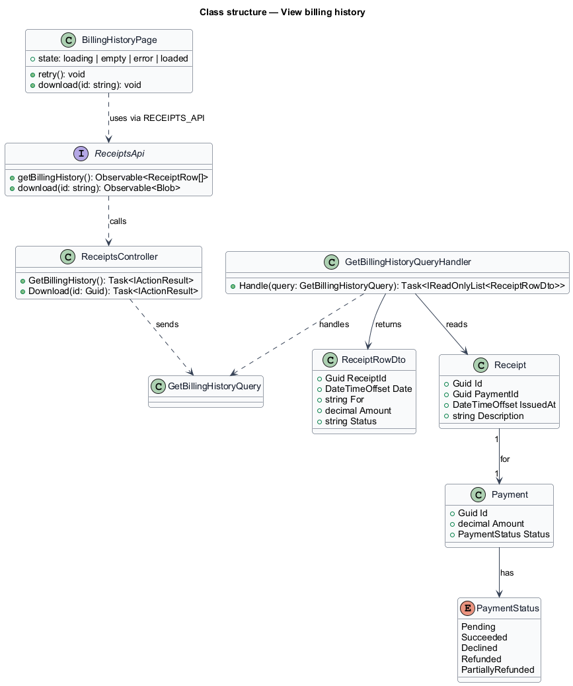
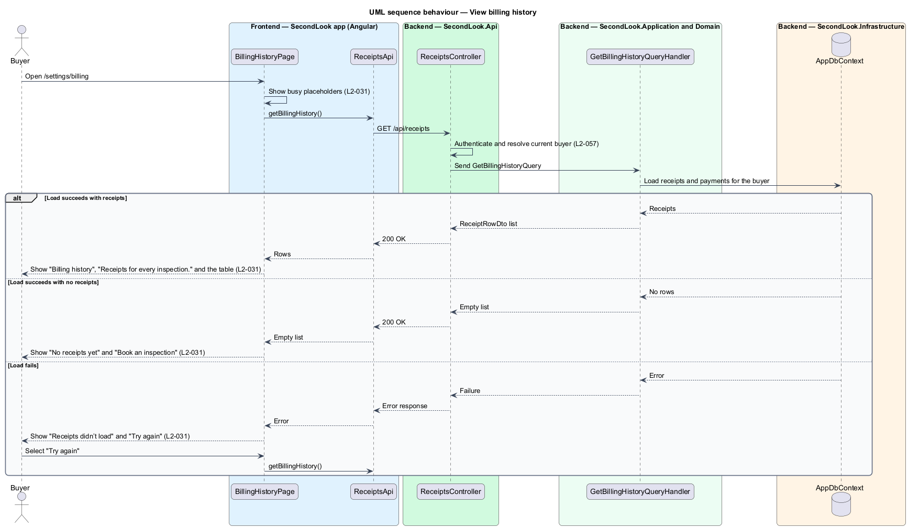
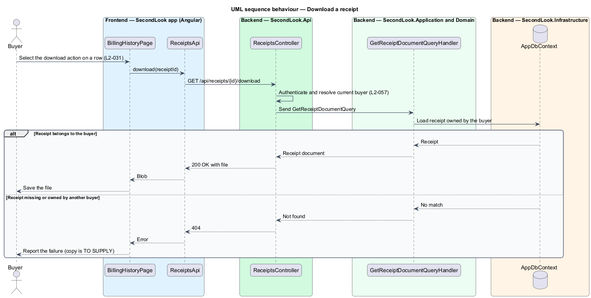

# View billing history

## Overview

SecondLook is a used-car safety platform in which a local mechanic inspects a vehicle over live video for a buyer who cannot attend in person. A *receipt* is a record, issued after a successful payment, of what the buyer bought and for how much. This feature covers the billing history screen, where a buyer reviews every receipt and downloads any one of them.

The screen lives at `/settings/billing`. It lists receipts in a table, shows busy placeholders while the request runs, and shows distinct empty and error states. Receipts are buyer-owned data, so each buyer sees only their own.

## Description

The feature is a vertical slice from the Angular app to the database. No booking or payment code exists yet, so every component below is introduced by this design.

- **`BillingHistoryPage`** — Angular page in `projects/secondlook/src/app/pages/`. It owns the loading, empty, error and loaded states and the per-row download action. It depends on the `RECEIPTS_API` injection token, not on a concrete client.
- **`ReceiptsApi`** — API contract in `projects/api`, bound to `RECEIPTS_API`. It requests the receipt list and a receipt document.
- **`ReceiptsController`** — ASP.NET Core controller in `SecondLook.Api` exposing `/api/receipts`. It authenticates the caller and dispatches queries.
- **`GetBillingHistoryQuery`** and **`GetBillingHistoryQueryHandler`** — MediatR query and handler in `SecondLook.Application`. The handler loads the current buyer's receipts and projects each to a `ReceiptRowDto` carrying Date, For, Amount and Status.
- **`Receipt`** — domain entity holding `Id`, `PaymentId`, `IssuedAt` and `Description`. `Description` is the text shown in the For column, for example "additional vehicle + body shop".
- **`Payment`** and **`PaymentStatus`** — the payment a receipt belongs to. The Status column reads "Paid" for a receipt whose payment has succeeded.
- **`GetReceiptDocumentQuery`** — query that returns the downloadable receipt for one row. The route `/api/receipts/{id}/download` is a design choice. The document format is `<TO SUPPLY>`.

The handler filters by the current buyer identifier, so other buyers' receipts are never returned (L2-057). A request for a receipt owned by another buyer returns not found. The copy shown when a download fails is `<TO SUPPLY>`.

## Requirements

The feature realizes the following level-2 (L2) requirement. It refines a level-1 (L1) requirement, cited by identifier.

| L2 ID | Refines (L1) | Requirement |
|-------|--------------|-------------|
| `L2-031` | `L1-006` | Billing history. Given a buyer with receipts, when they open billing history, the page shall show "Billing history", "Receipts for every inspection." and a table with Date, For, Amount, Status and a download action per row. Given a receipt, the status shall read "Paid" and the "For" column shall say what was bought, for example "additional vehicle + body shop". Given no receipts, when the page loads, it shall show "No receipts yet" with "Receipts appear here after your first booking." and "Book an inspection". Given receipts fail to load, when the page loads, it shall show "Receipts didn’t load" with "Your payments are safe. Try again." and "Try again". While loading, the page shall show busy placeholders. |

## Diagrams

### System context

The buyer reviews and downloads receipts through SecondLook. No external system takes part in this slice.

### Containers

The Angular app calls `SecondLook.Api`, which reads receipts and payments from the database.

### Components

`BillingHistoryPage` requests receipts through `ReceiptsApi`. `ReceiptsController` sends `GetBillingHistoryQuery` to its handler, which reads `Receipt` rows.

### Class structure

The handler reads `Receipt` and its `Payment` and returns `ReceiptRowDto` items. The page reaches the controller only through `ReceiptsApi`.

### Behaviour — view billing history

The page shows busy placeholders, requests the list, and then renders the table, the empty state or the error state with "Try again".

### Behaviour — download a receipt

The download action requests the receipt document for one row. The controller returns not found for a receipt that does not belong to the current buyer.

