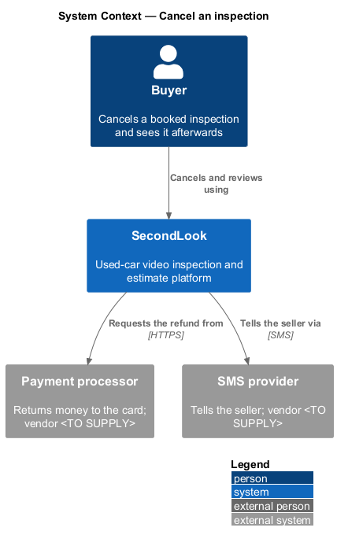
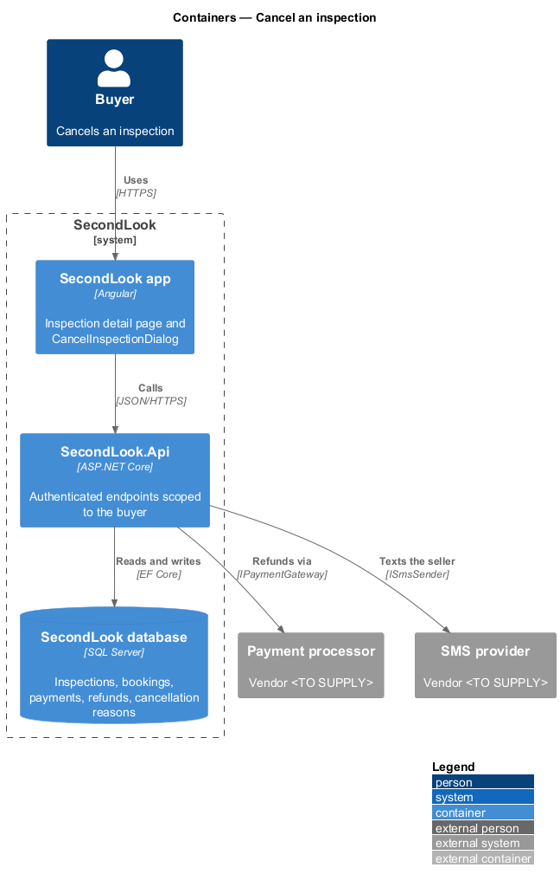
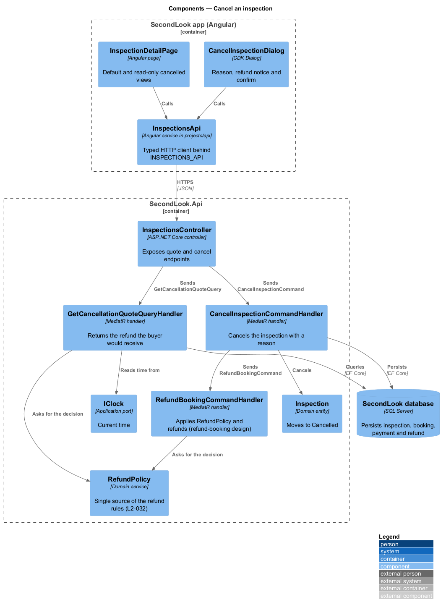
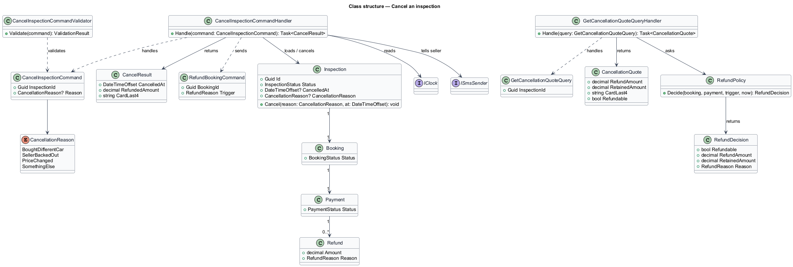
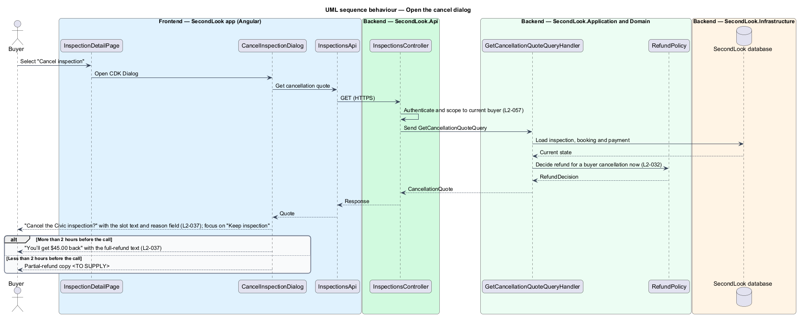
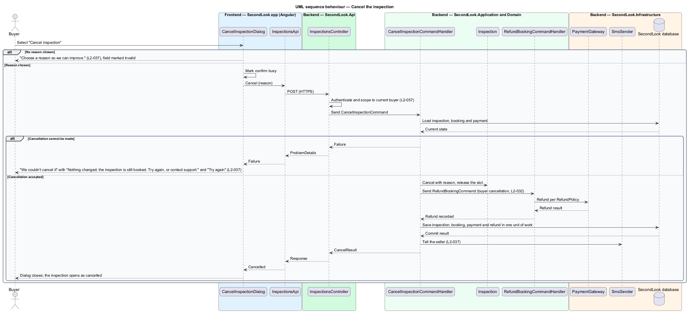
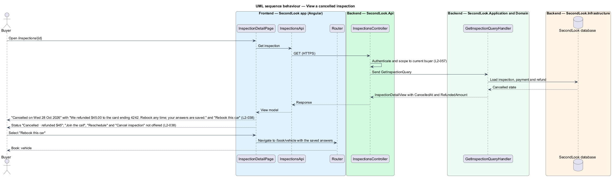

# Cancel an inspection

## Overview

SecondLook is a used-car safety app for buyers purchasing a vehicle "as is". *Cancelling* is the ending of a booked inspection by the buyer before the call. The buyer opens the dialog from the inspection detail by selecting "Cancel inspection", gives a reason and confirms. The mechanic slot is released and the seller is told. The money returned is set by the refund policy.

A *cancelled inspection* is an inspection in the status `Cancelled`. The inspection detail then renders as a read-only page that shows the cancellation and the refund, and offers "Rebook this car".

Mocks: the `cancel-inspection` dialog in four states (default, invalid, busy, failed) and the `inspection-detail` read-only state. This document assumes no prior knowledge of SecondLook internals.

## Description

The feature is a vertical slice from the Angular dialog through the refund to the payment processor. No inspection code exists yet, so every component below is introduced by this design.

- **`CancelInspectionDialog`** — Angular dialog in `projects/secondlook/src/app/dialogs/`, opened with the Angular CDK Dialog from `InspectionDetailPage`. It holds the reason field, the refund notice and the actions "Keep inspection" and "Cancel inspection". "Keep inspection" receives focus when the dialog opens.
- **`InspectionDetailPage`** — the page of `view-inspection`. For a cancelled inspection it renders the read-only variant of the mock.
- **`InspectionsApi` / `INSPECTIONS_API`** — contract and injection token in `projects/api`.
- **`InspectionsController`** — controller in `SecondLook.Api`. It scopes data to the current buyer (`L2-057`). The cancel endpoint is `POST /api/bookings/{id}/cancel` in the refund design, which this design reuses; whether the dialog calls it directly or through an `InspectionsController` action is `<TO SUPPLY>`.
- **`GetCancellationQuoteQuery`** and handler — return the refund the buyer would receive now, taken from `RefundPolicy`, so that the dialog can show the refund notice before confirmation.
- **`CancelInspectionCommand`**, **`CancelInspectionCommandValidator`** and **`CancelInspectionCommandHandler`** — the validator requires a reason. The handler calls `Inspection.Cancel`, releases the slot, sends `RefundBookingCommand` with a buyer-cancellation trigger, saves the results in one unit of work and texts the seller.
- **`CancellationReason`** — enumeration of the four reasons: "I bought a different car", "The seller backed out", "The price changed", "Something else". The names `BoughtDifferentCar`, `SellerBackedOut`, `PriceChanged` and `SomethingElse` are a design choice. The reason is stored on `Inspection`.
- **`RefundPolicy`** and **`RefundBookingCommandHandler`** — defined in the `booking-pricing/refund-booking` design, which this design does not change. The policy has five rules: a full refund when the buyer cancels more than 2 hours before the call, $25 back and $25 retained when the buyer cancels less than 2 hours before the call, and no refund once a report is delivered. The records are `Refund`, `RefundReason` (`BuyerCancelledEarly`, `BuyerCancelledLate`) and `PaymentStatus` (`Refunded`, `PartiallyRefunded`).
- **`IPaymentGateway`** and **`ISmsSender`** — ports. The processor and the SMS vendor are `<TO SUPPLY>`.

State behaviour of the dialog:

- **Default.** The dialog asks "Cancel the Civic inspection?" with "Dev Patel’s slot on Thu 29 Oct, 6:30 PM will be released and Sam Whitaker will be told." The field "Why are you cancelling?" offers "Choose a reason", "I bought a different car", "The seller backed out", "The price changed" and "Something else". For a cancellation more than 2 hours before the call, the notice "You’ll get $45.00 back" reads "Cancelling more than 2 hours before the call is a full refund to the card ending 4242, usually within 3 business days." The amount comes from the `Payment` record.
- **Invalid.** When no reason is chosen and the buyer cancels, the dialog shows "Choose a reason so we can improve." and marks the field `aria-invalid="true"`. The dialog sends no request.
- **Busy.** While the request runs, the confirm button is marked `aria-busy="true"`.
- **Failed.** When the cancellation cannot be made, the dialog shows "We couldn’t cancel it" with "Nothing changed; the inspection is still booked. Try again, or contact support." and "Try again".

State behaviour of the cancelled inspection:

- The page shows "Cancelled on Wed 28 Oct 2026" with "We refunded $45.00 to the card ending 4242. Rebook any time; your answers are saved." and the button "Rebook this car". "Rebook this car" opens `/book/vehicle`; how the saved answers prefill the form is `<TO SUPPLY>`.
- The status reads "Cancelled · refunded $45". "Join the call", "Reschedule" and "Cancel inspection" are not offered.
- The mock rounds the refunded amount in the status to whole dollars while the message shows "$45.00". The rounding rule for amounts that are not whole dollars is `<TO SUPPLY>`.

Open points: the dialog copy for a cancellation less than 2 hours before the call, the outcome at exactly 2 hours, and the copy for a booking that is no longer refundable are `<TO SUPPLY>`, consistent with the open points of the refund design. The mock shows a payment of $45.00 where the pricing rules state $50 for a first inspection; the reconciliation is `<TO SUPPLY>`.

## Requirements

The feature realizes the following level-2 (L2) requirements. Each L2 requirement refines a level-1 (L1) requirement, cited by identifier.

| L2 ID | Refines (L1) | Requirement |
|-------|--------------|-------------|
| `L2-037` | `L1-008` | Cancel an inspection. When the buyer selects "Cancel inspection" on a scheduled inspection, a dialog shall ask "Cancel the Civic inspection?" with "Dev Patel’s slot on Thu 29 Oct, 6:30 PM will be released and Sam Whitaker will be told." and a required reason from "I bought a different car", "The seller backed out", "The price changed" and "Something else". When the dialog opens, "Keep inspection" shall have focus. When no reason is chosen and the buyer cancels, the dialog shall show "Choose a reason so we can improve.". When the cancellation is more than 2 hours before the call, the dialog shall show "You’ll get $45.00 back" with "Cancelling more than 2 hours before the call is a full refund to the card ending 4242, usually within 3 business days.". When the cancellation cannot be made, the dialog shall show "We couldn’t cancel it" with "Nothing changed; the inspection is still booked. Try again, or contact support." and "Try again". |
| `L2-038` | `L1-008` | Cancelled inspection. When the buyer opens a cancelled inspection, the page shall show "Cancelled on Wed 28 Oct 2026" with "We refunded $45.00 to the card ending 4242. Rebook any time; your answers are saved." and "Rebook this car". The status shall read "Cancelled · refunded $45". "Join the call", "Reschedule" and "Cancel inspection" shall not be offered. |

## Diagrams

### System context

The buyer cancels in SecondLook. SecondLook asks the payment processor to refund and texts the seller through the SMS provider.

### Containers

The Angular app calls `SecondLook.Api`, which writes the cancellation and refund to the database and calls the processor and the SMS provider.

### Components

`CancelInspectionCommandHandler` cancels the `Inspection` and sends `RefundBookingCommand`. `RefundPolicy` supplies the decision for both the quote and the refund.

### Class structure

`CancelInspectionCommandHandler` applies a `CancellationReason` to `Inspection` and triggers the refund. `GetCancellationQuoteQueryHandler` returns a `CancellationQuote` from `RefundPolicy`.

### Behaviour — open the dialog

The dialog loads the quote and shows the full-refund notice, with focus on "Keep inspection".

### Behaviour — cancel the inspection

The dialog shows the invalid state with no reason, the failed state when the cancellation cannot be made, or closes after the refund.

### Behaviour — view a cancelled inspection

The detail page shows the cancellation, the refund and "Rebook this car", and withholds the call actions.

## Implementation (J07)

Decisions are in ADR 0009. Mocks reused: `inspection-detail`, `dialogs/reschedule` and `dialogs/cancel-inspection`.

`POST /api/inspections/{id}/cancel` `{reason}` (role Buyer, own inspection; reasons DifferentCar, SellerBackedOut, PriceChanged, Other; 400 when missing) cancels once: a conditional update picks the winner, who releases the slot and refunds through `RefundPaymentCommand` (full when more than 2 hours before the call, otherwise minus the $25 fee). A repeated or simultaneous request returns the cancelled inspection without another refund. The inspection reports `refundPreviewCents`, `cardLast4`, `cancelledAt`, `refundedCents` and `retainedCents`.
