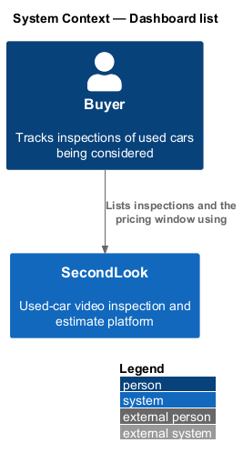
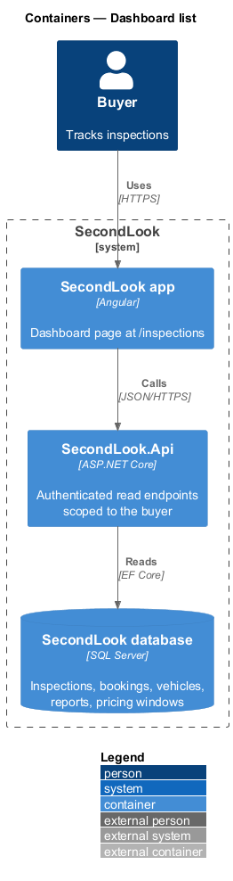
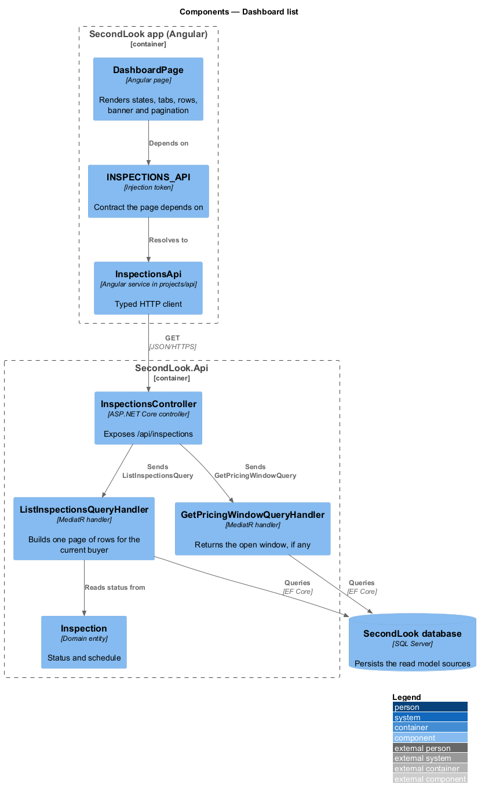
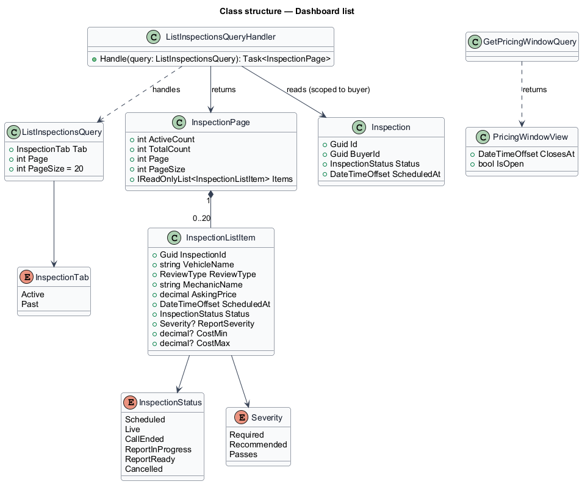
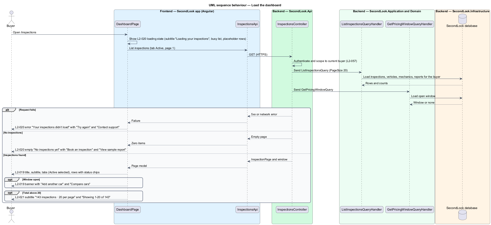
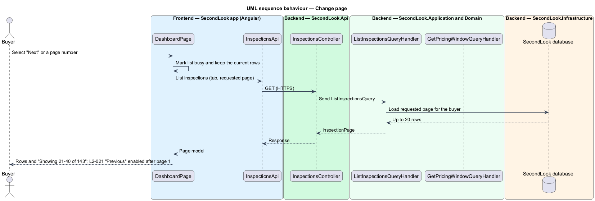
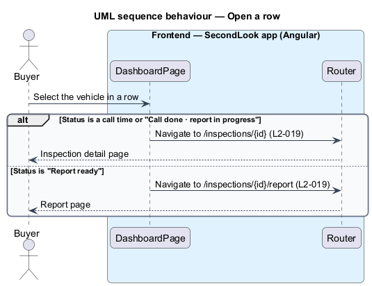

# Dashboard list

## Overview

SecondLook is a used-car safety app for buyers purchasing a vehicle "as is". The *dashboard* is the home screen of the buyer at `/inspections`, titled "Your inspections". It lists the inspections of the buyer, shows the state of the pricing window, and starts a new booking.

A *pricing window* is the period of fourteen days from the first booking of a buyer during which each additional vehicle costs $25. A *status chip* is the short label on a row that names where the inspection stands: the call time, "Report ready", or "Call done · report in progress".

The mock set covers six states: default, loading, empty, error, long and edge. This document assumes no prior knowledge of SecondLook internals.

## Description

The feature is a read-only vertical slice from the Angular app to the database. No inspection code exists yet, so every component below is introduced by this design.

- **`DashboardPage`** — Angular page in `projects/secondlook/src/app/pages/`, routed at `/inspections`. It holds the view state `loading`, `default`, `empty` and `error`, and renders the tabs, the rows, the window banner and the pagination.
- **`InspectionsApi` / `INSPECTIONS_API`** — contract and injection token in `projects/api`. The page depends on the token.
- **`InspectionsController`** — ASP.NET Core controller in `SecondLook.Api`, base route `/api/inspections`. It authenticates the caller, scopes data to the current buyer (`L2-057`) and dispatches `ListInspectionsQuery` and `GetPricingWindowQuery`. The query-string names (tab, page) are a design choice, and the final endpoint paths are `<TO SUPPLY>`.
- **`ListInspectionsQuery`** and **`ListInspectionsQueryHandler`** — return one `InspectionPage`: the items of the tab, the active count, the total, the page number and the page size of 20. The handler joins `Inspection`, `Booking`, `Vehicle`, the assigned `Provider` and the latest `Report`, and returns only the inspections of the current buyer.
- **`GetPricingWindowQuery`** — returns the open `PricingWindow` and its closing date, or none. The window rules belong to the booking-pricing subsystem.

State behaviour on the page:

- **Default.** The page shows "Your inspections", a subtitle such as "3 active · window open until Wed 4 Nov 2026" and the button "Book an inspection". The tabs "Active" with a count and "Past" appear with "Active" selected. Each row shows the vehicle, the review type, the mechanic or the estimate, the asking price and the status chip.
- **Window banner.** When a window is open, the banner "Your window is open until Wed 4 Nov 2026" reads "Add another car to compare for $25. After that, a new window starts at $50." with the links "Add another car" and "Compare cars". The mock note states that the banner switches to a warning two days before the window ends. `L2-019` does not state that behaviour, so its owner is `<TO SUPPLY>`.
- **Loading.** The subtitle reads "Loading your inspections" and the list carries `aria-busy="true"` with placeholder rows.
- **Empty.** The page shows "No inspections yet" with "Book a mechanic to look at a car over video. Your first inspection is $50 and you get a cost estimate within an hour." and the buttons "Book an inspection" and "View sample report". The target of "View sample report" is `<TO SUPPLY>`.
- **Error.** The page shows "Your inspections didn’t load" with "This is on our side. Your bookings are safe. Try again, or check back in a minute." and the buttons "Try again" and "Contact support". The target of "Contact support" is `<TO SUPPLY>`.
- **Long list.** With 143 inspections the page shows 20 rows, the subtitle "143 inspections · 20 per page" and the pagination "Showing 1–20 of 143". On the first page "Previous" is disabled and "Next" is enabled.
- **Edge.** Long vehicle and mechanic names stay inside the row without breaking the layout. The mock shows a Mercedes-Benz row with a long trim name, a long mechanic name and the status "Required: $12,480–$18,960". The edge mock subtitle reads "1,284 inspections in this window", which differs from the long-list subtitle. The rule that selects between the two subtitles is `<TO SUPPLY>`.
- **Status from the report.** A row with a delivered report shows "Required: " followed by the cost range when any finding is `Required`, "Recommended" when the worst finding is `Recommended`, and "Passes" otherwise.
- **Navigation.** Selecting the vehicle of a scheduled or in-progress row opens `/inspections/{id}`. Selecting a row with a report ready opens `/inspections/{id}/report`.

Open points: the sort order of the rows, and the rule that decides which inspections are "Active" and which are "Past", are `<TO SUPPLY>`. The `inspection-history` design depends on the second rule.

## Requirements

The feature realizes the following level-2 (L2) requirements. Each L2 requirement refines a level-1 (L1) requirement, cited by identifier.

| L2 ID | Refines (L1) | Requirement |
|-------|--------------|-------------|
| `L2-019` | `L1-004` | Dashboard list. When a buyer with active inspections opens the dashboard, it shall show "Your inspections", a subtitle with the number of active inspections and the window end, for example "3 active · window open until Wed 4 Nov 2026", and the button "Book an inspection". When the page loads, it shall show the tabs "Active" with a count and "Past", with "Active" selected. When the list shows, each row shall show the vehicle, the review type, the mechanic or the estimate, the asking price, and a status chip: the call time, "Report ready", or "Call done · report in progress". When the buyer selects the vehicle on a row for a scheduled or in-progress inspection, the system shall go to the inspection detail; for a row with a report ready, the system shall go to the report. When a window is open and the dashboard loads, the banner "Your window is open until Wed 4 Nov 2026" shall show "Add another car to compare for $25. After that, a new window starts at $50." with the links "Add another car" and "Compare cars". |
| `L2-020` | `L1-004` | Dashboard loading, empty and error states. While the inspections are loading, the subtitle shall read "Loading your inspections" and the list shall be marked busy with placeholder rows. When a buyer with no inspections loads the dashboard, it shall show "No inspections yet" with "Book a mechanic to look at a car over video. Your first inspection is $50 and you get a cost estimate within an hour." and the buttons "Book an inspection" and "View sample report". When the inspections fail to load, the dashboard shall show "Your inspections didn’t load" with "This is on our side. Your bookings are safe. Try again, or check back in a minute." and the buttons "Try again" and "Contact support". |
| `L2-021` | `L1-004` | Long inspection lists. When a buyer with 143 inspections loads the dashboard, it shall show 20 per page, the subtitle "143 inspections · 20 per page" and the pagination "Showing 1–20 of 143". When the first page shows, "Previous" shall be disabled and "Next" shall be enabled. When a vehicle or mechanic name is very long, the row shall remain readable without breaking the layout. For a report with required repairs the row status shall read "Required: " followed by the cost range; for recommended repairs, "Recommended"; for none, "Passes". |

## Diagrams

### System context

The buyer uses SecondLook to list inspections and to see the pricing window.

### Containers

The Angular app reads from `SecondLook.Api`, which reads the SecondLook database. The slice has no write path and no worker.

### Components

`DashboardPage` depends on `INSPECTIONS_API`. `InspectionsController` dispatches the list query and the pricing window query.

### Class structure

`ListInspectionsQueryHandler` returns an `InspectionPage` of at most 20 `InspectionListItem` values. The report severity and cost range drive the row status.

### Behaviour — load the dashboard

The page shows loading, then the default, empty or error state, and the window banner and pagination when they apply.

### Behaviour — change page

Selecting "Next", "Previous" or a page number requests that page and updates the range text.

### Behaviour — open a row

The status of the row decides whether the vehicle link opens the inspection or the report.

## Implementation (J06)

Decisions are in ADR 0008. Mocks reused: `book-vehicle`, `book-review-type`, `book-schedule`, `checkout`, `booking-confirmed`, `dashboard` and `inspection-detail`.

`GET /api/inspections` (roles Buyer, Mechanic, BodyShop) returns the caller's inspections only: buyers their own, providers those assigned to them. The dashboard shows them with an Active tab, the call time as the status chip, and an empty state with "Book an inspection".

## Implementation notes (J14)

Delivered as the reworked `InspectionsPage` (L2-019 to L2-021, L2-083, [ADR 0016](../../../adr/0016-inspection-history.md)). The list is read a page at a time (`GET /api/inspections/history`), with both tab counts in every response; the subtitle shows the active count and the window end, or "N inspections · 20 per page" for a long list, with "Showing 1–20 of N" and Previous and Next. Loading shows placeholder rows and "Loading your inspections"; no inspections shows the welcome with "Book an inspection" and "View sample report" (`/sample-report`); a failed load shows "Your inspections didn’t load" with "Try again" and "Contact support". Differences from the mock: delivered reports are listed under Past, so the Active count excludes them, and rows show the VIN rather than make and model.
