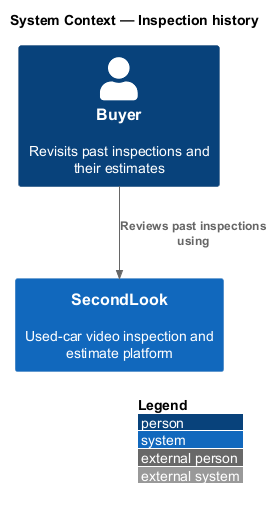
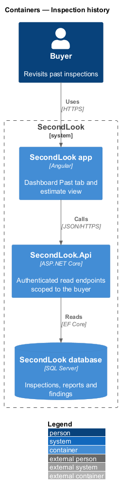
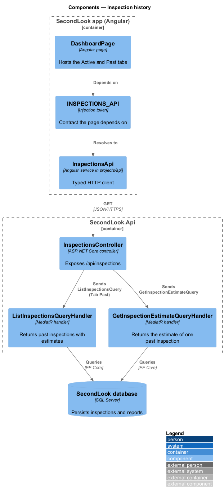
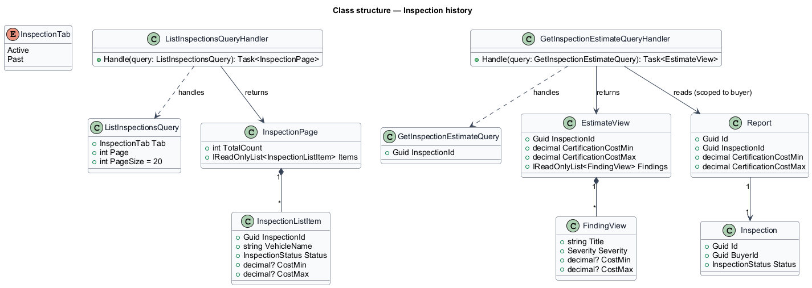
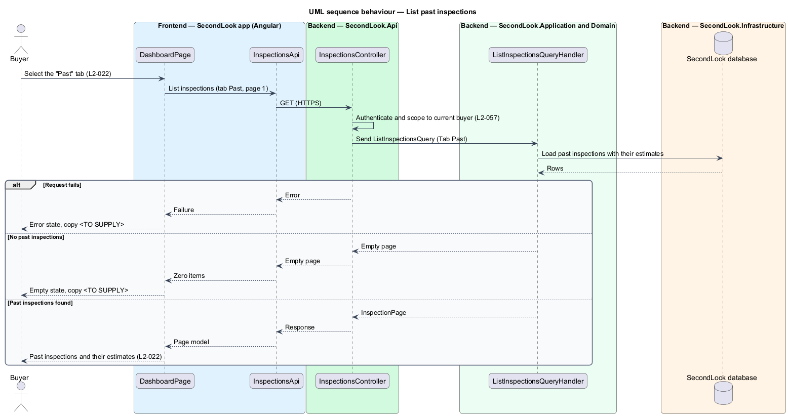
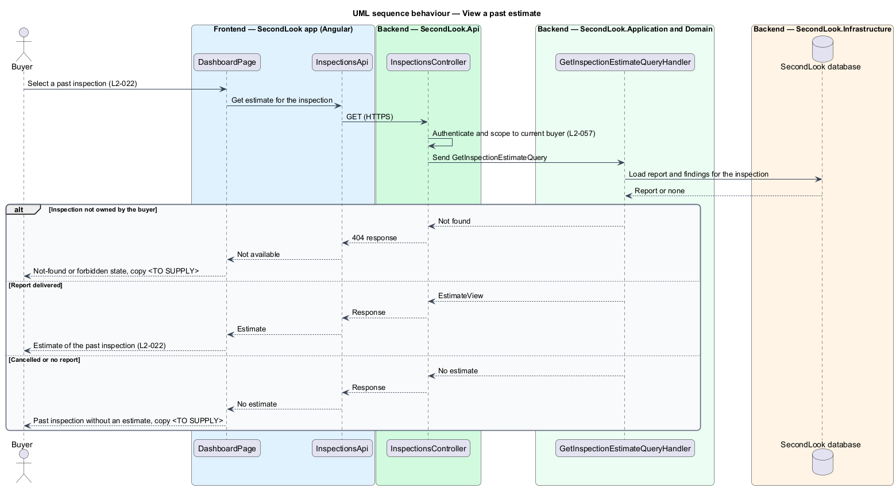

# Inspection history

## Overview

SecondLook is a used-car safety app for buyers purchasing a vehicle "as is". *Inspection history* is the record of the inspections that a buyer has finished with, listed under the "Past" tab of the dashboard at `/inspections`, so that the buyer can revisit each past inspection and its estimate. The user journey "Review inspection history" states the goal as "Buyer revisits past inspections and their estimates."

No mock exists for the Past tab. This design rests on `L2-022` and `docs/user-journeys.md` only. Every detail that neither states is marked `<TO SUPPLY>`, and the design adds no screen, field or rule beyond them.

## Description

The feature extends the dashboard slice (`dashboard-list`) with a second tab and a read path for one estimate. No inspection code exists yet, so every component below is introduced by this design.

- **`DashboardPage`** — the Angular page of `dashboard-list`. Selecting the "Past" tab requests the past inspections through `INSPECTIONS_API`. The tab control, the tab count and the selected state are shared with `L2-019`.
- **`InspectionsApi` / `INSPECTIONS_API`** — contract and injection token in `projects/api`.
- **`InspectionsController`** — controller in `SecondLook.Api`, base route `/api/inspections`. It scopes data to the current buyer (`L2-057`).
- **`ListInspectionsQuery`** with `Tab = Past` and **`ListInspectionsQueryHandler`** — return the past inspections of the buyer with their estimates. The handler is the one used for the Active tab. The rule that makes an inspection "past" is `<TO SUPPLY>`; the candidates are the statuses `ReportReady` and `Cancelled`, and the elapsed time since delivery.
- **`GetInspectionEstimateQuery`** and **`GetInspectionEstimateQueryHandler`** — return the estimate of one inspection: the certification cost range from `Report` and its findings. The handler returns not-found for an inspection that the current buyer does not own.

Behaviour stated by `L2-022`:

- **List.** When the buyer selects the "Past" tab, the page lists past inspections and their estimates.
- **Estimate.** When the buyer selects a past inspection, the page shows its estimate. Whether the estimate opens the report at `/inspections/{id}/report`, the inspection detail, or a new screen is `<TO SUPPLY>`.

Gaps with no specified copy or rule, all `<TO SUPPLY>`:

- the columns shown on a past row, and whether the row format matches the Active rows;
- the sort order and the page size of the Past tab;
- the loading, empty and error copy of the Past tab;
- the display of a cancelled inspection, which has no estimate, in the list;
- the retention period of past inspections.

## Requirements

The feature realizes the following level-2 (L2) requirement. It refines a level-1 (L1) requirement, cited by identifier.

| L2 ID | Refines (L1) | Requirement |
|-------|--------------|-------------|
| `L2-022` | `L1-004` | Inspection history. When a buyer with past inspections selects the "Past" tab, the system shall list the past inspections and their estimates. When the buyer selects a past inspection, the system shall show its estimate. |

## Diagrams

### System context

The buyer reviews past inspections through SecondLook.

### Containers

The Angular app reads past inspections and estimates from `SecondLook.Api`, which reads the SecondLook database. The slice has no write path.

### Components

`DashboardPage` calls `InspectionsController`, which dispatches the list query for the Past tab and the estimate query.

### Class structure

`ListInspectionsQueryHandler` returns an `InspectionPage`. `GetInspectionEstimateQueryHandler` reads a `Report` and returns an `EstimateView`.

### Behaviour — list past inspections

Selecting the "Past" tab requests the past inspections. The page shows the list, or the empty or error state with copy to be supplied.

### Behaviour — view a past estimate

Selecting a past inspection loads its estimate. A cancelled inspection or a missing report yields no estimate.

## Implementation notes (J14)

The `<TO SUPPLY>` items are decided in [ADR 0016](../../../adr/0016-inspection-history.md) (L2-022, L2-083). The Past tab is the same page and the same read as the Active tab: `GET /api/inspections/history?tab=Past&page=N` through `BOOKINGS_API.history`. Past holds cancelled inspections and ones whose review is delivered, newest first, 20 to a page; a delivered row reads "Report ready" with the estimate summary and opens its report; a cancelled row reads "Cancelled" and opens the inspection, which still shows the car and the refund it was booked with. The tab and page are in the address, so Back returns to the same place. An empty Past tab says "No past inspections yet. Finished and cancelled inspections show up here.".
