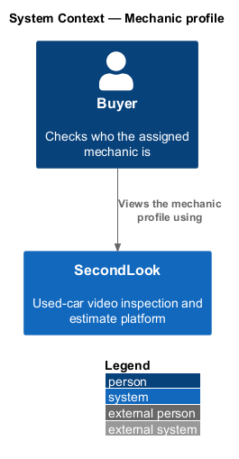
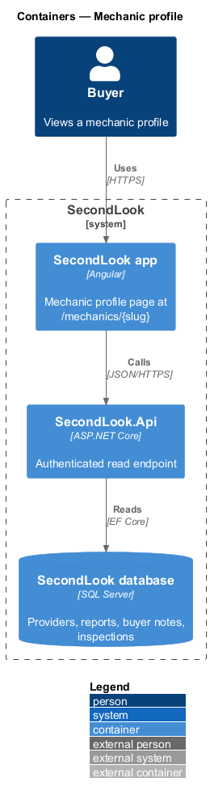
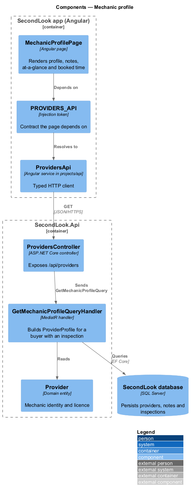
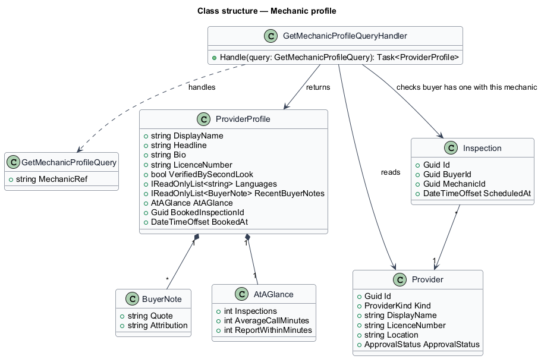
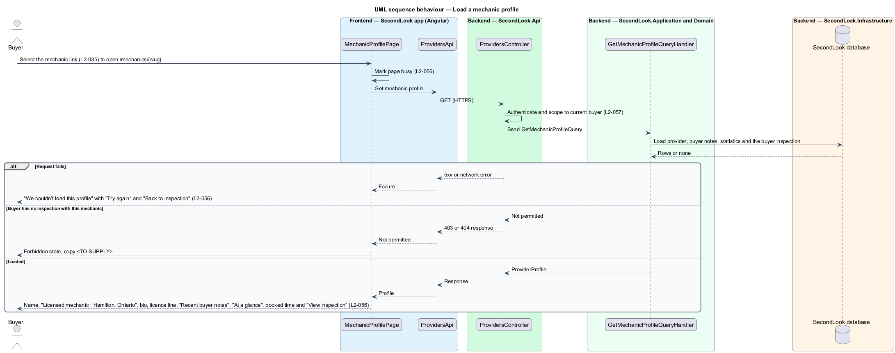
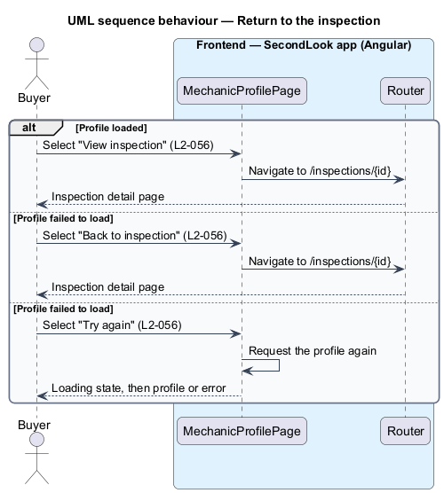

# Mechanic profile

## Overview

SecondLook is a used-car safety app for buyers purchasing a vehicle "as is". The *mechanic profile* is the page at `/mechanics/{slug}` that tells a buyer who the assigned mechanic is: the name, the credentials, the recent feedback from other buyers and a summary of the work done. The mock route is `/mechanics/dev-patel`. The buyer reaches the page from the mechanic link in "Your team" on the inspection detail, and from the "View profile" link on the schedule step.

A *buyer note* is a short quotation from a previous buyer about a mechanic, shown with the buyer's first name and initial and the vehicle.

The mock set covers default, loading and error. The mock manifest records that an empty state does not apply, because a profile always has content once a mechanic is assigned. This document assumes no prior knowledge of SecondLook internals.

## Description

The feature is a read-only vertical slice from the Angular app to the database. No provider code exists yet, so every component below is introduced by this design.

- **`MechanicProfilePage`** — Angular page in `projects/secondlook/src/app/pages/`, routed at `/mechanics/{slug}`. The slug in the mock is `dev-patel`; the rule that forms the slug is `<TO SUPPLY>`. The page holds the view state `loading`, `default` and `error`.
- **`ProvidersApi` / `PROVIDERS_API`** — contract and injection token in `projects/api`. The page depends on the token.
- **`ProvidersController`** — controller in `SecondLook.Api`, base route `/api/providers`. It authenticates the caller. The endpoint path is `<TO SUPPLY>`.
- **`GetMechanicProfileQuery`** and **`GetMechanicProfileQueryHandler`** — return the `ProviderProfile` read model for a buyer who has an inspection with that mechanic. The handler reads `Provider`, the buyer notes, the statistics and the inspection of the buyer.
- **`ProviderProfile`** — read model holding the display name, the headline, the bio, the licence number, the verification flag, the languages, the recent buyer notes, the at-a-glance figures, and the booked inspection and time.
- **Access.** `L2-056` applies to a buyer with an inspection. The handler returns not-found or forbidden for a buyer without an inspection with the mechanic. The behaviour for that case, and the copy, are `<TO SUPPLY>` with respect to `L1-014`.

State behaviour on the page:

- **Default.** The page shows the name, "Licensed mechanic · Hamilton, Ontario" and the bio. The line "Licence 310S · Verified by SecondLook · English, Gujarati" follows. The section "Recent buyer notes" lists the quotations with attribution, for example "Told me the brakes were due before I paid." with "Priya S. · 2013 Honda Fit · $480 saved on the price". The section "At a glance" shows Inspections (412 in the mock), Average call (22 min) and Report within (60 min). The page shows "Booked with Dev for Thu 29 Oct 2026, 6:30 PM." and the button "View inspection".
- **Loading.** The page is marked busy with `aria-busy="true"`. The loading layout is `<TO SUPPLY>`.
- **Error.** The page keeps the navigation and shows "We couldn’t load this profile" with "The mechanic’s details didn’t come through. Your booking is safe. Try again in a moment." and the buttons "Try again" and "Back to inspection".
- **Navigation.** "View inspection" and "Back to inspection" open `/inspections/{id}` for the booked inspection. "Try again" requests the profile again.

Open points: the source and the calculation of the at-a-glance figures, the moderation and selection rules of buyer notes, the number of notes shown, the source of the bio and the languages, the meaning of "Verified by SecondLook" and the licence verification process are `<TO SUPPLY>`. The profile of a body shop reviewer has no mock and is `<TO SUPPLY>`.

## Requirements

The feature realizes the following level-2 (L2) requirement. It refines a level-1 (L1) requirement, cited by identifier.

| L2 ID | Refines (L1) | Requirement |
|-------|--------------|-------------|
| `L2-056` | `L1-013` | Mechanic profile. When a buyer with an inspection opens the profile of the mechanic, the page shall show the name, "Licensed mechanic · Hamilton, Ontario", the bio, "Licence 310S · Verified by SecondLook · English, Gujarati", "Recent buyer notes" and "At a glance" with Inspections, Average call and Report within. The page shall show the booked time and "View inspection". While the profile is loading, the page shall be marked busy. When the profile fails to load, the page shall show "We couldn’t load this profile" with "The mechanic’s details didn’t come through. Your booking is safe. Try again in a moment." and the buttons "Try again" and "Back to inspection". |

## Diagrams

### System context

The buyer views the mechanic profile in SecondLook.

### Containers

The Angular app reads the profile from `SecondLook.Api`, which reads the SecondLook database.

### Components

`MechanicProfilePage` depends on `PROVIDERS_API`. `ProvidersController` dispatches `GetMechanicProfileQuery`.

### Class structure

`GetMechanicProfileQueryHandler` reads `Provider` and the inspection of the buyer, and returns a `ProviderProfile`.

### Behaviour — load a mechanic profile

The page shows the busy state, then the profile, the error state or the forbidden state.

### Behaviour — return to the inspection

"View inspection" and "Back to inspection" open the inspection. "Try again" requests the profile again.

