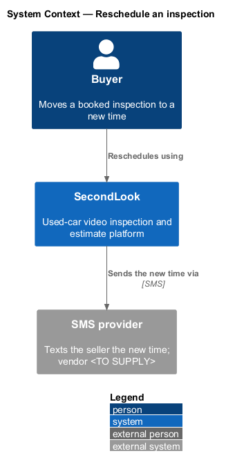
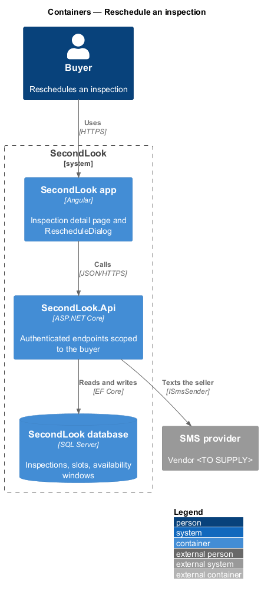
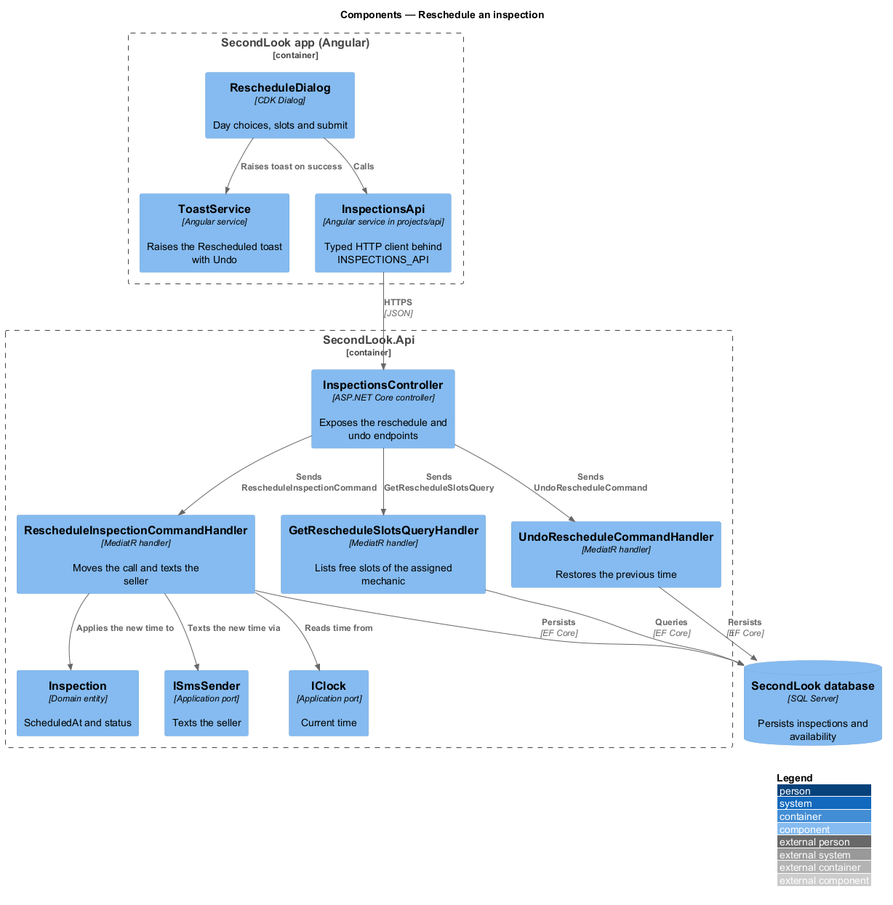
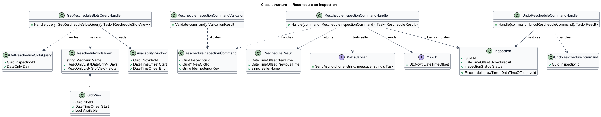
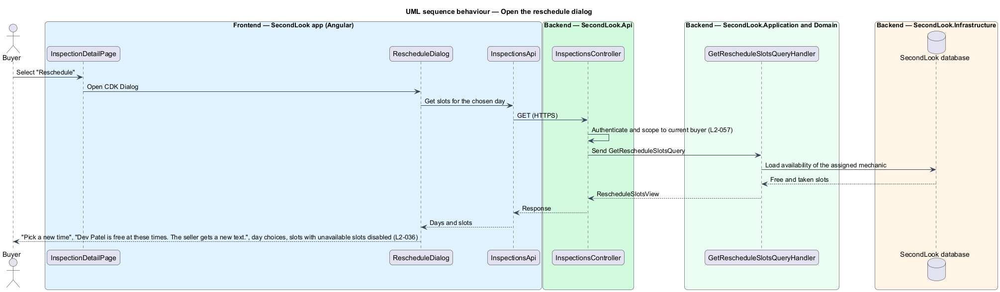
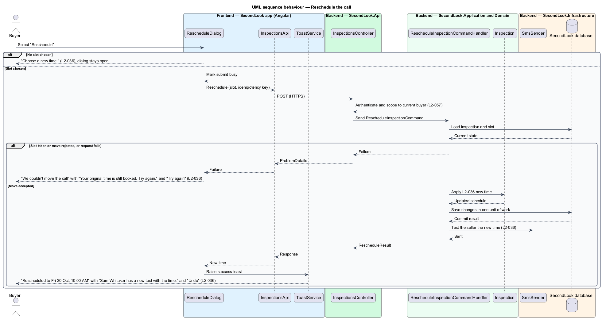
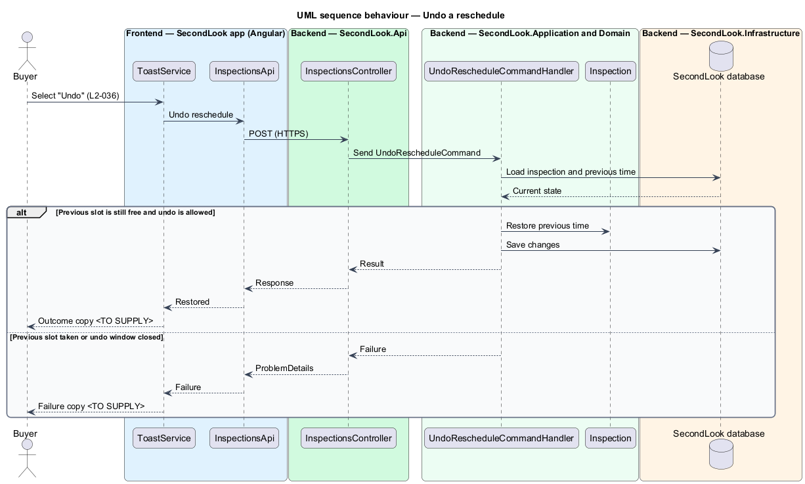

# Reschedule an inspection

## Overview

SecondLook is a used-car safety app for buyers purchasing a vehicle "as is". *Rescheduling* is the move of a booked inspection call to another free time of the same mechanic. The buyer opens the dialog from the inspection detail by selecting "Reschedule", picks a day and a slot, and submits. The seller of the vehicle receives a new text with the time.

The mock set is the `reschedule` dialog in four states (default, invalid, busy, failed) and the toast "Rescheduled to Fri 30 Oct, 10:00 AM" with the action "Undo" from `notifications/booking-toast/with-action`. This document assumes no prior knowledge of SecondLook internals.

## Description

The feature is a vertical slice from the Angular dialog to the database and the SMS port. No inspection code exists yet, so every component below is introduced by this design.

- **`RescheduleDialog`** — Angular dialog in `projects/secondlook/src/app/dialogs/`, opened with the Angular CDK Dialog from `InspectionDetailPage`. The mock lists it as opening from the inspection detail. It holds day choices, the slots of the chosen day, and the actions "Cancel" and "Reschedule". The page has no inline form.
- **`InspectionsApi` / `INSPECTIONS_API`** — contract and injection token in `projects/api`. The client sends the `Idempotency-Key` request header on the reschedule request (the header name is a design choice).
- **`ToastService`** and `sl-toast` — raise the success toast with the action "Undo".
- **`InspectionsController`** — controller in `SecondLook.Api`. It authenticates the caller and scopes the inspection to the current buyer (`L2-057`). The endpoint paths for listing slots, rescheduling and undoing are `<TO SUPPLY>`; `POST /api/inspections/{id}/reschedule` is a design choice.
- **`GetRescheduleSlotsQuery`** and handler — return the days and the slots of the assigned mechanic, each slot with an availability flag so that unavailable slots render disabled. The number of day choices is `<TO SUPPLY>`; the mock shows five days from Thu 29 Oct to Mon 2 Nov.
- **`RescheduleInspectionCommand`**, **`RescheduleInspectionCommandValidator`** and **`RescheduleInspectionCommandHandler`** — the validator rejects a command with no slot. The handler loads the `Inspection`, checks that the slot is free, calls `Inspection.Reschedule`, saves in one unit of work and then texts the seller through `ISmsSender`. Re-posting with the same idempotency key returns the existing result and does not text the seller twice.
- **`UndoRescheduleCommand`** and handler — restore the previous time when the buyer selects "Undo". The handler is a design addition required by the action in `L2-036`.
- **`Inspection`** — domain entity. `ScheduledAt` moves to the new time. The previous time is retained so that undo is possible.
- **`ISmsSender`** and **`IClock`** — application ports. The SMS vendor is `<TO SUPPLY>`.

State behaviour of the dialog:

- **Default.** The dialog shows "Pick a new time" and "Dev Patel is free at these times. The seller gets a new text.", day choices, a list of slots for the chosen day, and the actions "Cancel" and "Reschedule". The mock shows "Friday 30 October" with 10:00 AM, 12:30 PM, 4:00 PM, 5:30 PM, 6:30 PM and 7:30 PM. Unavailable slots are disabled.
- **Invalid.** When the buyer submits with no slot chosen, the dialog shows "Choose a new time.". The dialog stays open and sends no request.
- **Busy.** While the request runs, the submit button is marked busy. The busy label text is `<TO SUPPLY>`.
- **Failed.** When the move cannot happen, the dialog shows the alert "We couldn’t move the call" with "Your original time is still booked. Try again." and "Try again".
- **Success.** The call moves to the chosen time, the dialog closes and the toast "Rescheduled to Fri 30 Oct, 10:00 AM" appears with "Sam Whitaker has a new text with the time." and "Undo". The seller receives the new time by text (`L2-036` criterion 3).

Open points: the content of the seller text, the undo window, the effect of undo on the seller text, the outcome copy of undo, the earliest time before the call at which a reschedule is allowed, and the limit on reschedules are `<TO SUPPLY>`. The booking-pricing pricing and refund rules do not change on a reschedule, and this design adds no charge.

## Requirements

The feature realizes the following level-2 (L2) requirement. It refines a level-1 (L1) requirement, cited by identifier.

| L2 ID | Refines (L1) | Requirement |
|-------|--------------|-------------|
| `L2-036` | `L1-008` | Reschedule. When the buyer selects "Reschedule" on a scheduled inspection, a dialog shall show "Pick a new time", "Dev Patel is free at these times. The seller gets a new text.", day choices, and slots for the chosen day with unavailable slots disabled. When no slot is chosen and the buyer submits, the dialog shall show "Choose a new time.". When a slot is chosen and the buyer submits, the call shall move to that time and the seller shall be texted the new time. When the move cannot happen, the dialog shall show "We couldn’t move the call" with "Your original time is still booked. Try again." and "Try again". When the call is moved, a toast shall show "Rescheduled to Fri 30 Oct, 10:00 AM" with "Sam Whitaker has a new text with the time." and "Undo". |

## Diagrams

### System context

The buyer reschedules in SecondLook, which texts the seller through an external SMS provider.

### Containers

The Angular app calls `SecondLook.Api`, which writes the new time to the database and sends the text.

### Components

`RescheduleDialog` calls `InspectionsController`, which dispatches the slot query, the reschedule command and the undo command.

### Class structure

`RescheduleInspectionCommandHandler` mutates `Inspection` and texts the seller. `GetRescheduleSlotsQueryHandler` returns `SlotView` items.

### Behaviour — open the dialog

The dialog loads the slots of the assigned mechanic and disables unavailable ones.

### Behaviour — reschedule the call

The dialog shows the invalid state with no slot, the failed state when the move is rejected, or closes with the success toast.

### Behaviour — undo a reschedule

The "Undo" action restores the previous time when the previous slot is still free.

