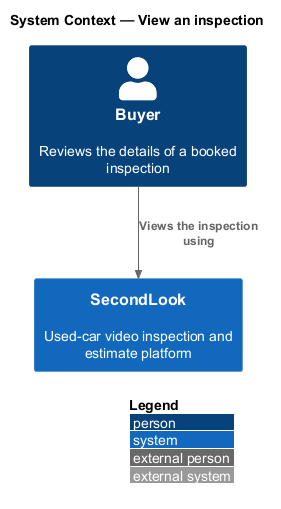
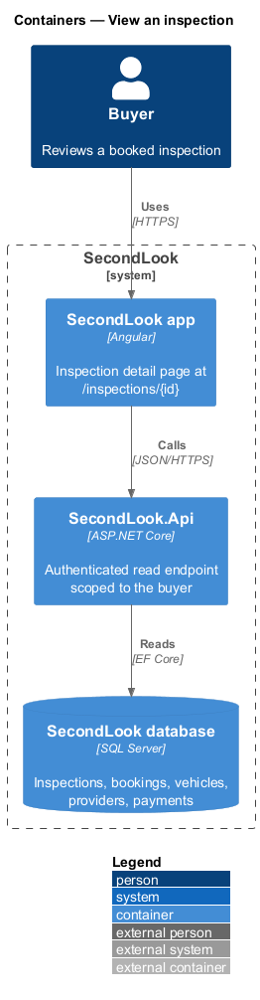
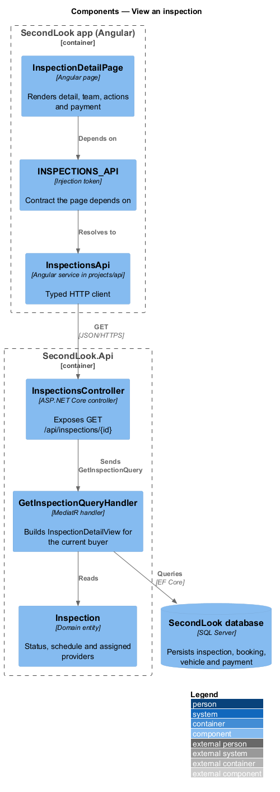
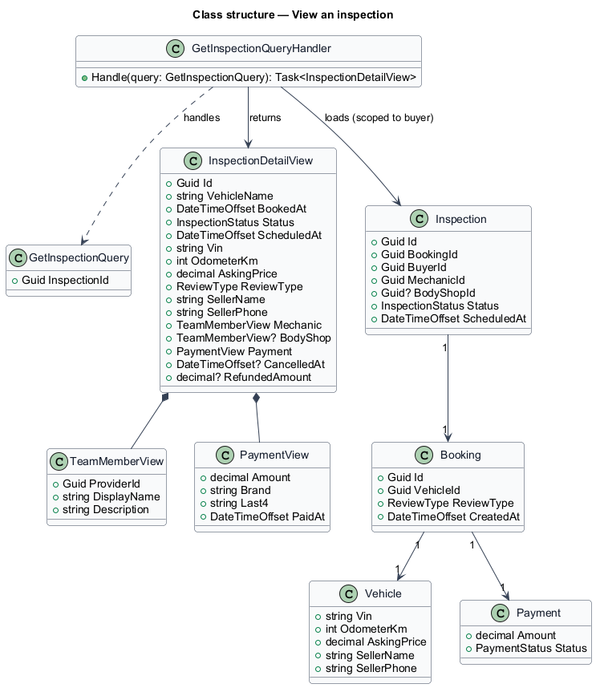
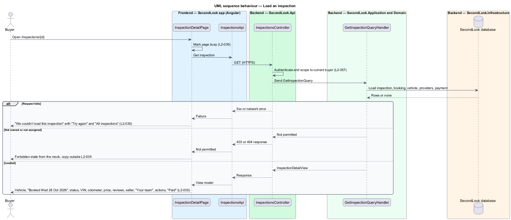
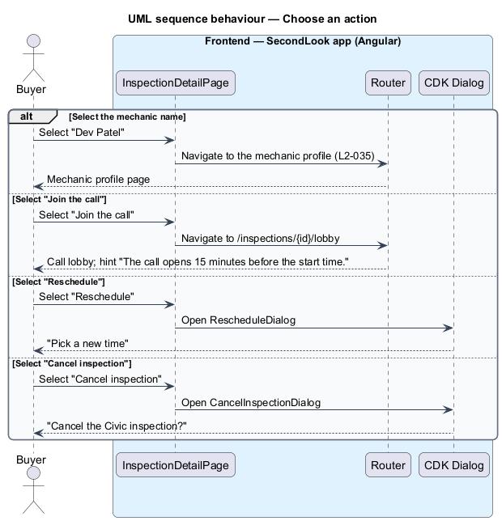

# View an inspection

## Overview

SecondLook is a used-car safety app for buyers purchasing a vehicle "as is". The *inspection detail* is the page at `/inspections/{id}` that shows one booked inspection: the vehicle, the status, the people assigned, the actions available and the payment. The mock route is `/inspections/civic-lx`.

An *inspection* is one video review of one vehicle by an assigned mechanic, and optionally a body shop reviewer, created from one booking. The page is the entry point to joining the call, rescheduling and cancelling, which the `reschedule-inspection` and `cancel-inspection` designs cover.

The mock set covers default, loading, error, read-only and forbidden. This design realizes the first three and the page structure shared with the read-only state, which `cancel-inspection` covers. This document assumes no prior knowledge of SecondLook internals.

## Description

The feature is a read-only vertical slice from the Angular app to the database. No inspection code exists yet, so every component below is introduced by this design.

- **`InspectionDetailPage`** — Angular page in `projects/secondlook/src/app/pages/`, routed at `/inspections/{id}`. It holds the view state `loading`, `default` and `error`.
- **`InspectionsApi` / `INSPECTIONS_API`** — contract and injection token in `projects/api`. The page depends on the token.
- **`InspectionsController`** — controller in `SecondLook.Api`, base route `/api/inspections`. It authenticates the caller and scopes the inspection to the current buyer (`L2-057`). Mechanics and body shops see only the inspections assigned to them. The endpoint path `GET /api/inspections/{id}` is a design choice.
- **`GetInspectionQuery`** and **`GetInspectionQueryHandler`** — load `Inspection`, `Booking`, `Vehicle`, the assigned `Provider` records and the `Payment`, and return an `InspectionDetailView`.
- **`InspectionDetailView`** — read model holding the vehicle name, the booking date, the status, the schedule, the VIN, the odometer, the asking price, the review type, the seller, the team, the payment, and for a cancelled inspection the cancellation date and the refunded amount.

State behaviour on the page:

- **Default.** The page shows the vehicle name, "Booked Wed 28 Oct 2026" and the status "Scheduled · Thu 29 Oct, 6:30 PM". The details list shows the VIN, the odometer, the asking price, the reviews and the seller.
- **Team section.** The section "Your team" lists the mechanic as a link to the mechanic profile and the body shop reviewer. The mock shows "Dev Patel", "Mechanic, 310S · Hamilton", and "Mira Okonkwo", "Body shop reviewer · Hamilton". The profile route in the mock is `/mechanics/dev-patel`; the route parameter that identifies a mechanic is `<TO SUPPLY>`.
- **Actions.** The page offers "Join the call", "Reschedule" and "Cancel inspection" with the hint "The call opens 15 minutes before the start time.". "Join the call" navigates to the call lobby, which the live-call subsystem owns. Whether the button is disabled before the call opens is `<TO SUPPLY>`. "Reschedule" and "Cancel inspection" each open a CDK Dialog (`RescheduleDialog`, `CancelInspectionDialog`) and the page has no inline form.
- **Payment.** The section "Paid" shows the amount, for example "$45.00", with the card and the date, for example "Visa ending 4242 · Wed 28 Oct 2026". The amount comes from the `Payment` record, not from a recomputed price.
- **Loading.** The page is marked busy with `aria-busy="true"`. The loading layout is `<TO SUPPLY>`.
- **Error.** The page shows "We couldn’t load this inspection" with "It’s still booked. Try again in a moment." and the buttons "Try again" and "All inspections". The navigation chrome stays visible. "All inspections" opens `/inspections`.
- **Forbidden.** A user who cannot view the inspection sees the forbidden state of the mock, whose text begins "The signed-in user can’t view this inspection." This state is not part of `L2-035`; its traceability to `L1-014` is `<TO SUPPLY>`.

## Requirements

The feature realizes the following level-2 (L2) requirement. It refines a level-1 (L1) requirement, cited by identifier.

| L2 ID | Refines (L1) | Requirement |
|-------|--------------|-------------|
| `L2-035` | `L1-008` | Inspection detail. When the buyer opens a scheduled inspection, the page shall show the vehicle name, "Booked Wed 28 Oct 2026", the status "Scheduled · Thu 29 Oct, 6:30 PM", the VIN, the odometer, the asking price, the reviews and the seller. The "Your team" section shall list the mechanic as a link to their profile and the body shop reviewer. The page shall offer "Join the call", "Reschedule" and "Cancel inspection", and the hint "The call opens 15 minutes before the start time.". The "Paid" section shall show the amount, for example "$45.00", with the card and the date. While the inspection is loading, the page shall be marked busy. When the inspection fails to load, the page shall show "We couldn’t load this inspection" with "It’s still booked. Try again in a moment." and the buttons "Try again" and "All inspections". |

## Diagrams

### System context

The buyer views a booked inspection in SecondLook.

### Containers

The Angular app reads one inspection from `SecondLook.Api`, which reads the SecondLook database.

### Components

`InspectionDetailPage` depends on `INSPECTIONS_API`. `InspectionsController` dispatches `GetInspectionQuery`.

### Class structure

`GetInspectionQueryHandler` loads an `Inspection` with its `Booking`, `Vehicle` and `Payment` and returns an `InspectionDetailView`.

### Behaviour — load an inspection

The page shows the busy state, then the detail, the error state or the forbidden state.

### Behaviour — choose an action

The page links to the mechanic profile and the call lobby, and opens the reschedule and cancel dialogs.

