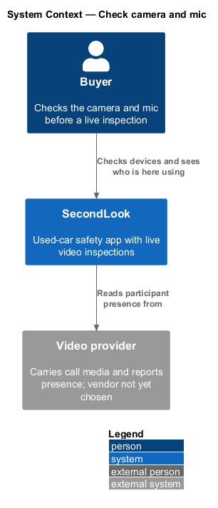
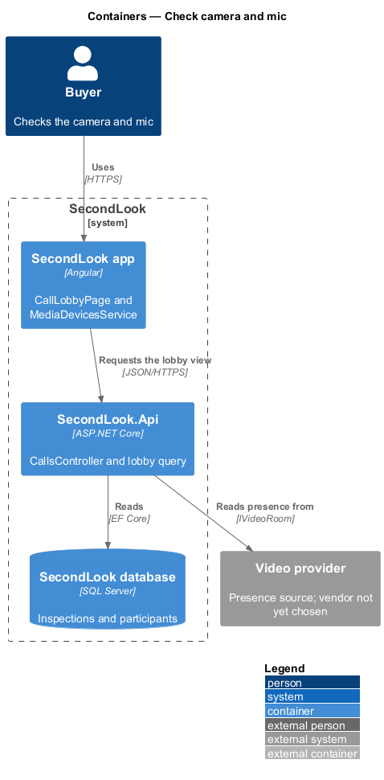
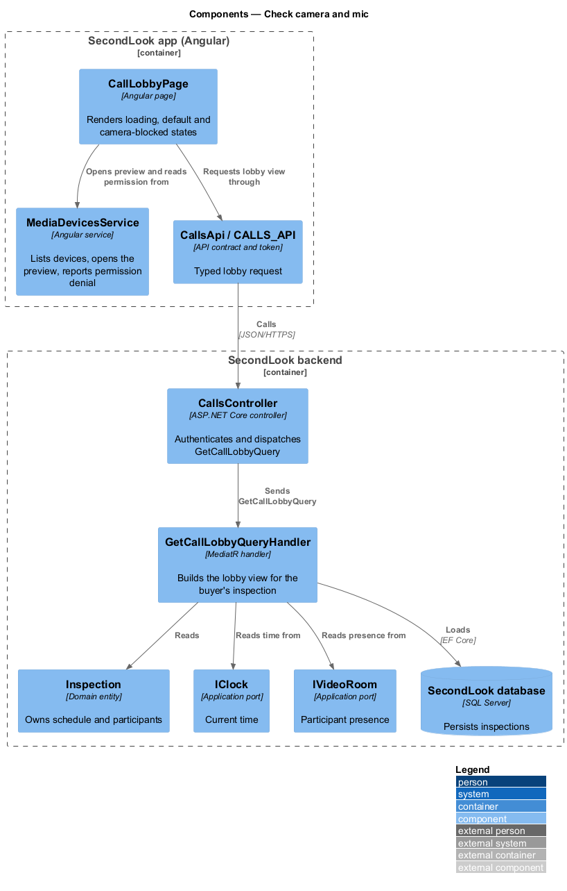
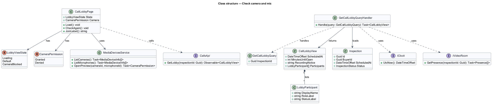
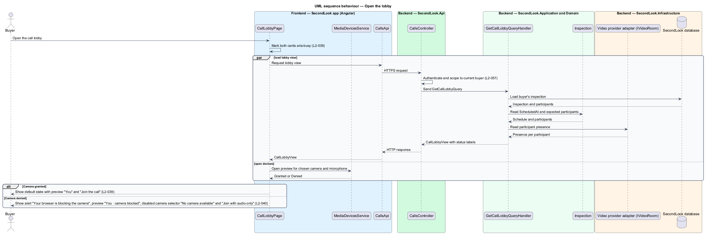
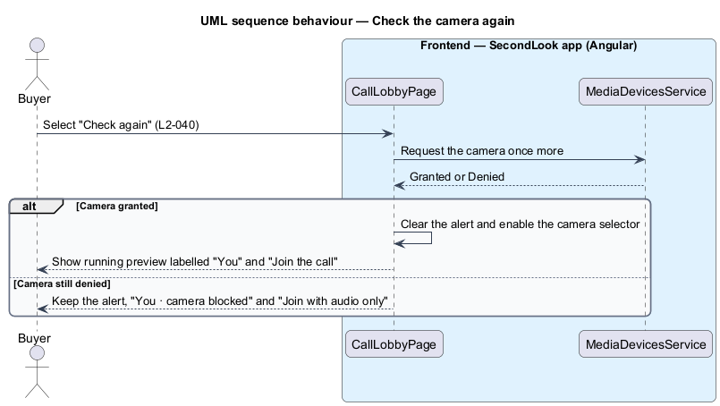

# Check camera and mic

## Overview

SecondLook is a used-car safety app for buyers purchasing a vehicle "as is" who cannot get a mechanic to the car in person. This feature covers the call lobby, the screen the buyer sees before a live inspection starts, at the route `/inspections/civic-lx/lobby` in the mock set. The `civic-lx` segment is a mock identifier; the production route parameter is `<TO SUPPLY>`. The lobby lets the buyer confirm the camera and microphone, see who is on the call, and read the recording notice before joining.

A *call lobby* is a pre-call screen where a participant checks devices and sees who has arrived before entering the call. A *preview* is a local, unsent rendering of the buyer's own camera. When the browser denies camera access, the lobby offers audio-only joining. The buyer enters the call through the "Join the call" action, which is covered by the join-live-inspection design.

The feature refines `L1-009`. The video provider, the signalling channel and the recording store are `<TO SUPPLY>`; this design names no vendor.

## Description

The feature is a vertical slice from the Angular app to the database. No call code exists yet, so every component below is introduced by this design.

- **`CallLobbyPage`** — Angular page in `projects/secondlook/src/app/pages/`, routed at `/inspections/civic-lx/lobby` in the mock set. It renders the heading "Check your camera and mic", the call time and when the call opens, the preview labelled "You", the "Camera" and "Microphone" selectors, the "Who’s here" list, the recording note and the join action. It holds the view state: `loading`, `default`, `cameraBlocked`.
- **`MediaDevicesService`** — Angular service in `projects/secondlook/src/app/` that wraps the browser media-device APIs. It lists cameras and microphones, opens the preview stream for the chosen devices, and reports a permission-denied result for the camera. It never sends the preview stream to the backend.
- **`CallsApi` / `CALLS_API`** — contract and injection token in `projects/api`. The page depends on the token, not on the concrete client. The lobby operation returns a `CallLobbyView`.
- **`CallsController`** — ASP.NET Core controller in `SecondLook.Api`, base route `/api/calls`. It authenticates the caller, scopes the request to the current buyer (`L2-057`) and dispatches `GetCallLobbyQuery`. The endpoint path under that base is `<TO SUPPLY>`.
- **`GetCallLobbyQuery`** and **`GetCallLobbyQueryHandler`** — MediatR query and handler. The handler loads the `Inspection` owned by the buyer, builds the call time, the minutes until the call opens, and one `LobbyParticipant` per expected participant with a status of "Ready", "Not joined" or "Joins at 6:45". The handler returns the recording notice text as a constant of the application layer. When the inspection does not belong to the buyer, the handler returns not-found.
- **`LobbyParticipant`** — application view model (`DisplayName`, `RoleLabel`, `StatusLabel`). The mock lists the mechanic, the seller and the body shop reviewer. How the body shop reviewer appears when the booking has no body shop review is `<TO SUPPLY>`.
- **`Inspection`**, **`CallSession`** — domain entities. The lobby reads `Inspection.ScheduledAt` and the assigned participants. Whether a `CallSession` exists before the first join is `<TO SUPPLY>`.
- **`IClock`** — application port for the current time, so the "call opens in 4 minutes" text is testable. The rule that sets how early the call opens is `<TO SUPPLY>`.
- **`IVideoRoom`** — application port for the video provider. The lobby reads participant presence through it. The vendor and the presence mechanism are `<TO SUPPLY>`.

State behaviour on the page:

- **Loading.** The heading reads "Checking your camera and mic". The two cards, the preview card and the "Who’s here" card, carry `aria-busy="true"` and show placeholders (`L2-039`).
- **Default.** The page shows "Check your camera and mic", the line "Thu 29 Oct 2026 · 6:30 PM · the call opens in 4 minutes", the preview labelled "You", the selectors "Camera" and "Microphone", "Who’s here" with each status, the note "The call is recorded so the mechanic can write your report. Everyone is told before it starts." and "Join the call".
- **Camera blocked.** When the browser blocks the camera, an alert with `role="alert"` shows "Your browser is blocking the camera" with "Click the camera icon in the address bar, choose Allow, then reload. You can still join with audio only; the mechanic talks to the seller, not you." and "Check again". The preview is labelled "You · camera blocked". The camera selector reads "No camera available" and is disabled. The join action reads "Join with audio only" (`L2-040`).
- **Check again.** "Check again" asks `MediaDevicesService` to request the camera once more. When access is granted, the page returns to the default state with the preview running. When access is still denied, the blocked state stays.

The microphone selector stays enabled in the blocked state. The behaviour when the microphone is also blocked is `<TO SUPPLY>`; `L2-040` states only the camera case. The behaviour when the buyer opens the lobby before the call opens or after it ends is `<TO SUPPLY>`.

The lobby reads data and issues no write. The idempotency rule for bookings and payments therefore does not apply to this slice.

## Requirements

The feature realizes the following level-2 (L2) requirements. Each L2 requirement refines a level-1 (L1) requirement, cited by identifier.

| L2 ID | Refines (L1) | Requirement |
|-------|--------------|-------------|
| `L2-039` | `L1-009` | Call lobby. When the buyer opens the lobby and it loads, the lobby shall show "Check your camera and mic", the call time and when it opens, a preview labelled "You", the selectors "Camera" and "Microphone", and "Who’s here" listing the mechanic, seller and body shop reviewer with each status ("Ready", "Not joined", "Joins at 6:45"). The lobby shall show the note "The call is recorded so the mechanic can write your report. Everyone is told before it starts." with "Join the call". While the lobby is loading, its cards shall be marked busy. |
| `L2-040` | `L1-009` | Camera blocked. When the browser blocks the camera, the lobby shall show the alert "Your browser is blocking the camera" with "Click the camera icon in the address bar, choose Allow, then reload. You can still join with audio only; the mechanic talks to the seller, not you." and "Check again". The preview shall be labelled "You · camera blocked". The camera selector shall say "No camera available" and shall be disabled. The join button shall read "Join with audio only". |

## Diagrams

### System context

The buyer checks devices in SecondLook before the call. The video provider reports who has arrived.

### Containers

The Angular app reads the browser media devices locally and calls the SecondLook API for the lobby view. The API reads inspection data from the database and participant presence from the video provider.

### Components

`CallLobbyPage` combines the lobby view from `CallsApi` with the device state from `MediaDevicesService`. `CallsController` dispatches `GetCallLobbyQuery`.

### Class structure

`GetCallLobbyQueryHandler` builds a `CallLobbyView` with `LobbyParticipant` items. `CallLobbyPage` holds a `LobbyViewState` and a `CameraPermission` value.

### Behaviour — open the lobby

The page shows the busy state, loads the lobby view, and renders the default state or the camera-blocked state according to the browser permission result.

### Behaviour — check the camera again

The buyer selects "Check again" after changing the browser setting. The page requests the camera once more and either clears or keeps the alert.

