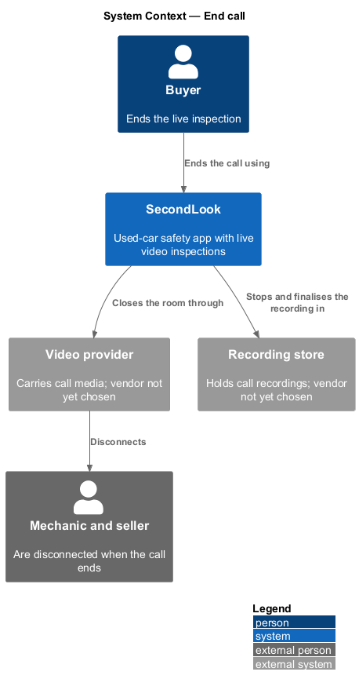
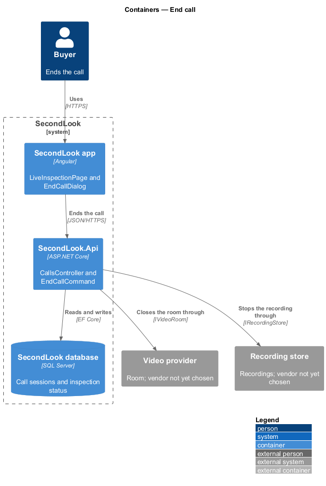
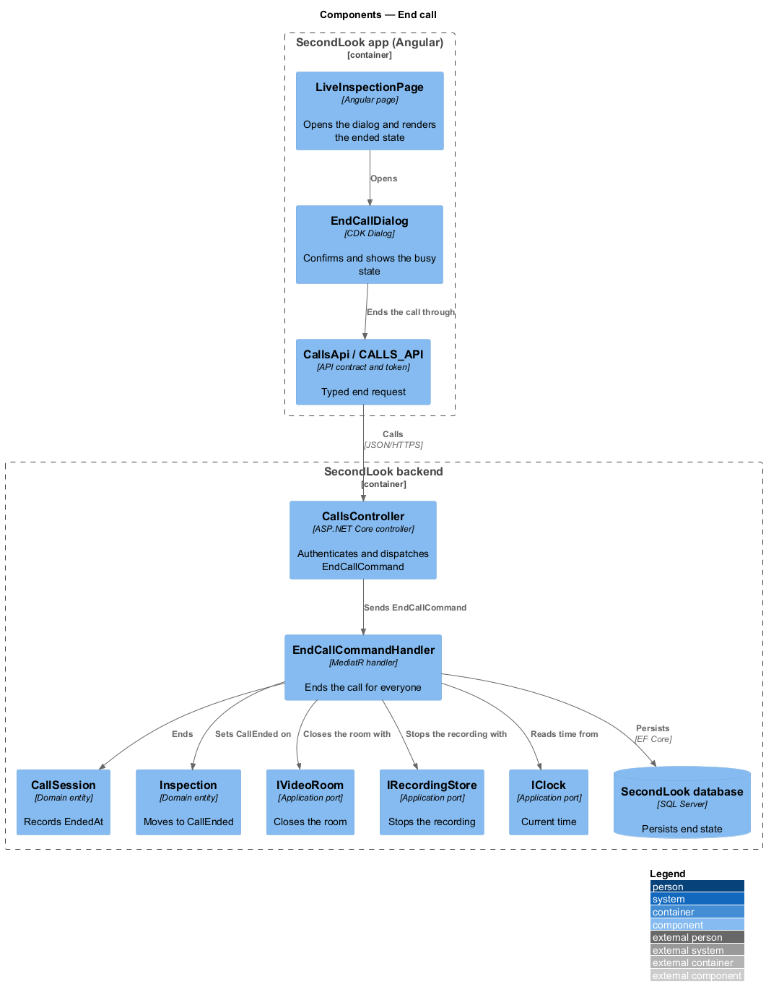
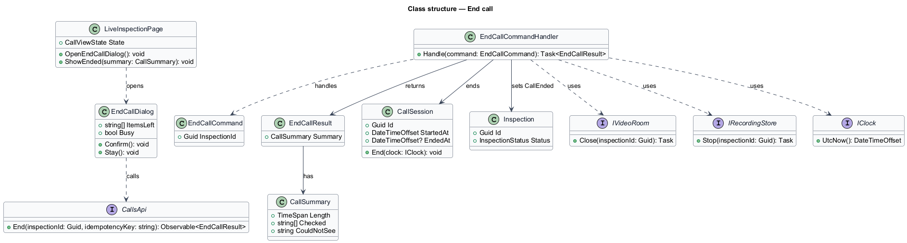
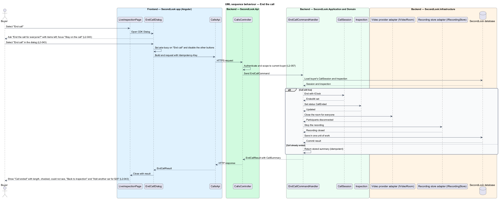
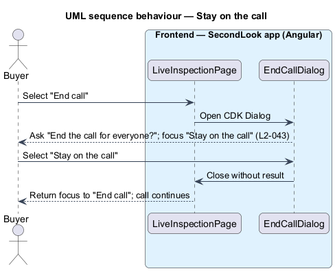

# End call

## Overview

SecondLook is a used-car safety app for buyers purchasing a vehicle "as is" who cannot get a mechanic to the car in person. This feature covers how the buyer ends a live inspection for everyone, and the "Call ended" summary the buyer sees afterwards, on the live inspection screen at `/inspections/civic-lx/call` in the mock set. The `civic-lx` segment is a mock identifier; the production route parameter is `<TO SUPPLY>`.

A *confirmation dialog* is a modal dialog that asks the user to confirm an action that cannot be undone. A *call summary* is the post-call view of the call length, the systems checked and the systems the mechanic could not see. Ending the call hands the inspection to the mechanic, who writes the report; the report itself belongs to the reports subsystem.

The feature refines `L1-009`. The video provider, the signalling channel and the recording store are `<TO SUPPLY>`; this design names no vendor.

## Description

The feature is a vertical slice from the Angular app to the database and the video provider. No call code exists yet, so every component below is introduced by this design.

- **`EndCallDialog`** — Angular dialog in `projects/secondlook/src/app/dialogs/`, opened with Angular CDK Dialog from `LiveInspectionPage` when the buyer selects "End call". It renders the title "End the call for everyone?", the text "Dev Patel and Sam Whitaker will be disconnected." followed by the items left on the checklist, and the buttons "Stay on the call" and "End call". It has `role="dialog"`, `aria-modal="true"`, a title and a description, and "Stay on the call" receives initial focus. The dialog has no inputs to validate. The dialog is a CDK Dialog and not an inline form, as AGENTS.md requires.
- **`LiveInspectionPage`** — Angular page that opens the dialog, and renders the ended state. The ended state shows "Call ended", "That’s the call. Dev is writing your report.", "You’ll get an email and a notification within an hour. It will say what it costs to get the Civic safety certified.", the call length, what was checked, what could not be seen, "Back to inspection" and "Add another car for $25".
- **`CallsApi` / `CALLS_API`** — contract and injection token in `projects/api`. The page and the dialog depend on the token. The end operation returns an `EndCallResult`. The client sends an `Idempotency-Key` request header on the end request (the header name is a design choice).
- **`CallsController`** — ASP.NET Core controller in `SecondLook.Api`, base route `/api/calls`. It authenticates the caller, scopes the request to the current buyer (`L2-057`) and dispatches `EndCallCommand`. The endpoint path is `<TO SUPPLY>`.
- **`EndCallCommand`** and **`EndCallCommandHandler`** — MediatR command and handler. The handler loads the buyer's `CallSession`, sets `EndedAt` from `IClock`, sets `Inspection.Status` to `CallEnded`, closes the room through `IVideoRoom` so the other participants are disconnected, stops the recording through `IRecordingStore`, and returns the call summary. The handler is idempotent: ending an already ended call returns the stored summary and performs no second close.
- **`CallSession`** — domain entity. `End(IClock)` sets `EndedAt`. The call length is `EndedAt` minus `StartedAt`.
- **`CallSummary`** — application view model (`Length`, `Checked`, `CouldNotSee`). `Checked` lists the checklist items that were done. The source of the "couldn’t see" text, for example "Underbody (car not on a lift)", is `<TO SUPPLY>`.
- **`Inspection`** — domain entity. `InspectionStatus` moves from `Live` to `CallEnded`. The move to `ReportInProgress` belongs to the reports subsystem.
- **`IVideoRoom`**, **`IRecordingStore`**, **`IClock`** — application ports. The vendors are `<TO SUPPLY>`.
- **Add another car.** The button label "Add another car for $25" shows the price that `PricingPolicy` returns for an additional vehicle inside an open pricing window. The button starts the add-another-vehicle flow of the booking-pricing subsystem through `AddAnotherVehicleCommand`. The behaviour when the window has closed, and the destination of the button, are `<TO SUPPLY>`.
- **Back to inspection.** The button navigates to `InspectionDetailPage` for the same inspection.

State behaviour:

- **Dialog default.** The dialog shows the title, the text with the items left on the checklist, and both buttons. The mock text reads "Dev Patel and Sam Whitaker will be disconnected. Dev has 2 items left on the checklist: steering, and lights." The items come from the checklist items whose state is not `Done`. The mock lists two items while the live page shows four items not done (Suspension, Steering, "Lights, horn, wipers" and "Body panels"), so the exact rule for which items count as left is `<TO SUPPLY>`.
- **Dialog busy.** After the buyer selects "End call", the "End call" button carries `aria-busy="true"`, the "Stay on the call" button and the close button are disabled, and the dialog stays open until the request finishes.
- **Stay on the call.** "Stay on the call" closes the dialog and leaves the call running.
- **Ended.** After a successful end, the dialog closes and the page shows the ended state with the summary. The ended mock shows "Length 21:08", "Checked Brakes, tires, suspension, steering, lights, body" and "Couldn’t see Underbody (car not on a lift)".
- **End failure.** The behaviour when the end request fails is `<TO SUPPLY>`; `L2-043` states only the success path.
- **Remote end.** The behaviour of the buyer's page when another participant ends the call is `<TO SUPPLY>`.

## Requirements

The feature realizes the following level-2 (L2) requirements. Each L2 requirement refines a level-1 (L1) requirement, cited by identifier.

| L2 ID | Refines (L1) | Requirement |
|-------|--------------|-------------|
| `L2-043` | `L1-009` | End the call. When the call is live and the buyer selects "End call", a dialog shall ask "End the call for everyone?" with "Dev Patel and Sam Whitaker will be disconnected." and the items left on the checklist, with "Stay on the call" focused. When the buyer selects "End call" in the dialog, the call shall end for everyone. When the call has ended, the page shall show "Call ended", "That’s the call. Dev is writing your report." and "You’ll get an email and a notification within an hour. It will say what it costs to get the Civic safety certified.", the length of the call, what was checked and what could not be seen, and the buttons "Back to inspection" and "Add another car for $25". |

## Diagrams

### System context

The buyer ends the call in SecondLook. The video provider disconnects the other participants and the recording store receives the closed recording.

### Containers

The Angular app opens the dialog and calls the SecondLook API. The API closes the room, stops the recording and writes the end time to the database.

### Components

`LiveInspectionPage` opens `EndCallDialog` and calls `CallsApi`. `EndCallCommandHandler` ends the `CallSession`, closes the room and stops the recording.

### Class structure

`EndCallCommandHandler` ends a `CallSession`, updates an `Inspection` and returns an `EndCallResult` with a `CallSummary`.

### Behaviour — end the call

The buyer opens the dialog, confirms, and the handler ends the session for everyone. The page then shows the call summary.

### Behaviour — stay on the call

The buyer dismisses the dialog and the call continues.

## Implementation notes (J10)

Delivered as `EndCallDialog` (CDK Dialog, "Stay on the call" focused) and the ended state of `CallPage` (L2-043, L2-075). The dialog names who will be disconnected and the checklist items not yet done. `POST /api/calls/{id}/end` is idempotent, closes every socket with an `ended` message, and both sides then read the call and show "Call ended", "That’s the call.", the call length and the items checked and not checked. Deviations from this design: the inspection's own status is not changed by a call in J10, there is no recording to stop, the report-in-progress promise and the "Add another car" action are not on the summary yet (J11 and J13), and the "couldn’t see" reasons are not captured.
