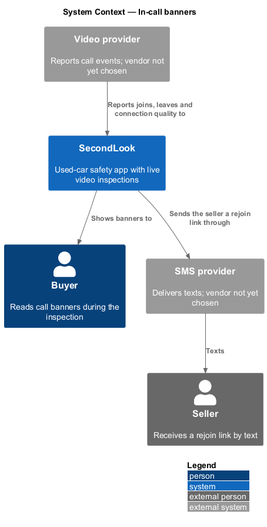
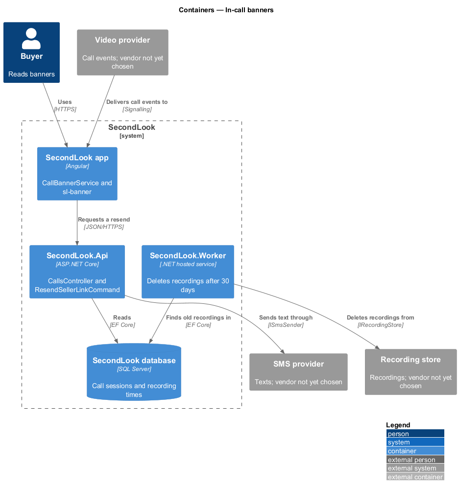
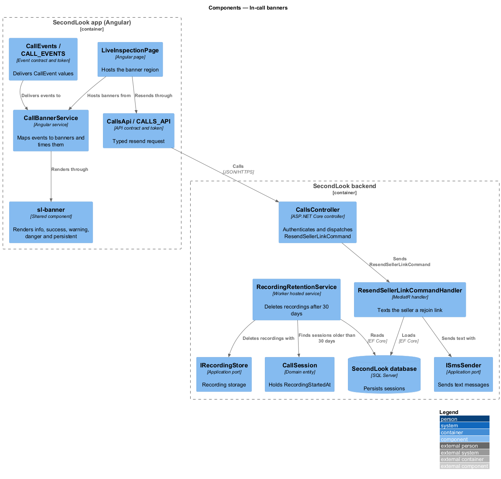
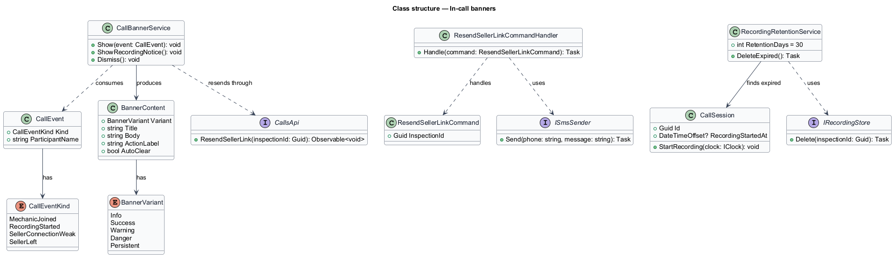
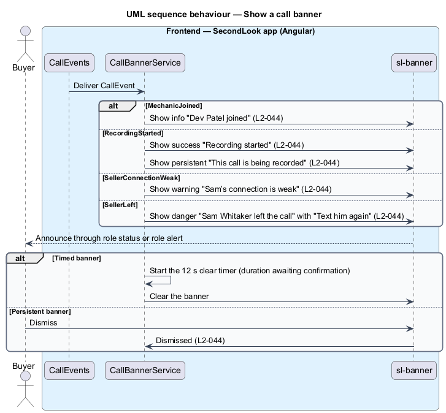
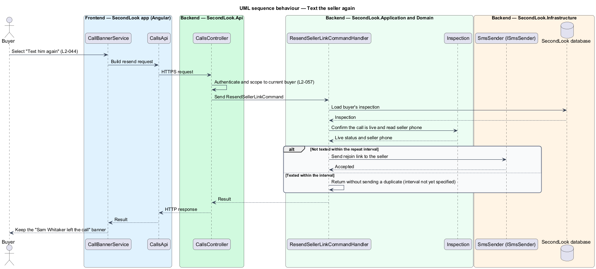
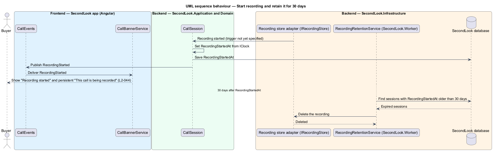

# In-call banners

## Overview

SecondLook is a used-car safety app for buyers purchasing a vehicle "as is" who cannot get a mechanic to the car in person. This feature covers the banners that appear across the top of the live inspection screen, at `/inspections/civic-lx/call` in the mock set, to tell the buyer about call events: the mechanic joined, recording started, the seller's connection is weak, the seller left, and the call is being recorded. The `civic-lx` segment is a mock identifier; the production route parameter is `<TO SUPPLY>`.

An *in-call banner* is a non-modal message shown over the live inspection that reports a call event and clears without blocking the call. A *persistent banner* is an in-call banner that stays until the buyer dismisses it. A *recording* is the stored audio and video of one call, kept so the mechanic can write the report. Recordings are kept for 30 days, the period stated in the privacy page copy.

The feature refines `L1-009`. The video provider, the signalling channel and the recording store are `<TO SUPPLY>`; this design names no vendor.

## Description

The feature is a vertical slice from the video provider events to the Angular banner component, with one backend operation for the "Text him again" action. No call code exists yet, so every component below is introduced by this design.

- **`sl-banner`** — shared component in `projects/components` that renders the banner. It has the variants `info`, `success`, `warning`, `danger` and `persistent` and keeps the mock's BEM classes (`alert`, `alert--info`, `alert--success`, `alert--warning`, `alert--danger`, `banner`). It renders an icon, a title, an optional body and an optional action button.
- **`CallBannerService`** — Angular service in `projects/secondlook/src/app/` that maps `CallEvent` values to banner content, shows one banner for each event, and clears timed banners after 12 seconds. The 12-second figure comes from the mock note, which states that "persistent banners stay until dismissed; the others clear after 12 s", and the requirements are silent on it, so confirmation is `<TO SUPPLY>`. Whether banners stack, queue or replace one another is `<TO SUPPLY>`.
- **`CallEvents` / `CALL_EVENTS`** — contract and injection token in `projects/api` that delivers `CallEvent` values to the app. The kinds are `MechanicJoined`, `RecordingStarted`, `SellerConnectionWeak`, and `SellerLeft`. The persistent banner follows `RecordingStarted`. The transport is `<TO SUPPLY>`.
- **`LiveInspectionPage`** — Angular page that hosts the banner region and passes the "Text him again" action to `CallsApi`.
- **`CallsApi` / `CALLS_API`** — contract and injection token. It carries the resend operation.
- **`CallsController`** — ASP.NET Core controller in `SecondLook.Api`, base route `/api/calls`. It authenticates the caller, scopes the request to the current buyer (`L2-057`) and dispatches `ResendSellerLinkCommand`. The endpoint path is `<TO SUPPLY>`.
- **`ResendSellerLinkCommand`** and **`ResendSellerLinkCommandHandler`** — MediatR command and handler. The handler loads the buyer's `Inspection`, checks the call is live, and sends the seller a rejoin link through `ISmsSender`. The handler is idempotent within a short interval, so a repeated press does not send duplicate texts. The interval is `<TO SUPPLY>`. The copy of the text message is `<TO SUPPLY>`.
- **`CallSession`** — domain entity. `RecordingStartedAt` is set when recording starts. Recording starts when the provider reports it, and `StartRecording(IClock)` raises the `RecordingStarted` event. The rule that starts recording, for example on the first participant joining, is `<TO SUPPLY>`.
- **`IRecordingStore`** — application port for the recording store. The vendor is `<TO SUPPLY>`.
- **`RecordingRetentionService`** — hosted service in `SecondLook.Worker` that deletes recordings 30 days after `RecordingStartedAt` through `IRecordingStore`. This is a design choice that realizes the retention period in the banner copy. What happens to the report that was written from a deleted recording is `<TO SUPPLY>`.
- **`ISmsSender`**, **`IVideoRoom`**, **`IClock`** — application ports. The vendors are `<TO SUPPLY>`.

Banner variants, as shown in the mock set under `notifications/call-banner`:

| Variant | Event | Title | Body | Action | ARIA role |
|---------|-------|-------|------|--------|-----------|
| `info` | Mechanic joins | "Dev Patel joined" | "The mechanic is on the call and the seller is walking the car." | none | `status` |
| `success` | Recording starts | "Recording started" | "Dev can now write your report from the call. Everyone was told." | none | `status` |
| `warning` | Seller's connection is weak | "Sam’s connection is weak" | none specified | none | `status` |
| `danger` | Seller leaves | "Sam Whitaker left the call" | "Dev is still here. We’ve texted Sam a link to rejoin." | "Text him again" | `alert` |
| `persistent` | Call is recorded | "This call is being recorded" | "Recordings are kept for 30 days to produce your report." | dismiss | `status` |

The `warning` banner has a title only in `L2-044`. The body of the `warning` banner and the quality threshold that raises it are `<TO SUPPLY>`. The dismissal control of the persistent banner and whether the banner reappears after a rejoin are `<TO SUPPLY>`.

The banner names come from participant data: "Dev Patel", "Sam Whitaker" and the short form "Sam". How the short form is derived is `<TO SUPPLY>`.

## Requirements

The feature realizes the following level-2 (L2) requirements. Each L2 requirement refines a level-1 (L1) requirement, cited by identifier.

| L2 ID | Refines (L1) | Requirement |
|-------|--------------|-------------|
| `L2-044` | `L1-009` | In-call banners. When the mechanic joins, the banner shall read "Dev Patel joined" with "The mechanic is on the call and the seller is walking the car.". When recording starts, the banner shall read "Recording started" with "Dev can now write your report from the call. Everyone was told.". When the seller’s connection is weak, the banner shall read "Sam’s connection is weak". When the seller leaves, the banner shall read "Sam Whitaker left the call" with "Dev is still here. We’ve texted Sam a link to rejoin." and a "Text him again" button. When the call is recorded, the persistent banner shall read "This call is being recorded" with "Recordings are kept for 30 days to produce your report." and shall stay until dismissed. |

## Diagrams

### System context

The video provider reports call events to SecondLook. SecondLook shows banners to the buyer and texts the seller a rejoin link.

### Containers

The Angular app receives call events and renders banners. The API sends the seller text. The worker deletes recordings after 30 days.

### Components

`CallBannerService` maps `CallEvents` to `sl-banner` content on `LiveInspectionPage`. `ResendSellerLinkCommandHandler` sends the text through `ISmsSender`. `RecordingRetentionService` applies the 30-day period.

### Class structure

`CallBannerService` produces `BannerContent` for each `CallEvent` kind. `ResendSellerLinkCommandHandler` uses `ISmsSender`.

### Behaviour — show a call banner

A call event reaches the app, and the service shows the matching timed or persistent banner.

### Behaviour — text the seller again

The buyer selects "Text him again" on the seller-left banner. The handler sends a rejoin link by text.

### Behaviour — start recording and retain it

Recording starts, the success and persistent banners appear, and the worker deletes the recording after 30 days.

