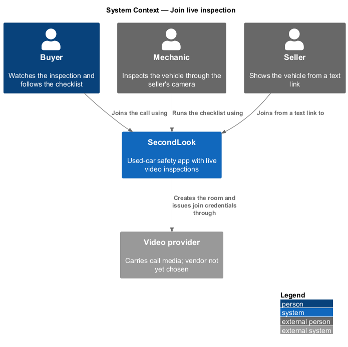
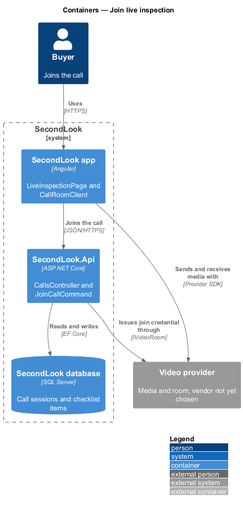
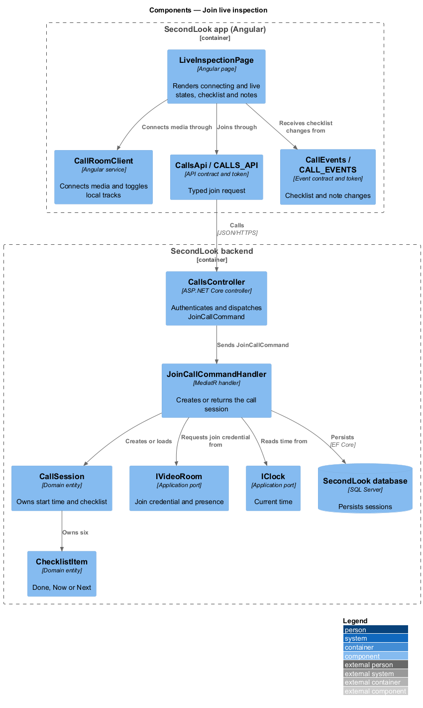
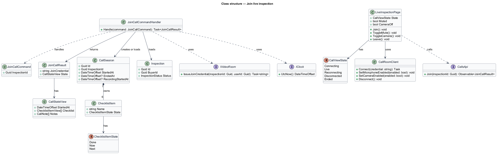
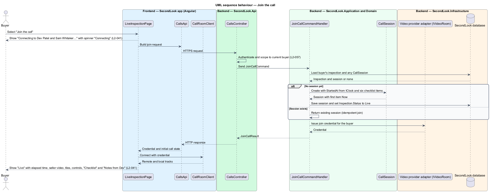
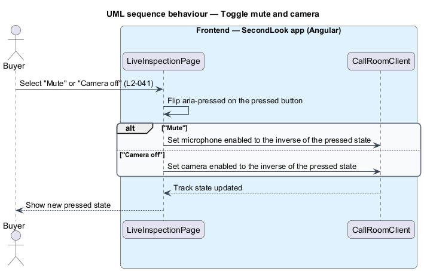
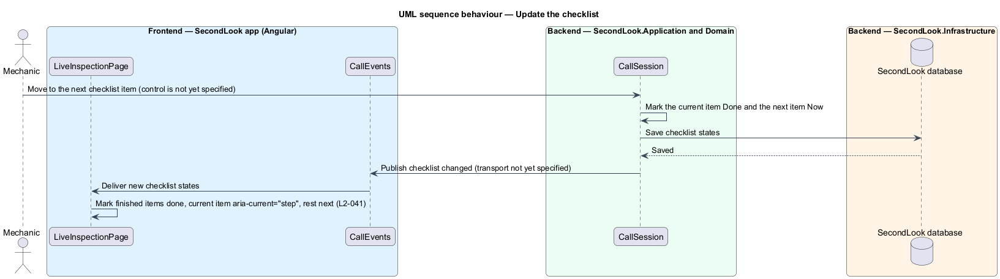

# Join live inspection

## Overview

SecondLook is a used-car safety app for buyers purchasing a vehicle "as is" who cannot get a mechanic to the car in person. This feature covers the live inspection screen at the route `/inspections/civic-lx/call` in the mock set, where the buyer joins the video call with the mechanic and the seller, watches the seller's camera, follows the inspection checklist and controls their own audio and video. The `civic-lx` segment is a mock identifier; the production route parameter is `<TO SUPPLY>`.

A *live inspection* is a video call in which a mechanic inspects a vehicle through the seller's camera while the buyer watches. A *checklist* is the ordered set of systems the mechanic inspects during the call: Brakes, Tires, Suspension, Steering, "Lights, horn, wipers" and "Body panels". A *room* is the provider-side meeting space that carries the call media.

The feature refines `L1-009`. The video provider, the signalling channel and the recording store are `<TO SUPPLY>`; this design names no vendor.

## Description

The feature is a vertical slice from the Angular app to the database and the video provider. No call code exists yet, so every component below is introduced by this design.

- **`LiveInspectionPage`** — Angular page in `projects/secondlook/src/app/pages/`, routed at `/inspections/civic-lx/call` in the mock set. It renders the status, the seller's main video, the mechanic and "You" tiles, the controls "Mute", "Camera off" and "End call", the "Leave" action, the "Checklist" and "Notes from Dev". It holds the view state: `connecting`, `live`, `reconnecting`, `disconnected`, `ended`. The last four are realized by the recover-from-connection-loss and end-call designs.
- **`CallRoomClient`** — Angular service in `projects/secondlook/src/app/` that connects to the room with a join credential, exposes the remote and local tracks, and toggles the local microphone and camera. It wraps the video provider SDK, which is `<TO SUPPLY>`.
- **`CallsApi` / `CALLS_API`** — contract and injection token in `projects/api`. The page depends on the token. The join operation returns a `JoinCallResult` with the join credential and the initial `CallStateView`.
- **`CallEvents` / `CALL_EVENTS`** — contract and injection token in `projects/api` for server-pushed call events, such as a checklist change. The transport is `<TO SUPPLY>`.
- **`CallsController`** — ASP.NET Core controller in `SecondLook.Api`, base route `/api/calls`. It authenticates the caller, scopes the request to the current buyer (`L2-057`), and dispatches `JoinCallCommand`. The endpoint paths under that base are `<TO SUPPLY>`. Mechanics and body shops reach only the inspections assigned to them.
- **`JoinCallCommand`** and **`JoinCallCommandHandler`** — MediatR command and handler. The handler loads the buyer's `Inspection`, finds or creates the `CallSession`, asks `IVideoRoom` for a join credential for the buyer, sets `Inspection.Status` to `Live` on the first join, and returns the initial call state. The handler is idempotent: a second join by the same buyer returns the existing session and a fresh credential and does not start a second session.
- **`CallSession`** — domain entity (`Id`, `InspectionId`, `StartedAt`, `EndedAt`, `RecordingStartedAt`, participants). `StartedAt` is set from `IClock` on the first join and drives the elapsed time shown beside "Live".
- **`ChecklistItem`** — domain entity (`Name`, `State`). `ChecklistItemState` is `Done`, `Now` or `Next`. Exactly one item is `Now` while the call is live, and the items before it are `Done`. The six items and their order are fixed by `L2-041`. The rule that moves the `Now` marker, and the mechanic-side control that triggers it, are `<TO SUPPLY>`.
- **`CallNote`** — domain value (`AuthorName`, `Text`). The page shows it under "Notes from Dev". How the mechanic enters notes is `<TO SUPPLY>`.
- **`IVideoRoom`** — application port for the video provider. It creates the room, issues join credentials and reports presence. The vendor is `<TO SUPPLY>`.
- **`IClock`** — application port for the current time.

State behaviour on the page:

- **Connecting.** The page heading reads "Joining the call". A region marked `aria-busy="true"` shows a spinner with `role="status"` and `aria-label="Connecting"` beside "Connecting to Dev Patel and Sam Whitaker…" (`L2-041`).
- **Live.** The status reads "Live" with the elapsed time. The seller's main video fills the stage with a caption such as "Sam’s camera · front driver wheel". The mechanic tile reads "Dev Patel · mechanic" and the buyer tile reads "You". The controls "Mute", "Camera off" and "End call" and the "Leave" action are shown. The caption text source is `<TO SUPPLY>`.
- **Checklist.** An ordered list labelled "Inspection checklist" shows each item with its state. Done items read "Done", the current item reads "Now" and carries `aria-current="step"`, and the remaining items read "Next".
- **Notes.** When the mechanic has notes, "Notes from Dev" shows them.
- **Controls.** "Mute" and "Camera off" are toggle buttons with `aria-pressed`. A press flips `aria-pressed` between `false` and `true` and toggles the matching local track. The label wording while pressed is `<TO SUPPLY>`. Control state is local to the buyer's browser and the design persists nothing.
- **Leave.** "Leave" disconnects the buyer from the room without ending the call for the other participants. The destination after leaving is `<TO SUPPLY>`.

## Requirements

The feature realizes the following level-2 (L2) requirements. Each L2 requirement refines a level-1 (L1) requirement, cited by identifier.

| L2 ID | Refines (L1) | Requirement |
|-------|--------------|-------------|
| `L2-041` | `L1-009` | Live inspection. When the buyer joins and the call is connecting, the page shall show "Connecting to Dev Patel and Sam Whitaker…" with a spinner labelled "Connecting". When the call is live, the page shall show the status "Live" with the elapsed time, the seller’s main video, the mechanic and "You" tiles, "Mute", "Camera off" and "End call", and "Leave". When the call is live, "Checklist" shall list Brakes, Tires, Suspension, Steering, "Lights, horn, wipers" and "Body panels", with finished items as done, the current item marked as the current step, and the rest as next. When the mechanic has notes and the call is live, "Notes from Dev" shall show them. When the buyer selects "Mute" or "Camera off", the pressed state of the button shall change. |

## Diagrams

### System context

The buyer joins the call in SecondLook. The video provider carries the media between the buyer, the mechanic and the seller.

### Containers

The Angular app calls the SecondLook API to join, then connects to the video provider directly for media. The API persists the call session and the checklist.

### Components

`LiveInspectionPage` joins through `CallsApi`, connects media through `CallRoomClient` and receives checklist changes through `CallEvents`. `JoinCallCommandHandler` creates the `CallSession`.

### Class structure

`JoinCallCommandHandler` loads an `Inspection`, creates a `CallSession` with six `ChecklistItem` values and returns a `CallStateView`.

### Behaviour — join the call

The page shows the connecting state, requests a join credential, connects to the room and moves to the live state.

### Behaviour — toggle mute and camera

A press on "Mute" or "Camera off" flips the button's pressed state and the matching local track.

### Behaviour — update the checklist

A checklist change reaches the page as a call event, and the page re-renders the item states.

## Implementation notes (J10)

The `<TO SUPPLY>` items are decided in [ADR 0012](../../../adr/0012-live-video-inspection-transport.md): browser-native WebRTC in a peer-to-peer mesh, signalling over a WebSocket at `GET /api/calls/{inspectionId}/ws` served by the in-memory `CallHub`, and a `CallSession` created by the first idempotent `POST /api/calls/{id}/join`. The Angular side is `CallPage` at `/inspections/:id/call`; it asks the API for the call, opens local media, connects the socket and offers to every participant already present, while later arrivals offer to it. `GET`, `join`, `end`, `checklist/advance` and `notes` all answer 404 to anyone who is not the buyer or an assigned provider (L2-057, L2-058, L2-075). The checklist has six fixed items; the mechanic alone advances it and adds notes, and the others see the change through the `changed` message. Admins have no call access.
