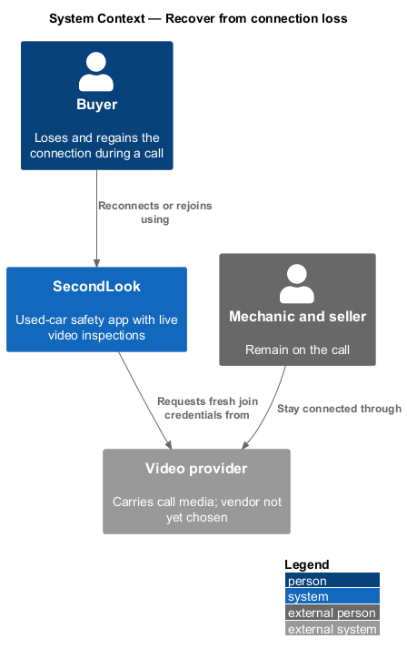
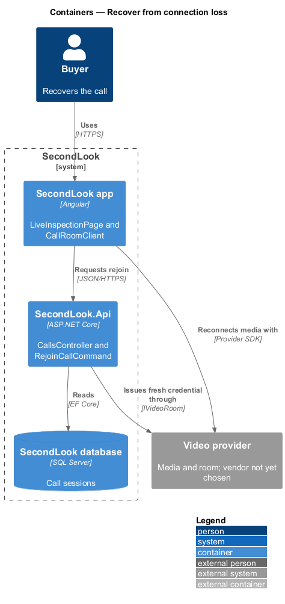
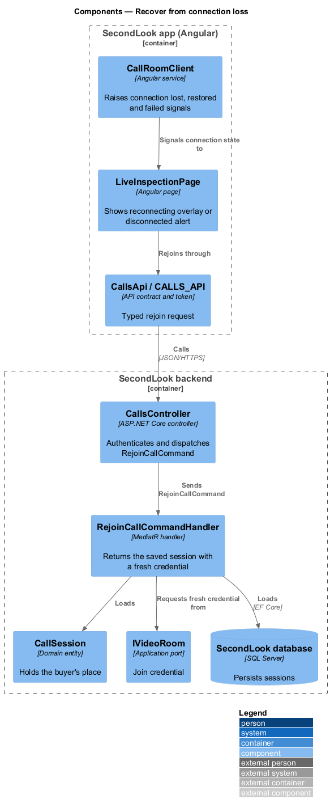
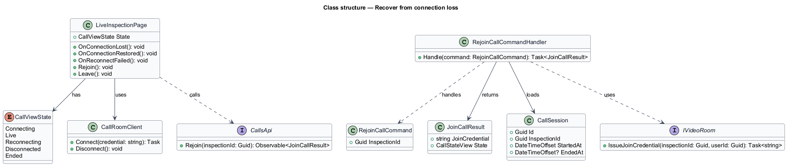
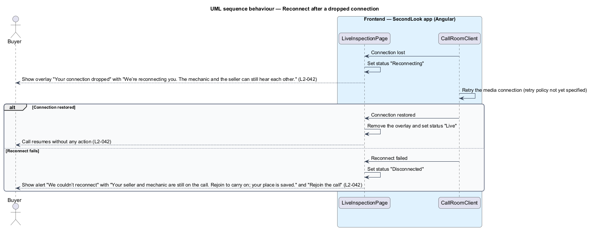
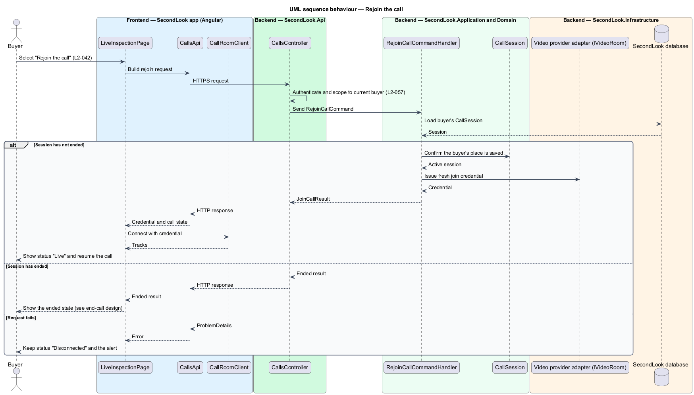

# Recover from connection loss

## Overview

SecondLook is a used-car safety app for buyers purchasing a vehicle "as is" who cannot get a mechanic to the car in person. This feature covers what the buyer sees and can do when their own network connection drops during a live inspection, on the live inspection screen at `/inspections/civic-lx/call` in the mock set. The `civic-lx` segment is a mock identifier; the production route parameter is `<TO SUPPLY>`.

A *reconnecting* state is a transient call state in which the client retries the media connection while the rest of the call continues. A *disconnected* state is a terminal client state reached when reconnecting fails and only the buyer's action can resume the call. The buyer's *place* is the buyer's saved participation in the call session, so that a rejoin resumes the same session.

The feature refines `L1-009`. The video provider, the signalling channel and the recording store are `<TO SUPPLY>`; this design names no vendor.

## Description

The feature is a vertical slice that extends `LiveInspectionPage` with two states and adds one backend operation. No call code exists yet, so every component below is introduced by this design.

- **`LiveInspectionPage`** — Angular page in `projects/secondlook/src/app/pages/`, routed at `/inspections/civic-lx/call` in the mock set. It adds the `reconnecting` and `disconnected` view states to the states described in the join-live-inspection design.
- **`CallRoomClient`** — Angular service that wraps the video provider SDK, which is `<TO SUPPLY>`. It raises `connectionLost`, `connectionRestored` and `reconnectFailed` signals to the page. The number of retries and the time allowed before `reconnectFailed` are `<TO SUPPLY>`.
- **`ConnectionBanner` overlay** — an overlay rendered inside the live stage with `role="status"` in the reconnecting state. It contains an icon, the heading "Your connection dropped" and the text "We’re reconnecting you. The mechanic and the seller can still hear each other." It dismisses itself when the connection returns.
- **`ReconnectFailedAlert`** — an alert rendered inside the live stage with `role="alert"` in the disconnected state. It contains the heading "We couldn’t reconnect", the text "Your seller and mechanic are still on the call. Rejoin to carry on; your place is saved.", the button "Rejoin the call" and the action "Leave".
- **`CallsApi` / `CALLS_API`** — contract and injection token in `projects/api`. The page depends on the token. The rejoin operation returns a fresh `JoinCallResult`.
- **`CallsController`** — ASP.NET Core controller in `SecondLook.Api`, base route `/api/calls`. It authenticates the caller, scopes the request to the current buyer (`L2-057`) and dispatches `RejoinCallCommand`. The endpoint path is `<TO SUPPLY>`.
- **`RejoinCallCommand`** and **`RejoinCallCommandHandler`** — MediatR command and handler. The handler loads the buyer's `CallSession`, checks the session has not ended, asks `IVideoRoom` for a fresh join credential and returns the existing call state. The handler is idempotent: repeated rejoin requests return the same session and do not create a second one. When the session has ended, the handler returns the ended result and the page moves to the ended state described in the end-call design.
- **`CallSession`** — domain entity. The session persists on the server while the buyer is disconnected, which is what saves the buyer's place. The checklist state and the elapsed time continue from the session.
- **`IVideoRoom`** — application port for the video provider. The vendor is `<TO SUPPLY>`.

State behaviour on the page:

- **Reconnecting.** The status reads "Reconnecting". An overlay with `role="status"` announces "Your connection dropped" with "We’re reconnecting you. The mechanic and the seller can still hear each other." The "Mute", "Camera off" and "End call" controls remain visible. Whether they are enabled while reconnecting is `<TO SUPPLY>` (`L2-042`).
- **Restored.** When the connection returns, the overlay is removed, the status returns to "Live" and the call resumes without any action from the buyer. No dialog or button is shown.
- **Disconnected.** When reconnecting fails, the status reads "Disconnected". An alert with `role="alert"` shows "We couldn’t reconnect" with "Your seller and mechanic are still on the call. Rejoin to carry on; your place is saved." and "Rejoin the call". The video stage keeps the last caption and the checklist panel stays visible.
- **Rejoin.** "Rejoin the call" requests a fresh credential and reconnects. A failure of the rejoin request itself keeps the disconnected state. The message for that failure is `<TO SUPPLY>`.

The mock note states that the overlay "usually" dismisses within 10 seconds. That figure is an observation in the mock and not a rule, and the design takes no timing guarantee from it.

## Requirements

The feature realizes the following level-2 (L2) requirements. Each L2 requirement refines a level-1 (L1) requirement, cited by identifier.

| L2 ID | Refines (L1) | Requirement |
|-------|--------------|-------------|
| `L2-042` | `L1-009` | Connection problems. When the buyer’s connection drops, the call shall show the status "Reconnecting" and an overlay shall announce "Your connection dropped" with "We’re reconnecting you. The mechanic and the seller can still hear each other.". When the connection is restored, the call shall resume without the buyer acting. When reconnecting fails, the status shall read "Disconnected" and an alert shall say "We couldn’t reconnect" with "Your seller and mechanic are still on the call. Rejoin to carry on; your place is saved." and "Rejoin the call". |

## Diagrams

### System context

The buyer's connection to the video provider drops and returns. The remote participants stay on the call through the provider.

### Containers

The Angular app detects the loss through the provider SDK. A rejoin goes through the SecondLook API, which keeps the call session in the database.

### Components

`LiveInspectionPage` reacts to signals from `CallRoomClient`, shows the overlay or the alert, and calls `CallsApi` to rejoin. `RejoinCallCommandHandler` reuses the existing `CallSession`.

### Class structure

`LiveInspectionPage` moves between `Live`, `Reconnecting` and `Disconnected`. `RejoinCallCommandHandler` returns a `JoinCallResult` for the existing `CallSession`.

### Behaviour — reconnect

The client loses the connection, shows the overlay, and either resumes the call or shows the disconnected alert.

### Behaviour — rejoin the call

The buyer selects "Rejoin the call". The handler returns a fresh credential for the saved session and the page reconnects.

## Implementation notes (J10)

Delivered in `CallPage` (L2-042, L2-075). A socket that closes without the participant leaving moves the call to "Reconnecting" with the "Your connection dropped" alert, closes the peer connections and retries after 1.2 s, 1.8 s and 2.4 s. A `welcome` message counts as success; a socket that opens and closes again counts as another failed attempt. After the last attempt the call shows "Disconnected", "We couldn’t reconnect" and "Rejoin the call", which joins again and reconnects; the participant's place is kept because a new socket for the same user replaces the old one without announcing a departure. Peers rebuild the media connection when a participant (re)joins. The weak-connection banner is deferred.
