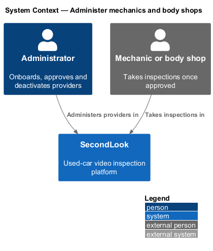
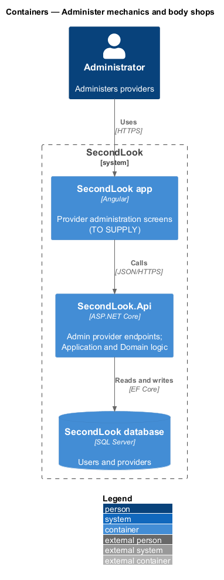
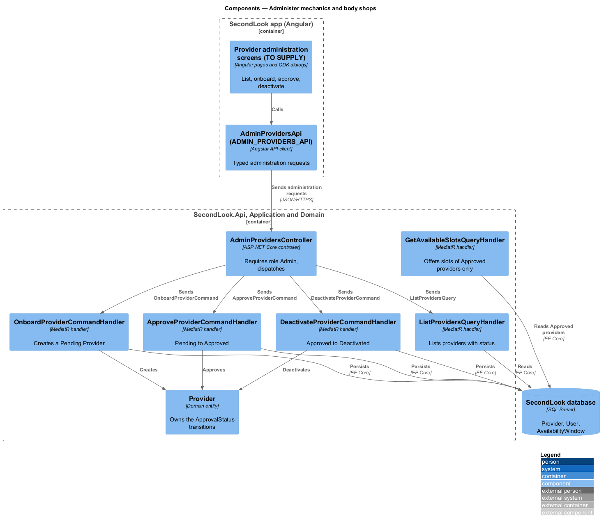
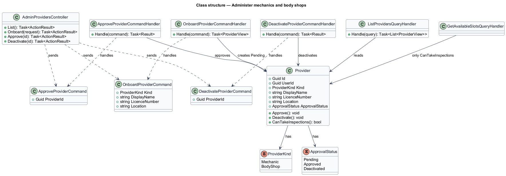
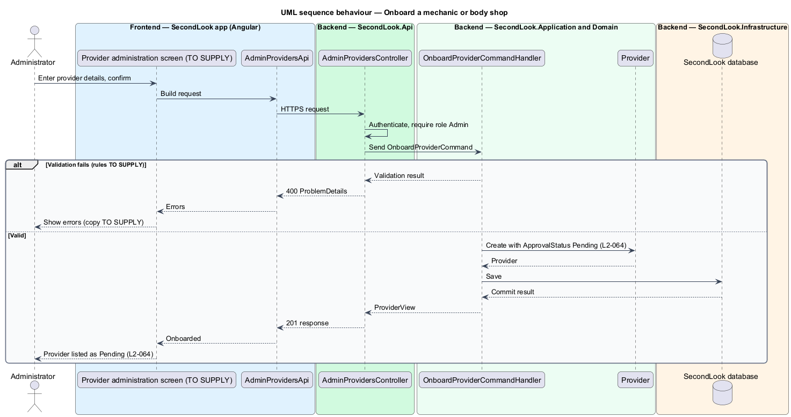
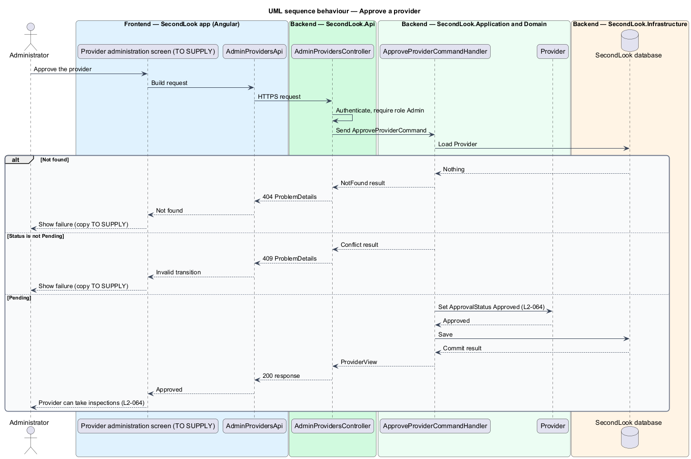
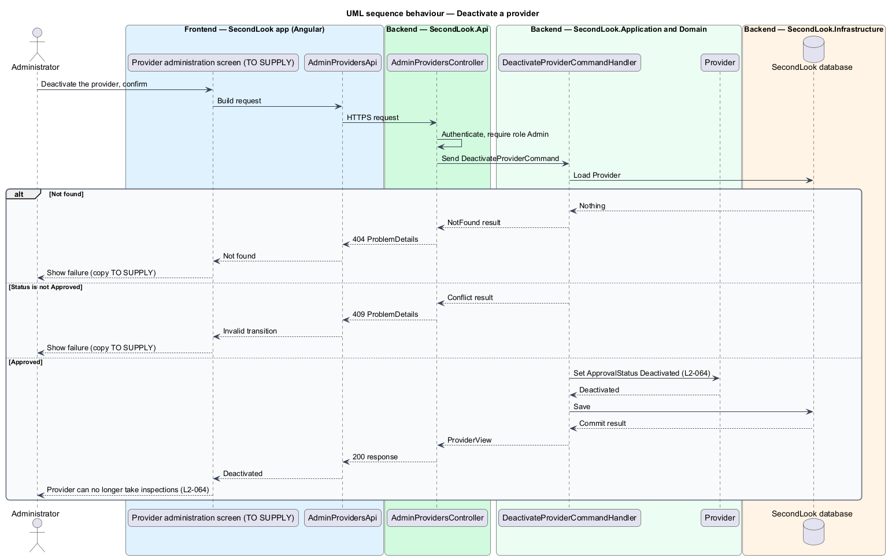

# Administer mechanics and body shops

## Overview

SecondLook is a used-car safety app for buyers purchasing a vehicle "as is" who cannot get a mechanic to the car in person. This feature lets an administrator onboard, approve and deactivate the mechanics and body shops that take inspections.

A *provider* is a mechanic or body shop registered with SecondLook, modelled as `Provider` with a `Kind` of `Mechanic` or `BodyShop`. *Approval status* is the provider's lifecycle state, modelled as `Provider.ApprovalStatus` with the values `Pending`, `Approved` and `Deactivated`. An *administrator* is a user with the role `Admin`.

The feature has no mock. The design is grounded in the "Administer mechanics and shops" journey and `L2-064`; every screen, field, endpoint and rule that those sources do not state is marked `<TO SUPPLY>`.

## Description

The feature is a vertical slice from the Angular app to the database. No administration code exists yet, so every component below is introduced by this design.

- **Provider administration screens** — the screens or dialogs on which an administrator lists providers and onboards, approves and deactivates them. Their routes, layout, fields, states and copy are `<TO SUPPLY>`. Because each action is button-triggered, each shall open a CDK Dialog or navigate to a screen, not render an inline form.
- **`AdminProvidersApi` / `ADMIN_PROVIDERS_API`** — contract and injection token in `projects/api`. Pages depend on the token.
- **`AdminProvidersController`** — ASP.NET Core controller in `SecondLook.Api`, base route `/api/admin/providers`. It authenticates the caller and admits only the role `Admin`; every other role receives forbidden. The paths and verbs under the base are `<TO SUPPLY>`. How an administrator account is created is `<TO SUPPLY>`.
- **`OnboardProviderCommand`** and **`OnboardProviderCommandHandler`** — create a `Provider` with `ApprovalStatus` `Pending` (`L2-064`). The fields captured are those of the shared vocabulary (`Kind`, `DisplayName`, `LicenceNumber`, `Location`); validation rules are `<TO SUPPLY>`. Whether the administrator creates the provider's `User` account, links an existing account that the provider created at sign-up, or sends an invitation, is `<TO SUPPLY>`. Idempotency of onboarding is `<TO SUPPLY>`.
- **`ApproveProviderCommand`** and handler — change `Pending` to `Approved`, after which the provider can take inspections (`L2-064`).
- **`DeactivateProviderCommand`** and handler — change `Approved` to `Deactivated`, after which the provider can no longer take inspections (`L2-064`). A request that does not start from the stated status returns a conflict.
- **`ListProvidersQueryHandler`** — returns providers with their `ApprovalStatus`. Filters and paging are `<TO SUPPLY>`.
- **`Provider`** — domain entity that owns the transitions and exposes `CanTakeInspections`, true only when `ApprovalStatus` is `Approved`. Transitions other than `Pending` to `Approved` and `Approved` to `Deactivated` (rejection of a pending provider, reactivation of a deactivated provider) are `<TO SUPPLY>`.

Effects on other features:

- `GetAvailableSlotsQueryHandler`, described in `manage-availability` and in the schedule-inspection design, offers slots only for providers whose `CanTakeInspections` is true. A deactivated provider therefore stops appearing in the buyer's slot list.
- The assignment of an `Inspection` accepts only a provider that can take inspections.
- The effect of deactivation on inspections already scheduled with that provider, on open slot holds, and on the provider's saved `AvailabilityWindow` rows, is `<TO SUPPLY>`.
- Notification of the provider about approval or deactivation is `<TO SUPPLY>`.
- An audit trail of administrator actions is `<TO SUPPLY>`.

## Requirements

The feature realizes the following level-2 (L2) requirement. The L2 requirement refines a level-1 (L1) requirement, cited by identifier.

| L2 ID | Refines (L1) | Requirement |
|-------|--------------|-------------|
| `L2-064` | `L1-019` | Administer mechanics and body shops. When an administrator onboards a mechanic or body shop, it shall be added to the system. When the administrator approves an onboarded mechanic or body shop, it shall be able to take inspections. When the administrator deactivates an approved mechanic or body shop, it shall no longer be able to take inspections. |

## Diagrams

### System context

The administrator administers providers in SecondLook. The provider takes inspections only after approval.

### Containers

The Angular app calls `SecondLook.Api`, which reads and writes `Provider` rows in the SecondLook database. The feature adds no worker.

### Components

`AdminProvidersController` dispatches the onboard, approve, deactivate and list requests. `GetAvailableSlotsQueryHandler` reads only approved providers.

### Class structure

`Provider` owns the `ApprovalStatus` transitions. Each handler loads or creates a `Provider`.

### Behaviour — onboard a provider

The handler creates a `Pending` provider, or returns a validation result.

### Behaviour — approve a provider

The handler sets `Approved` on a `Pending` provider, or returns not found or conflict.

### Behaviour — deactivate a provider

The handler sets `Deactivated` on an `Approved` provider, or returns not found or conflict.

