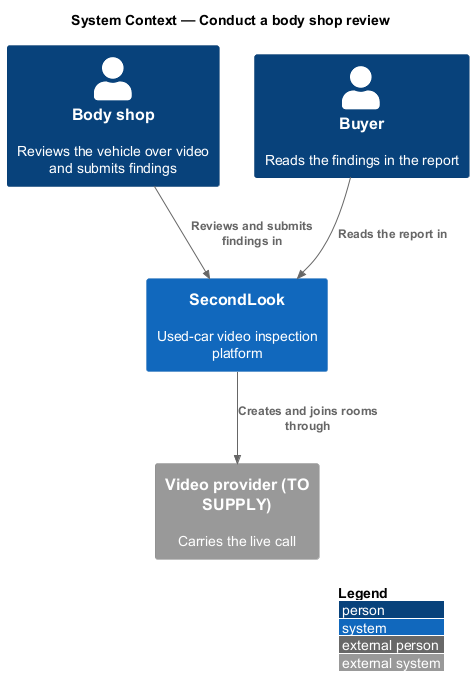
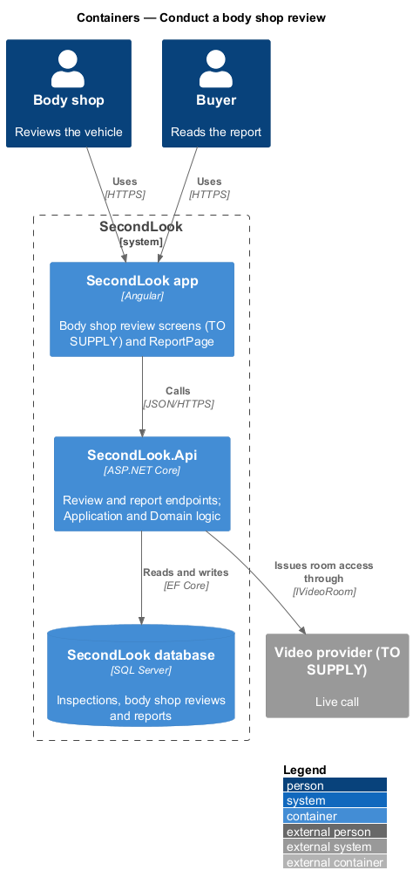
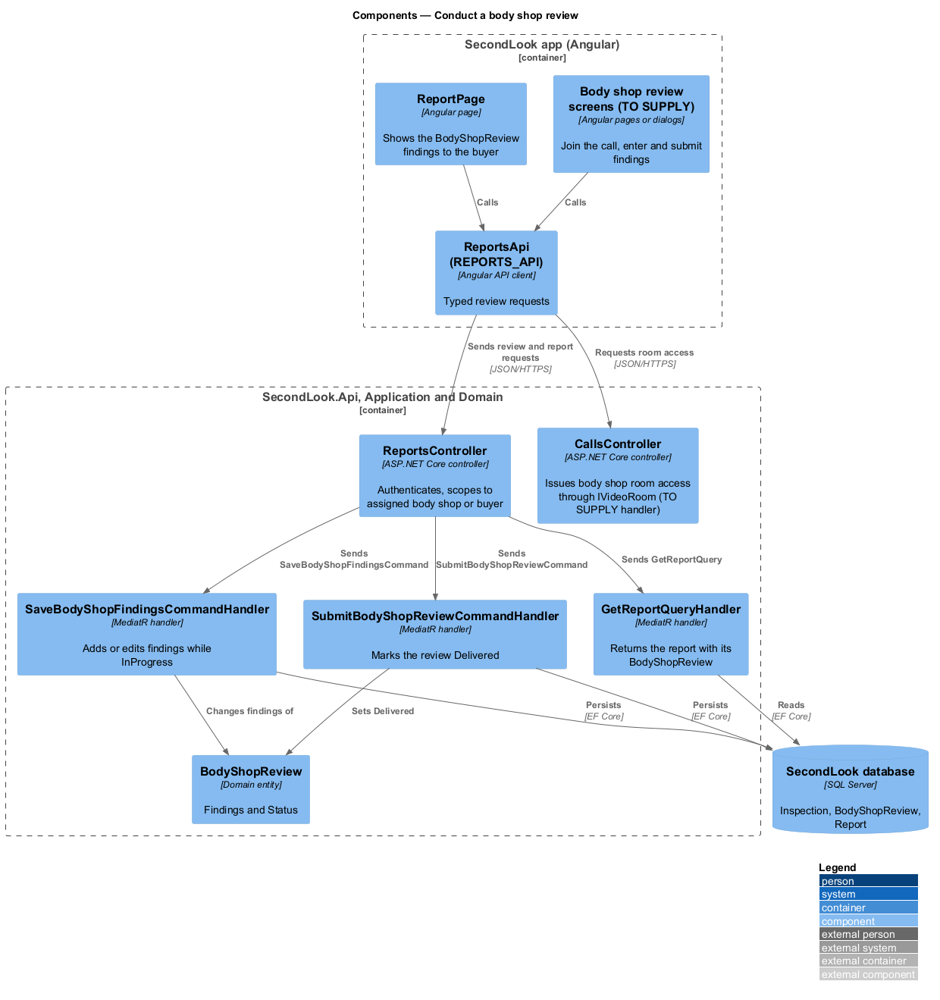
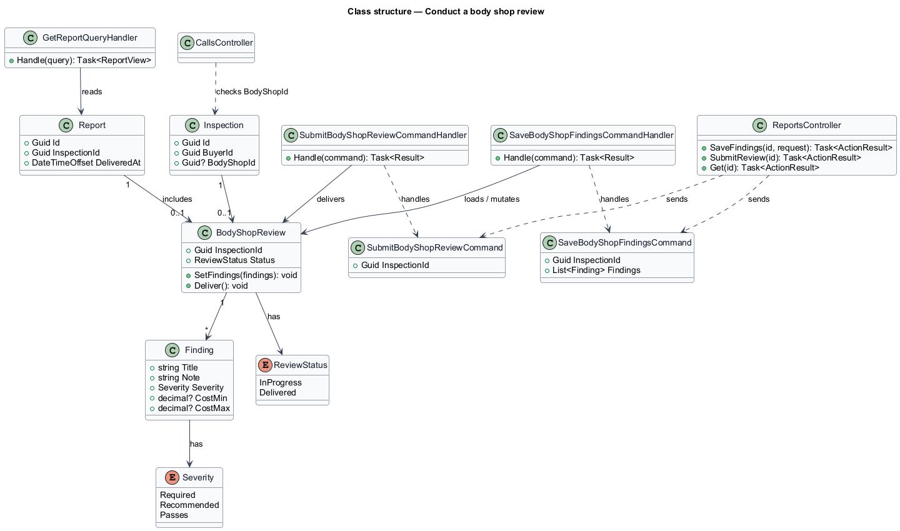
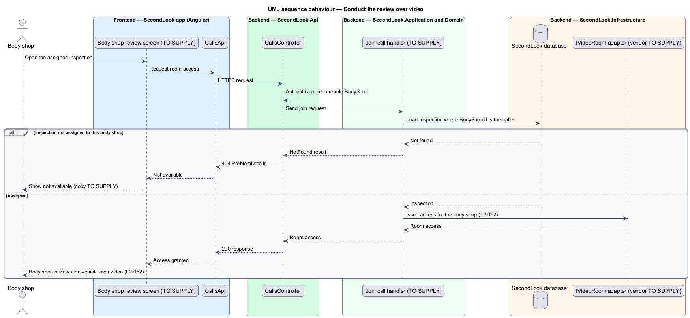
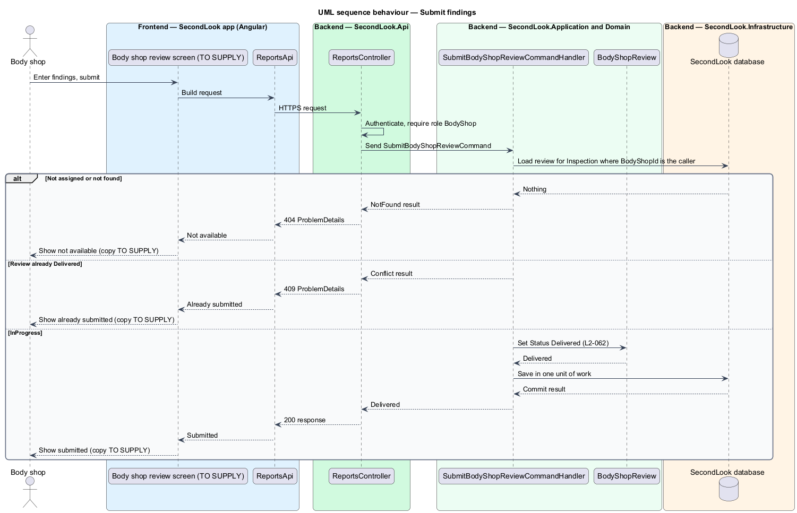
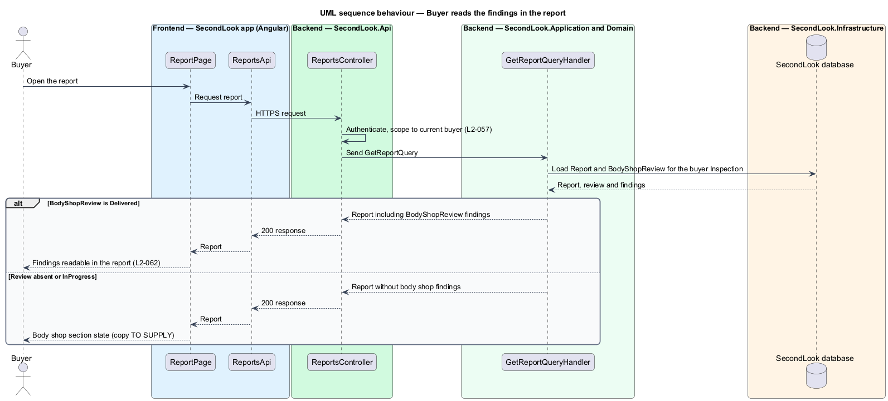

# Conduct a body shop review

## Overview

SecondLook is a used-car safety app for buyers purchasing a vehicle "as is" who cannot get a mechanic to the car in person. This feature covers the body shop side of the optional body shop review: the body shop reviews the vehicle over video and submits its findings, and the buyer reads them in the report.

A *body shop review* is an assessment of a vehicle's body condition by an assigned body shop, modelled as `BodyShopReview` with a `Status` of `InProgress` or `Delivered`. A *finding* is one recorded observation with a title, a note, a severity (`Required`, `Recommended` or `Passes`) and an optional cost range, modelled as `Finding`. The buyer chooses the body shop review at booking time (`ReviewType` of `BodyShop` or `Both`); that choice belongs to the booking-pricing subsystem.

The feature has no mock. The design is grounded in the "Conduct body shop review" journey and `L2-062`; every screen, field, endpoint and rule that those sources do not state is marked `<TO SUPPLY>`.

## Description

The feature is a vertical slice from the Angular app to the database. No review code exists yet, so every component below is introduced by this design.

- **Body shop review screens** — the screens or dialogs on which a body shop joins the call, enters findings and submits them. Their routes, layout, fields, states and copy are `<TO SUPPLY>`. A button-triggered edit shall open a CDK Dialog or navigate to a screen, not an inline form.
- **`ReportsApi` / `REPORTS_API`** and **`CallsApi`** — contracts and injection tokens in `projects/api`. Screens and pages depend on the tokens.
- **`CallsController`** — existing in the live-inspection design as the entry to the call. This feature adds the body shop as a participant. The handler loads the `Inspection` where `BodyShopId` equals the caller and, only then, requests access from `IVideoRoom` (`L2-062`). The video provider is `<TO SUPPLY>`. Whether the body shop joins the mechanic's call or a separate call, and whether the call is recorded, are `<TO SUPPLY>`.
- **`ReportsController`** — ASP.NET Core controller in `SecondLook.Api`, base route `/api/reports`. It authenticates the caller, scopes a buyer to their own report (`L2-057`) and scopes a body shop to inspections assigned to it. The paths under the base are `<TO SUPPLY>`.
- **`SaveBodyShopFindingsCommand`** and handler — add or edit the `Finding` list while the `BodyShopReview` is `InProgress`. Whether findings are saved as drafts before submission is `<TO SUPPLY>`; the `InProgress` status models that state.
- **`SubmitBodyShopReviewCommand`** and **`SubmitBodyShopReviewCommandHandler`** — set the review to `Delivered` in one unit of work. A review that is already `Delivered` is rejected with a conflict. Validation of the findings before submission, and whether a delivered review may be amended, are `<TO SUPPLY>`.
- **`BodyShopReview`** and **`Finding`** — domain entities as in the shared vocabulary. The `Report` includes one `BodyShopReview`. The values of `CostMin` and `CostMax` are the body shop's inputs; the rules that combine them with the mechanic's `CertificationCostMin` and `CertificationCostMax` are `<TO SUPPLY>`.
- **`GetReportQueryHandler`** — existing in the report design. It returns the `BodyShopReview` findings with the report once the review is `Delivered`, so the buyer reads them on `ReportPage` (`L2-062`). How the section appears while the review is absent or `InProgress`, and how the buyer learns of delivery (notification, email), are `<TO SUPPLY>`.
- **Authorization** — only a user with role `BodyShop` and an assigned `Inspection` can join or submit. Any other inspection returns not found, so other providers' inspections are not exposed.

## Requirements

The feature realizes the following level-2 (L2) requirement. The L2 requirement refines a level-1 (L1) requirement, cited by identifier.

| L2 ID | Refines (L1) | Requirement |
|-------|--------------|-------------|
| `L2-062` | `L1-017` | Conduct a body shop review. When a body shop is assigned to an inspection and the review is conducted, the body shop shall review the vehicle over video. When the body shop has reviewed the vehicle and submits its findings, the buyer shall be able to read them in the report. |

## Diagrams

### System context

The body shop reviews and submits findings in SecondLook, which uses a video provider for the call. The buyer reads the result in the report.

### Containers

The Angular app calls `SecondLook.Api`, which reads and writes reviews in the SecondLook database and issues room access through `IVideoRoom`.

### Components

The review screens call `CallsController` and `ReportsController`. The save and submit handlers change `BodyShopReview`, and `GetReportQueryHandler` returns it to `ReportPage`.

### Class structure

An `Inspection` has at most one `BodyShopReview`, which holds a list of `Finding` items and is included in the `Report`.

### Behaviour — conduct the review over video

The handler grants room access only to the assigned body shop; any other caller receives not found.

### Behaviour — submit findings

The handler marks an `InProgress` review `Delivered`, or returns not found or conflict.

### Behaviour — buyer reads the findings

The report query returns the delivered findings to the buyer who owns the inspection.

