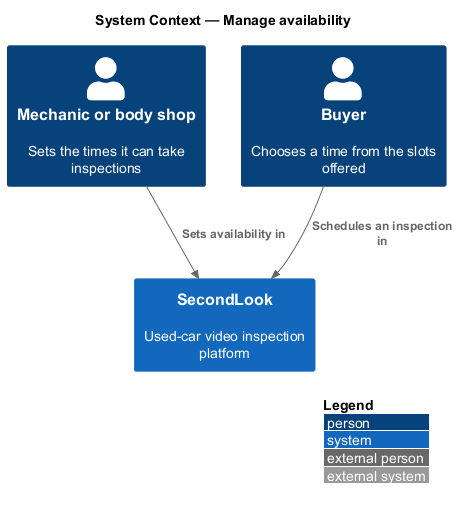
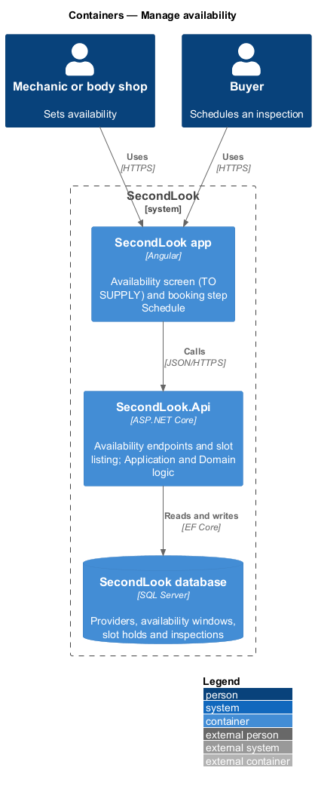
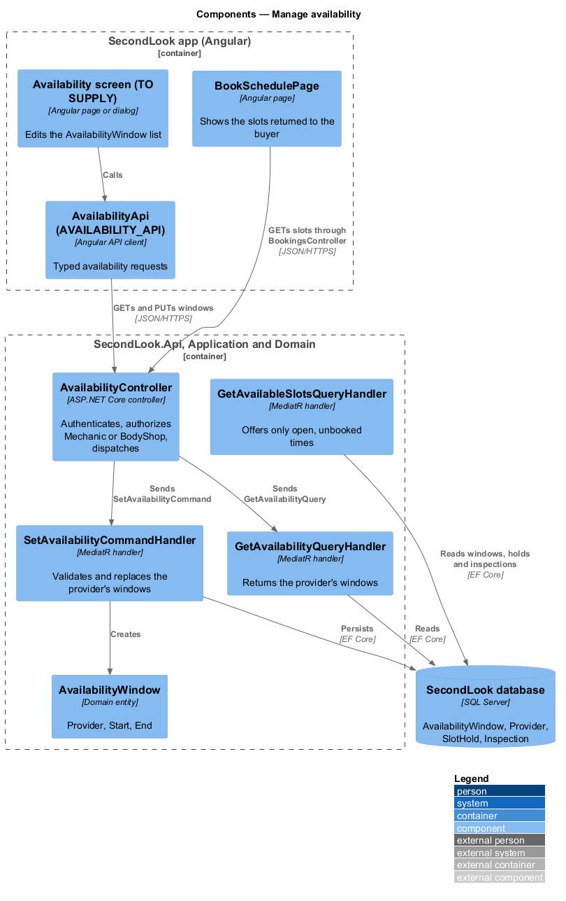
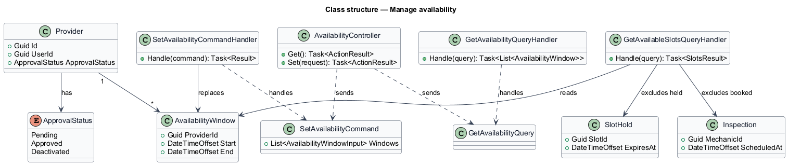
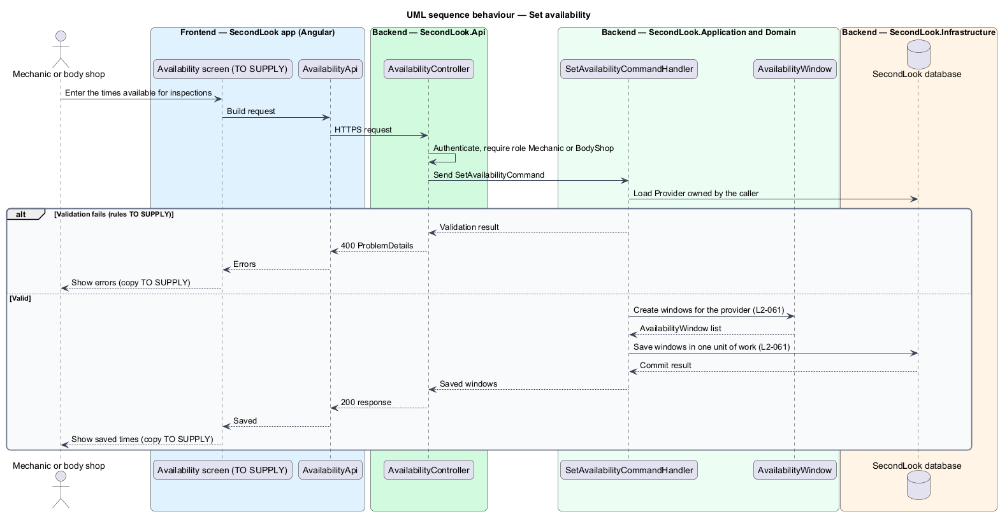
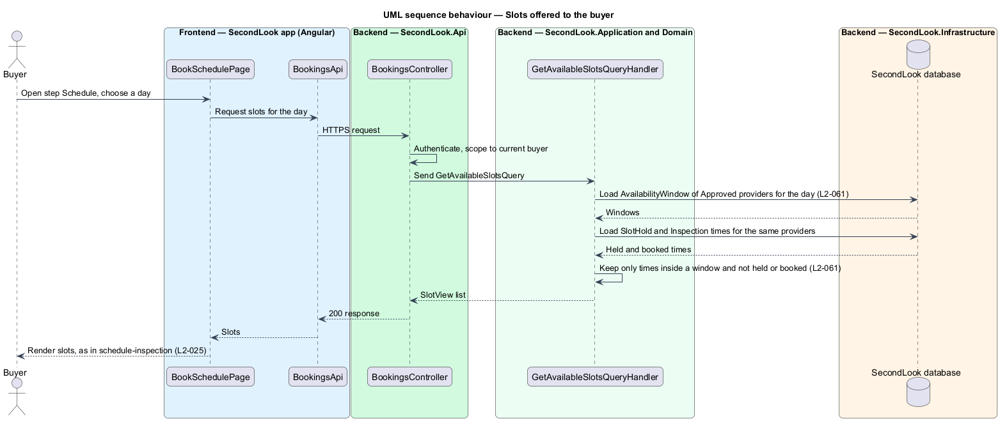

# Manage availability

## Overview

SecondLook is a used-car safety app for buyers purchasing a vehicle "as is" who cannot get a mechanic to the car in person. This feature lets a mechanic or body shop set the times it can take inspections, so buyers can book only those times.

An *availability window* is a span of time, with a start and an end, during which one provider can take inspections. A *provider* is a mechanic or body shop registered with SecondLook, modelled as `Provider`. A *slot* is a bookable time on a given day for one mechanic, as defined in the schedule-inspection design.

The feature has no mock. The design is grounded in the "Manage availability" journey and `L2-061`; every screen, field, endpoint and rule that those sources do not state is marked `<TO SUPPLY>`.

## Description

The feature is a vertical slice from the Angular app to the database. No availability code exists yet, so every component below is introduced by this design.

- **Availability screen** — the screen or dialog on which a provider sets its times. Its existence follows from the journey; its route, layout, fields, states and copy are `<TO SUPPLY>`. Because editing is triggered by a button, the editing surface shall be a CDK Dialog or a separate screen, not an inline form.
- **`AvailabilityApi` / `AVAILABILITY_API`** — contract and injection token in `projects/api`. The screen depends on the token.
- **`AvailabilityController`** — ASP.NET Core controller in `SecondLook.Api`, base route `/api/availability`. It authenticates the caller, admits the roles `Mechanic` and `BodyShop`, and dispatches `GetAvailabilityQuery` and `SetAvailabilityCommand`. The paths and HTTP verbs under the base are `<TO SUPPLY>`.
- **`SetAvailabilityCommand`** and **`SetAvailabilityCommandHandler`** — MediatR command and handler. The handler loads the `Provider` owned by the caller, validates the submitted windows, and saves them in one unit of work. The handler never accepts a provider identifier from the request, so a provider can change only its own windows. Whether a save replaces all windows or edits one at a time, and the window format (one-off dates, a weekly pattern, or both), are `<TO SUPPLY>`.
- **`GetAvailabilityQuery`** and handler — return the caller's own windows.
- **`AvailabilityWindow`** — domain entity (`ProviderId`, `Start`, `End`). A provider has zero or more windows. Overlap rules, minimum and maximum length, time zone handling, and the slot length into which a window divides are `<TO SUPPLY>`.
- **`GetAvailableSlotsQueryHandler`** — existing in the schedule-inspection design as the source of the buyer's slot list. This feature constrains it: the handler offers only a time that lies inside an `AvailabilityWindow` of an approved provider and that is not held by a `SlotHold` and not booked by an `Inspection`. The schedule-inspection design does not state where slots originate; this feature supplies that source and does not alter that design. How a window maps to a `SlotId` is `<TO SUPPLY>`.

Consistency with schedule-inspection:

- The buyer's states (loading, default, empty, error), the 10-minute `SlotHold` and the slot-taken toast are unchanged.
- The effect of removing or shortening a window that already covers a booked `Inspection` is `<TO SUPPLY>`.
- Only a provider whose `ApprovalStatus` is `Approved` contributes slots (see `administer-providers`, `L2-064`). Whether a pending provider may save windows before approval is `<TO SUPPLY>`.
- The assignment of a mechanic to a buyer's slot, and the matching of a body shop to a booking, are `<TO SUPPLY>`.

## Requirements

The feature realizes the following level-2 (L2) requirement. The L2 requirement refines a level-1 (L1) requirement, cited by identifier.

| L2 ID | Refines (L1) | Requirement |
|-------|--------------|-------------|
| `L2-061` | `L1-016` | Manage availability. When a mechanic or body shop sets the times they can take inspections, those times shall be saved. When a buyer is scheduling and the slots show, the slots shall be only times that a mechanic has set as available and that have not already been booked. |

## Diagrams

### System context

A mechanic or body shop sets availability in SecondLook. The buyer sees only the resulting times.

### Containers

The Angular app calls `SecondLook.Api`, which reads and writes availability windows in the SecondLook database. The feature adds no worker.

### Components

The availability screen calls `AvailabilityController`, which dispatches the set and get handlers. `GetAvailableSlotsQueryHandler` reads windows, holds and inspections to build the buyer's list.

### Class structure

`SetAvailabilityCommandHandler` replaces the `AvailabilityWindow` rows of one `Provider`. `GetAvailableSlotsQueryHandler` reads windows and excludes held and booked times.

### Behaviour — set availability

The provider submits windows. The handler validates them and saves them for the caller's own `Provider`, or returns a validation result.

### Behaviour — slots offered to the buyer

The slot query intersects approved providers' windows with held and booked times, so the buyer sees only open times.

## Implementation (J03)

Decisions are in ADR 0005. Mocks: `docs/mocks/pages/provider-availability` (default, loading, empty, error, not-approved) and the dialogs `add-availability`, `edit-availability` and `remove-availability`.

Endpoints: `GET /api/availability` (own windows), `POST /api/availability` `{start,end}` (201; 400 field errors; 409 overlap; 403 not approved), `PUT /api/availability/{id}` (200; 404 for another provider's window; 409 overlap or booked), `DELETE /api/availability/{id}` (204; 409 booked), all for roles Mechanic and BodyShop only, with the provider taken from the token. `GET /api/slots?from=&to=&kind=` (role Buyer) returns `{timeZone, slots:[{providerId,providerName,kind,start,end}]}` in UTC for free 30-minute slots of providers who can take inspections. `ReserveSlotCommand` (used by the booking journeys) takes a slot as Held or Booked and returns Reserved, Taken or NotAvailable; the unique index on `(ProviderId, StartUtc)` settles concurrent requests.
