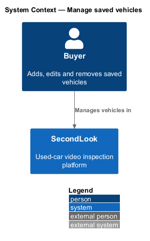
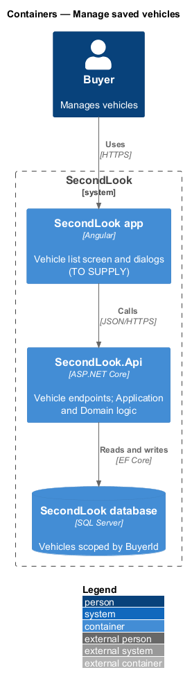
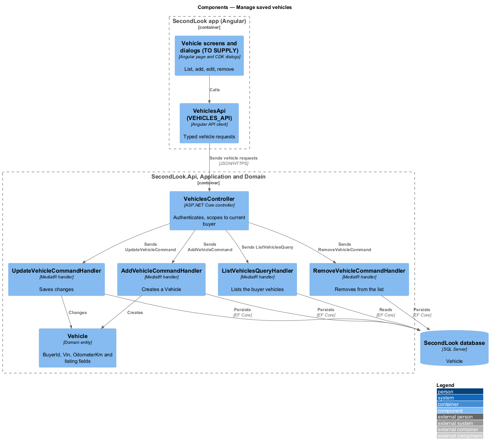
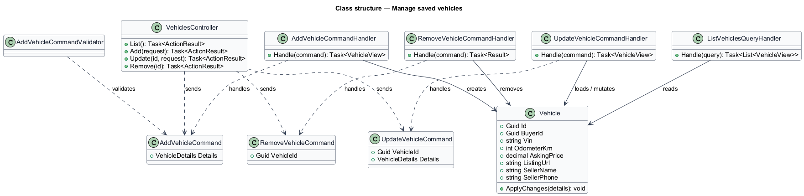
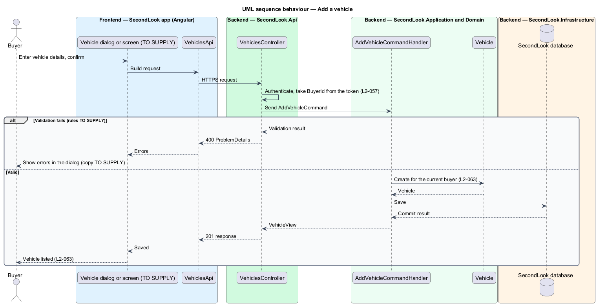
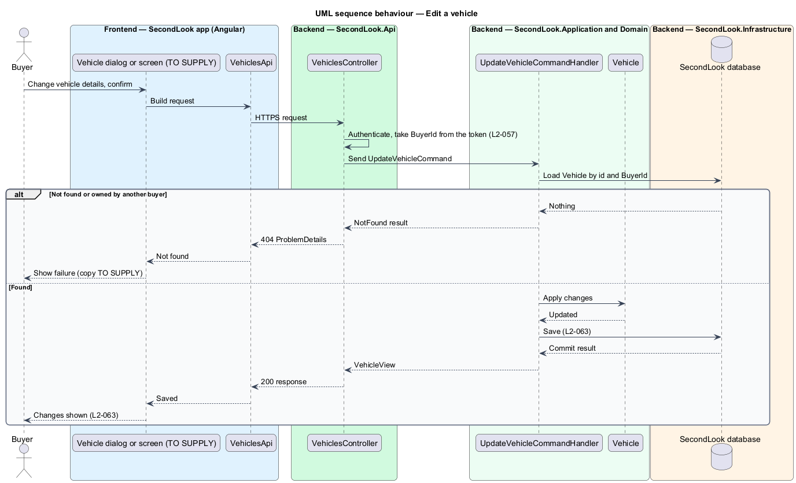
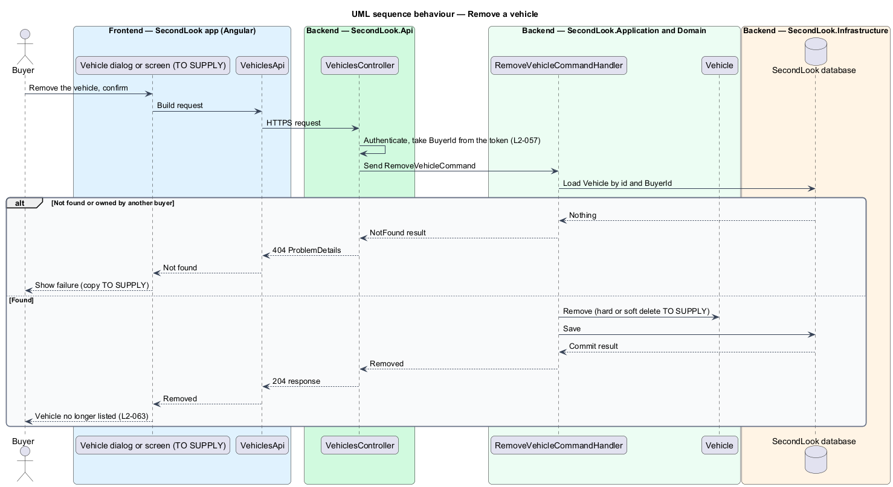

# Manage saved vehicles

## Overview

SecondLook is a used-car safety app for buyers purchasing a vehicle "as is" who cannot get a mechanic to the car in person. This feature lets a buyer add, edit and remove the vehicles saved to their account.

A *saved vehicle* is a vehicle record owned by one buyer, modelled as `Vehicle` with the fields `Vin`, `OdometerKm`, `AskingPrice`, `ListingUrl`, `SellerName` and `SellerPhone`. The booking flow creates and reuses the same record through `SaveVehicleDetailsCommand`, which belongs to the booking-pricing subsystem.

The feature has no mock. The design is grounded in the "Manage vehicles" journey and `L2-063`; every screen, field, endpoint and rule that those sources do not state is marked `<TO SUPPLY>`.

## Description

The feature is a vertical slice from the Angular app to the database. No vehicle-management code exists yet, so every component below is introduced by this design.

- **Vehicle screens and dialogs** — the list of saved vehicles and the add, edit and remove interactions. Their routes, layout, fields, states and copy are `<TO SUPPLY>`. Because add, edit and remove are button-triggered, each shall open a CDK Dialog in `projects/secondlook/src/app/dialogs/` or navigate to a screen, not render an inline form.
- **`VehiclesApi` / `VEHICLES_API`** — contract and injection token in `projects/api`. Pages depend on the token.
- **`VehiclesController`** — ASP.NET Core controller in `SecondLook.Api`. The controller name and the base route `/api/vehicles` are a design choice, because the shared vocabulary lists no vehicles controller. The controller authenticates the caller, takes `BuyerId` from the token, and dispatches the commands and the query. The paths and verbs under the base are `<TO SUPPLY>`.
- **`AddVehicleCommand`**, **`AddVehicleCommandValidator`** and **`AddVehicleCommandHandler`** — create a `Vehicle` for the current buyer (`L2-063`). The validation rules for each field, including the format of `Vin` and the range of `OdometerKm`, are `<TO SUPPLY>`. Whether adding is idempotent, and whether a duplicate `Vin` for one buyer is rejected, are `<TO SUPPLY>`.
- **`UpdateVehicleCommand`** and handler — load the `Vehicle` by identifier and `BuyerId`, apply the changes and save them (`L2-063`). Which fields are editable is `<TO SUPPLY>`.
- **`RemoveVehicleCommand`** and handler — load the `Vehicle` by identifier and `BuyerId` and remove it from the buyer's list (`L2-063`). Whether removal deletes the row or marks it removed, and the effect on a `Booking` or `Inspection` that references the vehicle, are `<TO SUPPLY>`. The confirmation copy is `<TO SUPPLY>`.
- **`ListVehiclesQueryHandler`** — returns only the current buyer's vehicles that are not removed.
- **Scoping** — every handler filters by `BuyerId`. A vehicle owned by another buyer returns not found, so other users' resources are not exposed (`L2-057`).

## Requirements

The feature realizes the following level-2 (L2) requirement. The L2 requirement refines a level-1 (L1) requirement, cited by identifier.

| L2 ID | Refines (L1) | Requirement |
|-------|--------------|-------------|
| `L2-063` | `L1-018` | Manage saved vehicles. When a buyer adds a vehicle, it shall be saved to their account. When a buyer edits a saved vehicle, the changes shall be saved. When a buyer removes a saved vehicle, it shall no longer be listed. |

## Diagrams

### System context

The buyer manages vehicles in SecondLook. The feature has no external system.

### Containers

The Angular app calls `SecondLook.Api`, which reads and writes `Vehicle` rows in the SecondLook database. The feature adds no worker.

### Components

`VehiclesController` dispatches one command or query per interaction. Each handler reads or writes `Vehicle`.

### Class structure

Three command handlers and one query handler operate on `Vehicle`. `AddVehicleCommandValidator` validates the add command.

### Behaviour — add a vehicle

The handler creates the vehicle for the current buyer, or returns a validation result.

### Behaviour — edit a vehicle

The handler saves the changes, or returns not found when the vehicle does not exist for the buyer.

### Behaviour — remove a vehicle

The handler removes the vehicle from the list, or returns not found when the vehicle does not exist for the buyer.

