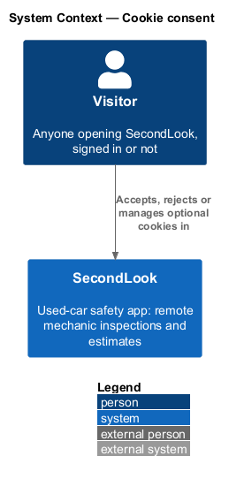
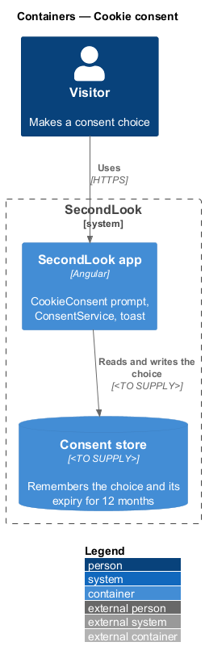
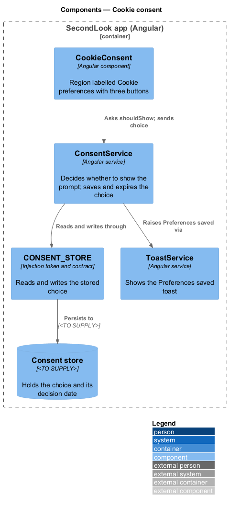
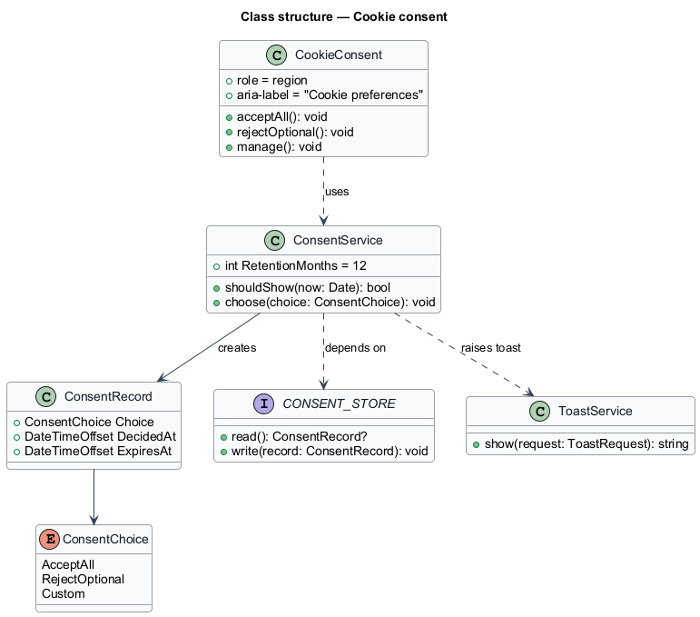
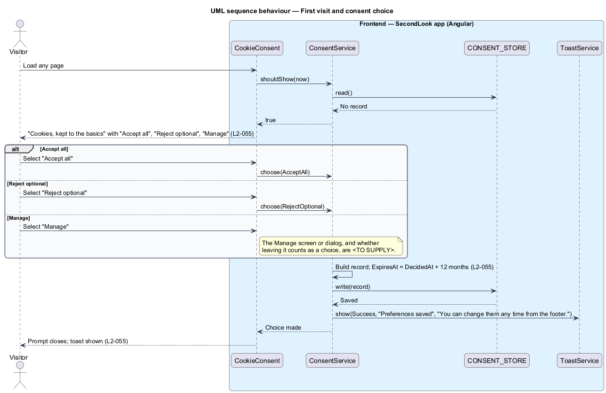
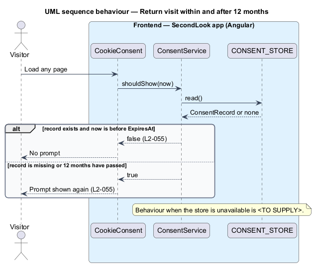

# Cookie consent

## Overview

SecondLook is a used-car safety app for buyers purchasing a vehicle "as is" who cannot get a mechanic to the car in person. This feature covers the cookie consent prompt, shown to a visitor on a first visit. The mocks are `docs/mocks/notifications/cookie-consent/` with the states `info` (the prompt) and `success` (the confirmation toast). The prompt is mocked over the home page, and it applies to every page.

*Cookie consent* is the visitor's recorded choice about optional cookies. *Essential cookies* are the cookies that keep a user signed in; *optional cookies* are the cookies used to see which pages help. The mock copy states that nothing is sold. The mock manifest records that no warning or danger state exists, because the choice is accept, reject or manage and saving it cannot fail in a way the visitor needs to act on.

This document assumes no prior knowledge of SecondLook internals; the diagrams show where each part lives.

## Description

The feature is a frontend slice. No consent code exists yet, so every component below is introduced by this design.

- **`CookieConsent`** — Angular component in `projects/secondlook/src/app/`, rendered once by the app shell. It is a card with `role="region"` and `aria-label="Cookie preferences"`. It shows the heading "Cookies, kept to the basics", the text "We use essential cookies to keep you signed in, and optional ones to see which pages help. Nothing is sold." and three buttons: "Accept all" (primary), "Reject optional" (outline) and "Manage" (ghost).
- **`ConsentService`** — Angular service. `shouldShow(now)` returns true when no record exists or the record has expired. `choose(choice)` builds a `ConsentRecord`, writes it, and raises the confirmation toast.
- **`CONSENT_STORE`** — injection token and contract with `read` and `write`. The service depends on the token, not on a storage mechanism.
- **`ConsentRecord`** — the choice (`AcceptAll`, `RejectOptional` or `Custom`), the decision time and the expiry, which is 12 months after the decision.
- **Toast** — after a choice, the service calls `ToastService` (see the toasts design) with the `success` variant, the title "Preferences saved" and the text "You can change them any time from the footer.".

Where the choice is stored is `<TO SUPPLY>`. Candidates are a browser cookie, browser local storage, and a server-side record for signed-in users; the design does not choose among them. The contract keeps the choice open. The same applies to how the stored choice gates optional cookies and which analytics provider the optional cookies serve.

Other points that `L2-055` leaves open are `<TO SUPPLY>`:

- What "Manage" opens, and whether leaving it counts as a choice. The mocks show no manage screen.
- How a visitor changes a choice later. The toast says this is possible "from the footer", and the footer in the mocks shows only Terms, Privacy and Help.
- The prompt position and focus handling. The mock places the card at the bottom of the page as a region, not a modal.

Behaviour:

- **First visit.** With no stored record, the prompt shows when the page loads.
- **Choice.** Selecting any of the buttons closes the prompt and shows the toast.
- **Return.** While the stored record is within 12 months of the decision, the prompt does not show. After 12 months, or when no record is readable, the prompt shows again.

## Requirements

The feature realizes the following level-2 (L2) requirement. Each L2 requirement refines a level-1 (L1) requirement, cited by identifier.

| L2 ID | Refines (L1) | Requirement |
|-------|--------------|-------------|
| `L2-055` | `L1-012` | Cookie consent. On a first visit, when the page loads, a prompt labelled "Cookie preferences" shall show "Cookies, kept to the basics" with "We use essential cookies to keep you signed in, and optional ones to see which pages help. Nothing is sold." and the buttons "Accept all", "Reject optional" and "Manage". When the visitor makes a choice, the prompt shall close and a toast shall show "Preferences saved" with "You can change them any time from the footer.". When a choice has been made and the visitor returns within 12 months, the prompt shall not show. |

## Diagrams

### System context

The visitor makes a consent choice inside SecondLook. No external system takes part in this slice.

### Containers

The Angular app holds the prompt and the service. The consent store is an unresolved container, `<TO SUPPLY>`.

### Components

`CookieConsent` asks `ConsentService`, which reads and writes through `CONSENT_STORE` and raises the toast.

### Class structure

`ConsentService` creates a `ConsentRecord` with a 12-month expiry and writes it through the `CONSENT_STORE` contract.

### Behaviour — first visit and choice

The prompt shows when no record exists. A choice writes the record, closes the prompt and shows "Preferences saved".

### Behaviour — return visit

The prompt stays hidden while the record is within 12 months and shows again afterward.

