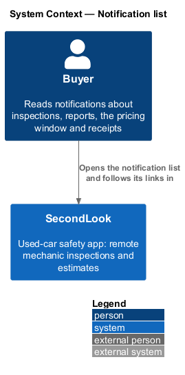
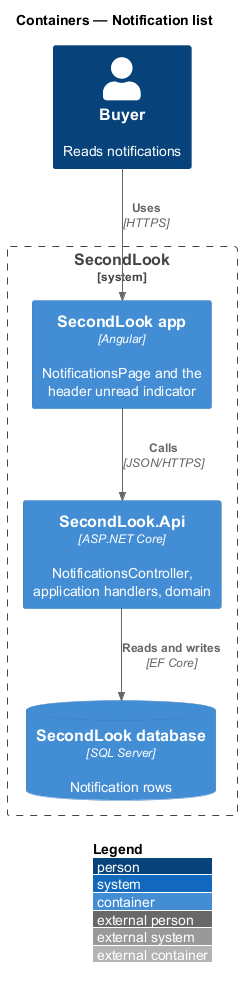
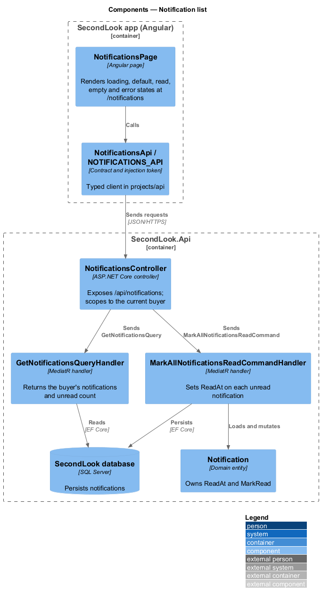
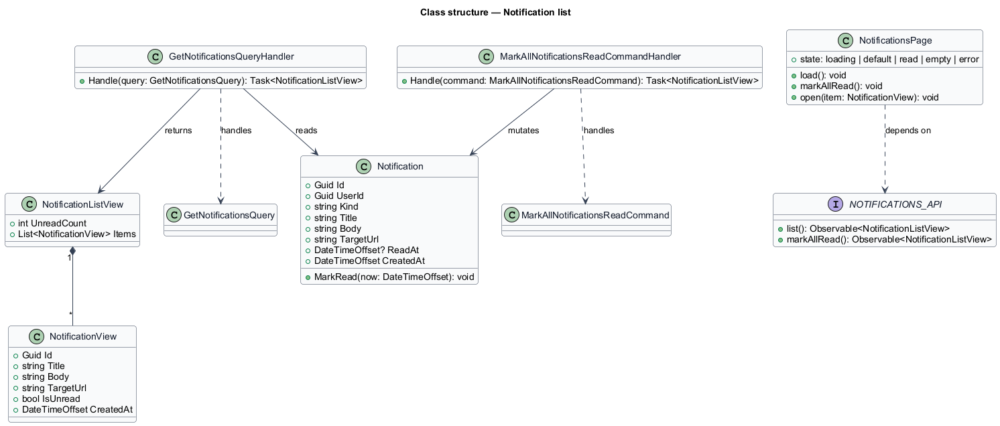
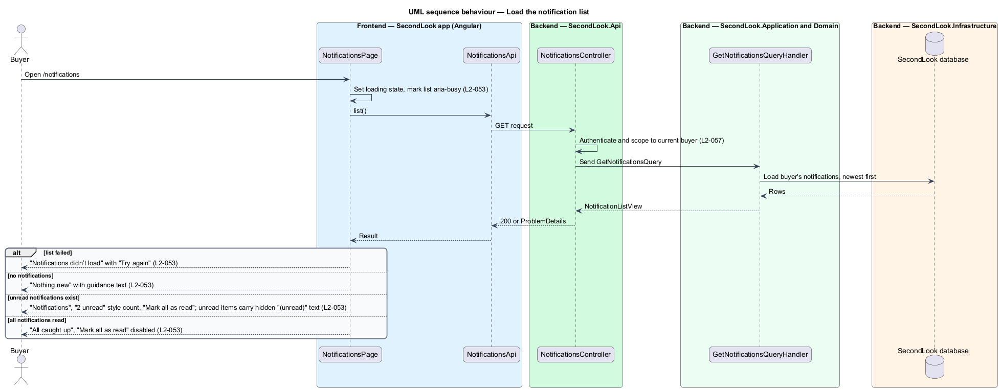
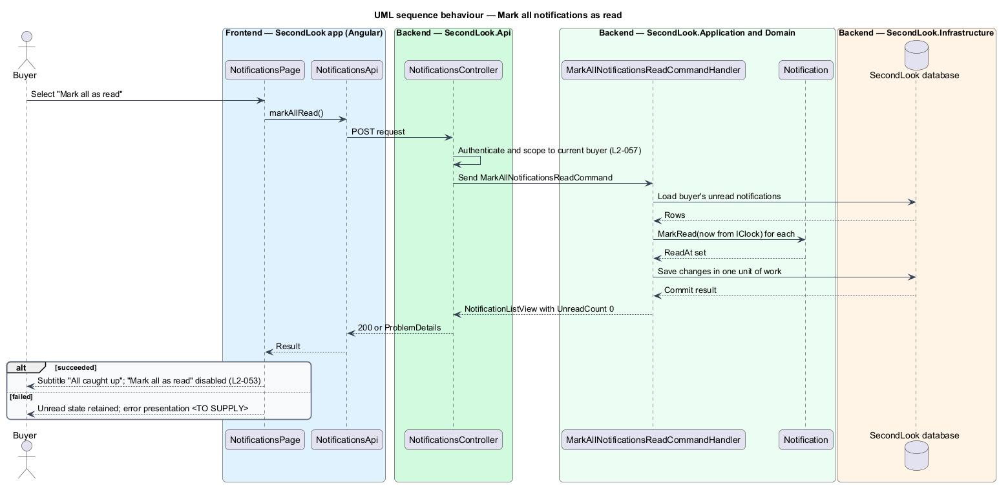
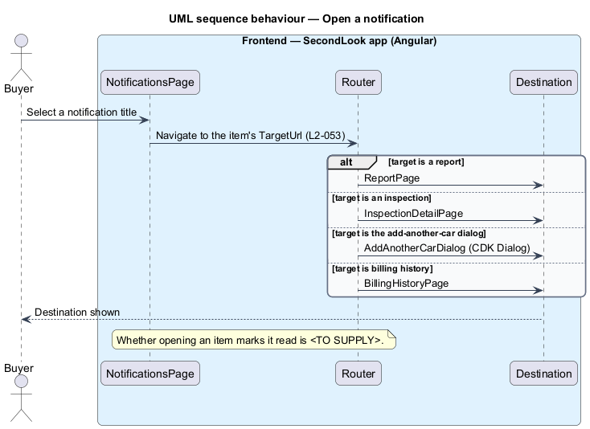

# Notification list

## Overview

SecondLook is a used-car safety app for buyers purchasing a vehicle "as is" who cannot get a mechanic to the car in person. This feature covers the notification list, a page at the route `/notifications` that records the events that matter to the buyer: a report is ready, an inspection is coming up, a call has ended, the pricing window is open, and a receipt has been issued. The page is reached from the bell link in the header, whose accessible name reads "Notifications, 2 unread".

A *notification* is a persisted message addressed to one user, with a title, a body, a target and a read state. An *unread notification* is a notification whose `ReadAt` is empty. The list is distinct from toasts and banners, which are transient and are not persisted (see the toasts design).

The mocks are `docs/mocks/pages/notifications/` with the states `default`, `loading`, `empty`, `error` and `read`. This document assumes no prior knowledge of SecondLook internals; the diagrams show where each part lives.

## Description

The feature is a vertical slice from the Angular app to the database. No notification code exists yet, so every component below is introduced by this design.

- **`NotificationsPage`** — Angular page in `projects/secondlook/src/app/pages/`, routed at `/notifications`. It renders the heading "Notifications", a subtitle, the "Mark all as read" button and the list. It holds the view state: `loading`, `default`, `read`, `empty`, `error`.
- **`NotificationsApi` / `NOTIFICATIONS_API`** — contract and injection token in `projects/api`. The page depends on the token, not the concrete client.
- **`NotificationsController`** — ASP.NET Core controller in `SecondLook.Api`, base route `/api/notifications`. It authenticates the caller, scopes data to the current buyer (`L2-057`), and dispatches `GetNotificationsQuery` and `MarkAllNotificationsReadCommand`. The endpoint paths under that base are `<TO SUPPLY>`.
- **`GetNotificationsQuery`** and handler — return the buyer's `Notification` rows, newest first, with the unread count. The page size and any paging are `<TO SUPPLY>`.
- **`MarkAllNotificationsReadCommand`** and handler — load the buyer's unread notifications, set `ReadAt` through `Notification.MarkRead` using `IClock`, and save in one unit of work. The command is idempotent: repeating it leaves every row read and returns the same view.
- **`Notification`** — domain entity (`Id`, `UserId`, `Kind`, `Title`, `Body`, `TargetUrl`, `ReadAt`, `CreatedAt`). Handlers in other features create rows when an event occurs. The set of `Kind` values and the events that create them beyond the five seen in the mocks are `<TO SUPPLY>`.

State behaviour on the page:

- **Loading.** The list is marked `aria-busy="true"` and shows four skeleton rows. The subtitle and "Mark all as read" are absent.
- **Default.** The heading reads "Notifications", the subtitle states the unread count, for example "2 unread", and "Mark all as read" is enabled. Each unread item carries a `data-unread` attribute and a visually hidden "(unread)" suffix after its title, so the unread state does not depend on colour. Each item shows an icon, a title that is a link, a body line and a time stamp.
- **Read.** After "Mark all as read" completes, or when every item is already read, the subtitle reads "All caught up" and the button is disabled. The hidden "(unread)" text is removed.
- **Empty.** When the buyer has no notifications, the page shows "Nothing new" with "We’ll tell you when a mechanic is ready, a report lands, or your window is about to close.".
- **Error.** When the list fails to load, the page shows "Notifications didn’t load" with "Your inspections are fine. Try again." and a "Try again" button that repeats the request.

Each title links to the thing the notification concerns. The four target types are the report page, the inspection detail page, the add-another-car dialog and billing history. Navigation to the dialog opens `AddAnotherCarDialog` through CDK Dialog. Whether opening an item marks that item read, and whether the header bell count updates at once, are `<TO SUPPLY>`; `L2-053` states only the bulk action. How the header unread count refreshes while the buyer stays on another page is `<TO SUPPLY>`.

## Requirements

The feature realizes the following level-2 (L2) requirement. Each L2 requirement refines a level-1 (L1) requirement, cited by identifier.

| L2 ID | Refines (L1) | Requirement |
|-------|--------------|-------------|
| `L2-053` | `L1-012` | Notification list. When a buyer with notifications opens the list, it shall show "Notifications", the count of unread such as "2 unread", and "Mark all as read". An unread notification shall be marked unread in a way that does not depend on colour. When the buyer selects "Mark all as read" and it completes, the subtitle shall read "All caught up" and the button shall be disabled. When the buyer selects a notification, the buyer shall go to what it is about: a report, an inspection, the add-another-car dialog or billing history. When there are no notifications, the page shall show "Nothing new" with "We’ll tell you when a mechanic is ready, a report lands, or your window is about to close.". When the list fails to load, the page shall show "Notifications didn’t load" with "Your inspections are fine. Try again." and "Try again". While the list is loading, it shall be marked busy. |

## Diagrams

### System context

The buyer reads and follows notifications inside SecondLook. No external system takes part in this slice.

### Containers

The Angular app calls `SecondLook.Api`, which reads and writes `Notification` rows in the SecondLook database.

### Components

`NotificationsPage` calls `NotificationsController` through the `NOTIFICATIONS_API` token. The controller dispatches the list query and the mark-all command.

### Class structure

The two handlers read and mutate `Notification` and return a `NotificationListView` of `NotificationView` items.

### Behaviour — load the list

The page requests the list and renders the loading state, then the error, empty, default or read state.

### Behaviour — mark all as read

The handler sets `ReadAt` on each unread row in one unit of work. The page then shows "All caught up" and disables the button.

### Behaviour — open a notification

Selecting a title navigates to the report, the inspection, the add-another-car dialog or billing history.

