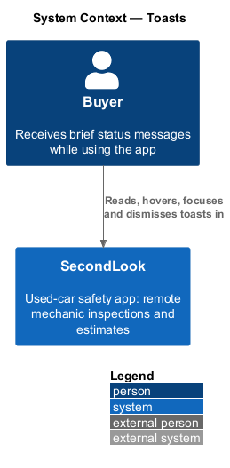
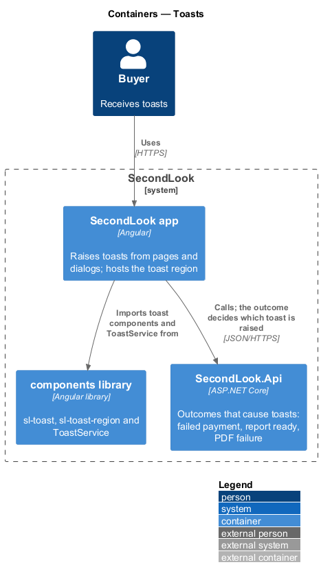
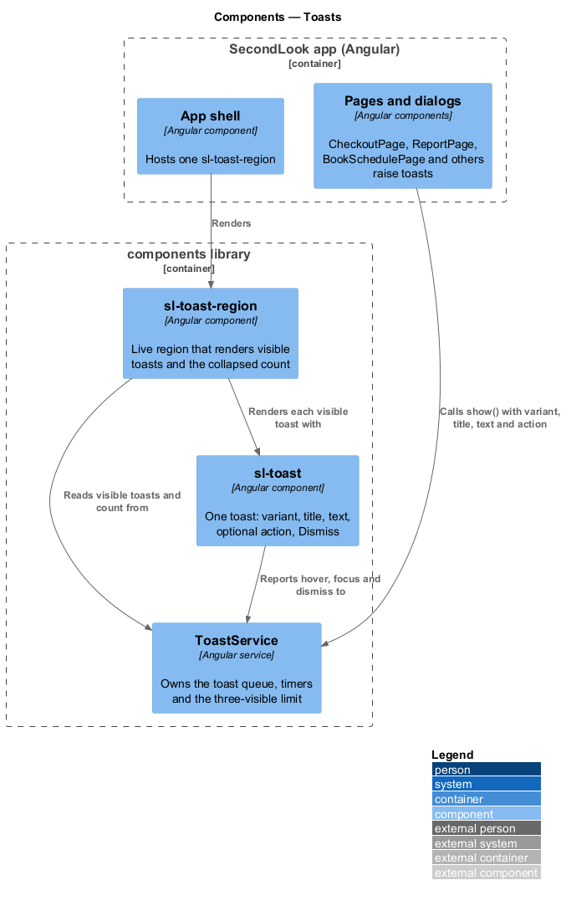
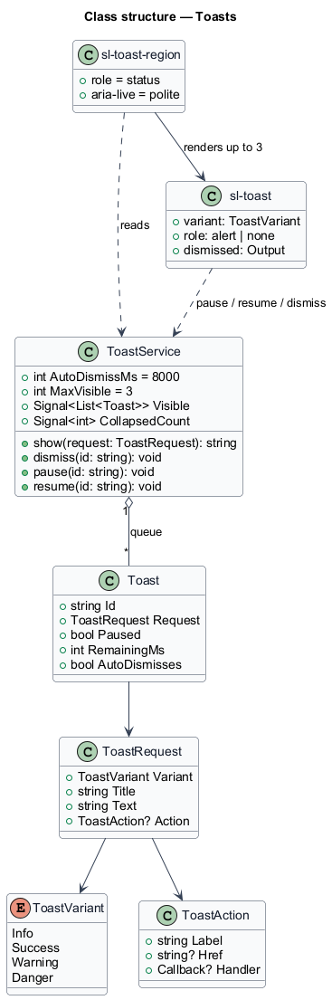
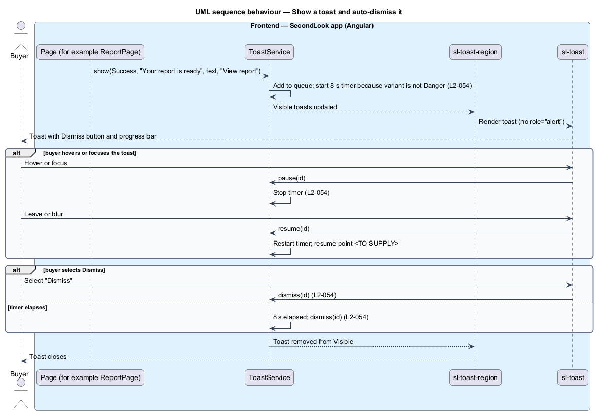
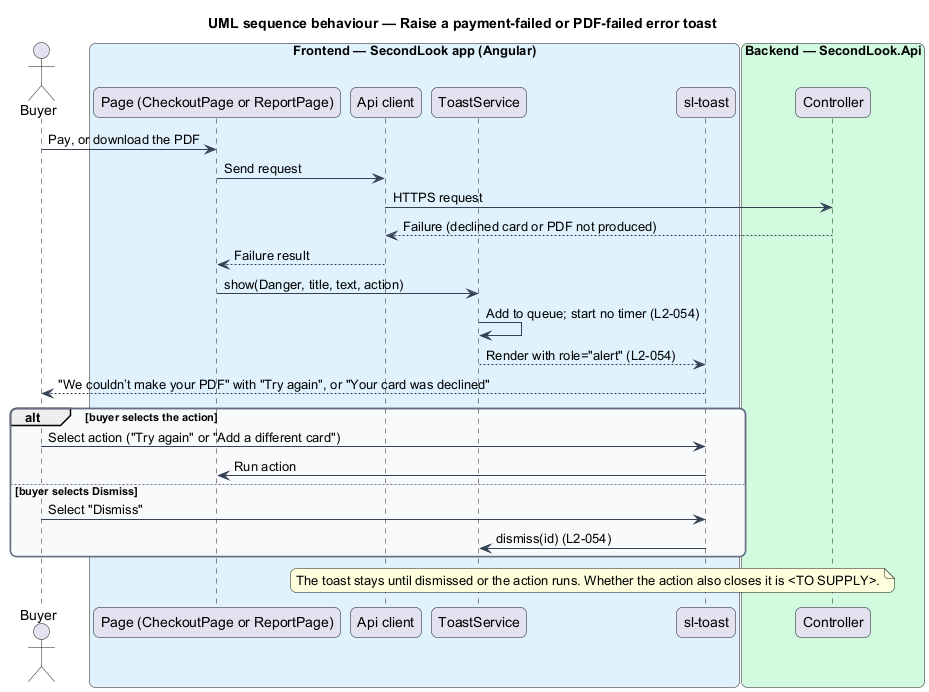
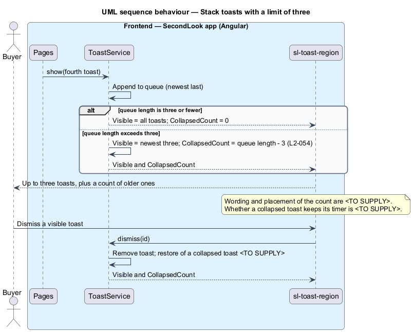

# Toasts

## Overview

SecondLook is a used-car safety app for buyers purchasing a vehicle "as is" who cannot get a mechanic to the car in person. This feature covers toasts, the brief messages that confirm an outcome or report a failure while the buyer stays on the current page. The mocks are `docs/mocks/notifications/booking-toast/`, `payment-failed/` and `report-ready/`, each in the variants `info`, `success`, `warning`, `danger` and `with-action`, plus the `stacked` state of the booking toast.

A *toast* is a transient, non-modal message that appears in a fixed region of the screen, shows a title and a line of text, may carry one action, and closes itself or is dismissed. A *toast variant* is one of `info`, `success`, `warning` and `danger`, which sets the icon, the colour role and the live-region semantics. Toasts are not persisted; the persisted counterpart is the notification list (see the notification-list design).

The design provides one shared mechanism, `ToastService` with `sl-toast`, rather than one component per mock folder. The three mock folders differ only in the copy and the action they pass to it. This document assumes no prior knowledge of SecondLook internals; the diagrams show where each part lives.

## Description

The feature is a frontend slice. No toast code exists yet, so every component below is introduced by this design. It has no backend component of its own; backend outcomes reach the buyer as toasts because a page receives a result and calls `ToastService`.

- **`ToastService`** — Angular service in `projects/components`. It owns the queue of `Toast` items, the timers, and the derived `Visible` and `CollapsedCount` signals. Its public operations are `show`, `dismiss`, `pause` and `resume`. It is provided in the root injector so that pages, dialogs and services raise toasts without a reference to the region.
- **`sl-toast-region`** — Angular component in `projects/components`, rendered once by the app shell. It is a live region with `role="status"` and `aria-live="polite"`, fixed to the bottom right, and it renders the visible toasts with the newest at the bottom.
- **`sl-toast`** — Angular component in `projects/components`. It keeps the BEM classes of the mock (`toast`, `toast--success`, `toast--info`, `toast--warning`, `toast--danger`, `toast__body`, `toast__title`, `toast__text`, `toast__action`, `toast__progress`) and renders an icon, a title, a text line, an optional action and a "Dismiss" button with `aria-label="Dismiss"`. A `danger` toast carries `role="alert"`. The action projects through one `ng-content` slot declared once in an `ng-template`, rendered as an anchor when it has an `href` and as a button when it has a handler.
- **`ToastRequest`** — the argument to `show`: variant, title, text, and an optional action with a label and either a link or a handler.

Behaviour:

- **Auto-dismiss.** A `success`, `info` or `warning` toast closes itself 8 seconds after it appears. The timer pauses while the toast is hovered or holds focus. Whether the timer restarts or resumes from the remaining time after the pause is `<TO SUPPLY>`. The progress bar in the mock shows the remaining time.
- **Errors.** A `danger` toast announces itself as an alert through `role="alert"` and starts no timer. It stays until the buyer selects "Dismiss" or runs its action.
- **Dismiss.** Selecting "Dismiss" closes the toast and cancels its timer.
- **Stacking.** At most three toasts are visible. When more are queued, the older ones collapse into a count. The wording, placement and interaction of the count are `<TO SUPPLY>`; so is whether a collapsed toast keeps running its timer. Whether dismissing a visible toast brings a collapsed toast back, and which one, is `<TO SUPPLY>`.

Toast copy, from the requirement and the mocks:

- **Report ready** (`report-ready`): "Your report is ready" with "Mazda3 GS: about $620–$900 to certify." and the action "View report". The mock appends "Asking $7,400."; `L2-054` ends the text at "certify.", and the requirement governs. The vehicle name and range come from the report.
- **Body shop still in progress** (`report-ready`, `warning`): "Body shop review still in progress" with "Mira will finish within 30 minutes. The mechanic’s report is ready now." and the action "Read it". The name and the 30-minute figure come from the body shop review.
- **PDF failure** (`report-ready`, `danger`): "We couldn’t make your PDF" with "The report is fine; only the download failed." and the action "Try again", which repeats the download request.
- **Payment failure** (`payment-failed`, `danger`): "Your card was declined" with "You haven’t been charged. Try another card.", or with the action "Add a different card" the text "Your bank didn’t approve $45.00. You haven’t been charged.". The action opens `AddPaymentMethodDialog`. `L2-054` does not list this copy; it is taken from the mock.
- **Booking** (`booking-toast`): the slot-taken danger toast and the hold-warning toast are specified by `L2-025` and `L2-026` and designed in the schedule-inspection feature. Other booking copy in the mock, such as "You’re booked", "Call tomorrow at 6:30 PM" and "Rescheduled to Fri 30 Oct, 10:00 AM" with "Undo", is shown by the features that raise it.

How the app learns that a report is ready while the buyer is on another page, by polling or by a push channel, is `<TO SUPPLY>`. The `window-expiring` and `call-banner` mocks are banners, not toasts, and belong to other designs.

## Requirements

The feature realizes the following level-2 (L2) requirement. Each L2 requirement refines a level-1 (L1) requirement, cited by identifier.

| L2 ID | Refines (L1) | Requirement |
|-------|--------------|-------------|
| `L2-054` | `L1-012` | Toasts. When a toast shows, success, information and warning toasts shall dismiss themselves after 8 seconds, and shall pause while hovered or focused. When an error toast shows, it shall announce itself as an alert and shall not dismiss itself. When the buyer selects "Dismiss", the toast shall close. When toasts stack, at most three shall be visible and older ones shall collapse into a count. When a report is ready, the toast shall read "Your report is ready" with "Mazda3 GS: about $620–$900 to certify." and "View report". When the body shop review is still in progress, the toast shall read "Body shop review still in progress" with "Mira will finish within 30 minutes. The mechanic’s report is ready now." and "Read it". When the PDF fails, the toast shall read "We couldn’t make your PDF" with "The report is fine; only the download failed." and "Try again". |

## Diagrams

### System context

The buyer reads, hovers over, focuses and dismisses toasts inside SecondLook.

### Containers

Toasts live in the Angular app and the shared `components` library. The API supplies the outcomes that pages turn into toasts.

### Components

Pages call `ToastService`. The app shell hosts one `sl-toast-region`, which renders each visible `sl-toast`.

### Class structure

`ToastService` holds `Toast` items built from a `ToastRequest`. The region renders at most three and reports the collapsed count.

### Behaviour — show and auto-dismiss

A non-error toast starts an 8-second timer that pauses on hover and focus. Selecting "Dismiss" or the timer elapsing removes it.

### Behaviour — error toast

A failed payment or PDF raises a `danger` toast that carries `role="alert"` and starts no timer.

### Behaviour — stacking

The service shows the newest three toasts and collapses the rest into a count.

