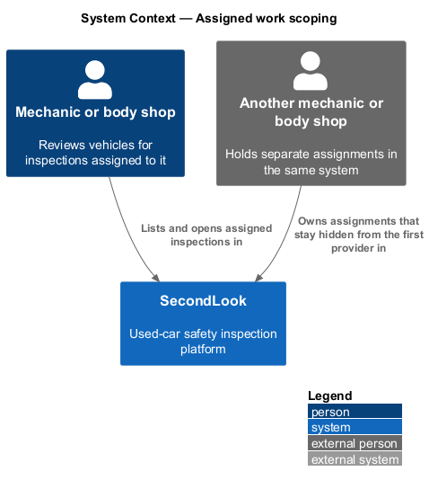
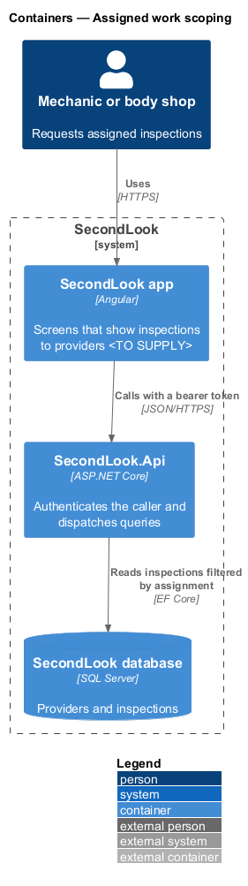
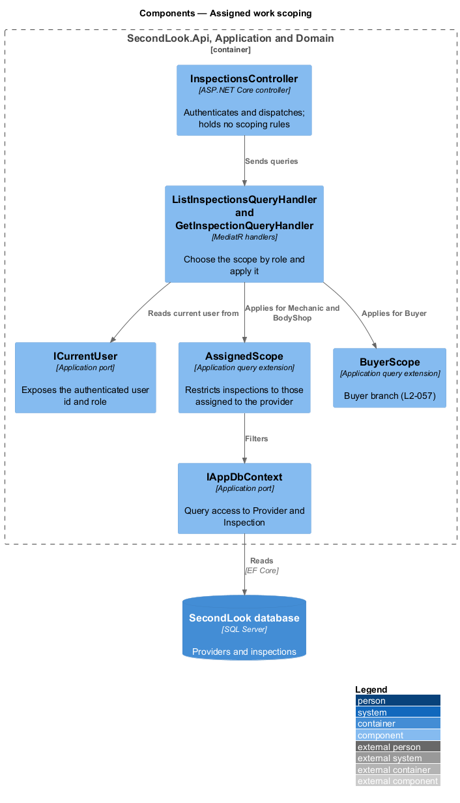
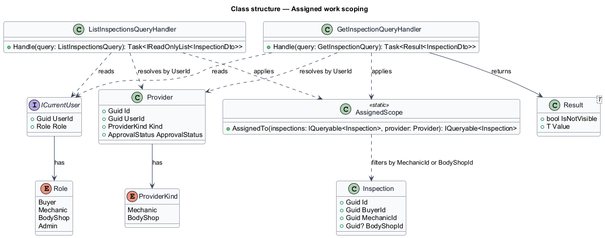
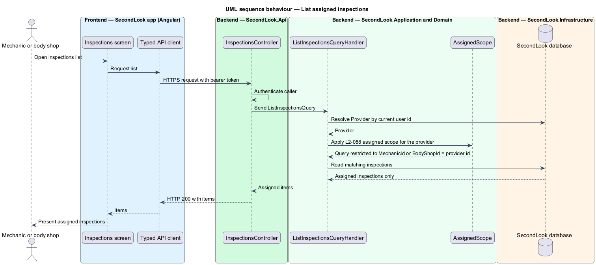
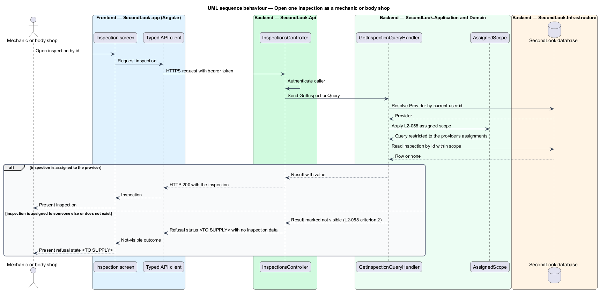

# Assigned work scoping

## Overview

SecondLook is a used-car safety app for buyers purchasing a vehicle "as is" who cannot get a mechanic to the car in person. A local mechanic inspects the vehicle over live video, and a body shop may add a review. This feature keeps the work of one mechanic or body shop hidden from the others. It covers the backend rule that a mechanic or body shop receives only the inspections assigned to it.

*Assigned scope* is a restriction on an inspection query that keeps only the rows whose `MechanicId` or `BodyShopId` identifies the calling provider. The feature has no mock. The design is grounded in `AGENTS.md` ("Mechanics and body shops see only the inspections assigned to them") and in `L2-058`. Every detail that neither source states is marked `<TO SUPPLY>`.

This document assumes no prior knowledge of SecondLook internals; the diagrams show where each part lives.

## Description

The feature is a rule applied inside the Application layer, beside the buyer rule in `buyer-data-scoping` (`L2-057`). No such code exists yet, so every component below is introduced by this design.

- **`ICurrentUser`** — application port that exposes the authenticated `UserId` and `Role`. The role comes from the validated JWT. The port is shared with `buyer-data-scoping`. Claim names are `<TO SUPPLY>`.
- **`Provider`** — domain entity (`Id`, `UserId`, `Kind`, `DisplayName`, `LicenceNumber`, `Location`, `ApprovalStatus`). The handler resolves the calling provider from `ICurrentUser.UserId`.
- **`Inspection`** — domain entity that holds `MechanicId` and the optional `BodyShopId`. Both identify a `Provider`.
- **`AssignedScope`** — static query extension in `SecondLook.Application`. `AssignedTo` keeps an inspection when its `MechanicId` equals the provider id for a mechanic, or its `BodyShopId` equals the provider id for a body shop. The name is a design choice.
- **`ListInspectionsQueryHandler`** and **`GetInspectionQueryHandler`** — MediatR handlers shared with the buyer rule. Each handler selects the scope by `Role`: `BuyerScope` for `Buyer`, `AssignedScope` for `Mechanic` and `BodyShop`. The handler for the `Admin` role is `<TO SUPPLY>`. Business rules live in handlers, not controllers (`AGENTS.md`).
- **`InspectionsController`** — ASP.NET Core controller at `/api/inspections`. It authenticates the caller and dispatches the queries. Endpoints require authentication by default. The controller accepts no provider id from the request.
- **`Result<T>`** — outcome for single-resource reads. An inspection that falls outside the scope yields a not-visible result, identical for an id assigned to someone else and for an id that does not exist.

Behaviour of the list (`L2-058` criterion 1). The list contains only inspections assigned to the calling mechanic or body shop. Paging, ordering and the page size are `<TO SUPPLY>`.

Behaviour of the single read (`L2-058` criterion 2). A request for an inspection assigned to someone else returns no inspection data. The HTTP status and the screen shown to the provider are `<TO SUPPLY>`.

Open points. The provider-facing screens and mocks are not part of this repository's mock set, so the screens that call these endpoints are `<TO SUPPLY>`. Whether a provider in the `Pending` or `Deactivated` approval status may list previously assigned inspections is `<TO SUPPLY>`; `L2-064` governs only whether a provider can take inspections. Reports and other resources that hang off an inspection should reuse `AssignedScope` through the inspection, and the resource-level rules are `<TO SUPPLY>`.

Tests are integration tests against the API (`AGENTS.md`). The test cases are outside this document.

## Requirements

The feature realizes the following level-2 (L2) requirement. Each L2 requirement refines a level-1 (L1) requirement, cited by identifier.

| L2 ID | Refines (L1) | Requirement |
|-------|--------------|-------------|
| `L2-058` | `L1-014` | Mechanics and body shops see only assigned inspections. When a mechanic or body shop lists inspections, the system shall return only those assigned to them. When an inspection is assigned to someone else and a mechanic or body shop requests it, the system shall not return it. |

## Diagrams

### System context

A mechanic or body shop works with SecondLook. Assignments held by other providers stay in the same system and remain hidden.

### Containers

The Angular app calls the SecondLook API with a bearer token. The API reads inspections from the SecondLook database filtered by assignment.

### Components

`InspectionsController` dispatches the queries. The handlers read `ICurrentUser` and apply `AssignedScope` for providers or `BuyerScope` for buyers.

### Class structure

`AssignedScope` filters `Inspection` by the provider's identifier. The handlers resolve the `Provider` from the current user.

### Behaviour — list assigned inspections

The handler resolves the provider, applies the assigned scope and returns only assigned inspections.

### Behaviour — open one inspection

An inspection assigned to the provider is returned. Otherwise the handler returns the not-visible outcome and the API returns no inspection data.

