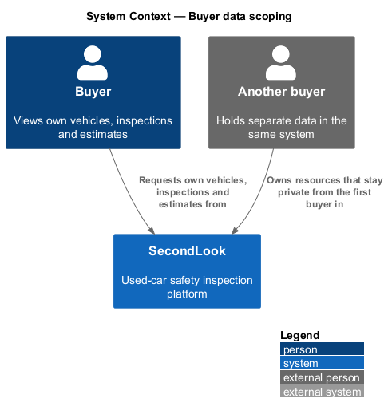
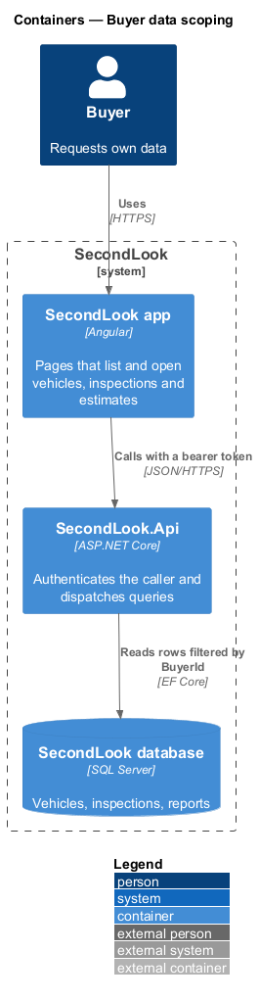
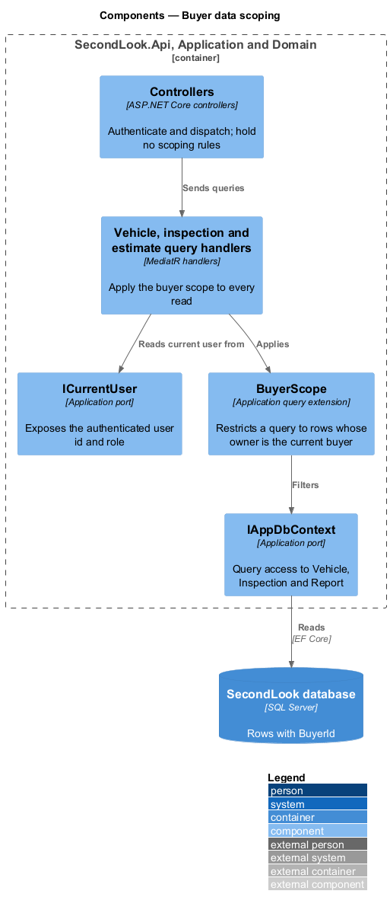
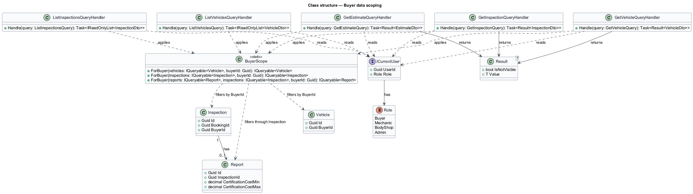
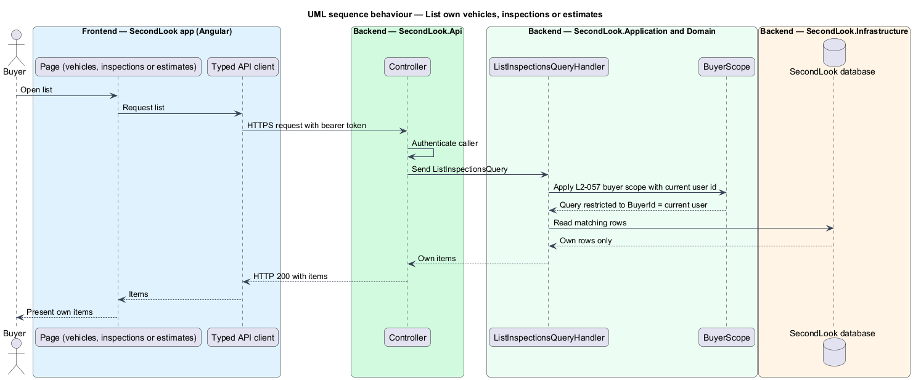
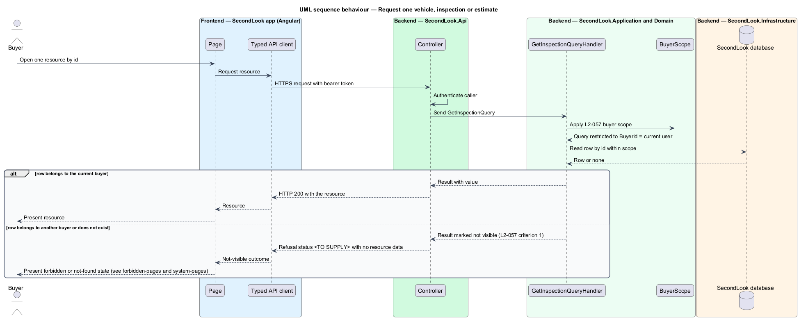

# Buyer data scoping

## Overview

SecondLook is a used-car safety app for buyers purchasing a vehicle "as is" who cannot get a mechanic to the car in person. This feature keeps each buyer's data private. It covers the backend rule that vehicles, inspections and estimates returned by the API belong to the authenticated buyer.

*Buyer scope* is a restriction on a data query that keeps only the rows owned by the authenticated buyer. The feature has no mock, because it changes no screen. The design is grounded in `AGENTS.md` ("Buyer-owned data (vehicles, inspections, estimates) must remain scoped to the current user; other users' resources must not be exposed") and in `L2-057`. Every detail that neither source states is marked `<TO SUPPLY>`.

*Estimate* is the range of the cost to get a vehicle safety certified, delivered to the buyer after the inspection. The domain model holds the range on `Report` (`CertificationCostMin`, `CertificationCostMax`). Whether a separate estimate entity exists is `<TO SUPPLY>`.

This document assumes no prior knowledge of SecondLook internals; the diagrams show where each part lives.

## Description

The feature is a rule applied inside the Application layer. No such code exists yet, so every component below is introduced by this design.

- **`ICurrentUser`** — application port that exposes the authenticated user's `UserId` and `Role`, read from the validated JWT. The port name is a design choice. The implementation in `SecondLook.Api` reads the token claims; the claim names are `<TO SUPPLY>`.
- **`BuyerScope`** — static query extension in `SecondLook.Application`. `ForBuyer` restricts a `Vehicle` query and an `Inspection` query to rows whose `BuyerId` equals the current user. The extension restricts a `Report` query through its `Inspection`, because `Report` carries no `BuyerId`. The name is a design choice.
- **Query handlers** — `ListVehiclesQueryHandler`, `GetVehicleQueryHandler`, `ListInspectionsQueryHandler`, `GetInspectionQueryHandler` and `GetEstimateQueryHandler`. Each handler reads `ICurrentUser`, applies `BuyerScope` and then queries `IAppDbContext`. Business rules live in handlers, not controllers (`AGENTS.md`). The query names are design choices; the vehicle and estimate controllers and the endpoint paths are `<TO SUPPLY>`. `InspectionsController` at `/api/inspections` serves inspections.
- **Controllers** — authenticate the caller and dispatch the query. Endpoints require authentication by default. A controller shall not accept a buyer id from the request and shall not pass one to a handler.
- **`Result<T>`** — handler outcome for single-resource reads. A row that is absent from the scoped query yields a not-visible result. The handler returns the same outcome for an id that belongs to another buyer and for an id that does not exist.

Behaviour of the listing endpoints (`L2-057` criterion 2). A list request returns only rows whose `BuyerId` equals the current user. Paging, sorting and the page size are `<TO SUPPLY>`.

Behaviour of the single-resource endpoints (`L2-057` criterion 1). A request for a resource owned by another buyer returns no resource data. The HTTP status for a not-visible result is `<TO SUPPLY>`. `L2-059` shows a "403" page for an inspection that belongs to another account, which implies a forbidden status for inspections. A not-found status for other buyers' ids would avoid disclosing that the id exists. Which status applies to each resource type is `<TO SUPPLY>`.

Scope of the rule. The rule applies to reads. Writes that act on a buyer-owned resource, such as rescheduling or cancelling, should reuse `BuyerScope` to load the resource, so a buyer cannot change another buyer's data. The write handlers belong to other designs. Access for the `Admin` role is `<TO SUPPLY>`. Access for mechanics and body shops is described in `assigned-work-scoping` (`L2-058`).

Tests are integration tests against the API (`AGENTS.md`). The test cases are outside this document.

## Requirements

The feature realizes the following level-2 (L2) requirement. Each L2 requirement refines a level-1 (L1) requirement, cited by identifier.

| L2 ID | Refines (L1) | Requirement |
|-------|--------------|-------------|
| `L2-057` | `L1-014` | Buyer data is private. When two buyers exist and one requests a vehicle, inspection or estimate that belongs to the other, the system shall not return it. When a buyer lists their vehicles, inspections or estimates, the system shall return only their own. |

## Diagrams

### System context

A buyer requests data from SecondLook. Data owned by another buyer stays in the same system and remains hidden from the first buyer.

### Containers

The Angular app calls the SecondLook API with a bearer token. The API reads rows from the SecondLook database filtered by `BuyerId`.

### Components

Controllers dispatch queries. The handlers read `ICurrentUser`, apply `BuyerScope` and query through `IAppDbContext`.

### Class structure

`BuyerScope` filters `Vehicle`, `Inspection` and `Report` by buyer. The query handlers return a `Result<T>` for single-resource reads.

### Behaviour — list own resources

A list request returns only the rows of the current buyer.

### Behaviour — request one resource

A request for one resource returns it when the current buyer owns it. Otherwise the handler returns the not-visible outcome and the API returns no resource data.

