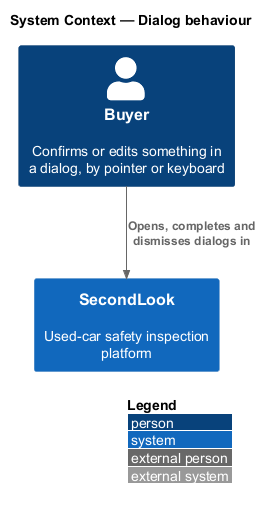
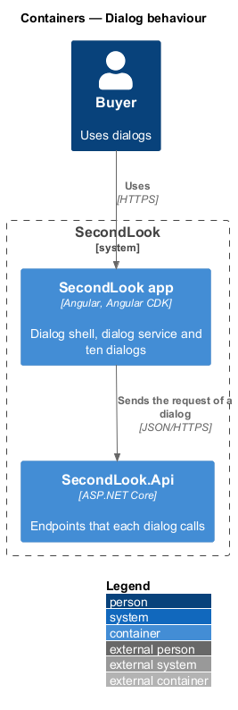
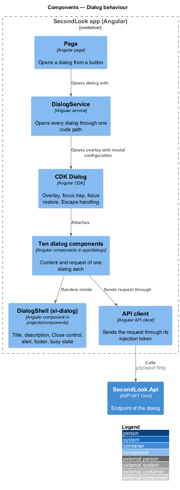
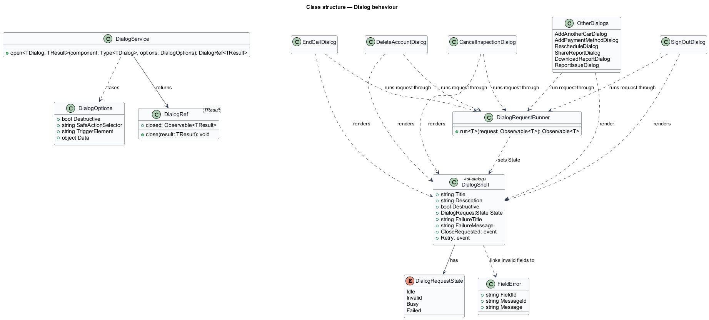
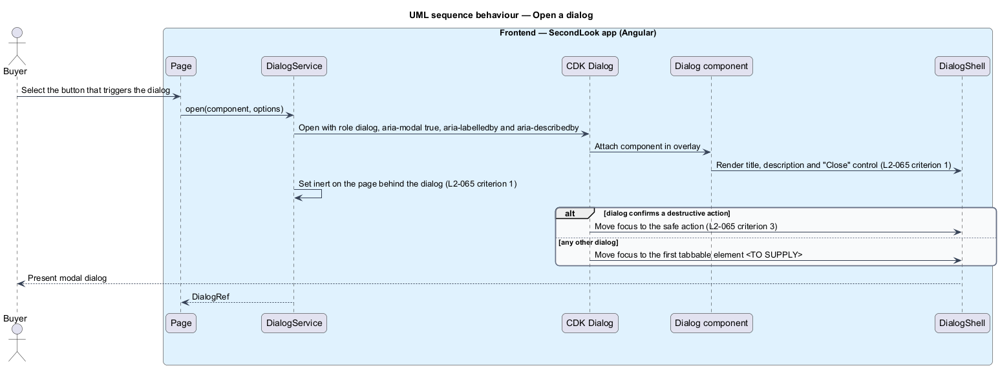
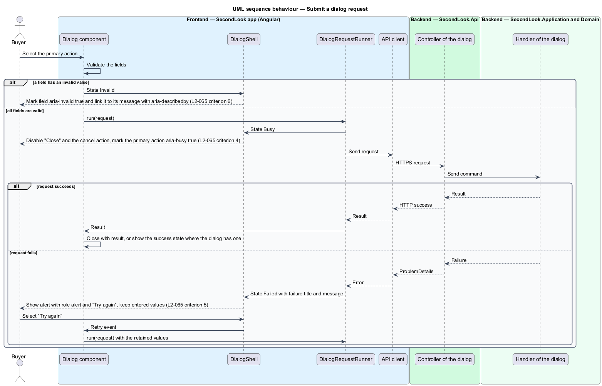
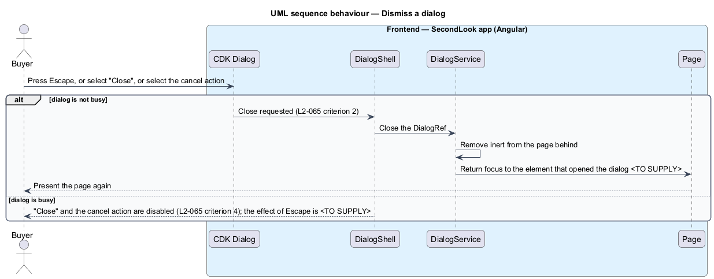

# Dialog behaviour

## Overview

SecondLook is a used-car safety app for buyers purchasing a vehicle "as is" who cannot get a mechanic to the car in person. This feature defines the one behaviour that every modal dialog in the app shares: how it opens, how focus moves, how it closes, and how it shows invalid input, work in progress and failure. The design fixes this behaviour once so that all ten dialogs act the same way for loading, failure and keyboard use (`L1-020`).

A *dialog* is a modal surface that presents a confirmation or a short edit over the current page. The mocks are the ten folders under `docs/mocks/dialogs/`: `add-another-car`, `add-payment-method`, `cancel-inspection`, `delete-account`, `download-report`, `end-call`, `report-issue`, `reschedule`, `share-report` and `sign-out`. The folder has no README of its own, so the behaviour below is read from the mocks and from `L2-065`.

A *destructive dialog* is a dialog that confirms an action the buyer cannot take back or that releases a booked resource. The mocks mark three with a danger icon and a focused safe action: `cancel-inspection`, `delete-account` and `end-call`.

This document assumes no prior knowledge of SecondLook internals; the diagrams show where each part lives.

## Description

The feature is a shared front-end layer. Dialogs open over a page, so they have no route of their own in the manifest. Button-triggered editing always opens a dialog or navigates to a screen, with no inline forms in pages, and modal behaviour uses Angular CDK Dialog and Overlay rather than hand-rolled modals (`AGENTS.md`). No dialog code exists yet, so every component below is introduced by this design.

- **`DialogService`** — Angular service that opens every dialog through one code path. It wraps the CDK `Dialog` and applies the modal configuration, so a dialog author cannot omit it. It returns a `DialogRef`. The service lives with the app dialogs; its package is `<TO SUPPLY>`.
- **`DialogShell`** — shared component in `projects/components` with selector `sl-dialog`. It renders the panel, the header with an icon, the title (`h2`), the description, the "Close" icon button, the body, the failure alert and the footer. A dialog component supplies its content and its footer actions to the shell through content slots. Each slot is declared once (`AGENTS.md`). The shell has a story folder and a perf-test scenario, as every component does.
- **Ten dialog components** in `projects/secondlook/src/app/dialogs/`, named without the Sl prefix: `AddAnotherCarDialog`, `AddPaymentMethodDialog`, `CancelInspectionDialog`, `RescheduleDialog`, `ShareReportDialog`, `DownloadReportDialog`, `ReportIssueDialog`, `SignOutDialog`, `DeleteAccountDialog` and `EndCallDialog`. Each owns its fields and its request. Each depends on an API client through its injection token.
- **`DialogRequestRunner`** — helper that runs a dialog request, sets the shell state to `Busy`, and then to `Failed` or to completion. It keeps one implementation of the busy and failure rules.
- **`DialogRequestState`** — `Idle`, `Invalid`, `Busy`, `Failed`. The mocks show these as the `default`, `invalid`, `busy` and `failed` states. Some dialogs add a `success` state (`share-report`, `report-issue`) and `delete-account` adds a `confirm` state. Their contents belong to the designs of those dialogs.

Behaviours, each tied to `L2-065`:

1. **Modal semantics (criterion 1).** The dialog element carries `role="dialog"`, `aria-modal="true"`, `aria-labelledby` for the title and `aria-describedby` for the description. The mocks wrap the page behind the dialog in an element marked `inert` and `aria-hidden="true"` and draw a backdrop. The service shall apply `inert` to the page behind the dialog on open and remove it on close. CDK Dialog traps focus but does not set `inert`, so the service adds it. The close control is an icon button labelled "Close".
2. **Escape (criterion 2).** Pressing Escape closes the dialog. CDK Dialog closes on Escape unless closing is disabled. The mocks mark the dialog with `data-dismiss-on-escape`.
3. **Safe-action focus (criterion 3).** A destructive dialog opens with focus on the safe action: "Keep inspection" in `CancelInspectionDialog`, "Keep my account" in `DeleteAccountDialog` and "Stay on the call" in `EndCallDialog`. The dialog options carry the safe action selector, and the service passes it to the CDK `autoFocus` setting. The mocks do not set an initial focus for the other seven dialogs, including `SignOutDialog`, which uses an informational icon. Their initial focus is `<TO SUPPLY>`.
4. **Busy (criterion 4).** While the request runs, the "Close" control and the cancel action are disabled, and the primary action has `aria-busy="true"` and keeps its label (for example "Cancel inspection", "Delete my account", "Send"). The mocks also disable the fields of a busy form. The shell disables the close and cancel controls from the `Busy` state, so a dialog cannot forget to. What Escape does while busy is `<TO SUPPLY>`: `L2-065` criterion 2 closes the dialog on Escape and criterion 4 disables the controls. This design recommends that the shell ignore Escape while busy, because a closed dialog cannot show the outcome of the request. The recommendation needs confirmation.
5. **Failure (criterion 5).** When the request fails, the shell shows an alert at the top of the body with `role="alert"`, so assistive technology announces it, and a "Try again" button. The dialog stays open and keeps the values the buyer entered, because the dialog component and its form state remain alive. "Try again" repeats the request with those values. The mocks give each dialog its own failure copy, listed below.
6. **Invalid field (criterion 6).** A field with an invalid value carries `aria-invalid="true"` and `aria-describedby` that points to the id of its message. The message is a `p` with class `field__error`, for example "Choose a reason so we can improve." for the reason field of `CancelInspectionDialog`. The `FieldError` pairing is a pattern for every dialog field. Where the first invalid field receives focus after a failed submit is `<TO SUPPLY>`.

Failure copy in the mocks:

| Dialog | Failure title and text |
|--------|------------------------|
| `AddAnotherCarDialog` | "We couldn’t add the car" with "Your window is still open. Check your connection and try again." |
| `AddPaymentMethodDialog` | "Your bank declined this card" with "Try a different card or call the number on the back." |
| `CancelInspectionDialog` | "We couldn’t cancel it" with "Nothing changed; the inspection is still booked. Try again, or contact support." |
| `RescheduleDialog` | "We couldn’t move the call" with "Your original time is still booked. Try again." |
| `ShareReportDialog` | "We couldn’t send it" with "The email didn’t go out. Copy the link instead, or try again." |
| `DownloadReportDialog` | "We couldn’t make the PDF" with "The report is fine. Try again in a moment." |
| `ReportIssueDialog` | "We couldn’t send that" with "Nothing was lost. Try again." |
| `DeleteAccountDialog` | "We couldn’t delete your account" with "Nothing was deleted. Try again, or email support." |
| `SignOutDialog` and `EndCallDialog` | No failed mock exists. The failure copy is `<TO SUPPLY>`. |

Focus return. On close, focus should return to the element that opened the dialog. CDK Dialog restores focus by default, and the target for a trigger that no longer exists, such as after account deletion, is `<TO SUPPLY>`.

Idempotency. A dialog request that creates a booking or a payment, such as `AddAnotherCarDialog` and `AddPaymentMethodDialog`, is idempotent at the API, so "Try again" can repeat the request without duplicating the resource (`AGENTS.md`).

## Requirements

The feature realizes the following level-2 (L2) requirement. Each L2 requirement refines a level-1 (L1) requirement, cited by identifier.

| L2 ID | Refines (L1) | Requirement |
|-------|--------------|-------------|
| `L2-065` | `L1-020` | Dialog behavior. When any dialog opens, it shall be a modal dialog with a title and description, the page behind it shall be inert, and the close control shall be labelled "Close". When the buyer presses Escape in any dialog, the dialog shall close. When a dialog that confirms a destructive action opens, the safe action shall have focus. When a dialog is busy because its request is running, the close control and the cancel action shall be disabled and the primary action shall be marked busy. When a dialog request fails and the alert shows, the alert shall be announced as an alert, offer "Try again" and keep the values the buyer entered. When a dialog field has an invalid value and the dialog shows the error, the field shall be marked invalid and linked to its message. |

## Diagrams

### System context

A buyer opens, completes and dismisses dialogs in SecondLook, by pointer or keyboard.

### Containers

The dialog layer lives entirely in the Angular app. Each dialog sends its request to an endpoint of the SecondLook API.

### Components

A page opens a dialog through `DialogService`, which uses CDK Dialog. Each dialog component renders inside `DialogShell` and sends its request through an API client.

### Class structure

`DialogService` opens dialogs with `DialogOptions`. `DialogShell` holds the `DialogRequestState`. `DialogRequestRunner` drives the state for each of the ten dialogs.

### Behaviour — open a dialog

The service opens the dialog as a modal, makes the page behind it inert and moves focus. A destructive dialog focuses the safe action.

### Behaviour — submit a dialog request

An invalid field leads to the invalid state. A valid submit moves the shell to busy, then to completion or to the failed alert with "Try again".

### Behaviour — dismiss a dialog

Escape, "Close" and the cancel action close a dialog that is not busy. A busy dialog disables its close and cancel controls.

