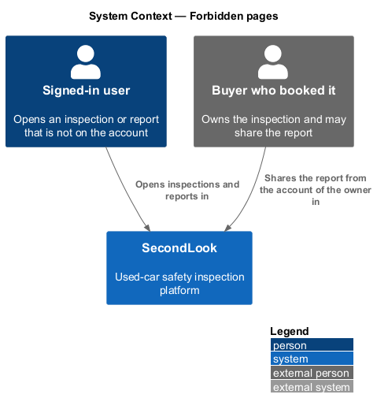
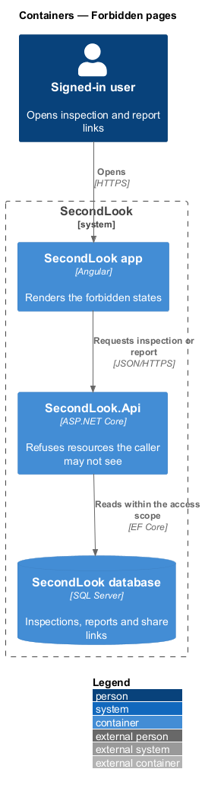
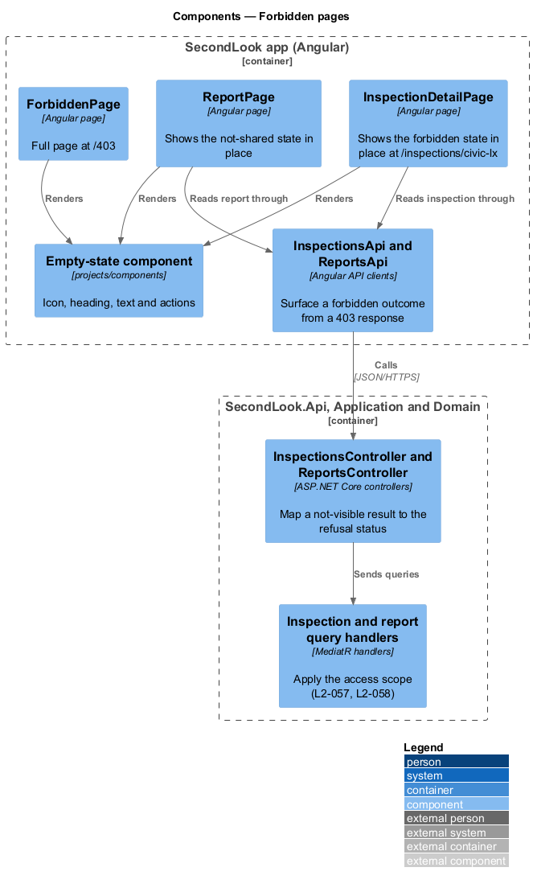
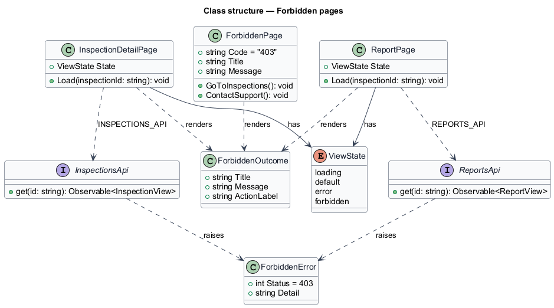
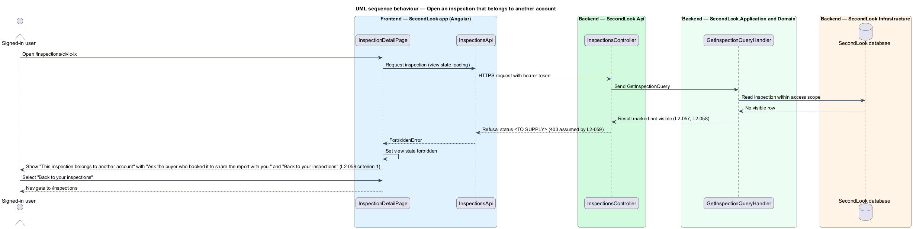
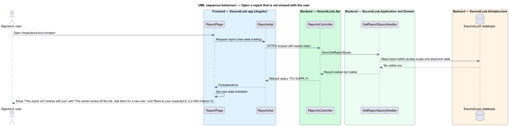
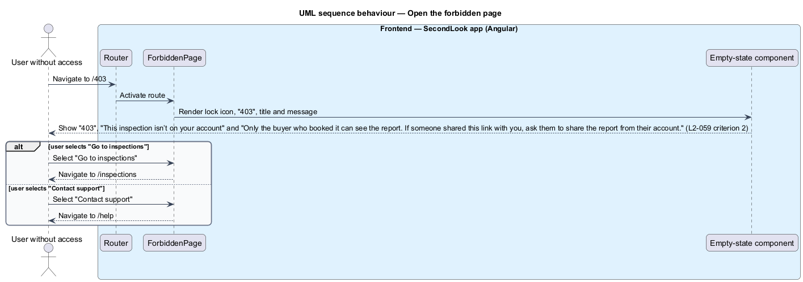

# Forbidden pages

## Overview

SecondLook is a used-car safety app for buyers purchasing a vehicle "as is" who cannot get a mechanic to the car in person. This feature covers what a signed-in user sees after opening an inspection or report that is not on the account. It tells the user clearly that access is denied and where to go next.

A *forbidden state* is a screen state that replaces the content of a page when the API refuses the resource to the caller. The feature renders a forbidden state in three places: the inspection detail page, the report page, and the standalone `/403` page. The mocks are `docs/mocks/pages/forbidden/default.html`, `docs/mocks/pages/inspection-detail/forbidden.html` and `docs/mocks/pages/report/forbidden.html`.

The refusal itself comes from the access rules in `buyer-data-scoping` (`L2-057`) and `assigned-work-scoping` (`L2-058`). This document covers how the Angular app presents the refusal.

This document assumes no prior knowledge of SecondLook internals; the diagrams show where each part lives.

## Description

The feature is a vertical slice in the Angular app over the refusals from the API. No page code exists yet, so every component below is introduced by this design.

- **`ForbiddenPage`** — Angular page in `projects/secondlook/src/app/pages/`, routed at `/403`. It renders a lock icon, the code "403", the heading "This inspection isn’t on your account", the text "Only the buyer who booked it can see the report. If someone shared this link with you, ask them to share the report from their account.", the primary action "Go to inspections" (link to the inspections dashboard) and the outline action "Contact support" (link to the help page). The page is a static view with no request, so it has no loading, empty or error state. It uses the public top bar with "Sign in".
- **`InspectionDetailPage`** — Angular page at `/inspections/civic-lx` in the mock (the route in the mock is for the sample inspection; the parameterised route is `<TO SUPPLY>`). When `InspectionsApi` reports a forbidden outcome, the page keeps the signed-in top bar and the breadcrumb, sets its view state to `forbidden` and shows the lock icon, the heading "This inspection belongs to another account", the text "Ask the buyer who booked it to share the report with you." and one action, "Back to your inspections".
- **`ReportPage`** — Angular page at `/inspections/civic-lx/report` in the mock. When `ReportsApi` reports a forbidden outcome, the page shows the lock icon, the heading "This report isn’t shared with you", the text "The owner turned off the link. Ask them for a new one." and one action, "Back to your inspections". `L2-059` states only the heading. The text and action come from the mock. Whether the text varies when the report was never shared, as opposed to a link turned off, is `<TO SUPPLY>`.
- **Empty-state component** — the shared component from `projects/components` that the mocks style as `empty empty--error` with an icon, optional code, heading, text and actions. Its selector and inputs are `<TO SUPPLY>`; the component belongs to the design system. The heading is the page `h1`. The icon is decorative and hidden from assistive technology.
- **`InspectionsApi` / `INSPECTIONS_API`** and **`ReportsApi` / `REPORTS_API`** — contracts and injection tokens in `projects/api`. The pages depend on the tokens. Each client maps an HTTP 403 response to a `ForbiddenError`, so a page distinguishes access denial from a failed load.
- **Controllers and handlers** — `InspectionsController` and `ReportsController` dispatch queries whose handlers apply the access scope. A not-visible result maps to a refusal status. The status is `<TO SUPPLY>`; this design assumes 403, because `L2-059` presents a "403" page. If the API returns 404 for resources owned by another account, the client cannot tell a missing resource from a forbidden one, and the handling is `<TO SUPPLY>`.

State behaviour:

- **Forbidden on a detail page.** A page that loads its resource first shows its loading state. A forbidden outcome replaces the loading state. Retrying is not offered, because a retry cannot change the outcome.
- **Primary action.** Each in-page forbidden state offers "Back to your inspections", which navigates to the inspections dashboard (`/inspections`).
- **Focus.** After the state renders, focus moves to the heading so assistive technology announces the outcome. This is a design choice.
- **Unauthenticated visitors.** A visitor without a valid session receives an authentication failure rather than a forbidden outcome. The redirect to sign-in is `<TO SUPPLY>` and belongs to the authentication design.
- **Sharing.** The text refers to the buyer sharing the report. The share flow is `ShareReportDialog` and belongs to the reports design.

## Requirements

The feature realizes the following level-2 (L2) requirement. Each L2 requirement refines a level-1 (L1) requirement, cited by identifier.

| L2 ID | Refines (L1) | Requirement |
|-------|--------------|-------------|
| `L2-059` | `L1-014` | Forbidden pages. When a signed-in user opens an inspection that belongs to another account, the page shall show "This inspection belongs to another account" with "Ask the buyer who booked it to share the report with you." and "Back to your inspections". When a user without access loads the forbidden page, the page shall show "403", "This inspection isn’t on your account" with "Only the buyer who booked it can see the report. If someone shared this link with you, ask them to share the report from their account." and the buttons "Go to inspections" and "Contact support". When a user opens a report that is not shared with them, the page shall show "This report isn’t shared with you". |

## Diagrams

### System context

A signed-in user opens an inspection or report. The buyer who booked it owns the inspection and may share the report from the account of that buyer.

### Containers

The Angular app renders the forbidden states from the refusals returned by the SecondLook API.

### Components

`InspectionDetailPage`, `ReportPage` and `ForbiddenPage` render the shared empty-state component. The API clients turn a 403 response into a `ForbiddenError`.

### Class structure

The pages hold a `ViewState` that includes `forbidden`. The API clients raise a `ForbiddenError` that the pages render as a `ForbiddenOutcome`.

### Behaviour — open an inspection that belongs to another account

The detail page requests the inspection, receives the refusal and shows the in-page forbidden state.

### Behaviour — open a report that is not shared

The report page requests the report, receives the refusal and shows "This report isn’t shared with you".

### Behaviour — open the forbidden page

The router activates `ForbiddenPage` at `/403`, which offers "Go to inspections" and "Contact support".

