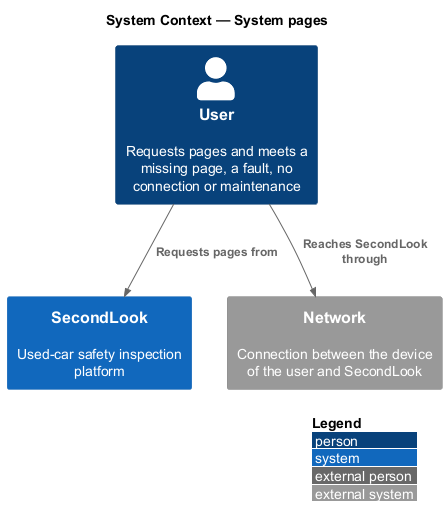
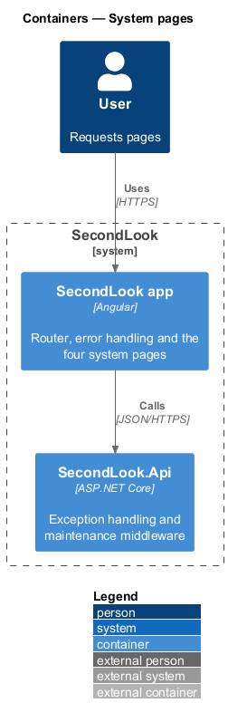
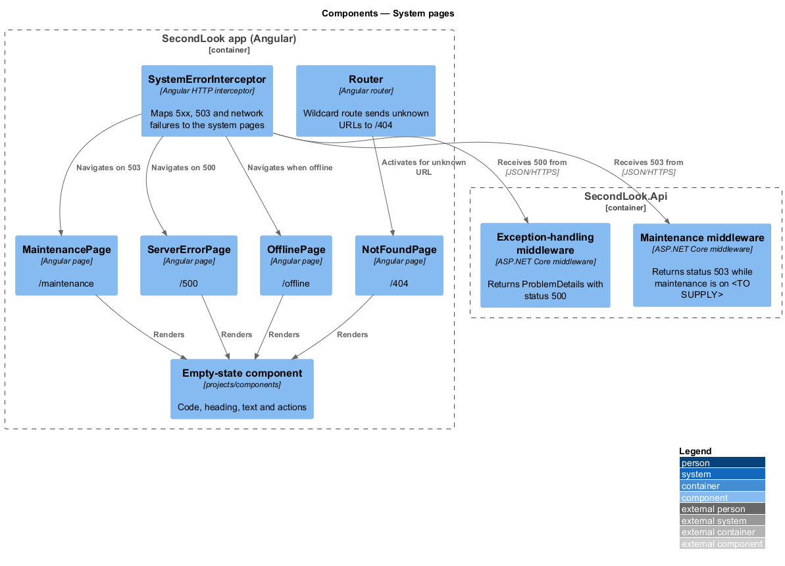
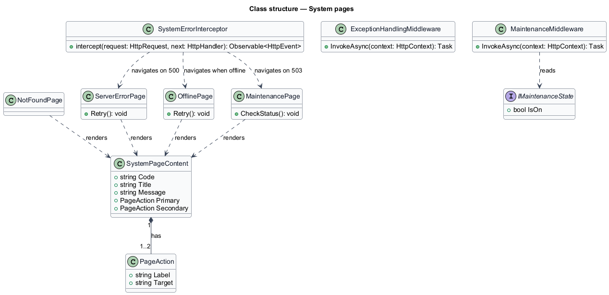
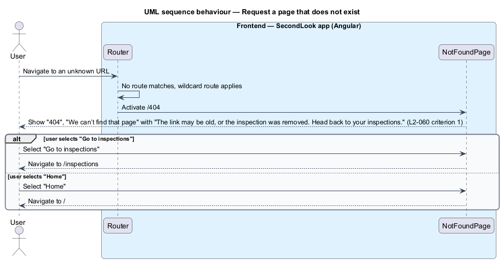
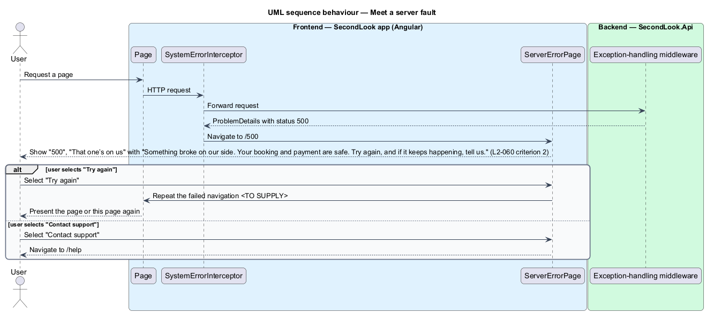
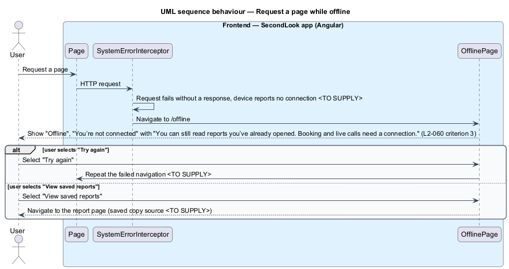
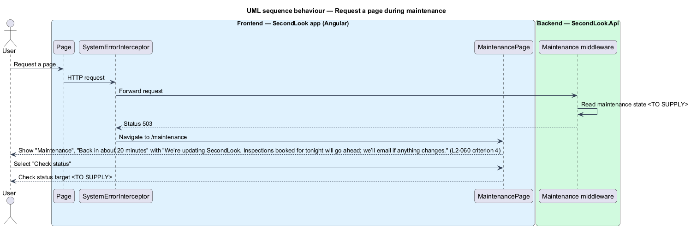

# System pages

## Overview

SecondLook is a used-car safety app for buyers purchasing a vehicle "as is" who cannot get a mechanic to the car in person. This feature covers the four full pages that appear when a page is missing, the system fails, the user is offline or the system is down for maintenance. Each page states what happened and what to do next.

A *system page* is a full-page state, not tied to one resource, that replaces the requested page when the request cannot be served. The mocks are `docs/mocks/pages/not-found/default.html`, `server-error/default.html`, `offline/default.html` and `maintenance/default.html`. Each mock has a single state, because the pages are static content with no request to load, no collection to empty and no data request to fail.

The forbidden page at `/403` follows the same layout and is described in `forbidden-pages` (`L2-059`).

This document assumes no prior knowledge of SecondLook internals; the diagrams show where each part lives.

## Description

The feature is a vertical slice from the Angular router and HTTP layer to the API middleware. No such code exists yet, so every component below is introduced by this design. All four pages use the public top bar with "Sign in" and the footer, and render through the shared empty-state component from `projects/components` (the mocks style it as `empty empty--error`). The selector and inputs of that component are `<TO SUPPLY>`.

- **`NotFoundPage`** — Angular page in `projects/secondlook/src/app/pages/`, routed at `/404`. It shows the code "404", the heading "We can’t find that page", the text "The link may be old, or the inspection was removed. Head back to your inspections." and the actions "Go to inspections" (primary, link to the inspections dashboard) and "Home" (outline, link to the home page). The router wildcard route activates it for any URL that no route matches. Whether the URL stays in the address bar or changes to `/404` is `<TO SUPPLY>`.
- **`ServerErrorPage`** — routed at `/500`. It shows "500", "That one’s on us", the text "Something broke on our side. Your booking and payment are safe. Try again, and if it keeps happening, tell us." and the actions "Try again" (primary button) and "Contact support" (outline link to the help page). What "Try again" repeats is `<TO SUPPLY>`.
- **`OfflinePage`** — routed at `/offline`. It shows "Offline", "You’re not connected", the text "You can still read reports you’ve already opened. Booking and live calls need a connection." and the actions "Try again" (primary button) and "View saved reports" (outline link to the report page in the mock). The text promises that reports opened before remain readable. The mechanism that stores them, such as a service worker or a local cache, is `<TO SUPPLY>`.
- **`MaintenancePage`** — routed at `/maintenance`. It shows "Maintenance", "Back in about 20 minutes", the text "We’re updating SecondLook. Inspections booked for tonight will go ahead; we’ll email if anything changes." and one action, "Check status" (primary button). The source of the duration, the status target and the email are `<TO SUPPLY>`.
- **`SystemErrorInterceptor`** — Angular HTTP interceptor in the app that routes failures to the pages. It sends a response with status 500 to `/500`, a response with status 503 to `/maintenance`, and a request that fails without a response while the device is offline to `/offline`. The interceptor name and the status mapping are design choices. Which requests navigate and which return the error to the calling page is `<TO SUPPLY>`; page-level errors such as "We couldn’t load time slots" stay on their pages.
- **Exception-handling middleware** — ASP.NET Core middleware in `SecondLook.Api` that converts an unhandled exception to a `ProblemDetails` response with status 500. Request logging stays outside the exception-handling middleware, so the logged status is the handled response status (`AGENTS.md`).
- **Maintenance middleware** — ASP.NET Core middleware that answers with status 503 while maintenance is on. The switch, its storage and the paths that stay reachable, such as a status endpoint, are `<TO SUPPLY>`. The middleware order relative to authentication and Swagger is `<TO SUPPLY>`, and it preserves the intentional anonymous endpoints and the Swagger middleware ordering that `AGENTS.md` requires.

Accessibility. Each page has one `h1`, the heading. The code line ("404", "500", "Offline", "Maintenance") is plain text. The icon is decorative. Whether the page announces itself to assistive technology on arrival is `<TO SUPPLY>`.

Reassurance copy. The 500 text states that a booking and payment are safe, and the maintenance text states that bookings go ahead. The backend shall keep booking and payment writes idempotent (`AGENTS.md`), so a repeated request after a fault returns the existing resource.

## Requirements

The feature realizes the following level-2 (L2) requirement. Each L2 requirement refines a level-1 (L1) requirement, cited by identifier.

| L2 ID | Refines (L1) | Requirement |
|-------|--------------|-------------|
| `L2-060` | `L1-015` | System pages. When a page that does not exist is requested, the page shall show "404", "We can’t find that page" with "The link may be old, or the inspection was removed. Head back to your inspections." and the buttons "Go to inspections" and "Home". When a server fault occurs and a page is requested, the page shall show "500", "That one’s on us" with "Something broke on our side. Your booking and payment are safe. Try again, and if it keeps happening, tell us." and the buttons "Try again" and "Contact support". When the user is offline and a page is requested, the page shall show "Offline", "You’re not connected" with "You can still read reports you’ve already opened. Booking and live calls need a connection." and the buttons "Try again" and "View saved reports". When the system is down for maintenance and a page is requested, the page shall show "Maintenance", "Back in about 20 minutes" with "We’re updating SecondLook. Inspections booked for tonight will go ahead; we’ll email if anything changes." and a "Check status" button. |

## Diagrams

### System context

A user requests pages from SecondLook through a network. A missing page, a fault, a lost connection or maintenance each lead to a system page.

### Containers

The Angular app owns the router, the interceptor and the four pages. The SecondLook API supplies the 500 and 503 responses.

### Components

The router activates `NotFoundPage`. The `SystemErrorInterceptor` navigates to the other three pages on a 500 response, a 503 response or a lost connection.

### Class structure

Each page renders a `SystemPageContent` with one or two `PageAction` entries. The interceptor selects the page, and the middleware produces the 500 and 503 responses.

### Behaviour — page not found

The wildcard route activates `NotFoundPage`, which offers "Go to inspections" and "Home".

### Behaviour — server fault

A 500 response leads to `ServerErrorPage`, which offers "Try again" and "Contact support".

### Behaviour — offline

A request that fails without a response while the device is offline leads to `OfflinePage`, which offers "Try again" and "View saved reports".

### Behaviour — maintenance

A 503 response leads to `MaintenancePage`, which offers "Check status".

