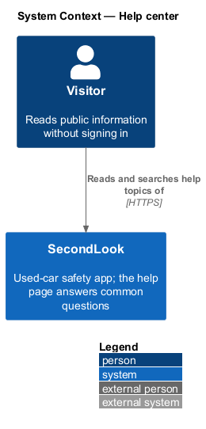
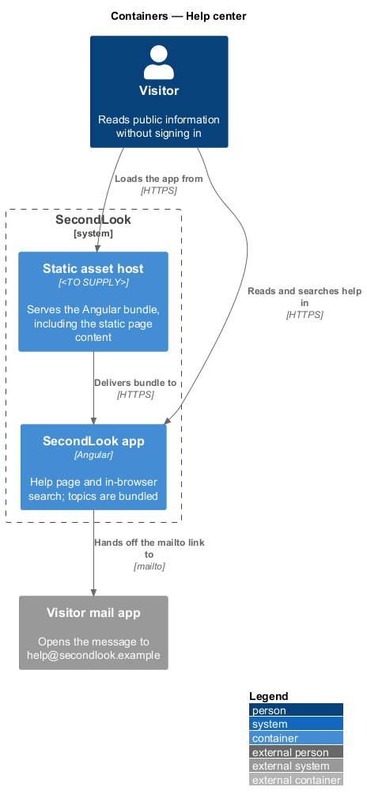
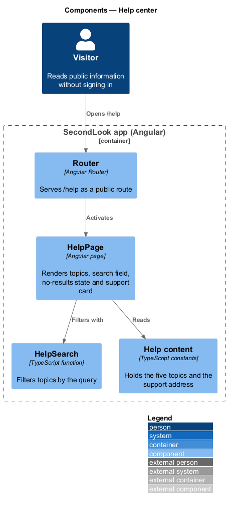
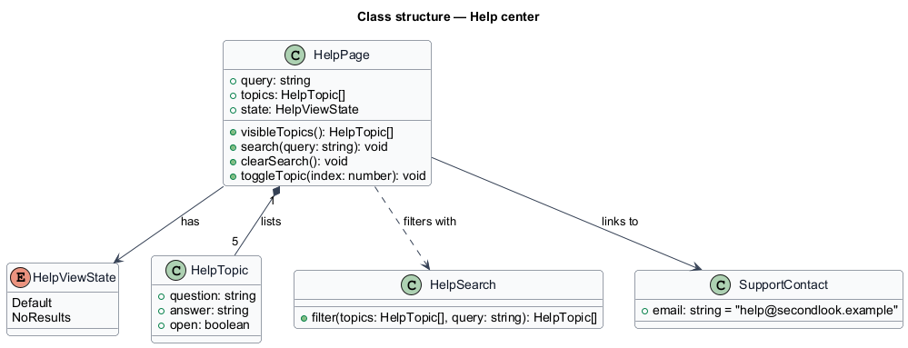
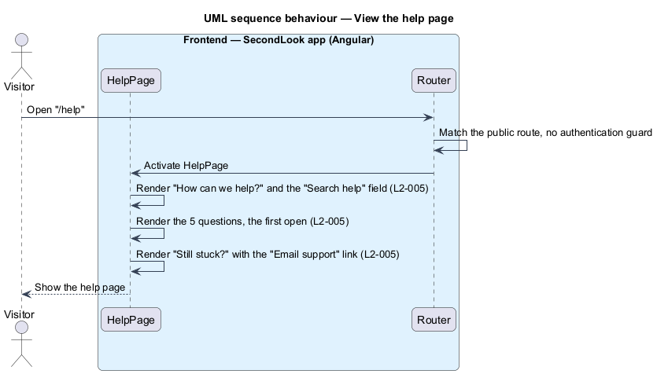
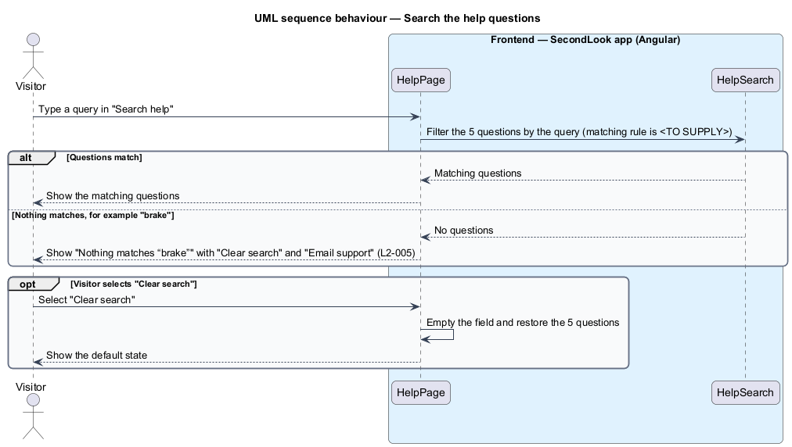
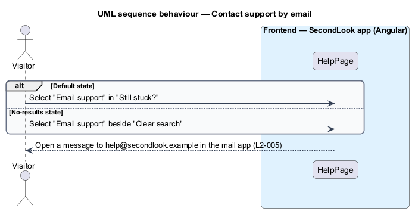

# Help center

## Overview

SecondLook is a used-car safety app for buyers purchasing a vehicle "as is" who cannot get a mechanic to the car in person. This feature covers the help page at the route `/help`. The page answers five common questions, lets the visitor search them, and offers an email link to support. Two states have mocks: default, and no-results.

A *help topic* is a question with its answer, shown as an expandable item. A *visitor* is a person using the app without a signed-in account.

This document assumes no prior knowledge of SecondLook internals; the diagrams show where each part lives.

## Description

The feature is a front-end-only slice. No help-page code exists yet, so every component below is introduced by this design.

- **Client-only versus API-backed.** The page is client-only. The five topics ship in the Angular bundle, the search filters them in the browser, and the page issues no request to `SecondLook.Api`. No anonymous endpoint is introduced. The mock manifest records that loading, empty and error states do not apply. The Angular bundle is delivered by a static asset host whose product is `<TO SUPPLY>`.
- **`HelpPage`** — Angular page in `projects/secondlook/src/app/pages/`, routed at `/help`. The route is public, because `L2-005` and the footer of every public page link to it.
- **Header variant.** The two help mocks render the header of a signed-in buyer ("Inspections", "Compare", "Help", notifications, account avatar). `L2-005` describes a visitor. The header a visitor who is not signed in sees on this route is `<TO SUPPLY>`; the public header of the other public pages is the likely choice.
- **Heading and search** — "How can we help?" with the line "Answers from the people who run the inspections." and a search field labelled "Search help" (a visually hidden label for the input `help-q`, inside a form with `role="search"`).
- **Topics** — five items: "What if the seller doesn’t show up?" (open on load), "How do refunds work?", "Can I share the report with the seller?", "Does the report guarantee the car will pass?" and "What counts as the same window?". The items use the native `details` and `summary` semantics of the mock, or a shared `sl-*` component, `<TO SUPPLY>`.
- **`HelpSearch`** — front-end function that filters the topics. The searched fields (question only, or question and answer), case handling, the debounce interval, and whether the filter runs on each keystroke or on submit are `<TO SUPPLY>`. The result for "brake" is no match, as `L2-005` states.
- **No-results state.** The page shows "Nothing matches “brake”" (the query appears inside the quotation marks), the line "Try a shorter word, or ask us directly. A person answers within a few hours.", and the actions "Clear search" and "Email support". "Clear search" empties the field and restores the five topics, with the first open `<TO SUPPLY>` after a restore.
- **Still stuck?** — a card with "Ask us. A person answers within a few hours, 8 AM to 8 PM." and an "Email support" link to `mailto:help@secondlook.example`. The email address is a placeholder domain in the specification.
- **Statements that restate product rules.** The answers state a full refund when the seller does not show, a refund of $25 when the buyer cancels less than 2 hours before the call, a share link that works for 14 days, and a window of fourteen days. The owners of these rules are the refund, report-sharing and pricing designs; a shared source is `<TO SUPPLY>`.

## Requirements

The feature realizes the following level-2 (L2) requirements. Each L2 requirement refines a level-1 (L1) requirement, cited by identifier.

| L2 ID | Refines (L1) | Requirement |
|-------|--------------|-------------|
| `L2-005` | `L1-001` | Help page. When a visitor opens the help page, it shall show "How can we help?", a search field labelled "Search help", the questions "What if the seller doesn’t show up?", "How do refunds work?", "Can I share the report with the seller?", "Does the report guarantee the car will pass?" and "What counts as the same window?", with the first open. When the page loads, "Still stuck?" shall offer an "Email support" link to help@secondlook.example. When the visitor searches for "brake" and nothing matches, the page shall show "Nothing matches “brake”" with the actions "Clear search" and "Email support". |

## Diagrams

### System context

The visitor reads and searches the help topics of SecondLook. No external system takes part in the page itself.

### Containers

The Angular app filters bundled topics in the browser. The mail app receives the support address through a `mailto` link. The API and database are not involved.

### Components

`HelpPage` reads bundled topics and calls `HelpSearch` to filter them.

### Class structure

`HelpPage` lists five `HelpTopic` items, and `HelpViewState` selects the default or the no-results presentation.

### Behaviour — view the help page

The page renders the heading, the search field, the five topics with the first open, and the support card. No request leaves the browser.

### Behaviour — search the help topics

The query filters the topics in the browser. When nothing matches, the page shows the no-results state, and "Clear search" restores the list.

### Behaviour — contact support by email

"Email support" appears in the default state and in the no-results state and hands the visitor to the mail app.

