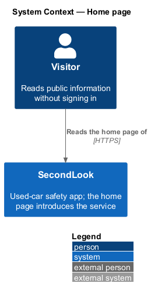
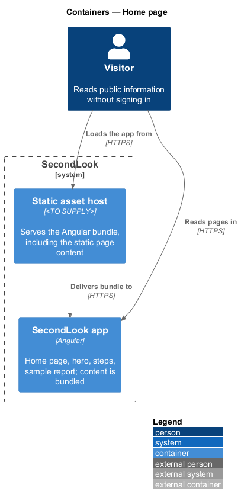
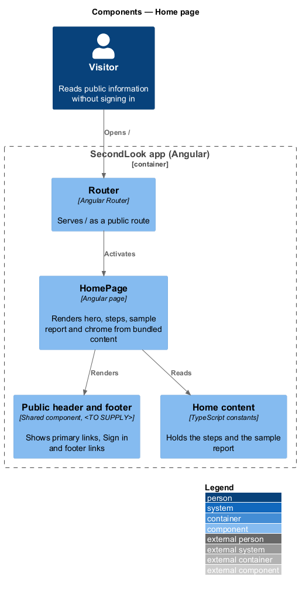
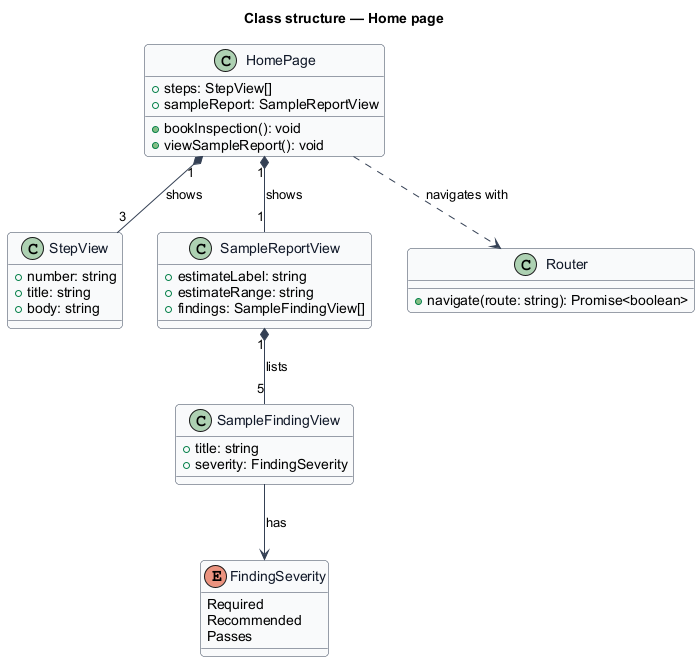
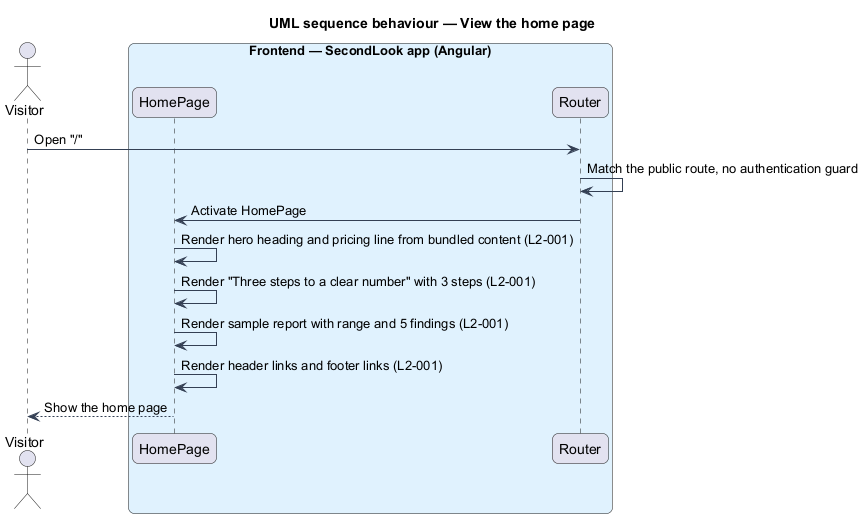
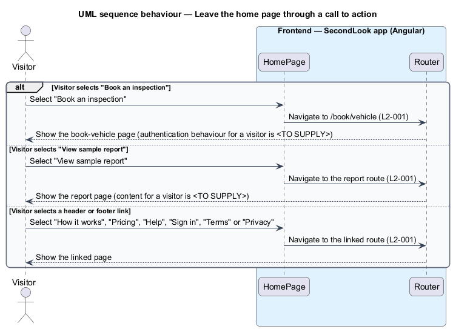

# Home page

## Overview

SecondLook is a used-car safety app for buyers purchasing a vehicle "as is" who cannot get a mechanic to the car in person. This feature covers the home page at the route `/`, the first screen a visitor sees. The page introduces the service, shows the three steps, shows a sample report, and teases the pricing.

A *visitor* is a person using the app without a signed-in account. A *sample report* is a fixed example of an inspection report shown for illustration, not the report of a real inspection.

This document assumes no prior knowledge of SecondLook internals; the diagrams show where each part lives.

## Description

The feature is a front-end-only slice. No home-page code exists yet, so every component below is introduced by this design.

- **Client-only versus API-backed.** The page is client-only. Its text, the three steps and the sample report ship in the Angular bundle, and the page issues no request to `SecondLook.Api`. No anonymous endpoint is introduced. The mock manifest records that loading, empty and error states do not apply because there is no request to wait on or to fail. The Angular bundle is delivered by a static asset host whose product is `<TO SUPPLY>`.
- **`HomePage`** — Angular page in `projects/secondlook/src/app/pages/`, routed at `/`. The route is public: it carries no authentication guard. Selectors of shared components from `projects/components` use the `sl-*` prefix.
- **Header and footer** — shared public chrome. The header shows "How it works", "Pricing", "Help" and "Sign in". The footer shows "Terms", "Privacy" and "Help". The component that owns this chrome is `<TO SUPPLY>`.
- **Hero** — the heading "A mechanic’s second look, before you commit." with the actions "Book an inspection" (to `/book/vehicle`) and "View sample report", and the line "First inspection $50. Each additional car in the same window, $25.".
- **Three steps** — the section "Three steps to a clear number" with "Book a slot", "Walk the car on video" and "Get the number".
- **Sample report** — a static report card. It shows "Estimated cost to get it safety certified" with "$1,180–$1,540", and five findings with statuses: "Front brake pads & rotors" (Required), "Rear tires" (Required), "Lower control arm bushing" (Recommended), "Windshield chip" (Recommended) and "Lights, horn, wipers" (Passes). The status words map to the `Severity` values `Required`, `Recommended` and `Passes` of the report domain.
- **Pricing teaser band** — the mock also shows a vehicle-count control with a total on the home page. `L2-001` names only the pricing line, so whether the band is required, and whether it shares the calculator of the pricing page, is `<TO SUPPLY>`.
- **Cookie consent** — the mock notes that the consent notification appears on a visitor’s first visit. It belongs to the notifications design and is outside this feature.

Navigation targets: "Book an inspection" opens the book-vehicle page. "View sample report" opens the report page, whose mock route is `/inspections/civic-lx/report`. Whether the report page is reachable by a visitor who is not signed in, and whether the target is a dedicated sample route, are `<TO SUPPLY>`; endpoints are authenticated by default and the report is buyer-scoped data.

## Requirements

The feature realizes the following level-2 (L2) requirements. Each L2 requirement refines a level-1 (L1) requirement, cited by identifier.

| L2 ID | Refines (L1) | Requirement |
|-------|--------------|-------------|
| `L2-001` | `L1-001` | Home page. The home page introduces the service, shows the three steps, a sample report, and the pricing teaser. When a visitor who is not signed in opens the home page, the page shall show the heading "A mechanic’s second look, before you commit." and the line "First inspection $50. Each additional car in the same window, $25.". When the visitor selects "Book an inspection", the app shall take the visitor to the book-vehicle page. When the visitor selects "View sample report", the app shall take the visitor to the report page. When the page loads, it shall show the section "Three steps to a clear number" with the steps "Book a slot", "Walk the car on video" and "Get the number". When the page loads, the sample report shall show "Estimated cost to get it safety certified" with "$1,180–$1,540" and the findings "Front brake pads & rotors", "Rear tires", "Lower control arm bushing", "Windshield chip" and "Lights, horn, wipers" with the statuses Required, Required, Recommended, Recommended and Passes. When the page loads, the header shall show "How it works", "Pricing", "Help" and "Sign in", and the footer shall show "Terms", "Privacy" and "Help". |

## Diagrams

### System context

The visitor reads the home page of SecondLook. No external system takes part.

### Containers

The Angular app renders the page from bundled content delivered by a static asset host. The API and database are not involved.

### Components

`HomePage` reads constants for the steps and the sample report, and renders the shared header and footer. The `Router` activates the page.

### Class structure

`HomePage` composes three `StepView` items and one `SampleReportView` with five `SampleFindingView` items.

### Behaviour — view the home page

The router matches the public route and the page renders its bundled content. No request leaves the browser.

### Behaviour — leave through a call to action or link

The visitor selects a call to action or a chrome link and the router navigates. The authentication behaviour for a visitor on the target pages is open.

