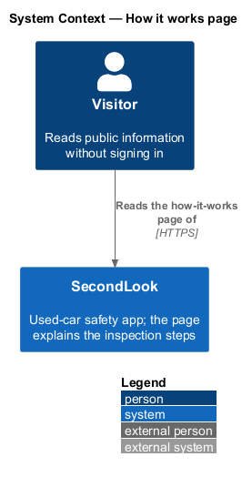
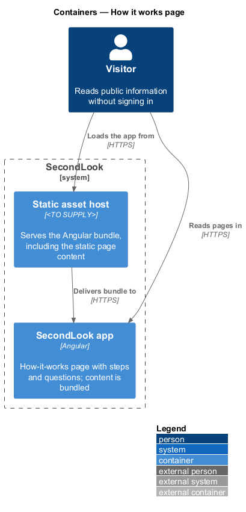
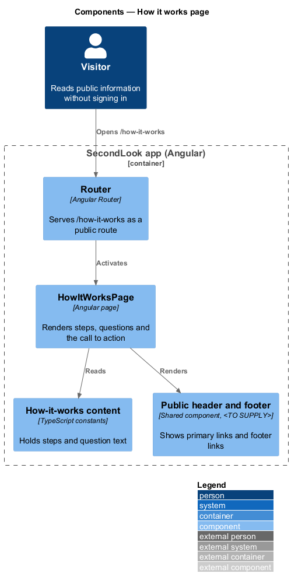
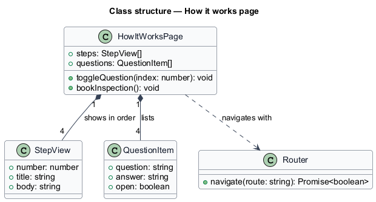
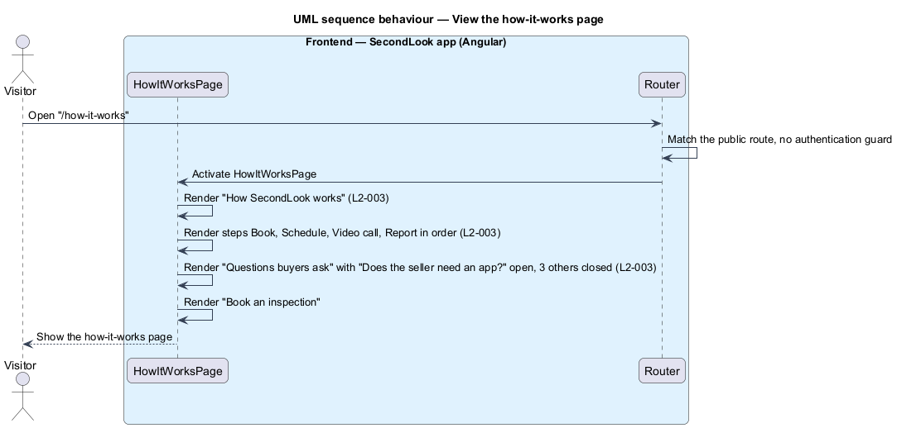
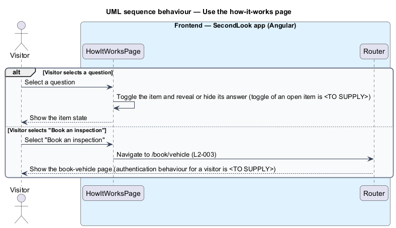

# How it works page

## Overview

SecondLook is a used-car safety app for buyers purchasing a vehicle "as is" who cannot get a mechanic to the car in person. This feature covers the how-it-works page at the route `/how-it-works`. The page explains the four steps of an inspection and answers four common questions.

A *visitor* is a person using the app without a signed-in account.

This document assumes no prior knowledge of SecondLook internals; the diagrams show where each part lives.

## Description

The feature is a front-end-only slice. No how-it-works code exists yet, so every component below is introduced by this design.

- **Client-only versus API-backed.** The page is client-only. Text and questions ship in the Angular bundle, and the page issues no request to `SecondLook.Api`. No anonymous endpoint is introduced. The mock manifest records that loading, empty and error states do not apply. The Angular bundle is delivered by a static asset host whose product is `<TO SUPPLY>`.
- **`HowItWorksPage`** — Angular page in `projects/secondlook/src/app/pages/`, routed at `/how-it-works`. The route is public. The header link "How it works" carries `aria-current="page"`.
- **Heading** — "How SecondLook works" with the line "From booking to a clear number, usually inside a day.".
- **Steps** — four steps in order: "Book", "Schedule", "Video call" and "Report", each with a short body text from the mock.
- **Questions** — the section "Questions buyers ask" with four items: "Does the seller need an app?" (open on load), "What does “safety certified” cover?", "Can I add a body shop review?" and "What if the seller cancels?" (closed on load). The items use the native `details` and `summary` semantics of the mock, or a shared `sl-*` component, `<TO SUPPLY>`. Whether more than one item may be open together is `<TO SUPPLY>`.
- **Call to action** — "Book an inspection" navigates to `/book/vehicle`. Authentication behaviour of that route for a visitor is `<TO SUPPLY>`.
- **Statements in the answers.** Answer text restates business rules held elsewhere, such as the report arriving within an hour of the call and a call that does not happen not being charged. The page copies the mock text. Where a rule changes, the copy changes with it; a source shared with the rule owners is `<TO SUPPLY>`.

## Requirements

The feature realizes the following level-2 (L2) requirements. Each L2 requirement refines a level-1 (L1) requirement, cited by identifier.

| L2 ID | Refines (L1) | Requirement |
|-------|--------------|-------------|
| `L2-003` | `L1-001` | How it works page. When a visitor opens the page, it shall show "How SecondLook works" and the four steps "Book", "Schedule", "Video call" and "Report" in that order. When the page loads, the questions under "Questions buyers ask" shall show "Does the seller need an app?" open and the other three closed. When the visitor selects "Book an inspection", the app shall take the visitor to the book-vehicle page. |

## Diagrams

### System context

The visitor reads the how-it-works page of SecondLook. No external system takes part.

### Containers

The Angular app renders the page from bundled content delivered by a static asset host. The API and database are not involved.

### Components

`HowItWorksPage` reads bundled content and renders the shared header and footer. The `Router` activates the page.

### Class structure

`HowItWorksPage` composes four `StepView` items and four `QuestionItem` items.

### Behaviour — view the how-it-works page

The page renders the heading, the four steps in order and the four questions, the first open. No request leaves the browser.

### Behaviour — open a question or start booking

The visitor toggles a question or selects "Book an inspection", which navigates to the book-vehicle page.

