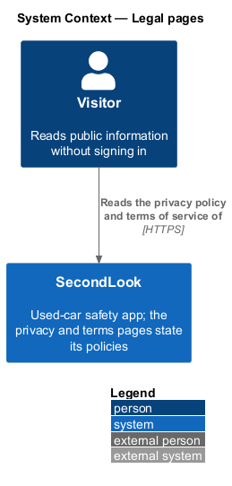
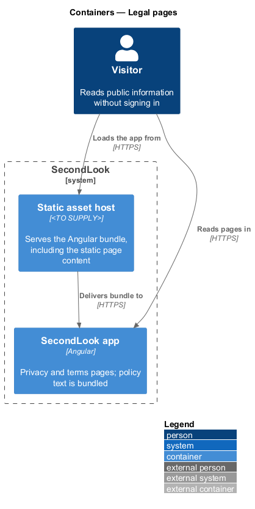
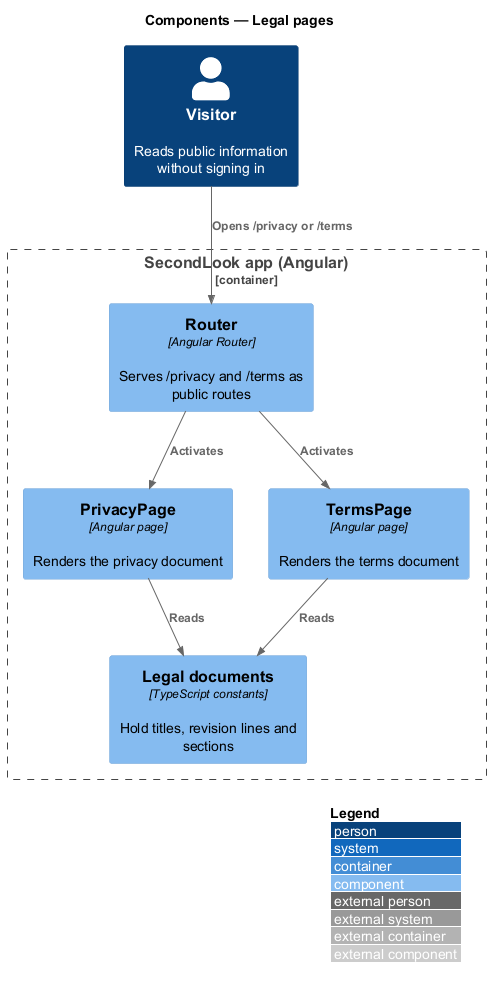
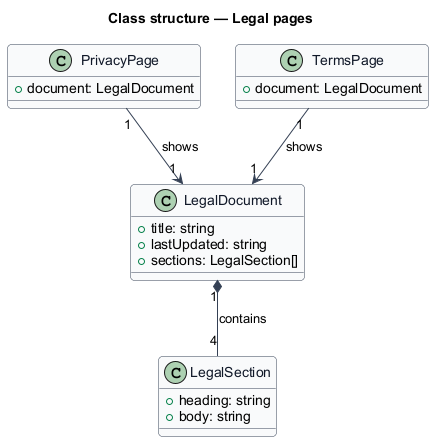
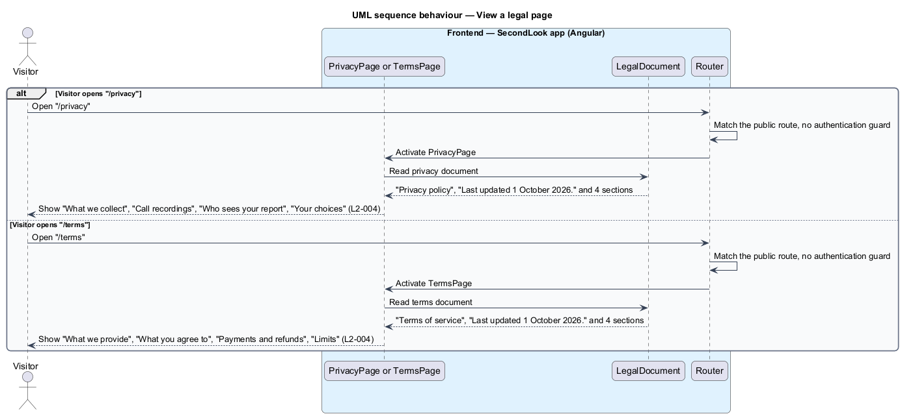
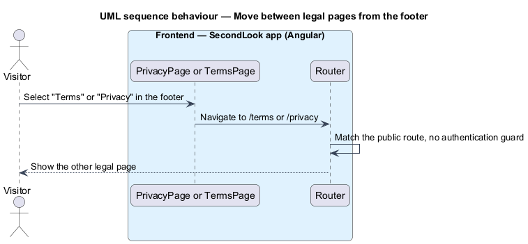

# Legal pages (privacy and terms)

## Overview

SecondLook is a used-car safety app for buyers purchasing a vehicle "as is" who cannot get a mechanic to the car in person. This feature covers two public pages: the privacy policy at `/privacy` and the terms of service at `/terms`. Each page shows a title, a "last updated" line and four sections.

A *legal document* is a titled text with a revision date and ordered sections that states how SecondLook handles data or what it provides.

This document assumes no prior knowledge of SecondLook internals; the diagrams show where each part lives.

## Description

The feature is a front-end-only slice. No legal-page code exists yet, so every component below is introduced by this design.

- **Client-only versus API-backed.** Both pages are client-only. Text ships in the Angular bundle, and the pages issue no request to `SecondLook.Api`. No anonymous endpoint is introduced. The mock manifest records that loading, empty and error states do not apply. The Angular bundle is delivered by a static asset host whose product is `<TO SUPPLY>`.
- **`PrivacyPage`** — Angular page in `projects/secondlook/src/app/pages/`, routed at `/privacy`. The route is public. It shows "Privacy policy", "Last updated 1 October 2026." and the sections "What we collect", "Call recordings", "Who sees your report" and "Your choices".
- **`TermsPage`** — Angular page in the same folder, routed at `/terms`. The route is public. It shows "Terms of service", "Last updated 1 October 2026." and the sections "What we provide", "What you agree to", "Payments and refunds" and "Limits".
- **`LegalDocument`** — front-end model with a title, a last-updated line and sections. Both pages read their text from one such document each. Whether the two pages share a layout component is `<TO SUPPLY>`.
- **Statements that restate product rules.** The sections state recording retention of 30 days, deletion of reports within 30 days of account deletion, a share link that can be turned off, and a full refund when the seller does not join or the mechanic cannot complete the inspection. The pages copy the mock text. The authoritative owners of these rules are the call, report and refund designs; a shared source is `<TO SUPPLY>`.
- **Revision date.** The line "Last updated 1 October 2026." is bundled text. The process that changes it, and who approves a revision, are `<TO SUPPLY>`.
- **Legal review.** The wording has not been reviewed for legal sufficiency in the specifications. Review status is `<TO SUPPLY>`.
- **Links.** The footer on every public page links "Terms" and "Privacy".

## Requirements

The feature realizes the following level-2 (L2) requirements. Each L2 requirement refines a level-1 (L1) requirement, cited by identifier.

| L2 ID | Refines (L1) | Requirement |
|-------|--------------|-------------|
| `L2-004` | `L1-001` | Privacy and terms pages. When a visitor opens the privacy page, it shall show "Privacy policy", "Last updated 1 October 2026." and the sections "What we collect", "Call recordings", "Who sees your report" and "Your choices". When a visitor opens the terms page, it shall show "Terms of service", "Last updated 1 October 2026." and the sections "What we provide", "What you agree to", "Payments and refunds" and "Limits". |

## Diagrams

### System context

The visitor reads the privacy policy and terms of service of SecondLook. No external system takes part.

### Containers

The Angular app renders both pages from bundled text delivered by a static asset host. The API and database are not involved.

### Components

`PrivacyPage` and `TermsPage` each read a document constant. The `Router` activates the page for each route.

### Class structure

Each page shows one `LegalDocument`, which contains four `LegalSection` items.

### Behaviour — view the privacy or terms page

The router activates the page for the route and the page renders its document. No request leaves the browser.

### Behaviour — move between legal pages

The footer links move the visitor between the two pages without any request to the API.

