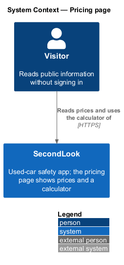
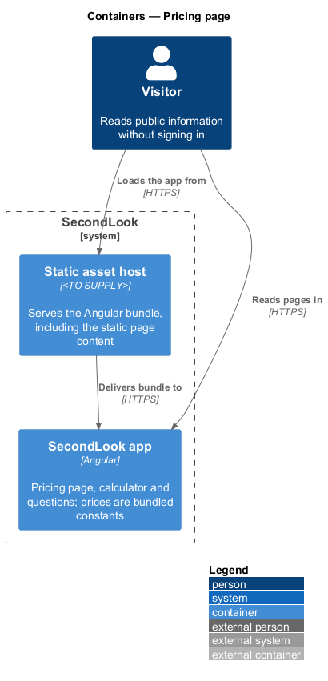
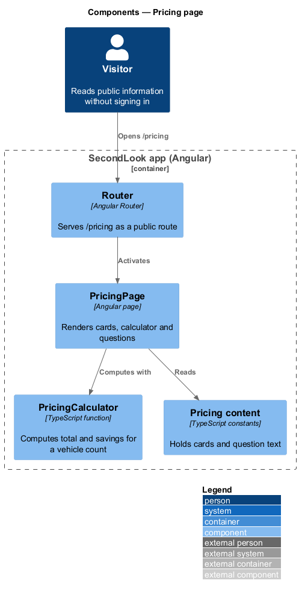
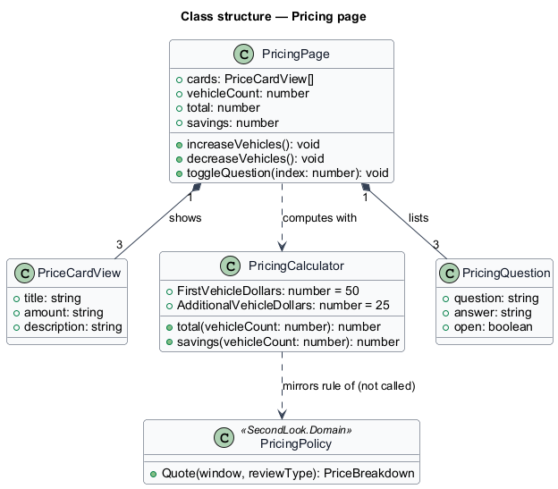
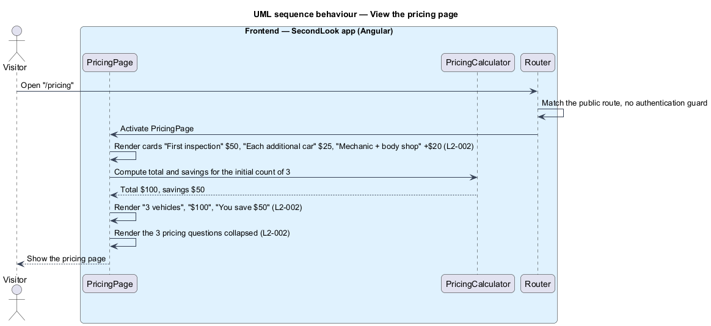
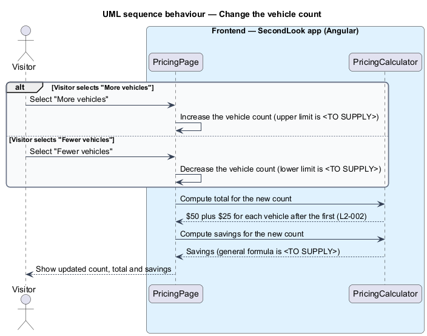
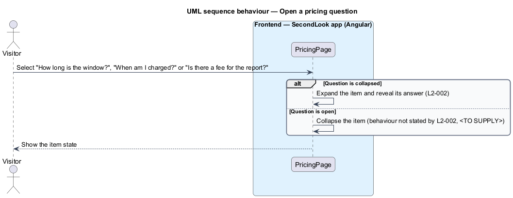

# Pricing page

## Overview

SecondLook is a used-car safety app for buyers purchasing a vehicle "as is" who cannot get a mechanic to the car in person. This feature covers the pricing page at the route `/pricing`. The page shows the price cards, a multi-vehicle calculator and three pricing questions.

A *pricing window* is a fourteen-day interval that opens at a buyer’s first booking, within which each additional vehicle costs less. The *calculator* is a control on the page that shows the total for a chosen number of vehicles.

This document assumes no prior knowledge of SecondLook internals; the diagrams show where each part lives.

## Description

The feature is a front-end-only slice. No pricing-page code exists yet, so every component below is introduced by this design.

- **Client-only versus API-backed.** The page is client-only. Cards, questions and the calculator run in the browser, and the page issues no request to `SecondLook.Api`. No anonymous endpoint is introduced. The mock manifest records that loading, empty and error states do not apply. The Angular bundle is delivered by a static asset host whose product is `<TO SUPPLY>`.
- **`PricingPage`** — Angular page in `projects/secondlook/src/app/pages/`, routed at `/pricing`. The route is public. It shows the heading "Simple pricing" with "Pay for the look, not for the sales pitch.".
- **Price cards** — "First inspection" at "$50" (mechanic review with a safety certification estimate), "Each additional car" at "$25" (more vehicles within the same window) and "Mechanic + body shop" at "+$20" (one call for mechanical and body).
- **`PricingCalculator`** — front-end function that returns the total and the savings for a vehicle count. The total is $50 plus $25 for each vehicle after the first, so 3 vehicles give $100. The page opens at 3 vehicles and shows "3 vehicles", "$100" and "You save $50". The "More vehicles" and "Fewer vehicles" buttons change the count, and the total updates at once.
- **Local computation versus `PricingPolicy`.** The `PricingPolicy` domain service in `SecondLook.Domain` is the single source of the booking prices (`L2-027`). The pricing page computes locally and shows the values as constants of the bundle, because the page is anonymous and `SecondLook.Api` is authenticated by default. This duplicates the rule in two places. A shared source, such as an anonymous read endpoint on `PricingWindowsController` or a generated constants file, is `<TO SUPPLY>`; the specifications do not state which.
- **Savings value.** `L2-002` states the savings only for the 3-vehicle example, $50. The general formula is `<TO SUPPLY>`. The example is consistent with the savings being the difference between the first-inspection price for every vehicle (3 × $50 = $150) and the total ($100).
- **Count limits.** The smallest and largest vehicle counts, and the disabled state of "Fewer vehicles" at the lower limit, are `<TO SUPPLY>`.
- **Pricing questions** — three collapsed items: "How long is the window?" (fourteen days from the first booking, with later cars $25 each), "When am I charged?" (at booking, with a full refund if the seller does not show) and "Is there a fee for the report?" (no; the report is included). Selecting an item shows its answer. The items use the native `details` and `summary` semantics of the mock, or a shared `sl-*` component, `<TO SUPPLY>`.
- **Mechanic + body shop price.** The card shows "+$20", which equals the `Both` surcharge in `PricingPolicy`.

## Requirements

The feature realizes the following level-2 (L2) requirements. Each L2 requirement refines a level-1 (L1) requirement, cited by identifier.

| L2 ID | Refines (L1) | Requirement |
|-------|--------------|-------------|
| `L2-002` | `L1-001` | Pricing page. The pricing page shows the price cards, a multi-vehicle calculator and pricing questions. When a visitor opens the pricing page, it shall show the cards "First inspection" at "$50", "Each additional car" at "$25" and "Mechanic + body shop" at "+$20". When the calculator shows 3 vehicles and the page loads, it shall show "3 vehicles", a total of "$100" and "You save $50". When the visitor selects "More vehicles" or "Fewer vehicles", the vehicle count shall change and the total shall equal $50 plus $25 for each vehicle after the first. When the page loads, the questions "How long is the window?", "When am I charged?" and "Is there a fee for the report?" shall be shown as collapsed items, and selecting one shall show its answer. |

## Diagrams

### System context

The visitor reads prices and uses the calculator of SecondLook. No external system takes part.

### Containers

The Angular app computes the calculator locally from bundled constants. The API and database are not called.

### Components

`PricingPage` reads bundled content and calls `PricingCalculator` for the total and the savings.

### Class structure

`PricingCalculator` mirrors the rule of `PricingPolicy` in `SecondLook.Domain` without calling it. The page lists three `PriceCardView` and three `PricingQuestion` items.

### Behaviour — view the pricing page

The page renders the three cards, the calculator at 3 vehicles and the collapsed questions. No request leaves the browser.

### Behaviour — change the vehicle count

The visitor selects "More vehicles" or "Fewer vehicles" and the calculator recomputes the total and the savings.

### Behaviour — open a pricing question

Selecting a collapsed question reveals its answer. The behaviour on a second selection is not stated by the requirement.

