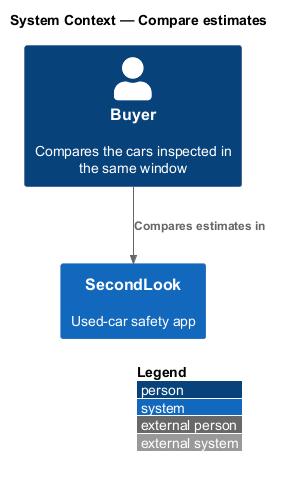
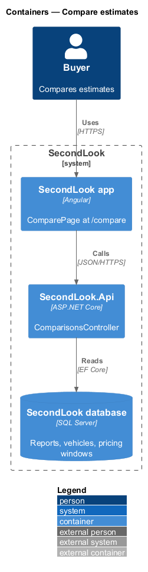
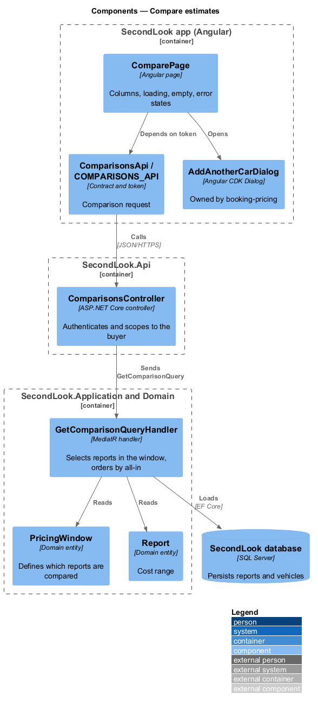
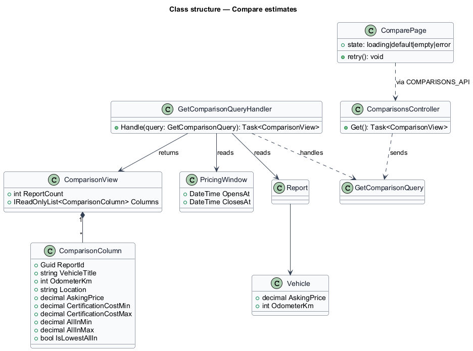
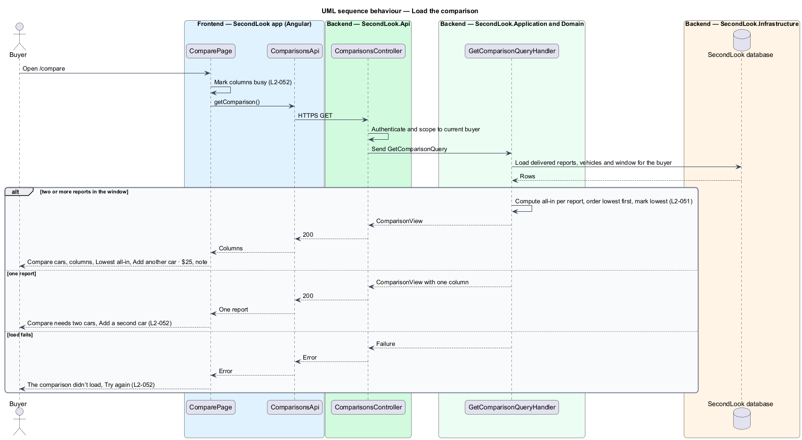

# Compare estimates

## Overview

SecondLook is a used-car safety app for buyers purchasing a vehicle "as is" who cannot get a mechanic to the car in person. This feature covers the "Compare cars" page at the route `/compare`, where a buyer lines up the certification estimates for the vehicles inspected in the same window.

A *pricing window* is the 14-day period that starts with a buyer’s first booking, within which each additional vehicle costs $25. *All-in cost* is the asking price plus the certification cost range. The page orders the vehicles by all-in cost, lowest first.

This document assumes no prior knowledge of SecondLook internals; the diagrams show where each part lives.

## Description

The feature is a read-only vertical slice from the Angular app to the database. No comparison code exists yet, so every component below is introduced by this design.

- **`ComparePage`** — Angular page in `projects/secondlook/src/app/pages/`, routed at `/compare` and linked as "Compare" in the primary navigation. It holds the state `loading`, `default`, `empty` and `error`.
- **`ComparisonsApi` / `COMPARISONS_API`** — contract and injection token in `projects/api`. The page depends on the token.
- **`ComparisonsController`** — controller in `SecondLook.Api`, base route `/api/comparisons`. It authenticates the caller and scopes data to the current buyer (`L2-057`). The endpoint path is `<TO SUPPLY>`.
- **`GetComparisonQuery`** and **`GetComparisonQueryHandler`** — the handler loads the buyer’s delivered reports for vehicles in the pricing window, computes each all-in range (`Vehicle.AskingPrice` plus the certification cost range), orders the columns lowest all-in first, and marks the lowest. Business rules stay in the handler, not in the controller.
- **`ComparisonView`** and **`ComparisonColumn`** — result types. A column carries the vehicle title, odometer, location, asking price, certification cost range, all-in range and the lowest-all-in flag.
- **`AddAnotherCarDialog`** — owned by the booking-pricing design. The page opens it from "Add another car · $25" and from "Add a second car".

Rules left open by the requirements and marked `<TO SUPPLY>`: the ordering key when ranges overlap (the mock orders consistently by both the lower and the upper bound), the tie-break for equal totals, the maximum number of columns, which window applies once it has closed, the source of the location text (for example "Burlington, ON"), and whether a vehicle with no delivered report appears.

State behaviour on the page:

- **Default.** The page shows "Compare cars", the subtitle "Same window, three reports. Lowest all-in first." and the button "Add another car · $25". The count in the subtitle follows the number of reports. Each column shows the vehicle, kilometres and location, "All-in, asking price plus certification" with the all-in range, "Asking" with the asking price, "To certify" with the cost range, and "View report", which opens `ReportPage`. The lowest all-in column is marked "Lowest all-in". Below the columns, the note reads "Costs are estimates from each mechanic’s call. The cheapest car all-in isn’t always the best car. That’s your decision."
- **Loading.** The columns are marked busy while the request runs. The "Add another car · $25" button stays visible in the mock.
- **Empty.** With one report, the page shows "Compare needs two cars" with "You’ve only had one inspection. Add another car in this window for $25 and we’ll line them up." and "Add a second car".
- **Error.** When the request fails, the page shows "The comparison didn’t load" with "Your reports are fine. Try again." and "Try again", which repeats the request.

## Requirements

The feature realizes the following level-2 (L2) requirements. Each L2 requirement refines a level-1 (L1) requirement, cited by identifier.

| L2 ID | Refines (L1) | Requirement |
|-------|--------------|-------------|
| `L2-051` | `L1-011` | Compare vehicles. When a buyer with several reports in the same window opens compare, the page shall show "Compare cars" and one column per vehicle, lowest all-in cost first. Each column shall show the vehicle, kilometres, location, "All-in, asking price plus certification", the asking price, the cost to certify, and "View report". The lowest all-in vehicle’s column shall be marked "Lowest all-in". The page shall offer "Add another car · $25" and the note "Costs are estimates from each mechanic’s call. The cheapest car all-in isn’t always the best car. That’s your decision.". |
| `L2-052` | `L1-011` | Compare states. While the comparison is loading, the columns shall be marked busy. When a buyer with one report opens compare, the page shall show "Compare needs two cars" with "You’ve only had one inspection. Add another car in this window for $25 and we’ll line them up." and "Add a second car". When the comparison fails to load, the page shall show "The comparison didn’t load" with "Your reports are fine. Try again." and "Try again". |

## Diagrams

### System context

The buyer compares estimates in SecondLook. The feature has no external systems.

### Containers

The Angular app calls `SecondLook.Api`, which reads reports, vehicles and the pricing window from the database.

### Components

`ComparePage` calls `ComparisonsController` through the `COMPARISONS_API` token. `GetComparisonQueryHandler` reads the window and the reports. The page opens `AddAnotherCarDialog`.

### Class structure

`GetComparisonQueryHandler` returns a `ComparisonView` that owns an ordered list of `ComparisonColumn` items.

### Behaviour — load the comparison

The page marks the columns busy, requests the comparison, and renders the columns, the one-report state or the error state.

## Implementation notes (J13)

The `<TO SUPPLY>` items are decided in [ADR 0015](../../../adr/0015-comparing-a-buyers-cars.md) (L2-051, L2-052, L2-081). `ComparePage` at `/compare` (linked as "Compare" in the primary navigation of every buyer page) reads `GET /api/comparisons` through `COMPARISONS_API`. The handler composes the buyer's scheduled inspections in their latest pricing window with each car's report: totals are the report's own, the lowest all-in cars are marked once two can be compared, and a car without an estimate stays in the list as pending. Two cars are needed for the columns; one or none shows "Compare needs two cars". "Add another car" reuses the J08 dialog. Not delivered: location and make or model on each column (the booking does not capture them), so a car is shown by its VIN and kilometres; the written column count in the subtitle follows the number of cars.
