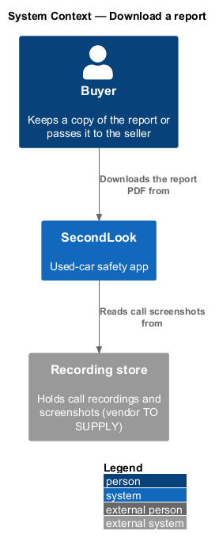
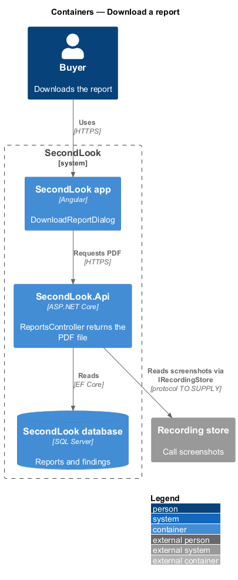
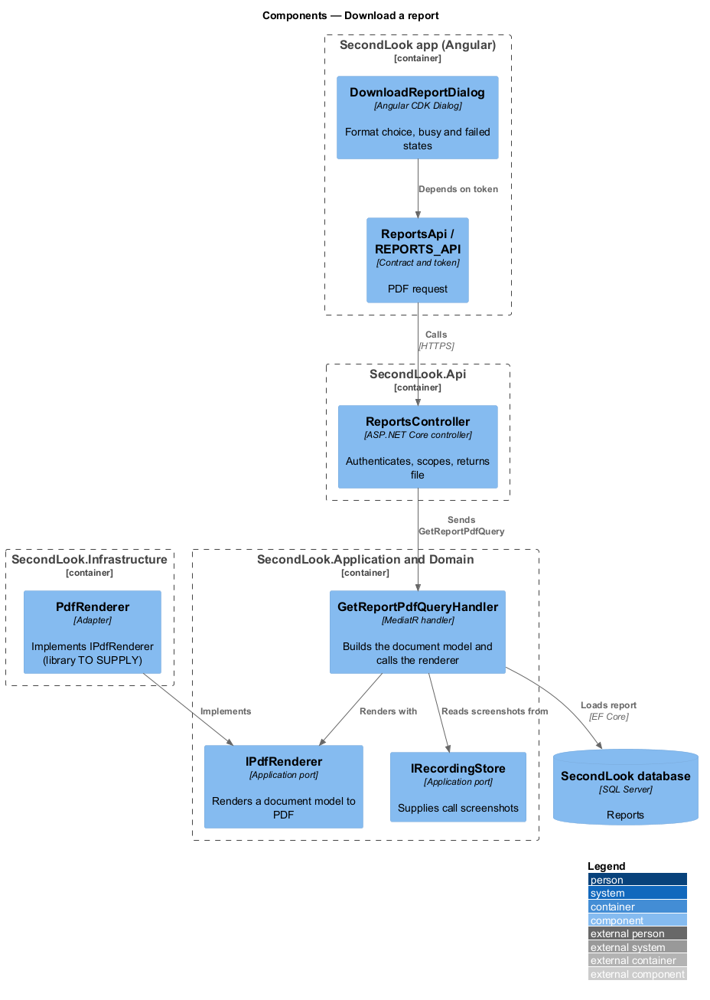
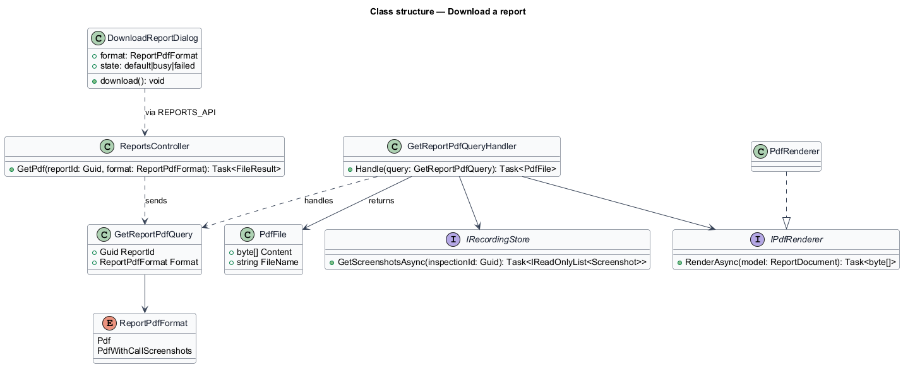
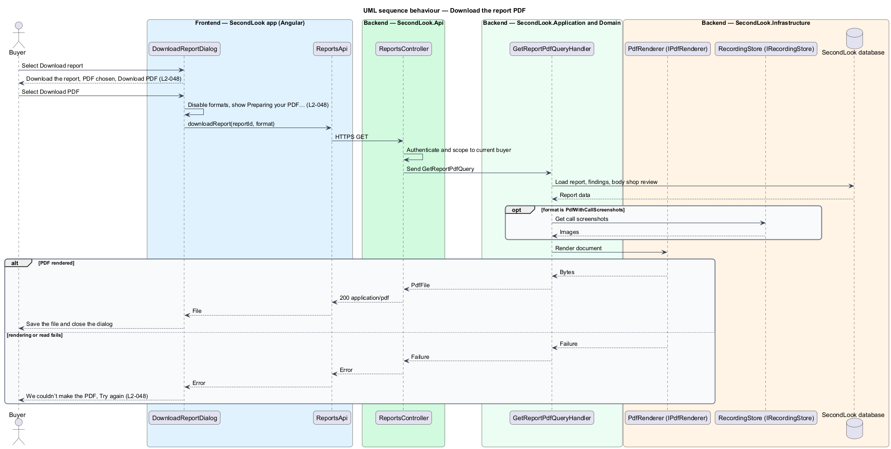

# Download a report

## Overview

SecondLook is a used-car safety app for buyers purchasing a vehicle "as is" who cannot get a mechanic to the car in person. This feature lets the buyer download the report as a PDF from the "Download report" button on `ReportPage`, as a copy for the buyer’s records or for the seller.

A *report PDF* is a rendered, paged document of one report. The buyer chooses between two formats: "PDF", and "PDF with call screenshots", which adds still images taken from the live call.

This document assumes no prior knowledge of SecondLook internals; the diagrams show where each part lives.

## Description

The feature is a vertical slice from the Angular app to a PDF renderer. No download code exists yet, so every component below is introduced by this design.

- **`DownloadReportDialog`** — Angular dialog in `projects/secondlook/src/app/dialogs/`, opened with Angular CDK Dialog from `ReportPage`. It holds the chosen `ReportPdfFormat` (default `Pdf`) and the state `default`, `busy` and `failed`.
- **`ReportsApi` / `REPORTS_API`** — contract and injection token in `projects/api`. The dialog depends on the token. The client returns the file, and the dialog hands it to the browser to save.
- **`ReportsController`** — controller in `SecondLook.Api`, base route `/api/reports`. It authenticates the caller, scopes the report to the current buyer (`L2-057`), and sends `GetReportPdfQuery`. The endpoint path is `<TO SUPPLY>`.
- **`GetReportPdfQuery`** and **`GetReportPdfQueryHandler`** — the handler loads the report, builds the document model, reads call screenshots from `IRecordingStore` when the format is `PdfWithCallScreenshots`, and calls `IPdfRenderer`. It returns a `PdfFile`. The file name is `<TO SUPPLY>`.
- **`IPdfRenderer`** — application port that renders a document model to PDF bytes. `PdfRenderer` in `SecondLook.Infrastructure` implements it. The rendering library is `<TO SUPPLY>`.
- **`IRecordingStore`** — application port that supplies screenshots. How the screenshots are chosen from the call, and the count of images ("Adds 6 images from the call." in the mock), are `<TO SUPPLY>`.

State behaviour of the dialog:

- **Default.** The dialog shows "Download the report", "A copy for your records, or for the seller.", the group "Format" with "PDF" ("Easy to print or send. About 1.2 MB.") chosen, "PDF with call screenshots" ("Adds 6 images from the call. About 4.8 MB."), and the buttons "Cancel" and "Download PDF". The file sizes shown are the mock values; how they are produced is `<TO SUPPLY>`. The dialog has no inputs to validate, because both choices have a default, so no invalid state applies.
- **Busy.** While the file is made, both format options are disabled and the dialog says "Preparing your PDF…". Whether "Cancel" aborts the request is `<TO SUPPLY>`.
- **Failed.** The dialog shows "We couldn’t make the PDF" with "The report is fine. Try again in a moment." and "Try again". The format choice stays as the buyer set it, and "Try again" repeats the request.

## Requirements

The feature realizes the following level-2 (L2) requirements. Each L2 requirement refines a level-1 (L1) requirement, cited by identifier.

| L2 ID | Refines (L1) | Requirement |
|-------|--------------|-------------|
| `L2-048` | `L1-010` | Download a report. When the buyer selects "Download report", a dialog shall show "Download the report", "A copy for your records, or for the seller." and the formats "PDF" and "PDF with call screenshots", with "PDF" chosen and "Download PDF". While the file is being made, the formats shall be disabled and the dialog shall say "Preparing your PDF…". When the file cannot be made, the dialog shall show "We couldn’t make the PDF" with "The report is fine. Try again in a moment." and "Try again". |

## Diagrams

### System context

The buyer downloads the report from SecondLook. The recording store supplies call screenshots for the second format.

### Containers

The Angular app requests the file from `SecondLook.Api`. The API reads the report from the database and screenshots from the recording store.

### Components

`GetReportPdfQueryHandler` depends on the `IPdfRenderer` and `IRecordingStore` ports. `PdfRenderer` in infrastructure implements the renderer port.

### Class structure

`GetReportPdfQuery` carries the report and the `ReportPdfFormat`. The handler returns a `PdfFile`.

### Behaviour — download the PDF

The dialog disables the formats and shows the busy copy while the handler renders the file. The flow alternates between a saved file and the failed state.

## Implementation notes (J11)

Delivered as `DownloadReportDialog` and `GET /api/inspections/{id}/report/pdf` (L2-048, L2-077). The PDF is generated in-process by a small text-only writer (no library, ADR 0013). The dialog disables the formats and says "Preparing your PDF…" while it works, saves `secondlook-report.pdf`, and offers "Try again" on failure. "PDF with call screenshots" is listed but unavailable, because calls are not recorded.
